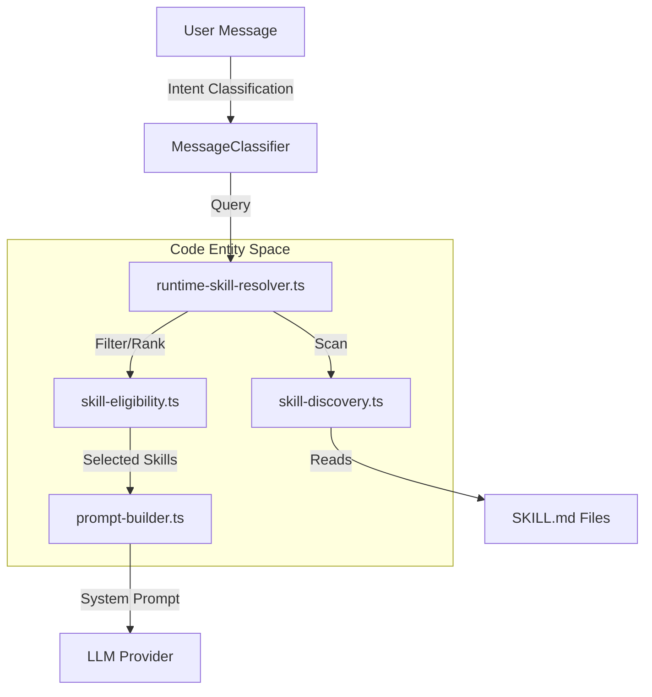
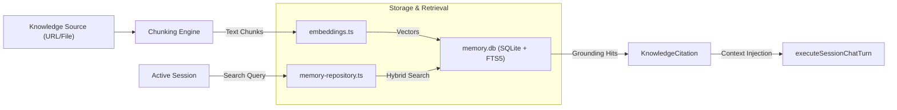

<!-- source: DeepWiki mcp.deepwiki.com · repo swarmclawai/swarmclaw · page 15 Skills & Knowledge · fetched 2026-10-26 -->

# Skills & Knowledge

Relevant source files

The following files were used as context for generating this wiki page:

- [skills/swarmclaw/SKILL.md](skills/swarmclaw/SKILL.md)
- [skills/swarmvault/SKILL.md](skills/swarmvault/SKILL.md)
- [src/app/api/mcp-servers/route.ts](src/app/api/mcp-servers/route.ts)
- [src/components/mcp-servers/mcp-server-sheet.tsx](src/components/mcp-servers/mcp-server-sheet.tsx)
- [src/lib/providers/openclaw.ts](src/lib/providers/openclaw.ts)
- [src/lib/server/__fixtures__/fake-mcp-stdio-server.mjs](src/lib/server/__fixtures__/fake-mcp-stdio-server.mjs)
- [src/lib/server/agents/guardian.ts](src/lib/server/agents/guardian.ts)
- [src/lib/server/chat-execution/chat-turn-preparation.ts](src/lib/server/chat-execution/chat-turn-preparation.ts)
- [src/lib/server/chat-execution/situational-awareness.ts](src/lib/server/chat-execution/situational-awareness.ts)
- [src/lib/server/chats/chat-session-service.ts](src/lib/server/chats/chat-session-service.ts)
- [src/lib/server/mcp-client.ts](src/lib/server/mcp-client.ts)
- [src/lib/server/memory/memory-consolidation.ts](src/lib/server/memory/memory-consolidation.ts)
- [src/lib/server/memory/memory-db.ts](src/lib/server/memory/memory-db.ts)
- [src/lib/server/runtime/daemon-state.ts](src/lib/server/runtime/daemon-state.ts)
- [src/lib/server/runtime/idle-window.ts](src/lib/server/runtime/idle-window.ts)
- [src/lib/server/runtime/perf.ts](src/lib/server/runtime/perf.ts)
- [src/lib/server/runtime/queue-recovery.test.ts](src/lib/server/runtime/queue-recovery.test.ts)
- [src/lib/server/runtime/queue.ts](src/lib/server/runtime/queue.ts)
- [src/lib/server/runtime/queue/core.ts](src/lib/server/runtime/queue/core.ts)
- [src/lib/server/skills/learned-skills.ts](src/lib/server/skills/learned-skills.ts)
- [src/lib/server/skills/runtime-skill-resolver.ts](src/lib/server/skills/runtime-skill-resolver.ts)
- [src/lib/server/universal-tool-access.test.ts](src/lib/server/universal-tool-access.test.ts)
- [src/lib/server/universal-tool-access.ts](src/lib/server/universal-tool-access.ts)
- [src/types/misc.ts](src/types/misc.ts)

The Skills and Knowledge systems provide the mechanism for agents to expand their capabilities beyond their base model training. **Skills** are structured documentation (SKILL.md) that teach agents how to use tools, APIs, and complex workflows. **Knowledge** refers to the RAG (Retrieval-Augmented Generation) system where external data sources are indexed, searched, and injected into the agent's prompt to provide factual grounding.

## Skills System

Skills are the "instruction manual" layer of SwarmClaw. They are discovered across multiple layers (bundled, workspace, and project) and resolved at runtime based on the agent's current task and toolset.

### Skill Discovery and Resolution
The system uses a `runtime-skill-resolver` to identify which skills are relevant to a specific session. Skills are discovered in several locations:
*   **Bundled:** Shipped with the platform in the `skills/` directory [skills/swarmclaw/SKILL.md:75-75]().
*   **Workspace:** Found in the agent's active working directory [src/lib/server/skills/runtime-skill-resolver.ts:24-24]().
*   **Project:** Attached to the specific project the agent is working on [src/lib/server/skills/runtime-skill-resolver.ts:24-24]().

### SKILL.md Format
Skills are defined using Markdown files with YAML frontmatter. This frontmatter includes metadata like versioning, author, and `openclaw` tags for privacy and data handling policies [skills/swarmclaw/SKILL.md:1-13]().

### Runtime Injection
During `streamAgentChat`, the system calls `buildRuntimeSkillPromptBlocks` to assemble the relevant skill documentation into the system prompt [src/lib/server/chat-execution/chat-turn-preparation.ts:25-28](). This process respects a **Skill Budget** to prevent prompt overflow, prioritizing "always-on" skills and those with high semantic relevance to the current message [src/lib/server/skills/runtime-skill-resolver.ts:20-22]().

For details, see [Skills System](#15.1).

**Sources:** [skills/swarmclaw/SKILL.md](), [src/lib/server/skills/runtime-skill-resolver.ts](), [src/lib/server/chat-execution/chat-turn-preparation.ts]()

---

## Knowledge Sources

Knowledge sources provide the raw data for the agent's RAG capabilities. Unlike skills, which focus on *how* to do things, knowledge sources focus on *what* the agent knows about a specific topic.

### Indexing and Storage
Knowledge is indexed into the `memory.db` using a hybrid approach:
1.  **FTS5 (Full-Text Search):** For keyword-based retrieval.
2.  **Vector Embeddings:** For semantic similarity searches.

### Chunking Strategy
To ensure high-quality retrieval, documents are processed using a chunking strategy that balances context with granularity, governed by `CHUNK_TARGET_CHARS` and `CHUNK_OVERLAP_CHARS` to prevent loss of context at boundaries.

### SwarmVault
SwarmVault acts as a local-first knowledge graph. It organizes data into `raw`, `wiki`, and `state` directories and can be queried by agents via a dedicated MCP (Model Context Protocol) server [src/components/mcp-servers/mcp-server-sheet.tsx:31-43]().

For details, see [Knowledge Sources](#15.2).

**Sources:** [src/lib/server/memory/memory-db.ts](), [src/components/mcp-servers/mcp-server-sheet.tsx]()

---

## System Integration

The following diagrams illustrate how natural language intent is mapped to specific code entities and how skills/knowledge are surfaced to the agent.

### Intent to Skill Mapping
This diagram shows how a user's request triggers the discovery and injection of skills.

**Sources:** [src/lib/server/skills/runtime-skill-resolver.ts:25-56](), [src/lib/server/chat-execution/prompt-builder.ts:89-89]()

### Knowledge Retrieval Pipeline
This diagram illustrates the flow from a raw knowledge source to an injected prompt hit.

**Sources:** [src/lib/server/memory/memory-db.ts](), [src/lib/server/chat-execution/chat-turn-preparation.ts:65-70]()

---

## Summary Table: Skills vs. Knowledge

| Feature | Skills (SKILL.md) | Knowledge (RAG) |
| :--- | :--- | :--- |
| **Primary Goal** | Procedural "How-to" | Declarative "What-is" |
| **Storage** | Markdown files in `skills/` | SQLite + Vector DB in `memory.db` |
| **Discovery** | `resolveRuntimeSkills` | `resolveLookupRequest` |
| **Budgeting** | `MAX_SKILLS_PROMPT_CHARS` | `MAX_MEMORY_CONTEXT_TOKENS` |
| **User Control** | Agent Skill Selection UI | Knowledge Source Registry |

**Sources:** [src/lib/server/skills/runtime-skill-resolver.ts:129-140](), [src/lib/server/skills/skill-prompt-budget.ts:20-22](), [src/lib/server/chat-execution/chat-turn-preparation.ts:63-65]()

---

