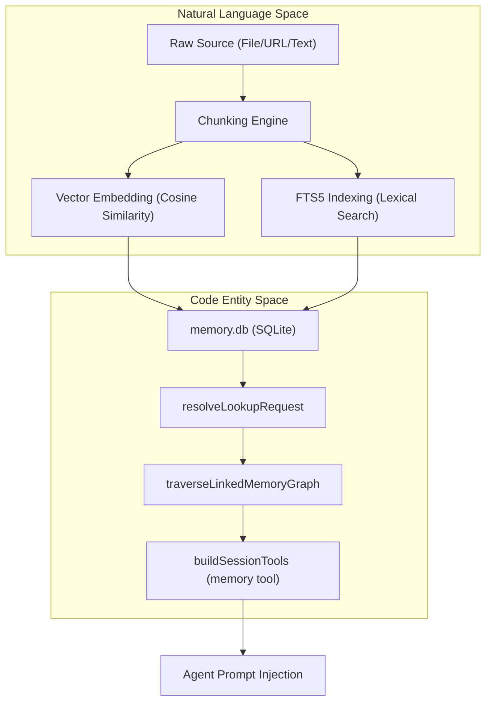
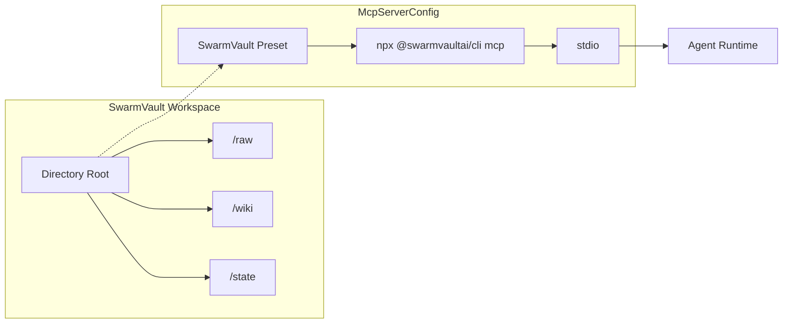

<!-- source: DeepWiki mcp.deepwiki.com · repo swarmclawai/swarmclaw · page 15.2 Knowledge Sources · fetched 2026-10-26 -->

# Knowledge Sources

Relevant source files

The following files were used as context for generating this wiki page:

- [skills/swarmclaw/SKILL.md](skills/swarmclaw/SKILL.md)
- [skills/swarmvault/SKILL.md](skills/swarmvault/SKILL.md)
- [src/app/api/mcp-servers/route.ts](src/app/api/mcp-servers/route.ts)
- [src/components/mcp-servers/mcp-server-sheet.tsx](src/components/mcp-servers/mcp-server-sheet.tsx)
- [src/lib/server/__fixtures__/fake-mcp-stdio-server.mjs](src/lib/server/__fixtures__/fake-mcp-stdio-server.mjs)
- [src/lib/server/agents/guardian.ts](src/lib/server/agents/guardian.ts)
- [src/lib/server/autonomy/supervisor-reflection.test.ts](src/lib/server/autonomy/supervisor-reflection.test.ts)
- [src/lib/server/autonomy/supervisor-reflection.ts](src/lib/server/autonomy/supervisor-reflection.ts)
- [src/lib/server/chat-execution/continuation-evaluator.ts](src/lib/server/chat-execution/continuation-evaluator.ts)
- [src/lib/server/chat-execution/message-classifier.ts](src/lib/server/chat-execution/message-classifier.ts)
- [src/lib/server/chat-execution/prompt-builder.ts](src/lib/server/chat-execution/prompt-builder.ts)
- [src/lib/server/chat-execution/situational-awareness.ts](src/lib/server/chat-execution/situational-awareness.ts)
- [src/lib/server/mcp-client.ts](src/lib/server/mcp-client.ts)
- [src/lib/server/memory/memory-consolidation.ts](src/lib/server/memory/memory-consolidation.ts)
- [src/lib/server/memory/memory-db.ts](src/lib/server/memory/memory-db.ts)
- [src/lib/server/memory/memory-policy.ts](src/lib/server/memory/memory-policy.ts)
- [src/lib/server/memory/temporal-decay.ts](src/lib/server/memory/temporal-decay.ts)
- [src/lib/server/runtime/daemon-state.ts](src/lib/server/runtime/daemon-state.ts)
- [src/lib/server/runtime/idle-window.ts](src/lib/server/runtime/idle-window.ts)
- [src/lib/server/runtime/queue.ts](src/lib/server/runtime/queue.ts)
- [src/lib/server/session-tools/memory.ts](src/lib/server/session-tools/memory.ts)
- [src/lib/server/skills/learned-skills.ts](src/lib/server/skills/learned-skills.ts)
- [src/types/misc.ts](src/types/misc.ts)

The Knowledge Sources system provides AI agents with a retrieval-augmented generation (RAG) framework to access, index, and cite external information. It bridges raw data (files, URLs, text) with the agent's reasoning loop through vector embeddings, full-text search (FTS5), and a specialized knowledge graph known as the **SwarmVault**.

## Overview of Knowledge Retrieval

SwarmClaw utilizes a multi-layered approach to knowledge. Unlike short-term session history, Knowledge Sources are persistent, indexed, and retrieved based on semantic relevance to the current task.

### Data Flow: From Source to Prompt

The following diagram illustrates how a raw Knowledge Source is processed and eventually injected into an agent's context.

**Knowledge Processing Pipeline**

Sources: `src/lib/server/memory/memory-db.ts:1-25`(), `src/lib/server/session-tools/memory.ts:1-33`()

## Chunking and Indexing Strategy

To maintain high retrieval precision, SwarmClaw implements a specific chunking strategy defined by character targets and overlaps.

*   **CHUNK_TARGET_CHARS**: The ideal size for a single knowledge chunk.
*   **CHUNK_OVERLAP_CHARS**: The amount of text preserved between adjacent chunks to maintain context across boundaries.

Once chunked, data is stored in `memory.db` using two primary methods:
1.  **Vector Embeddings**: Generated via `getEmbedding` for semantic similarity [src/lib/server/memory/memory-db.ts:7-7]().
2.  **FTS5 Indexing**: Provides fast lexical keyword matching for specific terms [src/lib/server/memory/memory-db.ts:35-37]().

Sources: `src/lib/server/memory/memory-db.ts:35-46`(), `src/lib/server/memory/memory-db.ts:77-82`()

## SwarmVault Knowledge Graph

**SwarmVault** is the local-first knowledge vault integration for SwarmClaw. It organizes knowledge into a structured graph that agents can query via the Model Context Protocol (MCP).

### Directory Structure
SwarmVault operates on a specific directory layout:
*   `raw/`: Contains original, unprocessed documents.
*   `wiki/`: Contains processed, markdown-formatted knowledge pages.
*   `state/`: Stores the metadata and graph relationship states.

### Implementation Details
*   **compile_vault**: A process that synchronizes the filesystem state with the vector and FTS indexes.
*   **Graph Queries**: Agents use the `memory` tool or MCP tools to perform `traverseLinkedMemoryGraph`, which follows `MemoryReference` links between entries [src/lib/server/memory/memory-db.ts:13-18]().

**SwarmVault MCP Integration**

Sources: `src/components/mcp-servers/mcp-server-sheet.tsx:31-43`(), `src/lib/server/memory/memory-db.ts:29-32`()

## Knowledge Hygiene and Citations

To prevent "hallucination" and context bloat, the system employs **KnowledgeHygiene** and **KnowledgeCitation** mechanisms.

### KnowledgeHygiene
The system periodically reflects on stored knowledge to identify:
*   **Stale Findings**: Information that has been superseded by newer data.
*   **Duplicates**: Overlapping chunks that provide redundant information.
*   **Overlap Findings**: Semantic clusters that can be consolidated into a single `consolidated_insight` [skills/swarmclaw/SKILL.md:110-110]().

### KnowledgeCitation
When an agent retrieves a "grounding hit" from a Knowledge Source, the system tracks the source metadata.
*   **Grounding Hits**: Injected into prompts with clear delimiters.
*   **Citations**: The agent is instructed to cite the `sourceId` or `path` of the knowledge chunk used in its response [src/lib/server/memory/memory-db.ts:149-161]().

Sources: `src/lib/server/memory/memory-db.ts:149-161`(), `skills/swarmclaw/SKILL.md:95-111`()

## Prompt Injection and Grounding

Grounding hits are injected into the agent's system prompt during the `streamAgentChat` pipeline.

1.  **Intent Classification**: `routeTaskIntent` determines if the user's query requires knowledge retrieval [src/lib/server/chat-execution/message-classifier.ts:105-117]().
2.  **Retrieval**: `resolveLookupRequest` fetches relevant chunks from `memory.db` based on the current `MemoryScopeFilter` [src/lib/server/memory/memory-db.ts:51-56]().
3.  **Injection**: The `prompt-builder.ts` utility formats these chunks into the system prompt, ensuring the agent "sees" the retrieved knowledge as part of its situational awareness [src/lib/server/chat-execution/prompt-builder.ts:1-6]().

Sources: `src/lib/server/chat-execution/message-classifier.ts:105-117`(), `src/lib/server/memory/memory-db.ts:179-195`(), `src/lib/server/chat-execution/prompt-builder.ts:1-6`()

---

