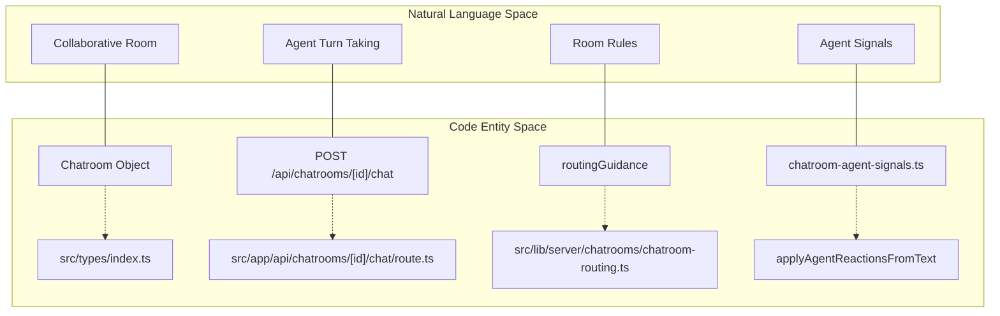
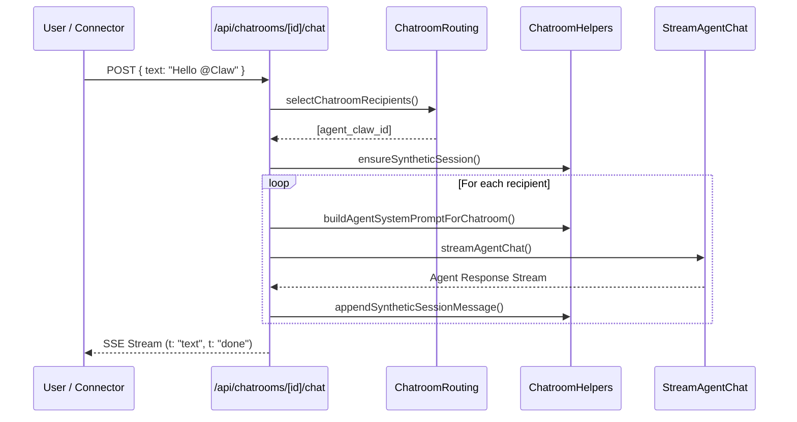

<!-- source: DeepWiki mcp.deepwiki.com · repo swarmclawai/swarmclaw · page 16.1 Chatroom Engine · fetched 2026-10-26 -->

# Chatroom Engine

Relevant source files

The following files were used as context for generating this wiki page:

- [src/app/api/chatrooms/[id]/chat/route.test.ts](src/app/api/chatrooms/[id]/chat/route.test.ts)
- [src/app/api/chatrooms/[id]/chat/route.ts](src/app/api/chatrooms/[id]/chat/route.ts)
- [src/app/api/chatrooms/[id]/members/route.ts](src/app/api/chatrooms/[id]/members/route.ts)
- [src/app/api/chatrooms/[id]/route.ts](src/app/api/chatrooms/[id]/route.ts)
- [src/app/api/chatrooms/route.ts](src/app/api/chatrooms/route.ts)
- [src/components/agents/inspector-panel.tsx](src/components/agents/inspector-panel.tsx)
- [src/components/chat/chat-list.tsx](src/components/chat/chat-list.tsx)
- [src/components/chatrooms/chatroom-input.tsx](src/components/chatrooms/chatroom-input.tsx)
- [src/components/chatrooms/chatroom-sheet.tsx](src/components/chatrooms/chatroom-sheet.tsx)
- [src/components/chatrooms/chatroom-view.tsx](src/components/chatrooms/chatroom-view.tsx)
- [src/lib/chatroom-sessions.ts](src/lib/chatroom-sessions.ts)
- [src/lib/server/chatrooms/chatroom-helpers.test.ts](src/lib/server/chatrooms/chatroom-helpers.test.ts)
- [src/lib/server/chatrooms/chatroom-helpers.ts](src/lib/server/chatrooms/chatroom-helpers.ts)
- [src/lib/server/connectors/discord.ts](src/lib/server/connectors/discord.ts)
- [src/lib/server/connectors/manager.ts](src/lib/server/connectors/manager.ts)
- [src/lib/server/connectors/media.ts](src/lib/server/connectors/media.ts)
- [src/lib/server/connectors/slack.ts](src/lib/server/connectors/slack.ts)
- [src/lib/server/connectors/telegram.ts](src/lib/server/connectors/telegram.ts)
- [src/lib/server/connectors/types.ts](src/lib/server/connectors/types.ts)
- [src/lib/server/connectors/whatsapp.ts](src/lib/server/connectors/whatsapp.ts)
- [src/lib/server/session-tools/chatroom.ts](src/lib/server/session-tools/chatroom.ts)
- [src/stores/slices/agent-slice.ts](src/stores/slices/agent-slice.ts)
- [src/stores/slices/session-slice.test.ts](src/stores/slices/session-slice.test.ts)
- [src/stores/slices/session-slice.ts](src/stores/slices/session-slice.ts)

The Chatroom Engine provides a multi-agent collaborative environment where multiple agents and users can interact within a shared context. Unlike standard sessions which are typically 1:1 (User:Agent), chatrooms facilitate N:M interactions, managing complex routing, agent turn-taking, and cross-agent memory synchronization.

## System Architecture

The chatroom backend acts as an orchestration layer over the standard `streamAgentChat` pipeline. It manages a "Synthetic Session" for each agent within the room to maintain individual agent memory while sharing the global chatroom history.

### Data Flow: Message Processing
1.  **Ingress**: A message arrives via `/api/chatrooms/[id]/chat` [src/app/api/chatrooms/[id]/chat/route.ts:41-45]() or a platform connector (Discord, Slack, etc.).
2.  **Routing**: The `chatroom-routing` logic determines which agents should respond based on explicit @mentions or implicit "room reading" [src/lib/server/chatrooms/chatroom-routing.ts:26-27]().
3.  **Context Assembly**: For each recipient, the engine builds a specialized system prompt including the chatroom's `routingGuidance` and the agent's specific persona [src/lib/server/chatrooms/chatroom-helpers.ts:19-22]().
4.  **Execution**: Agents are processed in a queue. If an agent's response triggers another agent (via mention or signal), the chain continues up to `MAX_CHAIN_DEPTH` [src/app/api/chatrooms/[id]/chat/route.ts:39-40]().
5.  **Persistence**: Messages are saved to the chatroom's message array and also mirrored into the `session-mailbox` for individual agent memory [src/lib/server/chatrooms/chatroom-memory-bridge.ts:34-34]().

### Chatroom Engine Component Relationship
This diagram bridges the Natural Language concepts to the specific code entities responsible for them.

Title: Chatroom Entity Map

Sources: [src/app/api/chatrooms/[id]/chat/route.ts:41-110](), [src/lib/server/chatrooms/chatroom-routing.ts:51-61](), [src/lib/server/chatrooms/chatroom-agent-signals.ts:29-30]()

## Routing & Mentions

The engine supports several modes of addressing agents within a room:

| Mode | Logic | Source |
| :--- | :--- | :--- |
| **Explicit** | `@agent_name` or `@all` in message text. | `parseMentions` |
| **Reply-based** | Implicitly targets the agent whose message is being replied to. | `resolveReplyTargetAgentId` |
| **Auto-address** | If enabled, all agents in the room are notified of every message. | `chatroom.autoAddress` |
| **Implicit** | Agents "read the room" to see if a topic matches their expertise. | `isImplicitlyMentioned` |

### Mention Resolution Logic
The `parseMentions` function performs a two-pass scan:
1.  **Pass 1**: Full name matching (longest-first) to ensure "Hal2k (OpenAI)" is matched before "Hal2k" [src/lib/server/chatrooms/chatroom-helpers.ts:102-105]().
2.  **Pass 2**: Regex fallback for IDs (e.g., `@agent_analyst`) [src/lib/server/chatrooms/chatroom-helpers.ts:124-125]().

Sources: [src/lib/server/chatrooms/chatroom-helpers.ts:79-160](), [src/app/api/chatrooms/[id]/chat/route.ts:68-81]()

## Execution & Memory Bridge

Each chatroom interaction is synchronized with the individual agent's long-term memory via a "Synthetic Session".

*   **Synthetic Session ID**: Derived using `resolveChatroomSyntheticSessionId(chatroomId, agentId)` [src/lib/chatroom-sessions.ts:12-16]().
*   **Mailbox Pattern**: When a message is posted to a chatroom, `persistChatroomInteractionMemory` ensures the text is appended to the synthetic sessions of all participating agents [src/lib/server/chatrooms/chatroom-memory-bridge.ts:34-34]().
*   **Context Compaction**: To prevent context window overflow in long-running rooms, the engine uses `compactChatroomMessages` to prune or summarize history [src/lib/server/chatrooms/chatroom-helpers.ts:104-104]().

Title: Chatroom Execution Flow

Sources: [src/app/api/chatrooms/[id]/chat/route.ts:137-170](), [src/lib/server/chatrooms/chatroom-helpers.ts:16-22]()

## Health & Refusal Policies

The engine includes safeguards to handle agent unavailability and inappropriate requests.

*   **Health Filtering**: `filterHealthyChatroomAgents` checks if an agent's provider is cooling down or if their endpoint is unreachable before attempting to route a message to them [src/lib/server/chatrooms/chatroom-health.ts:23-23]().
*   **OnRefusal Policy**: Configurable behavior for when an agent refuses a task (e.g., "I cannot browse the web"). Policies include:
    *   `ignore`: Silent failure.
    *   `notify`: Post a system message explaining the refusal.
    *   `re-route`: Attempt to find another agent in the room with the required capability.

Sources: [src/app/api/chatrooms/[id]/chat/route.ts:87-88](), [src/lib/server/chatrooms/chatroom-routing.ts:8-12]()

## REST Endpoints

The chatroom engine is exposed via the following internal API routes:

| Method | Endpoint | Description |
| :--- | :--- | :--- |
| `GET` | `/api/chatrooms` | Lists all active chatrooms, filtering out protocol-specific or hidden rooms by default [src/app/api/chatrooms/route.ts:16-38](). |
| `POST` | `/api/chatrooms` | Creates a new chatroom, generating initial "System" join messages for all members [src/app/api/chatrooms/route.ts:40-104](). |
| `GET` | `/api/chatrooms/[id]` | Retrieves full chatroom metadata and message history [src/app/api/chatrooms/[id]/route.ts:13-24](). |
| `PUT` | `/api/chatrooms/[id]` | Updates room settings (name, routing rules, members). Injects "joined/left" messages on member changes [src/app/api/chatrooms/[id]/route.ts:26-129](). |
| `POST` | `/api/chatrooms/[id]/chat` | The primary execution endpoint. Handles SSE streaming of agent responses [src/app/api/chatrooms/[id]/chat/route.ts:41-110](). |
| `DELETE` | `/api/chatrooms/[id]` | Deletes a room and nulls out references in platform connectors [src/app/api/chatrooms/[id]/route.ts:131-156](). |

Sources: [src/app/api/chatrooms/route.ts:1-105](), [src/app/api/chatrooms/[id]/route.ts:1-157](), [src/app/api/chatrooms/[id]/chat/route.ts:1-110]()

---

