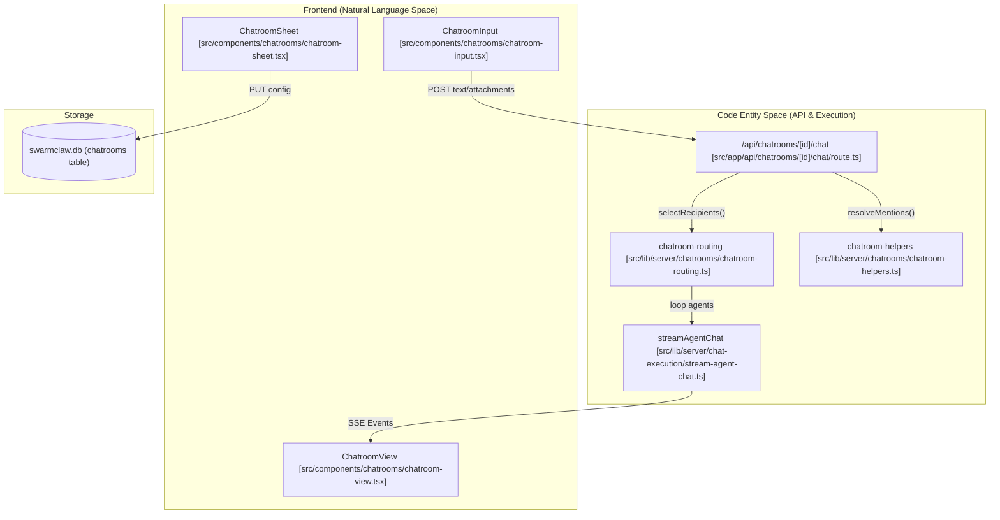
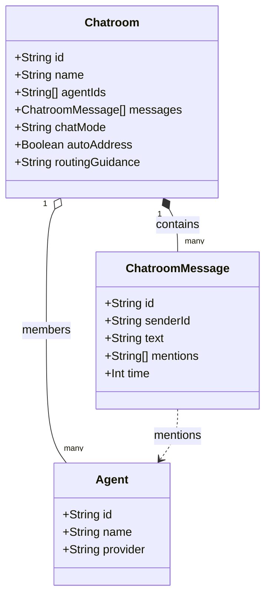

<!-- source: DeepWiki mcp.deepwiki.com · repo swarmclawai/swarmclaw · page 16.2 Chatroom UI · fetched 2026-10-26 -->

# Chatroom UI

Relevant source files

The following files were used as context for generating this wiki page:

- [src/app/api/chatrooms/[id]/chat/route.test.ts](src/app/api/chatrooms/[id]/chat/route.test.ts)
- [src/app/api/chatrooms/[id]/chat/route.ts](src/app/api/chatrooms/[id]/chat/route.ts)
- [src/app/api/chatrooms/[id]/members/route.ts](src/app/api/chatrooms/[id]/members/route.ts)
- [src/app/api/chatrooms/[id]/route.ts](src/app/api/chatrooms/[id]/route.ts)
- [src/app/api/chatrooms/route.ts](src/app/api/chatrooms/route.ts)
- [src/components/agents/agent-card.tsx](src/components/agents/agent-card.tsx)
- [src/components/agents/inspector-panel.tsx](src/components/agents/inspector-panel.tsx)
- [src/components/chat/chat-area.tsx](src/components/chat/chat-area.tsx)
- [src/components/chat/chat-header.tsx](src/components/chat/chat-header.tsx)
- [src/components/chat/chat-list.tsx](src/components/chat/chat-list.tsx)
- [src/components/chat/message-bubble.tsx](src/components/chat/message-bubble.tsx)
- [src/components/chat/message-list.tsx](src/components/chat/message-list.tsx)
- [src/components/chatrooms/chatroom-input.tsx](src/components/chatrooms/chatroom-input.tsx)
- [src/components/chatrooms/chatroom-sheet.tsx](src/components/chatrooms/chatroom-sheet.tsx)
- [src/components/chatrooms/chatroom-view.tsx](src/components/chatrooms/chatroom-view.tsx)
- [src/lib/chatroom-sessions.ts](src/lib/chatroom-sessions.ts)
- [src/lib/server/chatrooms/chatroom-helpers.test.ts](src/lib/server/chatrooms/chatroom-helpers.test.ts)
- [src/lib/server/chatrooms/chatroom-helpers.ts](src/lib/server/chatrooms/chatroom-helpers.ts)
- [src/lib/server/session-tools/chatroom.ts](src/lib/server/session-tools/chatroom.ts)
- [src/stores/slices/agent-slice.ts](src/stores/slices/agent-slice.ts)
- [src/stores/slices/session-slice.test.ts](src/stores/slices/session-slice.test.ts)
- [src/stores/slices/session-slice.ts](src/stores/slices/session-slice.ts)

The Chatroom UI provides a multi-agent collaborative environment where users can interact with groups of agents simultaneously. Unlike standard one-on-one sessions, Chatrooms support complex routing rules, automated addressing, and cross-agent communication within a shared message history.

## Architecture and Data Flow

The Chatroom UI is built on top of the `ChatroomStore` (Zustand) and interacts with the `/api/chatrooms` REST endpoints. While standard chats are tied to a specific `Session`, chatrooms utilize a "Synthetic Session" model to bridge the gap between multi-agent room state and the single-agent execution engine.

### System Interaction Diagram

This diagram illustrates how the UI components interact with the backend execution engine and storage layers.

"Chatroom UI Interaction Flow"

Sources: [src/components/chatrooms/chatroom-view.tsx:1-25](), [src/app/api/chatrooms/[id]/chat/route.ts:41-100](), [src/lib/server/chatrooms/chatroom-helpers.ts:79-85]()

## Key Components

### ChatroomView
The `ChatroomView` is the primary container for multi-agent conversations. It manages the message list, streaming states for multiple concurrent agents, and real-time "heartbeat" pulses from active agents.

*   **Heartbeat Monitoring**: It uses `useWs` to listen for `heartbeat:agent:${agentId}` topics, updating the UI with `AgentHeartbeatListeners` to show which agents are currently "thinking" or active [src/components/chatrooms/chatroom-view.tsx:57-79]().
*   **Message Grouping**: Messages are grouped by sender and time (threshold of 2 minutes) to maintain readability in fast-moving multi-agent rooms [src/components/chatrooms/chatroom-view.tsx:81-93]().
*   **Synthetic Sessions**: It resolves a `syntheticSessionId` for each agent in the room using `resolveChatroomSyntheticSessionId`, allowing individual agent inspection within the room context [src/components/chatrooms/chatroom-view.tsx:12-13]().

### ChatroomInput
A specialized input component that supports `@mentions`, slash commands, and "Breakout" sessions.

*   **Mention System**: It filters the room's `Agent[]` list based on the `@` trigger and inserts normalized names into the text [src/components/chatrooms/chatroom-input.tsx:121-164]().
*   **Draft Persistence**: Drafts are saved to `localStorage` using the key `sc_draft_cr_${chatroomId}` and restored when switching rooms [src/components/chatrooms/chatroom-input.tsx:68-87]().
*   **Breakout Commands**: Supports the `/breakout` command to launch structured multi-agent protocols directly from the chat input [src/components/chatrooms/chatroom-input.tsx:12-16]().

### ChatroomSheet
The configuration interface for creating and editing rooms. It allows users to:
1.  **Manage Membership**: Select which agents belong to the room.
2.  **Configure Routing**: Define `routingRules` or `routingGuidance` (system prompts for the "room coordinator") [src/app/api/chatrooms/[id]/route.ts:51-61]().
3.  **Chat Mode**: Switch between `parallel` (agents respond simultaneously) and `sequential` (agents wait for turns) [src/app/api/chatrooms/[id]/route.ts:45-47]().
4.  **Auto-Address**: Toggle whether agents should automatically "read the room" and respond without explicit `@mentions` [src/app/api/chatrooms/[id]/route.ts:48-50]().

### ChatList
The `ChatList` component (typically found in the sidebar) displays both 1:1 agent sessions and Chatrooms.
*   **Filtering**: It distinguishes between standard `sessions` and `chatrooms` based on the active view [src/components/chat/chat-list.tsx:1-20]().
*   **Presence**: Shows unread message counts and the last active timestamp for each room.

Sources: [src/components/chatrooms/chatroom-view.tsx:95-150](), [src/components/chatrooms/chatroom-input.tsx:26-50](), [src/app/api/chatrooms/[id]/route.ts:26-80]()

## Multi-Agent Interaction Logic

Interaction in a chatroom is governed by the `POST` handler in `src/app/api/chatrooms/[id]/chat/route.ts`.

| Feature | Implementation Detail |
| :--- | :--- |
| **Mention Parsing** | `parseMentions` scans for `@name`, `@id`, and `@all`. It also handles "implicit mentions" where agents are targeted based on their persona/skills [src/lib/server/chatrooms/chatroom-helpers.ts:79-156](). |
| **Response Chaining** | Agents can trigger other agents. The system tracks `MAX_CHAIN_DEPTH` (default 5) to prevent infinite loops [src/app/api/chatrooms/[id]/chat/route.ts:39-40](). |
| **Muting** | Members can be muted via `mutedUntil` timestamps, preventing them from responding to mentions [src/lib/server/chatrooms/chatroom-helpers.ts:43-48](). |
| **System Messages** | Joining or leaving a room triggers automatic system messages persisted to the chatroom history [src/app/api/chatrooms/[id]/route.ts:85-112](). |

### Data Model Association

"Chatroom Entity Mapping"

Sources: [src/types/index.ts](), [src/app/api/chatrooms/route.ts:84-97]()

## Multi-Agent Execution Flow

When a user sends a message to a chatroom:
1.  **Persistence**: The message is saved to the `chatrooms` collection in `swarmclaw.db` [src/app/api/chatrooms/[id]/chat/route.ts:103-107]().
2.  **Recipient Selection**: The engine determines which agents are mentioned or should respond based on `autoAddress` and `routingRules` [src/app/api/chatrooms/[id]/chat/route.ts:68-81]().
3.  **Agent Loop**: For each recipient, the system:
    *   Builds a specialized system prompt including the room's `routingGuidance` [src/lib/server/chatrooms/chatroom-helpers.ts:16-19]().
    *   Executes `streamAgentChat` for the agent [src/app/api/chatrooms/[id]/chat/route.ts:167-175]().
    *   Streams results back to the UI via SSE (Server-Sent Events).
4.  **Signals & Reactions**: Agents can output hidden "reaction" tokens (e.g., `[REACTION:...]`) which the backend parses to update message metadata [src/lib/server/chatrooms/chatroom-agent-signals.ts:29-30]().

Sources: [src/app/api/chatrooms/[id]/chat/route.ts:135-170](), [src/lib/server/chatrooms/chatroom-helpers.ts:1-22]()

---

