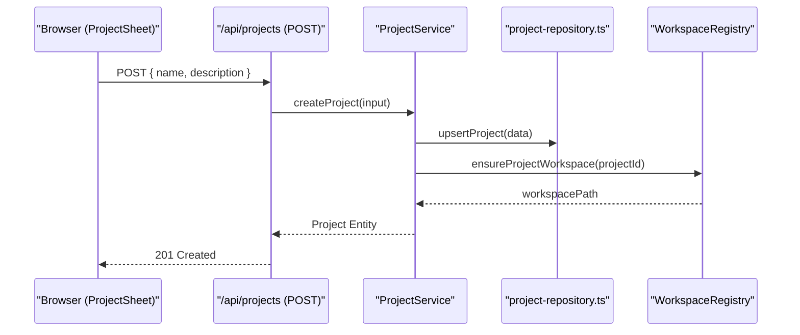
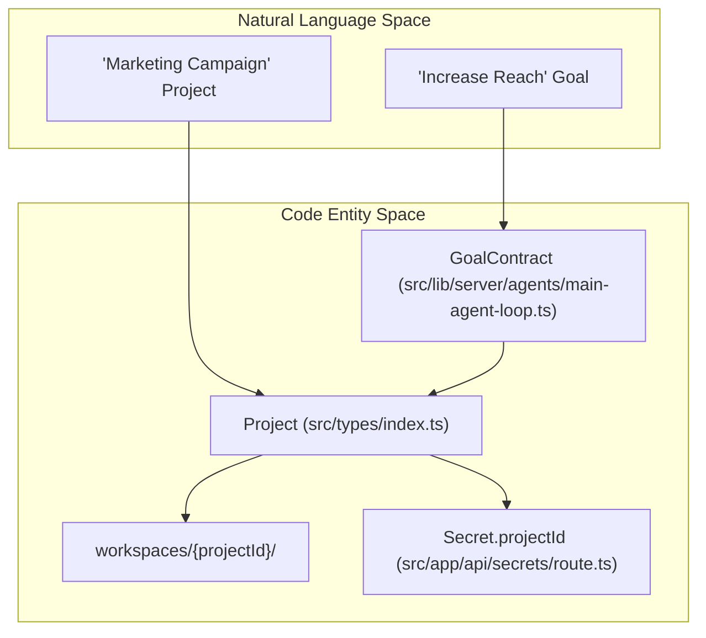

<!-- source: DeepWiki mcp.deepwiki.com · repo swarmclawai/swarmclaw · page 17.1 Project Management · fetched 2026-10-26 -->

# Project Management

Relevant source files

The following files were used as context for generating this wiki page:

- [src/app/api/documents/[id]/route.ts](src/app/api/documents/[id]/route.ts)
- [src/app/api/external-agents/[id]/route.ts](src/app/api/external-agents/[id]/route.ts)
- [src/app/api/goals/[id]/route.ts](src/app/api/goals/[id]/route.ts)
- [src/app/api/providers/[id]/route.ts](src/app/api/providers/[id]/route.ts)
- [src/app/api/secrets/[id]/route.ts](src/app/api/secrets/[id]/route.ts)
- [src/app/api/secrets/route.ts](src/app/api/secrets/route.ts)
- [src/app/api/settings/route.ts](src/app/api/settings/route.ts)
- [src/app/api/tts/route.test.ts](src/app/api/tts/route.test.ts)
- [src/app/api/tts/route.ts](src/app/api/tts/route.ts)
- [src/app/api/tts/stream/route.ts](src/app/api/tts/stream/route.ts)
- [src/app/settings/page.tsx](src/app/settings/page.tsx)
- [src/components/projects/project-detail.tsx](src/components/projects/project-detail.tsx)
- [src/components/projects/project-list.tsx](src/components/projects/project-list.tsx)
- [src/components/projects/tabs/activity-tab.tsx](src/components/projects/tabs/activity-tab.tsx)
- [src/components/projects/tabs/operations-tab.tsx](src/components/projects/tabs/operations-tab.tsx)
- [src/components/projects/tabs/overview-tab.tsx](src/components/projects/tabs/overview-tab.tsx)
- [src/components/projects/tabs/work-tab.tsx](src/components/projects/tabs/work-tab.tsx)
- [src/lib/server/agents/main-agent-loop-advanced.test.ts](src/lib/server/agents/main-agent-loop-advanced.test.ts)
- [src/lib/server/agents/main-agent-loop.ts](src/lib/server/agents/main-agent-loop.ts)
- [src/lib/server/chat-execution/post-stream-finalization.ts](src/lib/server/chat-execution/post-stream-finalization.ts)
- [src/lib/server/session-tools/search-providers.test.ts](src/lib/server/session-tools/search-providers.test.ts)
- [src/lib/server/session-tools/search-providers.ts](src/lib/server/session-tools/search-providers.ts)
- [src/types/app-settings.ts](src/types/app-settings.ts)
- [src/types/approval.ts](src/types/approval.ts)
- [src/views/settings/section-web-search.tsx](src/views/settings/section-web-search.tsx)

Project Management in SwarmClaw provides a structural layer above agents and sessions, allowing for the grouping of resources, enforcement of hierarchical goals, and filesystem isolation through workspaces. It serves as the primary organizational unit for complex, multi-agent endeavors.

## Project Service and Repository

The Project Service manages the lifecycle of project entities and their associated infrastructure. Projects are persisted via the `project-repository`, which interfaces with the primary SQLite database.

### Key Functions
- **`createProject`**: Initializes a new project entity with unique identifiers and default settings [src/app/api/projects/route.ts:31-52]().
- **`updateProject`**: Performs partial updates on project metadata, including credential requirements and member agents [src/app/api/projects/[id]/route.ts:20-65]().
- **`deleteProjectAndDetachReferences`**: A cascading cleanup operation. When a project is deleted, this function ensures that `projectId` references in agents, tasks, and sessions are cleared to prevent orphaned foreign keys [src/app/api/projects/[id]/route.ts:67-76]().
- **`ensureProjectWorkspace`**: Validates or creates a dedicated directory within the `workspaces/` root. This directory acts as the restricted filesystem scope for agents assigned to the project.

### Data Flow: Project Creation
The following diagram illustrates the flow from a client request to the creation of a project and its workspace.

**Project Provisioning Flow**

Sources: `[src/app/api/projects/route.ts:31-52]()`, `[src/components/projects/project-detail.tsx:1-15]()`

## Goals System

The Goals system introduces a structured hierarchy for defining success. Unlike simple task descriptions, Goals provide a `GoalContract` that agents use to measure progress and stay within resource constraints.

### Goal Hierarchy and Contracts
Goals are organized into a `GoalLevel` hierarchy (e.g., Strategic, Tactical, Operational).
- **`GoalContract`**: A structured object containing the `successMetric`, `budgetUsd`, and `targetDate` [src/lib/server/agents/main-agent-loop.ts:36-37]().
- **`resolveEffectiveGoal`**: Logic that traverses the project hierarchy to determine the active objective for an agent session [src/lib/server/agents/main-agent-loop.ts:19-19]().

### REST Endpoints
- **`/api/projects`**: Collection endpoint for listing and creating projects [src/app/api/projects/route.ts:9-29]().
- **`/api/goals`**: Manages the lifecycle of goal entities, supporting `GET` for chains and `PATCH` for metric updates [src/app/api/goals/[id]/route.ts:8-32]().

| Feature | Implementation | Description |
| :--- | :--- | :--- |
| **Cascading Deletion** | `deleteProjectAndDetachReferences` | Clears `projectId` from `agents`, `tasks`, and `secrets` [src/app/api/projects/[id]/route.ts:67-76](). |
| **Budget Enforcement** | `GoalContract.budgetUsd` | Tracked via `missionCostUsd` in the main loop [src/lib/server/agents/main-agent-loop.ts:80-80](). |
| **Success Metrics** | `GoalContract.successMetric` | Quantitative or qualitative criteria for completion [src/lib/server/agents/main-agent-loop.ts:4-4](). |

Sources: `[src/app/api/goals/[id]/route.ts:1-39]()`, `[src/lib/server/agents/main-agent-loop.ts:34-82]()`

## Workspace and Resource Mapping

SwarmClaw maps high-level Project entities to low-level system resources (Filesystem, Secrets, and Database entries).

**Code Entity Mapping**

Sources: `[src/app/api/secrets/route.ts:43-43]()`, `[src/lib/server/agents/main-agent-loop.ts:34-45]()`

## Project UI Components

The Project UI is divided into specialized tabs within the `ProjectDetail` view to manage different aspects of the project lifecycle.

### View Structure
- **OverviewTab**: Displays the project summary, hierarchical goals, and the `GoalContract` status [src/components/projects/project-detail.tsx:77-79]().
- **WorkTab**: A task management interface. It uses `useAppStore` to filter global tasks by `activeProjectFilter` [src/components/projects/tabs/work-tab.tsx:17-30](). It supports sorting by `status`, `updated`, or `agent` [src/components/projects/tabs/work-tab.tsx:42-49]().
- **OperationsTab**: Manages schedules and automated runs associated with the project [src/components/projects/project-detail.tsx:83-85]().
- **ActivityTab**: A unified log of agent actions, tool executions, and state changes within the project scope [src/components/projects/project-detail.tsx:86-88]().

### Project List and Navigation
The `ProjectList` component provides the primary navigation for switching between project contexts. Selecting a project updates the `activeProjectFilter` in the global store, which triggers a refresh of all project-dependent data, including secrets and tasks [src/components/projects/project-detail.tsx:20-23]().

Sources: `[src/components/projects/project-detail.tsx:1-92]()`, `[src/components/projects/tabs/work-tab.tsx:1-163]()`

---

