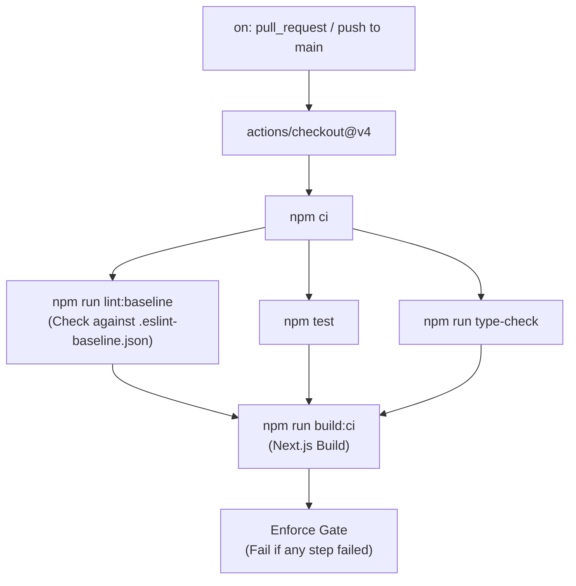
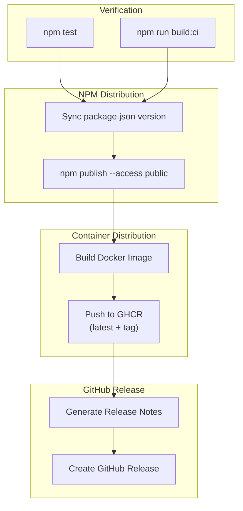

<!-- source: DeepWiki mcp.deepwiki.com · repo swarmclawai/swarmclaw · page 20 Development Guide · fetched 2026-10-26 -->

# Development Guide

Relevant source files

The following files were used as context for generating this wiki page:

- [.github/workflows/ci.yml](.github/workflows/ci.yml)
- [.github/workflows/release.yml](.github/workflows/release.yml)
- [CONTRIBUTING.md](CONTRIBUTING.md)
- [scripts/benchmark-autonomy-harness.mjs](scripts/benchmark-autonomy-harness.mjs)
- [scripts/run-agent-regression-suite.ts](scripts/run-agent-regression-suite.ts)
- [src/app/api/version/route.ts](src/app/api/version/route.ts)
- [src/app/api/version/update/route.ts](src/app/api/version/update/route.ts)
- [src/lib/server/agents/subagent-runtime.test.ts](src/lib/server/agents/subagent-runtime.test.ts)
- [src/lib/server/chat-execution/chat-execution-disabled.test.ts](src/lib/server/chat-execution/chat-execution-disabled.test.ts)
- [src/lib/server/chat-execution/chat-execution-eval-history.test.ts](src/lib/server/chat-execution/chat-execution-eval-history.test.ts)
- [src/lib/server/chat-execution/chat-execution-grounding.test.ts](src/lib/server/chat-execution/chat-execution-grounding.test.ts)
- [src/lib/server/chat-execution/chat-execution-session-sync.test.ts](src/lib/server/chat-execution/chat-execution-session-sync.test.ts)
- [src/lib/server/connectors/manager.test.ts](src/lib/server/connectors/manager.test.ts)
- [src/lib/server/daemon/controller.ts](src/lib/server/daemon/controller.ts)
- [src/lib/server/daemon/lease-owner.test.ts](src/lib/server/daemon/lease-owner.test.ts)
- [src/lib/server/daemon/lease-owner.ts](src/lib/server/daemon/lease-owner.ts)
- [src/lib/server/eval/agent-regression.ts](src/lib/server/eval/agent-regression.ts)
- [src/lib/server/git-metadata.test.ts](src/lib/server/git-metadata.test.ts)
- [src/lib/server/git-metadata.ts](src/lib/server/git-metadata.ts)
- [src/lib/server/runtime/daemon-state/core.ts](src/lib/server/runtime/daemon-state/core.ts)
- [src/lib/server/session-tools/delegate-fallback.test.ts](src/lib/server/session-tools/delegate-fallback.test.ts)
- [src/lib/server/skills/discovered-skill-prompt.test.ts](src/lib/server/skills/discovered-skill-prompt.test.ts)
- [src/lib/server/test-utils/run-with-temp-data-dir.ts](src/lib/server/test-utils/run-with-temp-data-dir.ts)
- [src/lib/server/tool-planning.test.ts](src/lib/server/tool-planning.test.ts)

This page is a practical reference for contributors working on the SwarmClaw codebase. It covers the project structure, npm script surface, CI pipeline, and linting practices. For detailed repository layout and dependency documentation, see [Project Structure & Dependencies](#20.1). For CI job specifics and testing frameworks, see [CI, Testing & Code Quality](#20.2).

---

## Prerequisites

| Requirement | Minimum Version |
|---|---|
| Node.js | `>=22.6.0` |
| npm | bundled with Node 22 |

The engine constraint is declared in `package.json`. Local development and production deployments require Node 22.6+ to support modern runtime features and native modules like `better-sqlite3`.

---

## npm Scripts

All developer-facing scripts are declared in `package.json`.

### Development & Build

| Script | Command | Purpose |
|---|---|---|
| `dev` | `next dev --hostname 0.0.0.0 -p 3456` | Turbopack dev server on port 3456 |
| `build` | `next build` | Production build with ESLint enabled |
| `build:ci` | `NEXT_DISABLE_ESLINT=1 next build` | CI build (lint gate runs separately) |
| `start` | `next start` | Start production Next.js server |

### Setup & Lifecycle

| Script | Command | Purpose |
|---|---|---|
| `setup:easy` | `node ./scripts/easy-setup.mjs` | Interactive first-run setup |
| `quickstart` | `node ./scripts/easy-setup.mjs --start` | Setup + immediate server start |
| `update:easy` | `node ./scripts/easy-update.mjs` | Pull latest changes and rebuild |

### CLI & Testing

| Script | Command | Purpose |
|---|---|---|
| `cli` | `node ./bin/swarmclaw.js` | Run the CLI directly from source |
| `test` | `node --test ...` | Run the primary Node.js test suite [package.json:34]() |
| `test:cli` | `node --test src/cli/index.test.js` | CLI-specific test suite |
| `test:openclaw` | `tsx --test ...` | OpenClaw integration and protocol tests [package.json:53]() |

### Linting

| Script | Command | Purpose |
|---|---|---|
| `lint:baseline` | `node ./scripts/lint-baseline.mjs check` | Check for net-new lint issues vs baseline |
| `lint:baseline:update` | `node ./scripts/lint-baseline.mjs update` | Refresh `.eslint-baseline.json` |

Sources: [package.json:34-53](), [CONTRIBUTING.md:50-66]()

---

## CI & Release Workflows

The project uses GitHub Actions for continuous integration and automated releases.

### CI Pipeline (`ci.yml`)
The CI workflow runs on every pull request and push to `main`. It enforces a "no net-new lint issues" policy and runs the core test suites.

**CI Pipeline Logic**

Sources: [.github/workflows/ci.yml:1-68]()

### Release Pipeline (`release.yml`)
Triggered by version tags (e.g., `v1.2.3`), this workflow handles multi-platform distribution.

**Release Distribution Flow**

Sources: [.github/workflows/release.yml:1-158]()

---

## Development Practices

### Lint Baseline System
SwarmClaw uses a "baseline" approach to linting. Instead of fixing all legacy debt at once, the `lint:baseline` script ensures that new PRs do not introduce *additional* violations.
- **Fingerprinting**: Issues are tracked by file path, rule ID, and message [scripts/lint-baseline.mjs:51-57]().
- **Updating**: If you intentionally fix lint debt, run `npm run lint:baseline:update` to lower the baseline [CONTRIBUTING.md:36]().

### Process & Lease Management
The background daemon uses a lease-locking mechanism to ensure only one primary instance manages the task queue and heartbeats.
- **Lease Owner**: Identified by a string like `pid:${pid}:${suffix}` [src/lib/server/daemon/lease-owner.ts:4-5]().
- **Stale Recovery**: Successor processes check if the recorded PID is still alive using `isOwnerProcessDead` [src/lib/server/daemon/lease-owner.ts:56-68]().

### Self-Updates
For source checkouts, the system supports a `POST /api/version/update` route that performs a `git pull`, checks for dependency changes, and checkpoints the SQLite WAL to prevent corruption during native module rebuilds [src/app/api/version/update/route.ts:17-23]().

---

## Child Pages

For more granular technical details, refer to the following:

- **[Project Structure & Dependencies](#20.1)**: Deep dive into the directory layout and the role of major dependencies like LangGraph and Better-SQLite3.
- **[CI, Testing & Code Quality](#20.2)**: Detailed breakdown of the regression testing harness, evaluation scenarios (GAIA/SWE-bench), and lint baseline configuration.

Sources: [src/lib/server/daemon/controller.ts:1-152](), [src/app/api/version/route.ts:1-97](), [CONTRIBUTING.md:1-85]()

---

