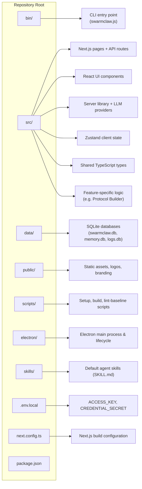
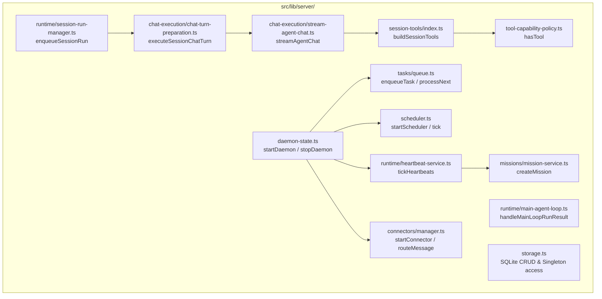
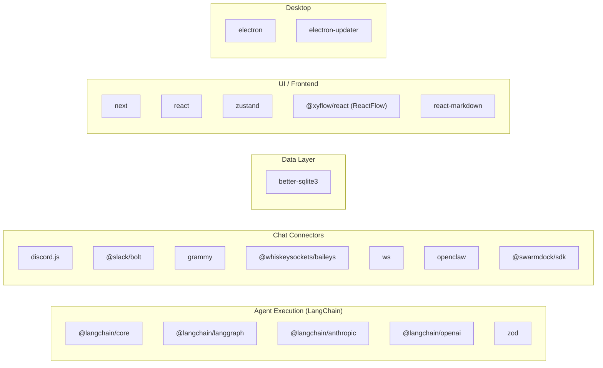

<!-- source: DeepWiki mcp.deepwiki.com · repo swarmclawai/swarmclaw · page 20.1 Project Structure & Dependencies · fetched 2026-10-26 -->

# Project Structure & Dependencies

Relevant source files

The following files were used as context for generating this wiki page:

- [.eslint-baseline.json](.eslint-baseline.json)
- [.github/workflows/desktop-release.yml](.github/workflows/desktop-release.yml)
- [.gitignore](.gitignore)
- [CLAUDE.md](CLAUDE.md)
- [README.md](README.md)
- [electron/free-port.ts](electron/free-port.ts)
- [electron/menu.ts](electron/menu.ts)
- [electron/paths.ts](electron/paths.ts)
- [electron/tsconfig.json](electron/tsconfig.json)
- [next.config.ts](next.config.ts)
- [package-lock.json](package-lock.json)
- [package.json](package.json)
- [src/cli/index.js](src/cli/index.js)
- [src/cli/spec.js](src/cli/spec.js)
- [src/components/org-chart/mini-chat-bubble.tsx](src/components/org-chart/mini-chat-bubble.tsx)
- [src/instrumentation.ts](src/instrumentation.ts)
- [src/lib/server/missions/mission-templates.ts](src/lib/server/missions/mission-templates.ts)
- [src/lib/server/storage.ts](src/lib/server/storage.ts)
- [src/types/index.ts](src/types/index.ts)

This page documents the repository directory layout, the role of each top-level and `src/` subdirectory, the key npm dependencies grouped by functional area, and the full set of npm scripts. It is intended as an orientation reference for contributors.

---

## Repository Layout

The following diagram maps each top-level directory to its primary owner system.

**Top-Level Directory → System Mapping**

Sources: [package.json:34-55](), [src/lib/server/storage.ts:81-86](), [src/lib/server/storage.ts:188-200]()

---

## `src/` Subdirectory Reference

| Directory | Purpose |
|---|---|
| `src/app/` | Next.js App Router root. Contains frontend pages and API route handlers. |
| `src/app/api/` | All REST, SSE, and WebSocket API routes exposed by the server. |
| `src/components/` | Reusable React UI components, organized by domain. |
| `src/features/` | Complex standalone features like the Protocol Builder (`src/features/protocols/builder`). |
| `src/lib/server/` | Server-only business logic: storage, orchestration, connectors, tools, daemon, scheduler. |
| `src/lib/providers/` | LLM provider implementations (API, CLI, and local gateways). |
| `src/stores/` | Zustand stores for client-side global state (`useAppStore`, `useProtocolBuilderStore`). |
| `src/types/` | Shared TypeScript interfaces (`Agent`, `Session`, `Message`, `Mission`, etc.). |
| `src/views/` | Top-level view components corresponding to main navigation routes. |

Sources: [package.json:37-41](), [src/types/index.ts:1-20](), [src/lib/server/storage.ts:47-64]()

---

## `src/lib/server/` Key Files

The diagram below maps major server-side modules to their filenames and primary exports.

**Server Library Modules**

Sources: [src/lib/server/storage.ts:1-45](), [CLAUDE.md:66-75](), [src/lib/server/missions/mission-templates.ts:28-39]()

---

## npm Scripts

| Script | Command | Purpose |
|---|---|---|
| `setup:easy` | `node ./scripts/easy-setup.mjs` | Environment and database initialization. |
| `quickstart` | `node ./scripts/easy-setup.mjs --start` | Setup + start development server. |
| `dev` | `next dev --turbopack -p 3456` | Start Next.js development server with Turbopack. |
| `build` | `node ./scripts/run-next-build.mjs` | Standard production build. |
| `build:ci` | `NEXT_DISABLE_ESLINT=1 ...` | Production build optimized for CI (skips lint). |
| `start` | `node .next/standalone/server.js` | Start the production server in standalone mode. |
| `lint:baseline` | `node ./scripts/lint-baseline.mjs check` | Fail only on new lint violations relative to baseline. |
| `electron:dev` | `npm run electron:compile && electron ...` | Start the desktop app in development mode. |
| `test:cli` | `node --test src/cli/*.test.js ...` | Execute CLI and script unit tests. |
| `test:runtime` | `tsx --test src/lib/server/...` | Execute server-side runtime and API tests. |

Sources: [package.json:56-96](), [CLAUDE.md:9-16]()

---

## Key Dependencies

The diagram below groups runtime dependencies by the subsystem they directly support.

**Dependency → Subsystem Map**

Sources: [package.json:97-125](), [package-lock.json:7-86]()

---

### Dependency Reference Table

| Package | Version | Role |
|---|---|---|
| `next` | 16.1.7 | App framework for UI and API routing. |
| `@langchain/langgraph` | ^1.2.2 | Orchestration engine for agent state and tool loops. |
| `better-sqlite3` | ^12.6.2 | Synchronous SQLite driver for `swarmclaw.db`, `memory.db`, and `logs.db`. |
| `zustand` | ^5.0.11 | Client-side state management (`setIfChanged` pattern). |
| `@xyflow/react` | ^12.10.2 | Powering the visual Protocol Builder DAG canvas. |
| `discord.js` | ^14.25.1 | Discord platform connector. |
| `@whiskeysockets/baileys` | ^7.0.0-rc.9 | WhatsApp platform connector. |
| `grammy` | ^1.40.0 | Telegram platform connector. |
| `@swarmdock/sdk` | ^0.5.3 | Integration with the SwarmDock agent marketplace. |
| `@playwright/mcp` | ^0.0.68 | Browser runtime tool via Model Context Protocol. |
| `commander` | ^13.1.0 | CLI argument parsing in `bin/swarmclaw.js`. |
| `electron` | ^33.3.0 | Desktop application shell. |

Sources: [package.json:97-125](), [package-lock.json:7-98](), [CLAUDE.md:42-55]()

---

## Node.js Version Requirement

The project requires **Node.js 22.6.0** or higher. This is enforced via the `engines` field in `package.json` and specified in `.nvmrc` for CI and development environments.

Sources: [package.json:31-33](), [README.md:72-73]()

---

