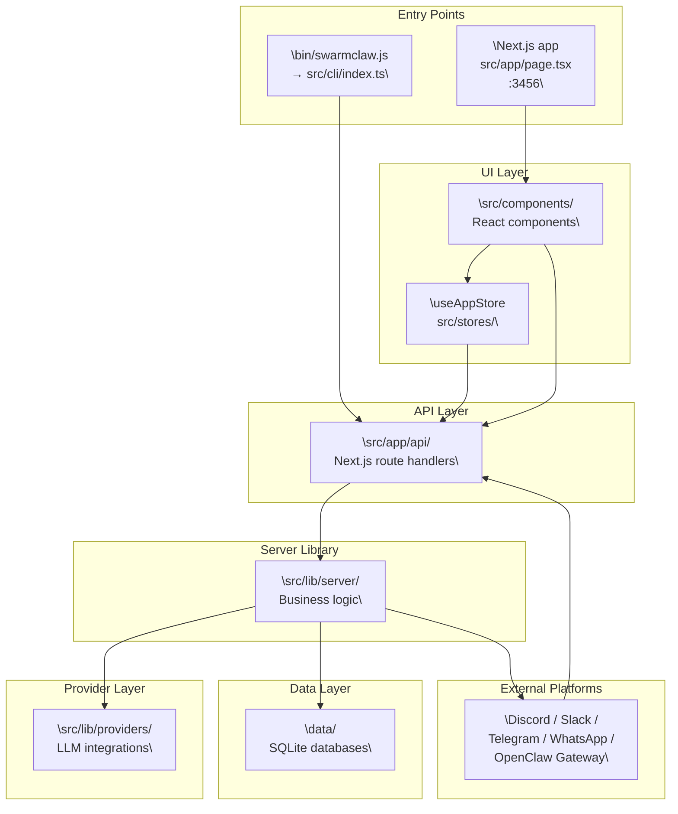
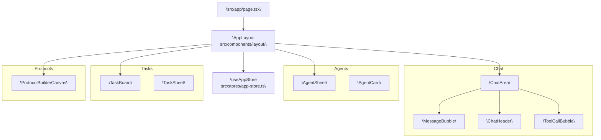
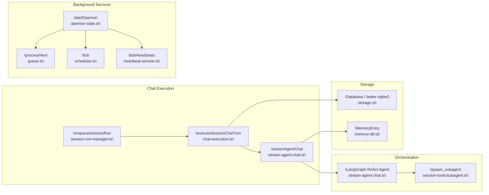
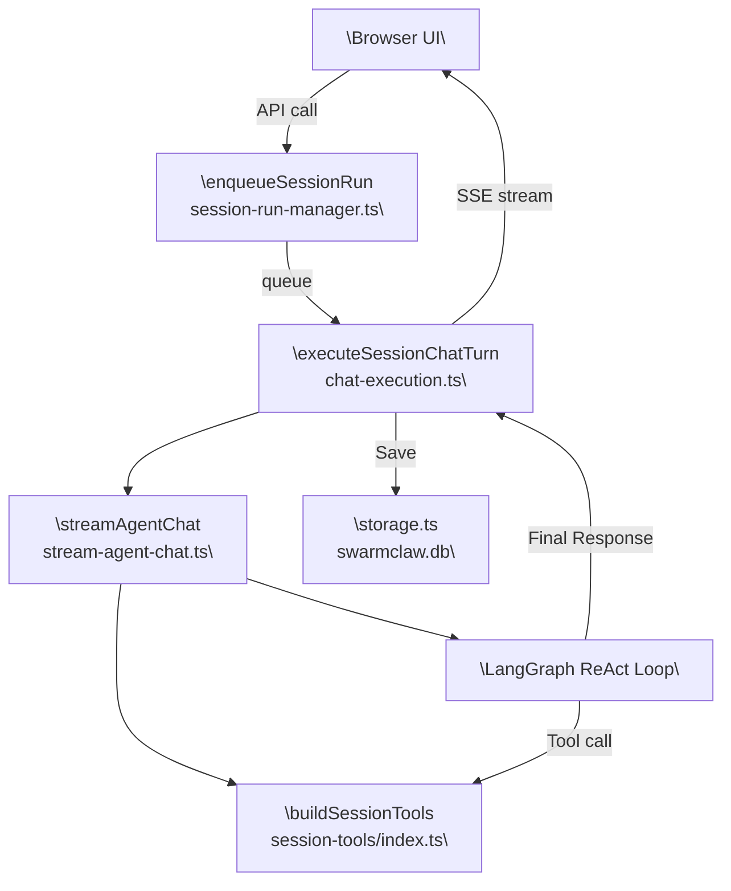

<!-- source: DeepWiki mcp.deepwiki.com · repo swarmclawai/swarmclaw · page 3 Architecture · fetched 2026-10-26 -->

# Architecture

<details>
<summary>Relevant source files</summary>

The following files were used as context for generating this wiki page:

- [.eslint-baseline.json](.eslint-baseline.json)
- [.github/workflows/desktop-release.yml](.github/workflows/desktop-release.yml)
- [.gitignore](.gitignore)
- [CLAUDE.md](CLAUDE.md)
- [README.md](README.md)
- [electron/free-port.ts](electron/free-port.ts)
- [electron/menu.ts](electron/menu.ts)
- [electron/paths.ts](electron/paths.ts)
- [electron/tsconfig.json](electron/tsconfig.json)
- [package-lock.json](package-lock.json)
- [package.json](package.json)
- [src/app/api/missions/[id]/route.ts](src/app/api/missions/[id]/route.ts)
- [src/app/api/missions/route.ts](src/app/api/missions/route.ts)
- [src/cli/index.js](src/cli/index.js)
- [src/cli/spec.js](src/cli/spec.js)
- [src/lib/server/agents/subagent-runtime.ts](src/lib/server/agents/subagent-runtime.ts)
- [src/lib/server/agents/subagent-swarm.test.ts](src/lib/server/agents/subagent-swarm.test.ts)
- [src/lib/server/agents/subagent-swarm.ts](src/lib/server/agents/subagent-swarm.ts)
- [src/lib/server/missions/mission-templates.ts](src/lib/server/missions/mission-templates.ts)
- [src/lib/server/session-tools/subagent.ts](src/lib/server/session-tools/subagent.ts)
- [src/lib/server/storage-normalization.ts](src/lib/server/storage-normalization.ts)
- [src/lib/server/storage.ts](src/lib/server/storage.ts)
- [src/types/index.ts](src/types/index.ts)
- [src/types/mission.ts](src/types/mission.ts)

</details>


This page describes SwarmClaw's high-level structure: how its six major layers — entry points, UI, API routes, server library, LLM providers, and data storage — fit together, and how external chat platforms connect into the system. It is a map of the whole codebase, not a deep dive into any single subsystem.

For implementation details of specific subsystems, see:
- Core data structures → [Core Data Model](#3.1)
- Data schemas and SQLite persistence → [Data Storage](#3.2)
- Agent loop and orchestration → [Agents](#4)
- LLM provider integrations → [LLM Providers](#5)
- Chat execution pipeline → [Chat Execution](#6)
- Agent tools and sandboxing → [Agent Tools](#7)
- Task queue and scheduling → [Task System](#8)
- Memory storage and retrieval → [Memory System](#9)
- Chat platform connectors → [Chat Connectors](#10)
- Background daemon and heartbeats → [Background Daemon](#11)
- UI components and state → [User Interface](#12)

---

## System Layers

SwarmClaw is a **Next.js 16** application [package.json:60]() that serves both the web dashboard and all API routes from a single process. A second entry point is the `swarmclaw` CLI binary [package.json:35](). Everything below the API layer is pure server-side Node.js.

**System Layers Overview**



Sources: [package.json:34-36](), [src/cli/index.js:12-141]()

---

## Entry Points

| Entry Point | File | Description |
|---|---|---|
| Web dashboard | `src/app/page.tsx` | Next.js root page; handles auth flow and layout. |
| CLI binary | `bin/swarmclaw.js` | Dispatches commands to API routes via `src/cli/index.js`. |
| Desktop App | `electron/main.ts` | Electron wrapper for the web dashboard and local server. |

Both the web UI and CLI share the same API surface at `http://localhost:3456`. The CLI is a thin client that maps user commands to REST/SSE calls defined in `src/cli/index.js` [src/cli/index.js:8-10]().

Sources: [package.json:34-36](), [src/cli/index.js:12-141]()

---

## UI Layer

The dashboard UI is built with **React 19**, **Tailwind v4**, and **shadcn/ui** components [package.json:67,79,111](). Global client state is managed by **Zustand** (`useAppStore` in `src/stores/`) [package.json:85](). All data fetching from the UI goes through the `api()` utility function.

**UI Component Map (code entities)**



Sources: [package.json:122-123](), [src/types/index.ts:1-20]()

---

## API Layer

All server endpoints live under `src/app/api/`. They are Next.js route handlers. The CLI uses a command specification [src/cli/spec.js:1-126]() to map subcommands to these routes.

**Key API Routes (Mapped to CLI Groups)**

| Group | Route Pattern | Purpose |
|---|---|---|
| `agents` | `/api/agents` | Agent CRUD and status [src/cli/index.js:17-31]() |
| `chats` | `/api/sessions/[id]` | SSE streaming chat turns [src/cli/index.js:154-162]() |
| `tasks` | `/api/tasks` | Task board and queue management [src/cli/index.js:203-219]() |
| `daemon` | `/api/daemon` | Lifecycle controls for background services [src/cli/index.js:114-122]() |
| `memory` | `/api/memory` | Vector and FTS memory search [src/cli/index.js:164-173]() |
| `connectors` | `/api/connectors` | Platform bridge management [src/cli/index.js:111-138]() |

Sources: [src/cli/index.js:12-230](), [src/cli/spec.js:1-126]()

---

## Server Library

`src/lib/server/` contains the core business logic. This layer handles agent execution, tool building, and background service orchestration.

**Server Library — Code Entity Map**



Sources: [src/lib/server/storage.ts:89-99](), [CLAUDE.md:66-75]()

---

## LLM Provider Layer

SwarmClaw abstracts model interaction through a provider layer. Most providers use the OpenAI-compatible bridge [CLAUDE.md:57-63]().

**Provider Architecture**

```mermaid
graph TB
    subgraph "API Providers"
        Anthropic["\"@langchain/anthropic\""]
        OpenAI["\"@langchain/openai\""]
        Custom["\"streamOpenAiChat\n(Generic Bridge)\""]
    end

    subgraph "CLI Providers"
        ClaudeCLI["\"claude-cli\""]
        CodexCLI["\"codex-cli\""]
    end

    subgraph "Local / Gateway"
        Ollama["\"ollama\""]
        OpenClaw["\"OpenClaw WebSocket\""]
    end

    ECT["\"executeSessionChatTurn\""]
    ECT --> Anthropic
    ECT --> OpenAI
    ECT --> Custom
    ECT --> ClaudeCLI
    ECT --> Ollama
    ECT --> OpenClaw
```

Sources: [package.json:99-102](), [CLAUDE.md:57-63]()

---

## Data Layer

SwarmClaw uses three **SQLite** databases [src/lib/server/storage.ts:89-99](), managed via `better-sqlite3` [package.json:124]().

**Database Layout**

| Database | Primary File | Role |
|---|---|---|
| `swarmclaw.db` | `storage.ts` | 50+ collection tables (Agents, Sessions, Tasks, etc.) [src/lib/server/storage.ts:129-186]() |
| `memory.db` | `memory-db.ts` | Vector embeddings and FTS5 agent memories. |
| `logs.db` | `logging.ts` | Execution traces and system logs. |

The `storage.ts` module manages an in-memory cache (`collectionCache`) and handles atomic transactions via `withTransaction` [src/lib/server/storage.ts:116-119]().

Sources: [src/lib/server/storage.ts:89-192](), [src/lib/server/storage-normalization.ts:71-75]()

---

## Request Lifecycle Summary

The following diagram traces a user message from the browser through the execution pipeline.

**End-to-End Chat Turn (key code entities)**



Sources: [CLAUDE.md:66-75](), [src/lib/server/storage.ts:129-186]()

---

