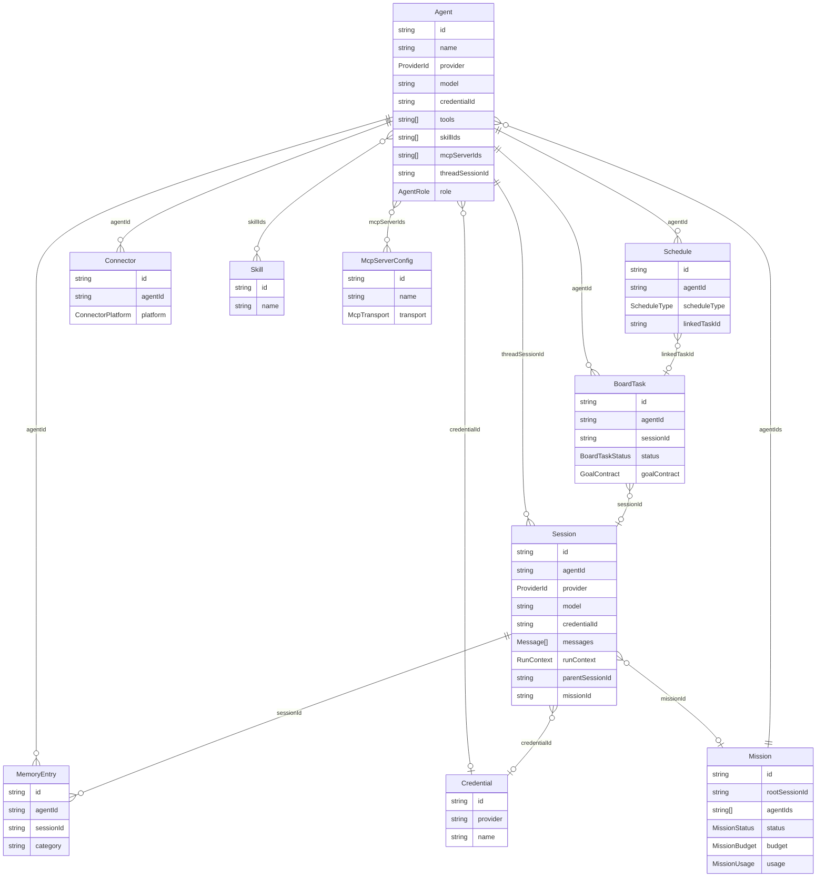
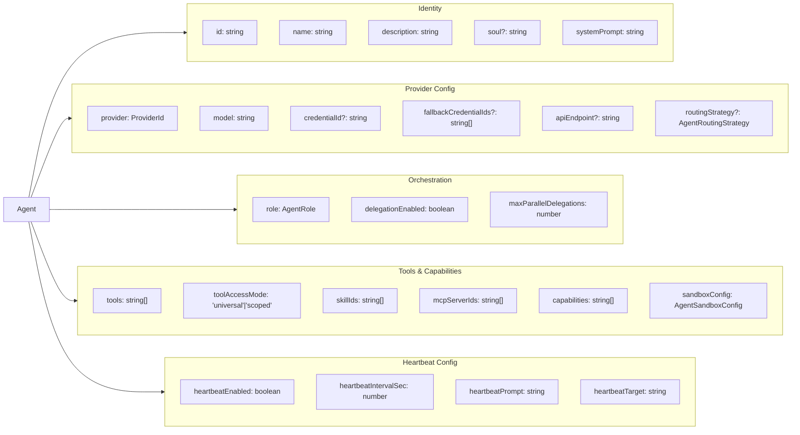
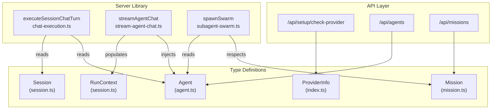

<!-- source: DeepWiki mcp.deepwiki.com · repo swarmclawai/swarmclaw · page 3.1 Core Data Model · fetched 2026-10-26 -->

# Core Data Model

Relevant source files

The following files were used as context for generating this wiki page:

- [src/app/api/missions/[id]/route.ts](src/app/api/missions/[id]/route.ts)
- [src/app/api/missions/route.ts](src/app/api/missions/route.ts)
- [src/app/api/setup/check-provider/route.ts](src/app/api/setup/check-provider/route.ts)
- [src/components/agents/agent-sheet.tsx](src/components/agents/agent-sheet.tsx)
- [src/lib/provider-sets.ts](src/lib/provider-sets.ts)
- [src/lib/providers/index.ts](src/lib/providers/index.ts)
- [src/lib/server/agents/agent-service.ts](src/lib/server/agents/agent-service.ts)
- [src/lib/server/agents/subagent-runtime.ts](src/lib/server/agents/subagent-runtime.ts)
- [src/lib/server/agents/subagent-swarm.test.ts](src/lib/server/agents/subagent-swarm.test.ts)
- [src/lib/server/agents/subagent-swarm.ts](src/lib/server/agents/subagent-swarm.ts)
- [src/lib/server/chat-execution/prompt-sections.planning-mode.test.ts](src/lib/server/chat-execution/prompt-sections.planning-mode.test.ts)
- [src/lib/server/chat-execution/prompt-sections.ts](src/lib/server/chat-execution/prompt-sections.ts)
- [src/lib/server/chat-execution/stream-agent-chat.ts](src/lib/server/chat-execution/stream-agent-chat.ts)
- [src/lib/server/context-manager.ts](src/lib/server/context-manager.ts)
- [src/lib/server/session-tools/subagent.ts](src/lib/server/session-tools/subagent.ts)
- [src/lib/server/storage-normalization.ts](src/lib/server/storage-normalization.ts)
- [src/lib/validation/schemas.test.ts](src/lib/validation/schemas.test.ts)
- [src/lib/validation/schemas.ts](src/lib/validation/schemas.ts)
- [src/types/agent.ts](src/types/agent.ts)
- [src/types/mission.ts](src/types/mission.ts)
- [src/types/provider.ts](src/types/provider.ts)
- [src/types/session.ts](src/types/session.ts)

This page documents the TypeScript interfaces that define the system-wide data contracts for SwarmClaw. All interfaces reside in [src/types/index.ts](), [src/types/agent.ts](), [src/types/session.ts](), [src/types/mission.ts](), [src/types/connector.ts](), and [src/types/misc.ts](). These types are shared across the UI layer, API routes, and server library, making them the canonical schema for all runtime objects.

This page covers *type definitions* only. For how these types are persisted in SQLite, see [Data Storage (3.2)](). For how `Agent` configuration flows into live sessions, see [Agent Configuration (4.1)](). For how `AppSettings` governs tool access and loop behavior, see [Chat Turn Execution (6.1)]().

---

## Entity Relationships

The following diagram shows how the primary runtime entities reference each other through their TypeScript fields.

**Entity relationship map for core types**

Sources: [src/types/agent.ts:42-185](), [src/types/session.ts:53-190](), [src/types/mission.ts:100-123](), [src/types/index.ts:40-112]()

---

## Agent

`Agent` is the persistent configuration record for an AI agent. It is stored as a JSON blob in `swarmclaw.db` under the `agents` collection.

**Agent interface fields**

Key field notes:
- `role`: `'worker'` or `'coordinator'`. Coordinators receive enhanced delegation prompts [src/types/agent.ts:31-66]().
- `toolAccessMode`: If `'scoped'`, tool guidance is restricted to the agent's specific toolset, reducing prompt overhead by up to 15k characters [src/types/agent.ts:80-83]().
- `planningMode`: If `'strict'`, the model must emit a `[MAIN_LOOP_PLAN]` block before multi-step actions [src/types/agent.ts:136-142]().
- `sandboxConfig`: Controls Docker-backed execution environments, including browser and filesystem isolation [src/types/agent.ts:154-185]().

Sources: [src/types/agent.ts:42-185](), [src/lib/server/chat-execution/prompt-sections.ts:89-118]()

---

## Session and RunContext

`Session` represents the runtime state of a conversation. Unlike the legacy `mainLoopState`, SwarmClaw uses a structured `RunContext` to manage working memory that flows through delegation.

| Field | Type | Description |
|---|---|---|
| `objective` | `string` | The active goal for the current run |
| `constraints` | `string[]` | Hard limits or rules to follow |
| `keyFacts` | `string[]` | Persistent facts discovered during the session |
| `currentPlan` | `string[]` | The agent's current step-by-step strategy |
| `blockers` | `string[]` | Issues preventing progress |

Sources: [src/types/session.ts:192-204]()

Notable `Session` fields:
- `sessionResetMode`: `'idle'`, `'daily'`, or `'isolated'`. Controls when conversation history is cleared [src/types/session.ts:5-111]().
- `connectorContext`: Stores platform-specific metadata like `channelId`, `senderId`, and `threadId` for inbound routing [src/types/session.ts:132-163]().
- `injectedMemoryIds`: A map tracking how many times specific memories have been recalled to prevent redundant prompt injection [src/types/session.ts:186-187]().

Sources: [src/types/session.ts:53-190]()

---

## Mission

`Mission` is a high-level entity for goal-driven, long-running agent activity. It aggregates usage and milestones across multiple sessions.

| Field | Type | Description |
|---|---|---|
| `budget` | `MissionBudget` | Limits on USD, tokens, tool calls, and wallclock time [src/types/mission.ts:25-38]() |
| `usage` | `MissionUsage` | Real-time tracking of consumed resources [src/types/mission.ts:40-49]() |
| `milestones` | `MissionMilestone[]` | Audit trail of significant events (budget warnings, subgoals) [src/types/mission.ts:51-59]() |
| `reportSchedule` | `MissionReportSchedule` | Config for automated progress reports (Slack, Discord, Email) [src/types/mission.ts:61-66]() |

Sources: [src/types/mission.ts:100-123]()

---

## Provider and Credential Types

`ProviderId` is the canonical identifier for LLM backends.

- **CLI Providers**: `claude-cli`, `codex-cli`, `opencode-cli`, etc. These manage their own tool execution [src/lib/provider-sets.ts:2-8]().
- **API Providers**: `openai`, `anthropic`, `google`, `deepseek`, `ollama`, `openclaw`, etc. [src/lib/providers/index.ts:54-207]().

`ProviderInfo` defines the capabilities of these backends:
| Field | Type | Description |
|---|---|---|
| `requiresApiKey` | `boolean` | If true, a `Credential` must be linked |
| `requiresEndpoint` | `boolean` | If true, a custom URL is mandatory (e.g., Ollama, OpenClaw) |
| `models` | `string[]` | List of supported model identifiers |

Sources: [src/lib/providers/index.ts:50-53](), [src/types/index.ts:19-38]()

---

## Type Consumption at Runtime

The following diagram maps key runtime paths to the type interfaces they consume.

**Type consumption by execution path**

Sources: [src/app/api/setup/check-provider/route.ts:10-34](), [src/lib/server/chat-execution/stream-agent-chat.ts:19-34](), [src/lib/server/agents/subagent-swarm.ts:155-163]()

---

