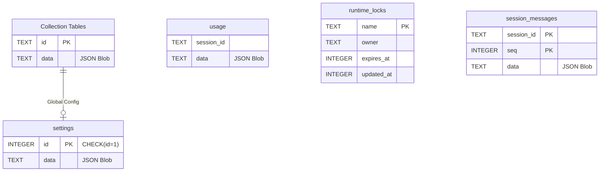
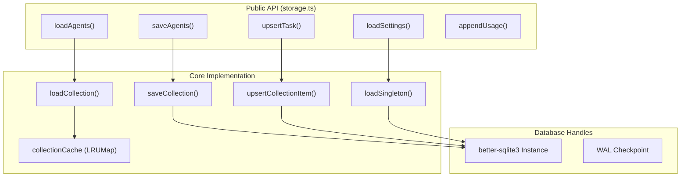
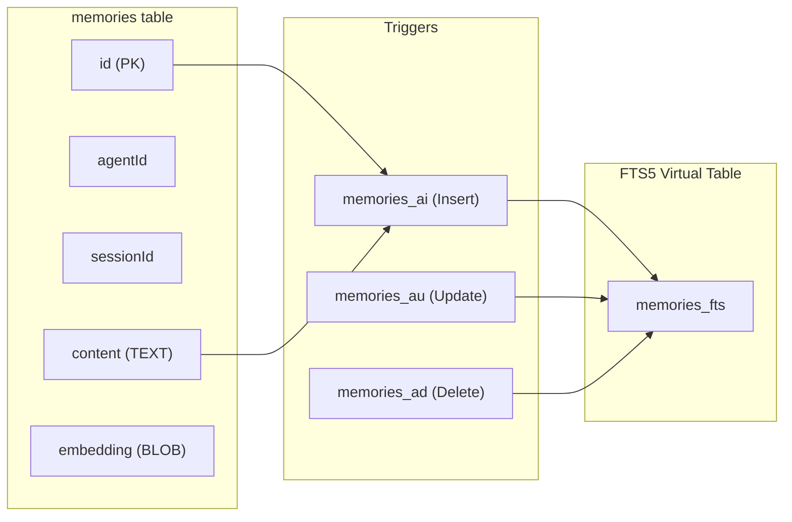

<!-- source: DeepWiki mcp.deepwiki.com · repo swarmclawai/swarmclaw · page 3.2 Data Storage · fetched 2026-10-26 -->

# Data Storage

Relevant source files

The following files were used as context for generating this wiki page:

- [.eslint-baseline.json](.eslint-baseline.json)
- [README.md](README.md)
- [package-lock.json](package-lock.json)
- [package.json](package.json)
- [src/app/api/missions/[id]/route.ts](src/app/api/missions/[id]/route.ts)
- [src/app/api/missions/route.ts](src/app/api/missions/route.ts)
- [src/cli/index.js](src/cli/index.js)
- [src/cli/spec.js](src/cli/spec.js)
- [src/lib/server/agents/subagent-runtime.ts](src/lib/server/agents/subagent-runtime.ts)
- [src/lib/server/agents/subagent-swarm.test.ts](src/lib/server/agents/subagent-swarm.test.ts)
- [src/lib/server/agents/subagent-swarm.ts](src/lib/server/agents/subagent-swarm.ts)
- [src/lib/server/data-dir.test.ts](src/lib/server/data-dir.test.ts)
- [src/lib/server/data-dir.ts](src/lib/server/data-dir.ts)
- [src/lib/server/missions/mission-templates.ts](src/lib/server/missions/mission-templates.ts)
- [src/lib/server/session-tools/subagent.ts](src/lib/server/session-tools/subagent.ts)
- [src/lib/server/storage-normalization.ts](src/lib/server/storage-normalization.ts)
- [src/lib/server/storage.ts](src/lib/server/storage.ts)
- [src/types/index.ts](src/types/index.ts)
- [src/types/mission.ts](src/types/mission.ts)

This page documents the three SQLite databases used by SwarmClaw, their schemas, the storage access layer in `src/lib/server/storage.ts`, the normalization engine, and the JSON-to-SQLite migration.

---

## Overview

SwarmClaw persists all state in three separate SQLite databases under the `DATA_DIR` (typically `data/` in the workspace or app-data directory):

| Database | File | Purpose |
|---|---|---|
| `swarmclaw.db` | `data/swarmclaw.db` | Operational state: agents, sessions, tasks, credentials, protocols, and configuration. |
| `memory.db` | `data/memory.db` | Per-agent and per-session memories with FTS5 search and vector embeddings. |
| `logs.db` | `data/logs.db` | Structured audit trail of chat turns and tool execution. |

All databases use Write-Ahead Logging (`WAL`) mode for concurrent performance and `synchronous = NORMAL` for a balance between speed and durability.

Sources: [src/lib/server/storage.ts:89-98](), [src/lib/server/data-dir.ts:1-20]()

---

## swarmclaw.db

This is the primary relational store for system entities. It utilizes a hybrid approach: most entities are stored as JSON blobs in collection tables for flexibility, while high-frequency data (like usage and locks) uses standard columns.

**Database schema diagram**

Sources: [src/lib/server/storage.ts:129-219]()

### Table Categories

#### Collection Tables
Over 50 tables (e.g., `agents`, `sessions`, `tasks`, `protocol_runs`, `connectors`) share the schema `(id TEXT PRIMARY KEY, data TEXT NOT NULL)`.
*   **Indexes:** SwarmClaw uses `json_extract` indexes for performance on frequent queries, such as `idx_protocol_run_events_runid` and `idx_activity_timestamp`.

Sources: [src/lib/server/storage.ts:188-200]()

#### Relational Message Storage
To optimize large chat histories, messages are extracted from session blobs into the `session_messages` table. This uses a composite primary key `(session_id, seq)` and the `WITHOUT ROWID` optimization for clustered storage.

Sources: [src/lib/server/storage.ts:214-219]()

#### Runtime Locking
The `runtime_locks` table manages distributed mutual exclusion for the background daemon and heartbeat services, ensuring only one instance (the "lease owner") processes autonomous tasks.

Sources: [src/lib/server/storage.ts:206-211](), [src/lib/server/storage-locks.ts:1-50]()

---

## Storage Access Layer (`storage.ts`)

The storage layer provides a unified API for interacting with `swarmclaw.db`, featuring an in-memory cache and atomic transactions.

**Natural Language Space to Code Entity Space: Storage API**

Sources: [src/lib/server/storage.ts:116-123](), [src/lib/server/storage.ts:231-365]()

### Storage Normalization
SwarmClaw performs "Storage Normalization" during every read and write. This ensures that data remains consistent even if schemas evolve or if legacy data is loaded.

*   **`normalizeStoredRecord`**: Dispatches to specific logic for agents, schedules, and connectors.
*   **Schedule Normalization**: Converts legacy `type` fields to `scheduleType` and ensures timestamps are valid integers.
*   **Agent Normalization**: Ensures `capabilityPolicy` and `sandbox` configurations meet system defaults.

Sources: [src/lib/server/storage-normalization.ts:12-22](), [src/lib/server/storage-normalization.ts:139-160]()

---

## JSON-to-SQLite Migration

On the first run of a new version, SwarmClaw detects if data is still in the legacy `.json` file format. If so, it triggers an atomic migration.

1.  **Detection**: Checks for `data/.sqlite_migrated`.
2.  **Transaction**: Opens an immediate transaction in `swarmclaw.db`.
3.  **Transfer**: Iterates through `JSON_FILES` (e.g., `agents.json`, `sessions.json`), parses the content, and performs `INSERT OR REPLACE` into the new SQLite tables.
4.  **Finalization**: Writes the `.sqlite_migrated` flag. Legacy JSON files are kept as backups.

Sources: [src/lib/server/storage.ts:143-228]()

---

## memory.db

The memory database stores long-term agent context, insights, and RAG (Retrieval-Augmented Generation) data.

**Memory Schema and FTS Integration**

Sources: [src/lib/server/memory-db.ts:333-402]()

### Hybrid Search Implementation
The `memory.db` supports hybrid search by combining:
*   **FTS5**: Full-text search for keyword matching in `title`, `content`, and `category`.
*   **Vector Search**: Cosine similarity against the `embedding` BLOB (computed using `@huggingface/transformers`).

Sources: [src/lib/server/memory-db.ts:755-808]()

---

## Runtime Locking Mechanism

To prevent race conditions in multi-process environments (like Electron + CLI or Docker clusters), SwarmClaw implements a lease-based locking system in `storage-locks.ts`.

*   **`tryAcquireRuntimeLock(name, owner, ttl)`**: Attempts to insert or update a lock. If the existing lock is expired, it takes ownership.
*   **`renewRuntimeLock(name, owner, ttl)`**: Updates the `expires_at` timestamp if the caller is the current owner.
*   **`isRuntimeLockActive(name)`**: Checks if a valid, unexpired lock exists for the given resource.

Sources: [src/lib/server/storage-locks.ts:14-48]()

---

