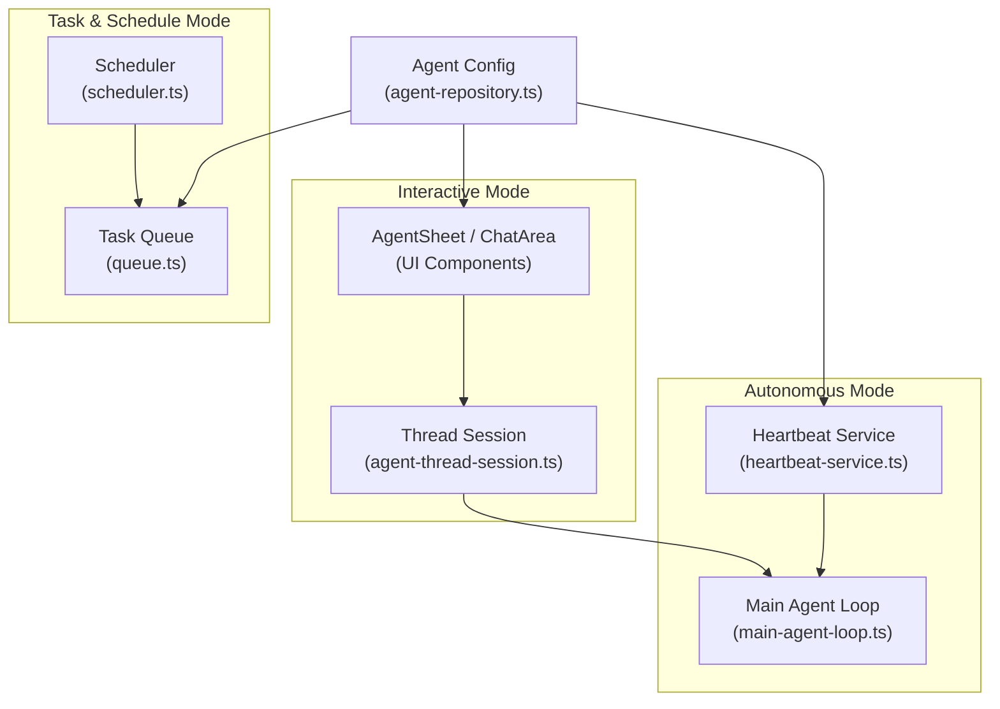

<!-- source: DeepWiki mcp.deepwiki.com · repo swarmclawai/swarmclaw · page 4 Agents · fetched 2026-10-26 -->

# Agents

<details>
<summary>Relevant source files</summary>

The following files were used as context for generating this wiki page:

- [src/app/api/settings/route.ts](src/app/api/settings/route.ts)
- [src/app/api/setup/check-provider/route.ts](src/app/api/setup/check-provider/route.ts)
- [src/app/settings/page.tsx](src/app/settings/page.tsx)
- [src/components/agents/agent-sheet.tsx](src/components/agents/agent-sheet.tsx)
- [src/lib/provider-sets.ts](src/lib/provider-sets.ts)
- [src/lib/providers/index.ts](src/lib/providers/index.ts)
- [src/lib/server/agents/agent-service.ts](src/lib/server/agents/agent-service.ts)
- [src/lib/server/agents/main-agent-loop-advanced.test.ts](src/lib/server/agents/main-agent-loop-advanced.test.ts)
- [src/lib/server/agents/main-agent-loop.ts](src/lib/server/agents/main-agent-loop.ts)
- [src/lib/server/chat-execution/post-stream-finalization.ts](src/lib/server/chat-execution/post-stream-finalization.ts)
- [src/lib/server/chat-execution/prompt-sections.planning-mode.test.ts](src/lib/server/chat-execution/prompt-sections.planning-mode.test.ts)
- [src/lib/server/chat-execution/prompt-sections.ts](src/lib/server/chat-execution/prompt-sections.ts)
- [src/lib/server/chat-execution/stream-agent-chat.ts](src/lib/server/chat-execution/stream-agent-chat.ts)
- [src/lib/server/context-manager.ts](src/lib/server/context-manager.ts)
- [src/lib/server/session-tools/search-providers.test.ts](src/lib/server/session-tools/search-providers.test.ts)
- [src/lib/server/session-tools/search-providers.ts](src/lib/server/session-tools/search-providers.ts)
- [src/lib/validation/schemas.test.ts](src/lib/validation/schemas.test.ts)
- [src/lib/validation/schemas.ts](src/lib/validation/schemas.ts)
- [src/types/agent.ts](src/types/agent.ts)
- [src/types/app-settings.ts](src/types/app-settings.ts)
- [src/types/approval.ts](src/types/approval.ts)
- [src/types/provider.ts](src/types/provider.ts)
- [src/types/session.ts](src/types/session.ts)
- [src/views/settings/section-web-search.tsx](src/views/settings/section-web-search.tsx)

</details>


This page covers what an agent is, the data model that defines one, how agents relate to providers, sessions, skills, and tools, and the distinct operational modes that agents support. For details on configuring agent properties in the UI, see [Agent Configuration](#4.1). For the agent registry and awareness injection, see [Agent Registry](#4.2). For the autonomous main loop, see [Main Agent Loop](#4.3). For orchestration between agents, see [Orchestration & Subagents](#4.4).

---

## What Is an Agent?

An **agent** is a named, persisted configuration that combines an LLM provider, a model, a system prompt, an optional personality ("soul"), and a set of tools and skills. Agents are the central organizing unit in SwarmClaw. Almost all chat turns, task executions, scheduled runs, and connector-routed messages are executed under the identity of an agent.

Agents are stored in `swarmclaw.db` under the `agents` collection key. The authoritative TypeScript definition is the `Agent` interface in [src/types/agent.ts:42-192]().

---

## Agent Data Model

**Agent interface field groups**

```mermaid
graph TB
    AgentNode["Agent\nsrc/types/agent.ts:42"]

    subgraph "Identity"
        id["id: string"]
        name["name: string"]
        description["description: string"]
        soul["soul?: string"]
        systemPrompt["systemPrompt: string"]
        avatarUrl["avatarUrl?: string"]
    end

    subgraph "Provider & Routing"
        provider["provider: ProviderId"]
        model["model: string"]
        routingStrategy["routingStrategy?: AgentRoutingStrategy"]
        routingTargets["routingTargets?: AgentRoutingTarget[]"]
        credentialId["credentialId?: string"]
        apiEndpoint["apiEndpoint?: string"]
    end

    subgraph "Tools & Skills"
        tools["tools?: string[]"]
        toolAccessMode["toolAccessMode: universal | scoped"]
        skillIds["skillIds?: string[]"]
        mcpServerIds["mcpServerIds?: string[]"]
        capabilities["capabilities?: string[]"]
    end

    subgraph "Autonomy & Loop"
        planningMode["planningMode: off | strict"]
        heartbeatEnabled["heartbeatEnabled?: boolean"]
        heartbeatIntervalSec["heartbeatIntervalSec?: number"]
        autoRecovery["autoRecovery: boolean"]
    end

    subgraph "Safety & Budget"
        monthlyBudget["monthlyBudget?: number"]
        dailyBudget["dailyBudget?: number"]
        budgetAction["budgetAction: warn | block"]
        filesystemScope["filesystemScope: workspace | machine"]
        sandboxConfig["sandboxConfig: AgentSandboxConfig"]
    end

    AgentNode --> Identity
    AgentNode --> "Provider & Routing"
    AgentNode --> "Tools & Skills"
    AgentNode --> "Autonomy & Loop"
    AgentNode --> "Safety & Budget"
```

Sources: [src/types/agent.ts:42-192](), [src/lib/validation/schemas.ts:73-137]()

---

### Key Field Reference

| Field | Type | Purpose |
|---|---|---|
| `id` | `string` | Unique identifier |
| `name` | `string` | Display name |
| `description` | `string` | Purpose summary; shown in agent directory and delegation hints |
| `soul` | `string?` | Personality / voice block; injected before the system prompt |
| `systemPrompt` | `string` | Core instruction set for the LLM |
| `provider` | `ProviderId` | Which LLM provider to use [src/types/provider.ts:1-2]() |
| `routingStrategy` | `string?` | Strategy for multi-model load balancing (e.g., `balanced`, `economy`) |
| `toolAccessMode` | `string` | `'universal'` (all tools) or `'scoped'` (restricted to `agent.tools`) |
| `planningMode` | `string?` | If `'strict'`, agent must emit a `[MAIN_LOOP_PLAN]` block [src/lib/server/chat-execution/prompt-sections.ts:97-118]() |
| `sandboxConfig` | `object` | Docker-based isolation settings for tool execution [src/lib/validation/schemas.ts:24-40]() |
| `heartbeatEnabled`| `boolean` | Whether the agent performs autonomous background actions |
| `autoRecovery` | `boolean` | If enabled, the system attempts to restart failed agent sessions |

Sources: [src/types/agent.ts:42-192](), [src/lib/server/agents/agent-service.ts:118-176]()

---

## Provider Identification

The `provider` field refers to either a built-in or custom provider. Built-in providers include:

```typescript
'claude-cli' | 'codex-cli' | 'opencode-cli' | 'gemini-cli' | 'copilot-cli' // Subprocess CLI
'openai' | 'anthropic' | 'google' | 'deepseek' | 'groq' | 'mistral'      // API
'ollama' | 'openclaw' | 'hermes'                                         // Local/Gateway
```

[src/types/provider.ts:1-2]()

Certain providers are classified as **non-LangGraph** or **native-capability** providers because they manage their own tool execution loop internally (e.g., `claude-cli`, `hermes`).

Sources: [src/lib/provider-sets.ts:1-15](), [src/lib/providers/index.ts:54-133]()

---

## Tools and Capabilities

Agents access tools through `extensions` and `tools` lists. These are resolved at runtime into active toolsets.

- **Standard Tools:** Shell, Files, Web Search, Browser, Memory, Sandbox.
- **Platform Tools:** Manage Agents, Tasks, Schedules, Connectors, Sessions.
- **MCP Tools:** Dynamically injected from Model Context Protocol servers.

The `toolAccessMode` [src/types/agent.ts:83]() allows agents to operate in a `scoped` mode, which drastically reduces prompt overhead by only providing documentation for tools specifically listed in the agent's configuration.

Sources: [src/components/agents/agent-sheet.tsx:14](), [src/lib/server/chat-execution/prompt-sections.ts:152-165]()

---

## Operational Modes

Agents can operate in multiple concurrent modes depending on their configuration and the triggers received.

**Agent Invocation Pathways**



Sources: [src/lib/server/agents/agent-service.ts:70-94](), [src/lib/server/agents/main-agent-loop.ts:34-82](), [src/lib/server/chat-execution/stream-agent-chat.ts:1-100]()

| Mode | Trigger | Core Logic |
|---|---|---|
| **Interactive** | User Chat | `streamAgentChat` in [src/lib/server/chat-execution/stream-agent-chat.ts]() |
| **Autonomous** | Heartbeat Tick | `tickHeartbeats` calls the `MainLoopState` processor |
| **Scheduled** | Cron/Interval | `enqueueTask` assigns a `BoardTask` to the agent |
| **Orchestrated** | Subagent Spawn | `createOrchestratorSession` in `orchestrator-lg.ts` |

---

## Main Agent Loop

When an agent operates autonomously, it maintains a `MainLoopState`. This state tracks the current **GoalContract**, a **momentum score**, and a **timeline** of events.

```typescript
export interface MainLoopState {
  goal: string | null;
  status: 'idle' | 'progress' | 'blocked' | 'ok';
  momentumScore: number;
  planSteps: string[];
  pendingEvents: Array<{ type: string; text: string }>;
  // ...
}
```

The loop parses the agent's output for specific tags like `[MAIN_LOOP_PLAN]` or `[AUTONOMY_TICK]` to update its internal representation of progress.

Sources: [src/lib/server/agents/main-agent-loop.ts:34-82](), [src/lib/server/agents/main-agent-loop.ts:155-186]()

---

## Agent Registry and Awareness

The system maintains a registry that computes agent availability in real-time. This is used to build the **Agent Awareness Block**, which is injected into every agent's system prompt so they know which peers are available for delegation.

- **Idle:** No active tasks or sessions.
- **Working:** Currently processing a task or has an active chat session.

Sources: [src/lib/server/agents/agent-service.ts:70-94](), [src/lib/server/chat-execution/prompt-sections.ts:24-34]()

---

## Safety and Sandboxing

Agents can be restricted using several safety mechanisms:
1. **Budgets:** Hourly, daily, and monthly USD limits [src/lib/validation/schemas.ts:133-136]().
2. **Filesystem Scope:** Restricting file operations to the `workspace` or allowing `machine` access [src/types/agent.ts:143-151]().
3. **Docker Sandbox:** Running tools inside an isolated container with CPU and Memory limits [src/lib/validation/schemas.ts:24-40]().
4. **Governance:** Requiring human approval for high-impact actions (e.g., `orchestratorGovernance: 'approval-required'`) [src/lib/validation/schemas.ts:114]().

Sources: [src/types/agent.ts:143-182](), [src/lib/validation/schemas.ts:5-40]()

---

