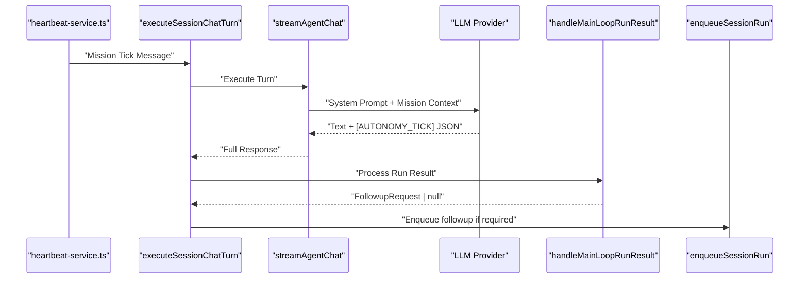
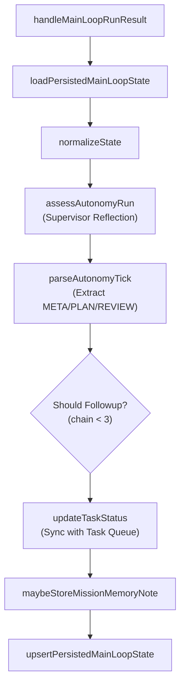

<!-- source: DeepWiki mcp.deepwiki.com · repo swarmclawai/swarmclaw · page 4.3 Main Agent Loop · fetched 2026-10-26 -->

# Main Agent Loop

<details>
<summary>Relevant source files</summary>

The following files were used as context for generating this wiki page:

- [src/app/api/settings/route.ts](src/app/api/settings/route.ts)
- [src/app/settings/page.tsx](src/app/settings/page.tsx)
- [src/lib/server/agents/main-agent-loop-advanced.test.ts](src/lib/server/agents/main-agent-loop-advanced.test.ts)
- [src/lib/server/agents/main-agent-loop.ts](src/lib/server/agents/main-agent-loop.ts)
- [src/lib/server/autonomy/supervisor-reflection.test.ts](src/lib/server/autonomy/supervisor-reflection.test.ts)
- [src/lib/server/autonomy/supervisor-reflection.ts](src/lib/server/autonomy/supervisor-reflection.ts)
- [src/lib/server/chat-execution/chat-execution.ts](src/lib/server/chat-execution/chat-execution.ts)
- [src/lib/server/chat-execution/chat-streaming-utils.ts](src/lib/server/chat-execution/chat-streaming-utils.ts)
- [src/lib/server/chat-execution/continuation-evaluator.ts](src/lib/server/chat-execution/continuation-evaluator.ts)
- [src/lib/server/chat-execution/message-classifier.ts](src/lib/server/chat-execution/message-classifier.ts)
- [src/lib/server/chat-execution/post-stream-finalization.ts](src/lib/server/chat-execution/post-stream-finalization.ts)
- [src/lib/server/chat-execution/prompt-builder.ts](src/lib/server/chat-execution/prompt-builder.ts)
- [src/lib/server/chat-execution/stream-agent-chat.test.ts](src/lib/server/chat-execution/stream-agent-chat.test.ts)
- [src/lib/server/chat-execution/stream-continuation.ts](src/lib/server/chat-execution/stream-continuation.ts)
- [src/lib/server/memory/memory-policy.ts](src/lib/server/memory/memory-policy.ts)
- [src/lib/server/memory/temporal-decay.ts](src/lib/server/memory/temporal-decay.ts)
- [src/lib/server/session-tools/memory.ts](src/lib/server/session-tools/memory.ts)
- [src/lib/server/session-tools/search-providers.test.ts](src/lib/server/session-tools/search-providers.test.ts)
- [src/lib/server/session-tools/search-providers.ts](src/lib/server/session-tools/search-providers.ts)
- [src/types/app-settings.ts](src/types/app-settings.ts)
- [src/types/approval.ts](src/types/approval.ts)
- [src/views/settings/section-web-search.tsx](src/views/settings/section-web-search.tsx)

</details>


This page documents the autonomous main agent loop: the `MainLoopState` structure, how it is updated after each LLM run, how the agent communicates structured state back through `[MAIN_LOOP_META]` annotations, and how chained follow-up requests are generated to keep autonomous work progressing. The main loop is specific to sessions identified as main sessions; for how those sessions are triggered by the heartbeat service, see [Heartbeat Service](#11.2).

---

## Overview

The main agent loop is the mechanism by which a single session can execute autonomously over an extended period. Instead of waiting for user input, it runs on a heartbeat cadence. After each LLM turn, the response is parsed for structured annotations that update persisted loop state and may schedule an immediate follow-up turn.

All logic lives in [src/lib/server/agents/main-agent-loop.ts]().

**Main Session Identity:** A session is a main loop session if it has associated `MainLoopState`. The `isMainSession` function at [src/lib/server/agents/main-agent-loop.ts:713-715]() enforces this check.

---

## MainLoopState

`MainLoopState` is the full persisted state of one main loop session. It is stored in the `main_loop_state` table in `swarmclaw.db` and managed via a repository. The state is synchronized with the session's working state to ensure consistency across the agent's memory and execution context.

| Field | Type | Description |
|---|---|---|
| `goal` | `string \| null` | Current mission goal |
| `goalContract` | `GoalContract \| null` | Structured goal contract with objective, constraints, budget, deadline |
| `status` | `'idle' \| 'progress' \| 'blocked' \| 'ok'` | High-level mission status |
| `summary` | `string \| null` | Latest LLM-provided summary of work done |
| `nextAction` | `string \| null` | Next concrete action queued for the next tick |
| `planSteps` | `string[]` | Ordered plan steps |
| `completedPlanSteps` | `string[]` | Steps from the plan that have been finished |
| `currentPlanStep` | `string \| null` | The plan step currently being executed |
| `momentumScore` | `number` | 0–100 computed health indicator |
| `paused` | `boolean` | Whether autonomous ticks are suppressed |
| `autonomyMode` | `'assist' \| 'autonomous'` | Whether the agent operates with or without explicit confirmation |
| `pendingEvents` | `Array` | External events queued for the agent (max 16) |
| `timeline` | `Array` | Ordered audit trail of state transitions (max 40) |
| `followupChainCount` | `number` | How many chained follow-ups have fired consecutively |
| `lifetimeIterations` | `number` | Total iterations this loop has run (max 200) |
| `workingMemoryNotes` | `string[]` | Short notes accumulated in the current loop (max 12) |
| `updatedAt` | `number` | Timestamp of last state save |

Sources: [src/lib/server/agents/main-agent-loop.ts:34-82](), [src/lib/server/agents/main-agent-loop.ts:155-186]()

---

## GoalContract

`GoalContract` is a structured description of the mission. It is often derived from user message text by `parseGoalContractFromText` or explicitly provided via the project/goal system.

| Field | Type | Description |
|---|---|---|
| `objective` | `string` | The primary goal to be achieved |
| `constraints` | `string[]` | Operational limits or rules to follow |
| `budgetUsd` | `number \| null` | Spending limit in USD |
| `deadlineAt` | `number \| null` | Unix timestamp deadline |
| `successMetric` | `string \| null` | How to measure completion |

Sources: [src/types/app-settings.ts:7-13](), [src/lib/server/agents/main-agent-loop.ts:19-20]()

---

## Loop Execution Flow

The main loop is driven by the heartbeat service, which calls `executeSessionChatTurn`. After each turn completes, `handleMainLoopRunResult` processes the output to update the `MainLoopState` and determine if a continuation is required.

**Tick Message Lifecycle Diagram**



Sources: [src/lib/server/agents/main-agent-loop.ts:473-585](), [src/lib/server/chat-execution/chat-execution.ts:49-171]()

---

## Agent Protocol: META, PLAN, REVIEW Annotations

The agent signals structured state back through specially formatted lines in its response. These are parsed out after each turn and stripped from the persistent message history.

### `[AUTONOMY_TICK]` / `[AGENT_HEARTBEAT_META]`

The primary control line. It allows the agent to update its high-level state within the response text.

```
[AUTONOMY_TICK] {"status":"progress","summary":"...","nextAction":"...","goal":"updated goal"}
```

| Field | Description |
|---|---|
| `status` | Updated mission status (`progress`, `blocked`, `ok`, `idle`) |
| `summary` | Brief description of what was done |
| `nextAction` | Concrete next step to execute |
| `planSteps` | Updated list of steps for the mission |
| `needsReplan` | Boolean indicating the agent should rethink its approach |

### `[MAIN_LOOP_PLAN]` & `[MAIN_LOOP_REVIEW]`

Used for detailed plan updates and post-step reflections. These are parsed by utility functions in `autonomy-contract.ts` [src/lib/server/agents/main-agent-loop.ts:4-5]().

Sources: [src/lib/server/agents/main-agent-loop.ts:22-24](), [src/lib/server/agents/main-agent-loop.ts:341-370]()

---

## handleMainLoopRunResult

`handleMainLoopRunResult` is the core post-processing function. It updates the loop state, performs supervisor assessment, and manages the follow-up chain.

**Key Function and Data Flow Diagram**



Sources: [src/lib/server/agents/main-agent-loop.ts:473-585](), [src/lib/server/autonomy/supervisor-reflection.ts:195-208]()

### Follow-up Chain

The loop supports chaining turns to allow the agent to perform multi-step work without waiting for the next heartbeat tick.

| Constant | Value | Description |
|---|---|---|
| `DEFAULT_MAX_FOLLOWUP_CHAIN` | `3` | Maximum consecutive chained turns |
| `DEFAULT_FOLLOWUP_DELAY_MS` | `1500` | Delay between chained turns |
| `MAX_LIFETIME_ITERATIONS` | `200` | Total safety cap for a loop's life |

The chain resets to `0` when the agent returns a terminal status (`ok`) or when the user sends a new message [src/lib/server/agents/main-agent-loop.ts:28-30]().

---

## Momentum Score

`computeMomentumScore` summarizes loop health into a 0–100 integer. It is recalculated after every run.

| Condition | Effect |
|---|---|
| `status = 'ok'` | High momentum (94+) |
| `status = 'progress'` | Steady momentum (72+) |
| `status = 'blocked'` | Low momentum (20) |
| `metaMissCount` | Penalty per turn without structured meta |
| `pendingEvents` | Penalty for unhandled external events |

Sources: [src/lib/server/agents/main-agent-loop.ts:161-173]()

---

## Supervisor Reflection

The main loop integrates with `assessAutonomyRun` to detect "thrashing" or lack of progress. If the supervisor detects repeated tool failures or repeated shell commands with the same output, it can inject an `interventionPrompt` or force a replan [src/lib/server/autonomy/supervisor-reflection.ts:57-66]().

### Autonomy Assessment
The assessment results in an `AutonomyAssessment` object containing:
- **Incidents:** Detected issues like `repeated_tool` or `no_progress`.
- **Auto Actions:** Instructions to `block`, `replan`, or `budget_trim`.
- **Intervention Prompt:** Guidance injected into the next turn to steer the agent out of a loop.

Sources: [src/lib/server/autonomy/supervisor-reflection.ts:195-208](), [src/lib/server/autonomy/supervisor-reflection.test.ts:45-87]()

---

## Public API Reference

| Function | Exported | Role |
|---|---|---|
| `handleMainLoopRunResult` | Yes | Processes LLM output and manages loop transitions. |
| `getMainLoopStateForSession` | Yes | Retrieves and normalizes state for a session. |
| `pushMainLoopEvent` | Yes | Adds external events to the `pendingEvents` queue. |
| `syncWorkingStateFromMainLoopState` | Yes | Updates the agent's internal working memory. |
| `buildExecutionBrief` | Yes | Generates a prompt summary for the loop's context. |

Sources: [src/lib/server/agents/main-agent-loop.ts:473-1017](), [src/lib/server/working-state/service.ts:15]()

---

