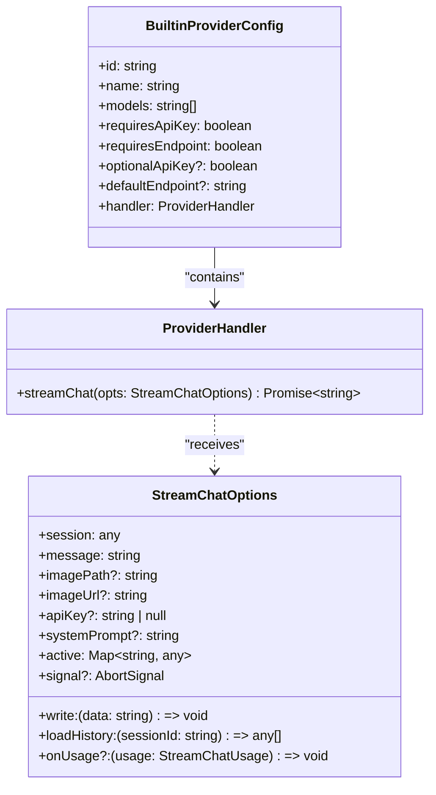
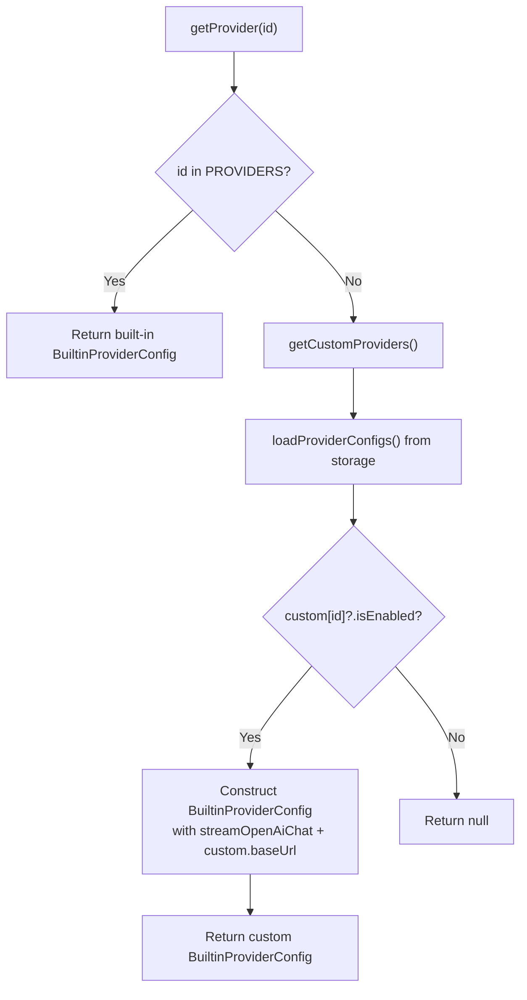
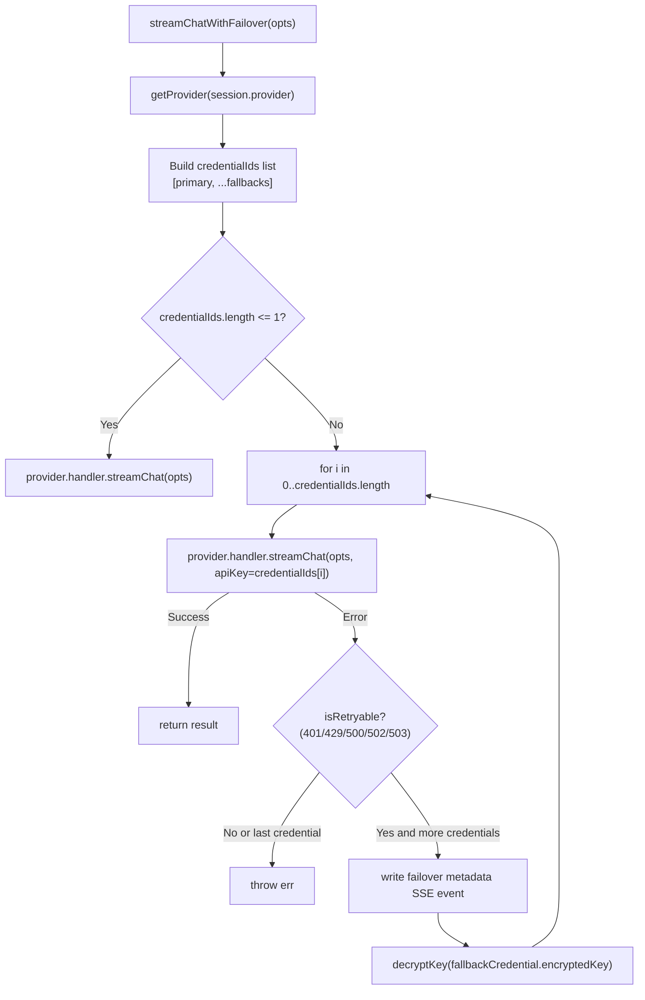
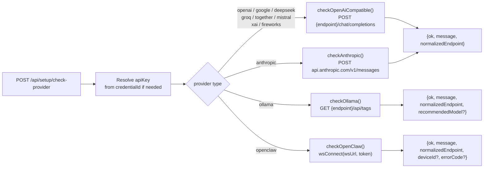

<!-- source: DeepWiki mcp.deepwiki.com · repo swarmclawai/swarmclaw · page 5 LLM Providers · fetched 2026-10-26 -->

# LLM Providers

<details>
<summary>Relevant source files</summary>

The following files were used as context for generating this wiki page:

- [src/app/api/setup/check-provider/route.ts](src/app/api/setup/check-provider/route.ts)
- [src/components/agents/agent-sheet.tsx](src/components/agents/agent-sheet.tsx)
- [src/components/providers/provider-sheet.tsx](src/components/providers/provider-sheet.tsx)
- [src/features/providers/queries.ts](src/features/providers/queries.ts)
- [src/lib/provider-sets.ts](src/lib/provider-sets.ts)
- [src/lib/providers/anthropic.ts](src/lib/providers/anthropic.ts)
- [src/lib/providers/index.ts](src/lib/providers/index.ts)
- [src/lib/providers/ollama.ts](src/lib/providers/ollama.ts)
- [src/lib/providers/openai.ts](src/lib/providers/openai.ts)
- [src/lib/providers/provider-defaults.ts](src/lib/providers/provider-defaults.ts)
- [src/lib/server/agents/agent-runtime-config.test.ts](src/lib/server/agents/agent-runtime-config.test.ts)
- [src/lib/server/build-llm.test.ts](src/lib/server/build-llm.test.ts)
- [src/lib/server/build-llm.ts](src/lib/server/build-llm.ts)
- [src/lib/server/chat-execution/chat-turn-state.test.ts](src/lib/server/chat-execution/chat-turn-state.test.ts)
- [src/lib/server/chat-execution/chat-turn-state.ts](src/lib/server/chat-execution/chat-turn-state.ts)
- [src/lib/server/context-manager.ts](src/lib/server/context-manager.ts)
- [src/lib/server/messages/message-repository.ts](src/lib/server/messages/message-repository.ts)
- [src/lib/server/provider-endpoint.ts](src/lib/server/provider-endpoint.ts)
- [src/types/provider.ts](src/types/provider.ts)
- [src/types/session.ts](src/types/session.ts)

</details>


This page documents the provider abstraction layer in SwarmClaw: how providers are registered and resolved, what interfaces they implement, how credentials and fallback keys are managed, and how the failover mechanism works. It covers the top-level registry in `src/lib/providers/index.ts` and the shared types used by all providers.

For per-provider implementation details, see the child pages:
- API-based providers (Anthropic, OpenAI, Gemini, etc.) — see [API Providers](#5.1)
- CLI subprocess providers (Claude Code, Codex, OpenCode) — see [CLI Providers](#5.2)
- Local and gateway providers (Ollama, OpenClaw) — see [Local & Gateway Providers](#5.3)

For how a provider is selected and invoked during a chat turn, see [Chat Turn Execution](#6.1).

---

## Provider Abstraction

All provider implementations satisfy the `ProviderHandler` interface, and are registered in a static `PROVIDERS` map. The rest of the system interacts with providers only through the exported functions `getProvider`, `getProviderList`, and `streamChatWithFailover`.

**Provider abstraction interfaces**



Sources: [src/lib/providers/index.ts:24-61]()

The `write` callback in `StreamChatOptions` is the SSE emission function — providers stream deltas by calling `write(data)` with Server-Sent Event formatted strings via `writeSSE` [src/lib/providers/provider-defaults.ts:29-31](). The `active` map allows callers to cancel an in-flight request by session ID [src/lib/providers/openai.ts:70-70]().

---

## Provider Registry

The `PROVIDERS` constant in `src/lib/providers/index.ts` is a static `Record<string, BuiltinProviderConfig>` mapping provider IDs to their configurations and handler implementations. It is evaluated at module load time.

**Built-in provider registry**

| Provider ID | Display Name | API Key | Endpoint | Handler |
|---|---|---|---|---|
| `claude-cli` | Claude Code CLI | No | No | `streamClaudeCliChat` |
| `codex-cli` | OpenAI Codex CLI | No | No | `streamCodexCliChat` |
| `opencode-cli` | OpenCode CLI | No | No | `streamOpenCodeCliChat` |
| `openai` | OpenAI | Yes | Optional | `streamOpenAiChat` |
| `anthropic` | Anthropic | Yes | Optional | `streamAnthropicChat` |
| `google` | Google Gemini | Yes | Optional | `streamOpenAiChat` (patched) |
| `deepseek` | DeepSeek | Yes | Optional | `streamOpenAiChat` (patched) |
| `groq` | Groq | Yes | Optional | `streamOpenAiChat` (patched) |
| `together` | Together AI | Yes | Optional | `streamOpenAiChat` (patched) |
| `mistral` | Mistral AI | Yes | Optional | `streamOpenAiChat` (patched) |
| `xai` | xAI (Grok) | Yes | Optional | `streamOpenAiChat` (patched) |
| `fireworks` | Fireworks AI | Yes | Optional | `streamOpenAiChat` (patched) |
| `ollama` | Ollama | Optional | Yes | `streamOllamaChat` |
| `openclaw` | OpenClaw | Optional | Yes | `streamOpenClawChat` |

Sources: [src/lib/providers/index.ts:54-221]()

Several API providers (Google, DeepSeek, Groq, Together, Mistral, xAI, Fireworks) are implemented by patching the session's `apiEndpoint` to their respective base URLs and delegating to the shared `streamOpenAiChat` function [src/lib/providers/index.ts:213-221](). This is because they all expose OpenAI-compatible `/chat/completions` endpoints.

---

## How Providers Are Resolved

Two public functions control provider lookup:

**`getProvider(id: string): BuiltinProviderConfig | null`**

Looks up a provider by ID. First checks the built-in `PROVIDERS` map. If not found, it attempts to resolve custom providers from storage [src/lib/providers/index.ts:263-285](). If a matching custom provider is found and `isEnabled`, it returns a dynamically constructed `BuiltinProviderConfig` that patches the session endpoint with the custom `baseUrl` and uses `streamOpenAiChat`.

**`getProviderList(): ProviderInfo[]`**

Returns the complete list of providers for display in the UI. It applies model list overrides via `loadModelOverrides()` [src/lib/providers/index.ts:233-260]() and appends active custom providers from storage.

**Provider resolution flow**



Sources: [src/lib/providers/index.ts:263-285]()

---

## Failover: `streamChatWithFailover`

The `streamChatWithFailover` function wraps a normal provider `streamChat` call with automatic credential rotation on retryable errors.

**Signature:**
```typescript
streamChatWithFailover(
  opts: StreamChatOptions & { fallbackCredentialIds?: string[] }
): Promise<string>
```

**Retry logic:**

1. Builds a list of credential IDs: `[session.credentialId, ...fallbackCredentialIds]` [src/lib/providers/index.ts:302-302]().
2. Iterates credentials in order. On a retryable error, decrypts the next fallback credential using `decryptKey` from storage, emits a `{ t: 'md', failover: {...} }` metadata SSE event to the client, and retries [src/lib/providers/index.ts:333-345]().
3. Non-retryable errors are re-thrown immediately.

**Retryable status codes** (defined as `RETRYABLE_STATUS_CODES`): `401`, `429`, `500`, `502`, `503`. Additionally, any error whose message contains `"rate limit"` or `"429"` or `"401"` is treated as retryable [src/lib/providers/index.ts:354-362]().



Sources: [src/lib/providers/index.ts:287-352]()

---

## Custom Providers

Users can add any OpenAI-compatible endpoint as a custom provider via the UI. Custom providers are stored in the `provider_configs` table in `swarmclaw.db` [src/lib/server/storage.ts:19-19]().

A custom provider config (`ProviderConfig` from `src/types/provider.ts`) contains:
- `id` — unique provider identifier
- `name` — display name
- `baseUrl` — OpenAI-compatible base URL
- `models` — list of model IDs
- `isEnabled` — soft-delete toggle

When resolved via `getProvider`, custom providers get a dynamically constructed handler that injects `baseUrl` into the session as `apiEndpoint` and calls `streamOpenAiChat` [src/lib/providers/index.ts:281-283]().

Sources: [src/types/provider.ts:43-54](), [src/lib/providers/index.ts:263-285]()

---

## Provider Health Checks

The `/api/setup/check-provider` route provides live connection validation for all provider types. This is used by the `SetupWizard` and the `AgentSheet` "Test Connection" button [src/components/agents/agent-sheet.tsx:8-8]().

**Validation strategies per provider type:**

| Provider Type | Validation Method |
|---|---|
| OpenAI-compatible | `POST /chat/completions` with a minimal prompt. [src/app/api/setup/check-provider/route.ts:105-118]() |
| `anthropic` | `POST /v1/messages` with a minimal prompt. [src/app/api/setup/check-provider/route.ts:133-147]() |
| `ollama` | `GET /api/tags` (local) or `/v1/models` (cloud). [src/app/api/setup/check-provider/route.ts:189-193]() |
| `openclaw` | WebSocket handshake via `wsConnect()`. [src/app/api/setup/check-provider/route.ts:223-223]() |



Sources: [src/app/api/setup/check-provider/route.ts:1-237]()

---

## LangChain Integration

For complex agentic workflows (LangGraph), SwarmClaw uses `buildChatModel` to construct LangChain-compatible model instances.

- **Anthropic**: Uses `ChatAnthropic` [src/lib/server/build-llm.ts:78-93]().
- **OpenAI & Others**: Uses `ChatOpenAI` with custom `baseURL` [src/lib/server/build-llm.ts:114-140]().
- **Ollama**: Uses `ChatOpenAI` with local or cloud endpoints [src/lib/server/build-llm.ts:95-111]().

Sources: [src/lib/server/build-llm.ts:59-140]()

---

