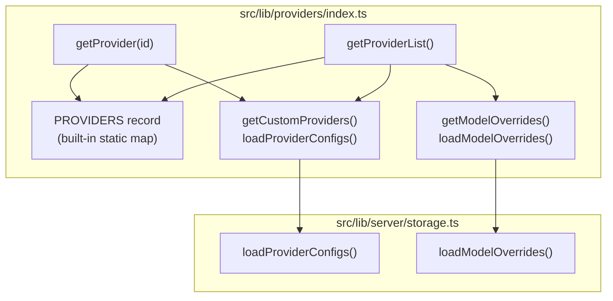
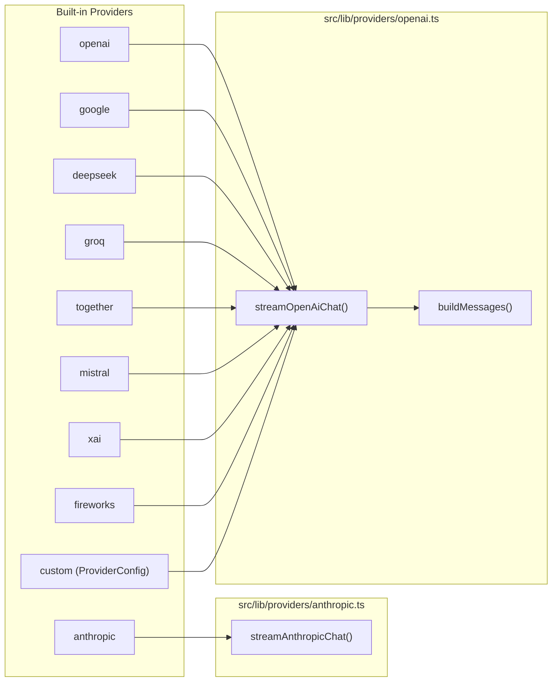

<!-- source: DeepWiki mcp.deepwiki.com · repo swarmclawai/swarmclaw · page 5.1 API Providers · fetched 2026-10-26 -->

# API Providers

Relevant source files

The following files were used as context for generating this wiki page:

- [src/components/providers/provider-sheet.tsx](src/components/providers/provider-sheet.tsx)
- [src/features/providers/queries.ts](src/features/providers/queries.ts)
- [src/lib/agent-provider-options.ts](src/lib/agent-provider-options.ts)
- [src/lib/providers/anthropic.ts](src/lib/providers/anthropic.ts)
- [src/lib/providers/error-classification.test.ts](src/lib/providers/error-classification.test.ts)
- [src/lib/providers/error-classification.ts](src/lib/providers/error-classification.ts)
- [src/lib/providers/openai.ts](src/lib/providers/openai.ts)
- [src/lib/server/provider-endpoint.ts](src/lib/server/provider-endpoint.ts)

This page documents the built-in API-based LLM providers: Anthropic, OpenAI, Google Gemini, DeepSeek, Groq, Mistral AI, xAI (Grok), Fireworks AI, Together AI, and the Custom OpenAI-compatible provider type. It covers provider registration, model lists, endpoint configuration, the shared OpenAI-compatible streaming implementation, and credential failover behavior.

For CLI-based providers (claude-cli, codex-cli, opencode-cli), see [CLI Providers](#5.2). For Ollama and the OpenClaw gateway, see [Local & Gateway Providers](#5.3). For the broader provider abstraction layer and failover orchestration, see [LLM Providers](#5).

---

## Provider Registration

All built-in providers are declared in the `PROVIDERS` record in [src/lib/providers/index.ts:31-221](). Each entry implements the `BuiltinProviderConfig` interface, which extends `ProviderInfo` with a `handler` field of type `ProviderHandler`.

**Key types:**

| Type | Location | Description |
|---|---|---|
| `ProviderInfo` | [src/types/index.ts:36-47]() | Public-facing provider metadata (id, name, models, flags) |
| `BuiltinProviderConfig` | [src/lib/providers/index.ts:27-29]() | Extends `ProviderInfo` with a `handler` |
| `ProviderHandler` | [src/lib/providers/index.ts:12-14]() | Object with a single `streamChat(opts)` method |
| `StreamChatOptions` | [src/lib/providers/index.ts:16-25]() | Arguments passed to every `streamChat` call |

**Provider lifecycle diagram:**

Sources: [src/lib/providers/index.ts:31-284](), [src/lib/server/storage.ts:100-110]()

---

## Built-in API Providers

### Provider Reference Table

| Provider ID | Display Name | Default Endpoint | `requiresApiKey` | Handler |
|---|---|---|---|---|
| `anthropic` | Anthropic | `api.anthropic.com/v1/messages` | `true` | `streamAnthropicChat` |
| `openai` | OpenAI | `api.openai.com/v1` | `true` | `streamOpenAiChat` |
| `google` | Google Gemini | `generativelanguage.googleapis.com/v1beta/openai` | `true` | `streamOpenAiChat` |
| `deepseek` | DeepSeek | `api.deepseek.com/v1` | `true` | `streamOpenAiChat` |
| `groq` | Groq | `api.groq.com/openai/v1` | `true` | `streamOpenAiChat` |
| `together` | Together AI | `api.together.xyz/v1` | `true` | `streamOpenAiChat` |
| `mistral` | Mistral AI | `api.mistral.ai/v1` | `true` | `streamOpenAiChat` |
| `xai` | xAI (Grok) | `api.x.ai/v1` | `true` | `streamOpenAiChat` |
| `fireworks` | Fireworks AI | `api.fireworks.ai/inference/v1` | `true` | `streamOpenAiChat` |

Sources: [src/lib/providers/index.ts:48-200]()

---

### Model Lists

Each provider's default model list is declared inline in the `PROVIDERS` record. Model lists can be overridden per-instance via the `model_overrides` table in `swarmclaw.db` (loaded by `getModelOverrides()` in [src/lib/providers/index.ts:233-240]()).

| Provider | Default Models |
|---|---|
| `anthropic` | `claude-sonnet-4-6`, `claude-opus-4-6`, `claude-haiku-4-5-20251001` |
| `openai` | `gpt-4o`, `gpt-4o-mini`, `gpt-4.1`, `gpt-4.1-mini`, `gpt-4.1-nano`, `o3`, `o3-mini`, `o4-mini` |
| `google` | `gemini-2.5-pro`, `gemini-2.5-flash`, `gemini-2.5-flash-lite` |
| `deepseek` | `deepseek-chat`, `deepseek-reasoner` |
| `groq` | `llama-3.3-70b-versatile`, `deepseek-r1-distill-llama-70b`, `qwen-qwq-32b`, `gemma2-9b-it` |
| `together` | `meta-llama/Llama-4-Maverick-17B-128E-Instruct-FP8`, `deepseek-ai/DeepSeek-R1`, `Qwen/Qwen2.5-72B-Instruct` |
| `mistral` | `mistral-large-latest`, `mistral-small-latest`, `magistral-medium-2506`, `devstral-small-latest` |
| `xai` | `grok-3`, `grok-3-fast`, `grok-3-mini`, `grok-3-mini-fast` |
| `fireworks` | `accounts/fireworks/models/deepseek-r1-0528`, `accounts/fireworks/models/llama-v3p3-70b-instruct`, `accounts/fireworks/models/qwen3-235b-a22b` |

Sources: [src/lib/providers/index.ts:48-200]()

---

## Custom OpenAI-Compatible Providers

Users can add arbitrary OpenAI-compatible endpoints through the UI via the `ProviderSheet` component [src/components/providers/provider-sheet.tsx:21-250](). These are stored as `ProviderConfig` objects and loaded by `loadProviderConfigs()` [src/lib/server/storage.ts:100-110]().

When `getProvider(id)` is called with an ID that does not match a built-in, it falls back to `getCustomProviders()` [src/lib/providers/index.ts:263-284](). If a matching entry is found and `isEnabled` is `true`, a synthetic `BuiltinProviderConfig` is returned with a handler delegating to `streamOpenAiChat`.

**Key features for Custom Providers:**
- **Base URL Support:** Custom endpoints (e.g., local proxies, specialized gateways) can be specified [src/lib/providers/openai.ts:57-58]().
- **Credential Linking:** Custom providers can be linked to specific credentials [src/lib/agent-provider-options.ts:18-32]().
- **Model Discovery:** Built-in support for discovering models via the `/models` endpoint [src/features/providers/queries.ts:142-146]().

Sources: [src/lib/providers/index.ts:223-284](), [src/lib/agent-provider-options.ts:18-32]()

---

## Handler Implementations

**Provider-to-handler mapping diagram:**

Sources: [src/lib/providers/index.ts:48-200](), [src/lib/providers/openai.ts:47-152]()

### `streamOpenAiChat`

The shared handler for all OpenAI-compatible providers [src/lib/providers/openai.ts:47-152]().

**Behavior:**
1. **Message Assembly:** Calls `buildMessages()` to construct the message array, handling image attachments by converting them to base64 `image_url` parts [src/lib/providers/openai.ts:9-23]().
2. **Stream Options Retry:** Attempts to request usage statistics via `stream_options: { include_usage: true }`. If the provider returns a 400 error, it automatically retries without this field [src/lib/providers/openai.ts:80-105]().
3. **SSE Parsing:** Reads the response stream line-by-line. It extracts `content` from `choices[0].delta` and usage information from the `usage` field if present [src/lib/providers/openai.ts:162-210]().
4. **HTML Detection:** Explicitly checks if the provider returned an HTML landing page instead of a JSON API response, which often happens with misconfigured proxies [src/lib/providers/openai.ts:115-122]().

**Attachment handling:**
- **Images:** `.png`, `.jpg`, `.jpeg`, `.gif`, `.webp` are converted to base64 [src/lib/providers/openai.ts:12-23]().
- **PDFs:** Uses `pdf-parse` to extract text content, truncated to `PDF_MAX_CHARS` [src/lib/providers/openai.ts:24-37]().
- **Text:** Standard text files are inlined [src/lib/providers/openai.ts:38-43]().

Sources: [src/lib/providers/openai.ts:9-210]()

### `streamAnthropicChat`

The Anthropic provider implementation [src/lib/providers/anthropic.ts:27-153]().

**Behavior:**
- **Native Protocol:** Uses the `x-api-key` and `anthropic-version: 2023-06-01` headers [src/lib/providers/anthropic.ts:65-66]().
- **System Prompt:** Anthropic expects the system prompt as a top-level property rather than a message [src/lib/providers/anthropic.ts:42-44]().
- **Usage Tracking:** Parses `message_start` and `message_delta` events to track `input_tokens` and `output_tokens` [src/lib/providers/anthropic.ts:120-125]().

Sources: [src/lib/providers/anthropic.ts:27-153]()

---

## Error Classification & Failover

SwarmClaw includes a robust error classification system to determine if an API failure is transient or permanent.

### `classifyProviderError`

Defined in [src/lib/providers/error-classification.ts:26-58](), this function maps HTTP status codes and error message strings to `FailoverReason` types.

| Status | Reason | Retryable | Rotate Credential |
|---|---|---|---|
| 401 | `auth` | Yes | Yes |
| 402 | `billing` | No | Yes |
| 403 | `auth_permanent` | No | No |
| 429 | `rate_limit` | Yes | Yes |
| 400 (Context) | `context_overflow` | Yes | No |
| 5xx | `overloaded` | Yes | Yes |

The `CONTEXT_OVERFLOW_RE` regex matches patterns like "too many tokens" or "context length exceeded" [src/lib/providers/error-classification.ts:4-5]().

Sources: [src/lib/providers/error-classification.ts:1-79]()

### `streamChatWithFailover`

This wrapper orchestrates the retry logic [src/lib/providers/index.ts:291-352]().

1. **Credential Resolution:** Resolves the primary `credentialId` and any fallback keys.
2. **Execution Loop:** Attempts the chat turn. If a retryable error occurs (classified by `classifyProviderError`), it selects the next available credential.
3. **Metadata Feedback:** Emits `t: 'md'` (metadata) events to the stream to notify the UI that a failover has occurred.

Sources: [src/lib/providers/index.ts:291-352]()

---

## Connection Validation

The `POST /api/setup/check-provider` endpoint validates credentials during setup or agent configuration [src/app/api/setup/check-provider/route.ts:18-237]().

**Validation Flow:**
- **OpenAI-Compatible:** Performs a `GET /models` request. If successful, it returns the list of available models [src/app/api/setup/check-provider/route.ts:64-89]().
- **Anthropic:** Performs a minimal `POST /v1/messages` call with a 1-token max limit to verify the API key without significant cost [src/app/api/setup/check-provider/route.ts:91-115]().

Sources: [src/app/api/setup/check-provider/route.ts:18-237]()

---

