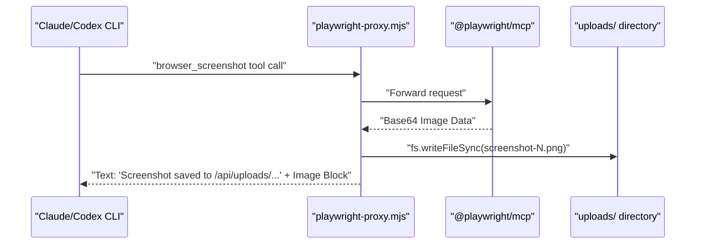

<!-- source: DeepWiki mcp.deepwiki.com · repo swarmclawai/swarmclaw · page 5.2 CLI Providers · fetched 2026-10-26 -->

# CLI Providers

<details>
<summary>Relevant source files</summary>

The following files were used as context for generating this wiki page:

- [scripts/codex-login-noninteractive.sh](scripts/codex-login-noninteractive.sh)
- [src/app/api/memory/[id]/route.ts](src/app/api/memory/[id]/route.ts)
- [src/app/globals.css](src/app/globals.css)
- [src/components/agents/agent-list.tsx](src/components/agents/agent-list.tsx)
- [src/lib/providers/claude-cli.ts](src/lib/providers/claude-cli.ts)
- [src/lib/providers/cli-utils.ts](src/lib/providers/cli-utils.ts)
- [src/lib/providers/codex-cli.ts](src/lib/providers/codex-cli.ts)
- [src/lib/providers/copilot-cli.ts](src/lib/providers/copilot-cli.ts)
- [src/lib/providers/opencode-web.test.ts](src/lib/providers/opencode-web.test.ts)
- [src/lib/providers/opencode-web.ts](src/lib/providers/opencode-web.ts)
- [src/lib/server/connectors/connector-inbound.ts](src/lib/server/connectors/connector-inbound.ts)
- [src/lib/server/playwright-proxy.mjs](src/lib/server/playwright-proxy.mjs)
- [src/lib/server/provider-health.ts](src/lib/server/provider-health.ts)
- [src/lib/server/runtime/heartbeat-service.test.ts](src/lib/server/runtime/heartbeat-service.test.ts)
- [src/lib/server/runtime/heartbeat-service.ts](src/lib/server/runtime/heartbeat-service.ts)
- [src/lib/server/runtime/process-manager.ts](src/lib/server/runtime/process-manager.ts)
- [src/lib/server/session-tools/context.ts](src/lib/server/session-tools/context.ts)

</details>


CLI providers in SwarmClaw are subprocess-based LLM adapters that operate by spawning external binaries (like `claude`, `codex`, or `copilot`) and parsing their output streams. Unlike API-based providers that use HTTP requests, these providers bypass the standard LangGraph `streamAgentChat` pipeline and instead delegate the entire agentic loop to the external CLI tool.

---

## Architecture and Execution Flow

CLI providers are registered in the `PROVIDERS` record and identified by the absence of `requiresApiKey` or `requiresEndpoint` constraints in their definition. In `executeSessionChatTurn`, the system detects if a provider is a CLI tool and calls its handler directly.

### CLI Execution Pipeline

The diagram below shows how a chat turn is routed from the API to a subprocess.

```mermaid
flowchart TD
    subgraph "Natural Language Space"
        UserMsg["User Message / Prompt"]
    end

    subgraph "Code Entity Space: src/lib/server/chat-execution/"
        ECT["executeSessionChatTurn"]
        BRANCH{"Provider Type?"}
        SAC["streamAgentChat\n(LangGraph Loop)"]
    end

    subgraph "Code Entity Space: src/lib/providers/"
        CPCLI["streamCopilotCliChat"]
        CCLI["streamClaudeCliChat"]
        DCLI["streamCodexCliChat"]
        UTILS["cli-utils.ts\n(resolveCliBinary, probeCliAuth)"]
    end

    subgraph "OS / Process Space"
        BIN["External Binary\n(claude / codex / copilot)"]
        STDOUT["JSON Stream (Stdout)"]
    end

    UserMsg --> ECT
    ECT --> BRANCH
    BRANCH -->|"API Provider"| SAC
    BRANCH -->|"CLI Provider"| CPCLI
    BRANCH -->| "CLI Provider"| CCLI
    BRANCH -->| "CLI Provider"| DCLI

    CPCLI & CCLI & DCLI --> UTILS
    UTILS -->|"spawn()"| BIN
    BIN --> STDOUT
    STDOUT -->|"JSON.parse()"| ECT
```
Sources: [src/lib/providers/index.ts:32-81](), [src/lib/providers/claude-cli.ts:13-16](), [src/lib/providers/copilot-cli.ts:16-19]()

---

## Common CLI Infrastructure (`cli-utils.ts`)

To maintain consistency, CLI providers utilize a shared utility layer for binary discovery, authentication checks, and environment preparation.

| Function | Purpose | Implementation Detail |
|---|---|---|
| `resolveCliBinary` | Discovery | Searches `PATH` and known installation directories (Brew, NPM global, etc.) |
| `probeCliAuth` | Preflight | Runs a non-interactive status command (e.g., `claude auth status`) to verify session validity |
| `buildCliEnv` | Isolation | Cleans `process.env` and sets `TERM=dumb` and `NO_COLOR=1` to ensure machine-readable output |
| `attachAbortHandler` | Lifecycle | Maps the SwarmClaw `AbortSignal` to a `SIGKILL` on the child process |

Sources: [src/lib/providers/cli-utils.ts:1-50](), [src/lib/providers/claude-cli.ts:9-15]()

---

## Provider Implementations

### 1. Claude CLI (`claude-cli`)
Spawns the Anthropic `claude` binary with `--output-format stream-json`.

*   **Auth Check:** Runs `claude auth status` before spawning. If `loggedIn` is false, it terminates early. [src/lib/providers/claude-cli.ts:61-66]()
*   **MCP Integration:** If the `browser` tool is enabled, it generates a temporary MCP config pointing to `playwright-proxy.mjs` and passes it via `--mcp-config`. [src/lib/providers/claude-cli.ts:41-56]()
*   **Session Resumption:** Captures `session_id` from the stdout JSON stream and persists it to `session.claudeSessionId` for use with the `--resume` flag in subsequent turns. [src/lib/providers/claude-cli.ts:114-120]()

### 2. Codex CLI (`codex-cli`)
Spawns the `codex` binary (OpenAI-based).

*   **Sandbox Bypass:** Uses `--dangerously-bypass-approvals-and-sandbox` because SwarmClaw manages its own Docker-based isolation. [src/lib/providers/codex-cli.ts:39-39]()
*   **Reasoning Effort:** Automatically adds `-c model_reasoning_effort="high"` for GPT-5 class models. [src/lib/providers/codex-cli.ts:42-44]()
*   **System Prompts:** Writes the system prompt to a temporary `AGENTS.override.md` in a unique `CODEX_HOME` directory. [src/lib/providers/codex-cli.ts:89-91]()

### 3. Copilot CLI (`copilot-cli`)
Spawns the GitHub Copilot CLI (`copilot`).

*   **Environment:** Injects `GH_TOKEN` from the session's API key if available. [src/lib/providers/copilot-cli.ts:28-30]()
*   **Continuity:** Tracks `session.copilotSessionId` from streamed events and resumes via `--resume`. [src/lib/providers/copilot-cli.ts:51-51]()
*   **JSON Parsing:** Parses `assistant.message_delta` events to extract streaming content. [src/lib/providers/copilot-cli.ts:161-164]()

---

## Playwright Proxy for Browser Tools

For CLI tools that support the Model Context Protocol (MCP), SwarmClaw provides a proxy (`src/lib/server/playwright-proxy.mjs`) that intercepts browser actions.


Sources: [src/lib/server/playwright-proxy.mjs:1-98]()

---

## Provider Health and Ranking

The `provider-health.ts` module manages the availability of these CLI tools. It maintains a cache of which binaries are installed and authenticated to prevent "hallucinating" that a tool is available when the binary is missing from the host.

*   **`commandExists(binary)`**: Probes the OS using `where` (Windows) or `command -v` (Unix) with a 30s TTL cache. [src/lib/server/provider-health.ts:42-53]()
*   **`delegateToolReady(tool)`**: Performs deep health checks, such as running `auth status` for Claude or Codex to ensure the user is logged in. [src/lib/server/provider-health.ts:129-161]()
*   **`rankDelegatesByHealth(order)`**: Reorders a list of requested CLI delegates based on their current availability and cooldown status. [src/lib/server/provider-health.ts:174-181]()

Sources: [src/lib/server/provider-health.ts:1-181]()

---

## Data Flow: Streaming JSON Parsing

CLI providers must transform fragmented stdout chunks into valid JSON events.

1.  **Buffering:** Raw chunks are appended to a local `buf` string. [src/lib/providers/claude-cli.ts:98-106]()
2.  **Line Splitting:** The buffer is split by `\n`. The last incomplete segment is retained in the buffer. [src/lib/providers/claude-cli.ts:105-106]()
3.  **Event Handling:** Each line is passed to `JSON.parse()`.
    *   `delta` events are immediately sent to the UI via `write()`.
    *   `session_id` events update the session record in the database.
    *   `error` events trigger a UI error notification and process termination.

Sources: [src/lib/providers/claude-cli.ts:108-150](), [src/lib/providers/codex-cli.ts:178-210]()

---

