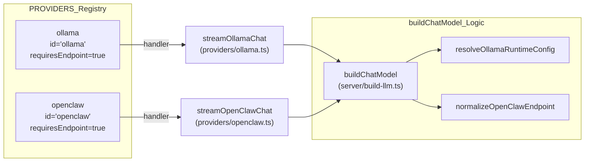
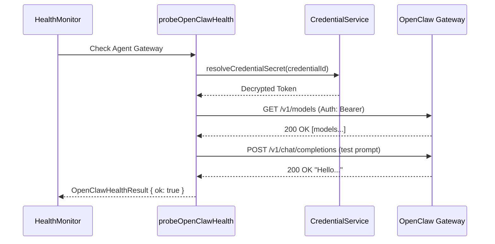

<!-- source: DeepWiki mcp.deepwiki.com · repo swarmclawai/swarmclaw · page 5.3 Local & Gateway Providers · fetched 2026-10-26 -->

# Local & Gateway Providers

Relevant source files

The following files were used as context for generating this wiki page:

- [bin/update-cmd.test.js](bin/update-cmd.test.js)
- [src/app/api/gateways/[id]/health/route.ts](src/app/api/gateways/[id]/health/route.ts)
- [src/app/api/gateways/health-route.test.ts](src/app/api/gateways/health-route.test.ts)
- [src/app/api/setup/check-provider/helpers.ts](src/app/api/setup/check-provider/helpers.ts)
- [src/app/api/setup/check-provider/route.test.ts](src/app/api/setup/check-provider/route.test.ts)
- [src/lib/ollama-mode.test.ts](src/lib/ollama-mode.test.ts)
- [src/lib/ollama-mode.ts](src/lib/ollama-mode.ts)
- [src/lib/providers/ollama.ts](src/lib/providers/ollama.ts)
- [src/lib/providers/provider-defaults.ts](src/lib/providers/provider-defaults.ts)
- [src/lib/server/agents/agent-runtime-config.test.ts](src/lib/server/agents/agent-runtime-config.test.ts)
- [src/lib/server/build-llm.test.ts](src/lib/server/build-llm.test.ts)
- [src/lib/server/build-llm.ts](src/lib/server/build-llm.ts)
- [src/lib/server/chat-execution/chat-turn-state.test.ts](src/lib/server/chat-execution/chat-turn-state.test.ts)
- [src/lib/server/chat-execution/chat-turn-state.ts](src/lib/server/chat-execution/chat-turn-state.ts)
- [src/lib/server/chat-execution/chat-turn-tool-routing.ts](src/lib/server/chat-execution/chat-turn-tool-routing.ts)
- [src/lib/server/messages/message-repository.ts](src/lib/server/messages/message-repository.ts)
- [src/lib/server/ollama-runtime.ts](src/lib/server/ollama-runtime.ts)
- [src/lib/server/openclaw/health.ts](src/lib/server/openclaw/health.ts)

This page documents the non-API provider types in SwarmClaw: **Ollama** (local inference) and **OpenClaw** (per-agent gateway). These providers share the architectural property of requiring an endpoint URL instead of a mandatory global API key. While Ollama provides local model serving, OpenClaw serves as a gateway to other autonomous instances.

---

## Provider Registration

Both providers are registered in the central `PROVIDERS` map. Their entries share distinguishing properties compared to API providers:

| Property | Ollama | OpenClaw |
|---|---|---|
| `requiresApiKey` | `false` | `false` |
| `optionalApiKey` | `true` | `true` |
| `requiresEndpoint` | `true` | `true` |
| `defaultEndpoint` | `http://localhost:11434` | `http://localhost:18789` |
| Handler | `streamOllamaChat` | `streamOpenClawChat` |

**Model selection behavior:**
- **Ollama:** Uses a curated list of ~30 models in the registry as a fallback, but prefers live discovery during setup.
- **OpenClaw:** Always defaults to the model string `'default'`, as the gateway handles model selection internally.

**Diagram: Provider Registry Mapping**

Sources: [src/lib/server/build-llm.ts:74-76](), [src/lib/server/build-llm.ts:95-111](), [src/lib/providers/provider-defaults.ts:2-7]()

---

## Ollama

### Overview
Ollama runs inference locally and exposes an API. SwarmClaw interacts with it via `streamOllamaChat` in `src/lib/providers/ollama.ts` [src/lib/providers/ollama.ts:16-152](). It supports two operational modes: `local` and `cloud`.

### Ollama Runtime Mode
The `resolveOllamaRuntimeConfig` function determines how to connect to Ollama based on the agent or session configuration [src/lib/server/ollama-runtime.ts:23-53]().

- **Local Mode:** Connects to the local daemon (default `http://localhost:11434`). The `apiKey` is set to the string `'ollama'` by default if not provided [src/lib/server/build-llm.ts:105-105]().
- **Cloud Mode:** Connects to `https://ollama.com/v1`. This mode requires an API key, resolved from environment variables like `OLLAMA_API_KEY` or attached credentials [src/lib/server/ollama-runtime.ts:13-21]().
- **Endpoint Normalization:** For cloud mode, `normalizeOllamaCloudEndpoint` rewrites `api.ollama.com` to `ollama.com` to prevent 301 redirects that might drop authorization headers [src/lib/ollama-mode.ts:25-27]().

### Connection Check and Model Discovery
During setup, the system performs a live health check.
1. **Ollama Tags:** Sends a request to `{endpoint}/api/tags` to list installed models.
2. **Recommended Model:** The check returns the first available model (e.g., `qwen3.5` or `llama3`) to pre-fill the configuration.
3. **OpenAI Compatibility:** Even though Ollama has a native `/api/chat` protocol, SwarmClaw's `buildChatModel` configures a `ChatOpenAI` instance pointing to the Ollama endpoint for standardized tool calling and streaming [src/lib/server/build-llm.ts:103-110]().

Sources: [src/lib/server/ollama-runtime.ts:23-53](), [src/lib/ollama-mode.ts:29-36](), [src/lib/server/build-llm.ts:95-111]()

---

## OpenClaw Gateway

### Overview
OpenClaw is treated as a **per-agent** gateway. Each agent can be configured with a unique `apiEndpoint` and `gatewayProfileId`. This allows a single SwarmClaw instance to orchestrate a fleet of remote OpenClaw nodes.

### Per-Agent Endpoint Configuration
The `apiEndpoint` and `credentialId` fields on the `Agent` or `Session` object carry the gateway URL and optional bearer token [src/lib/server/build-llm.ts:150-160]().

- **Content-Type Bypass:** OpenClaw endpoints often sit behind proxies. SwarmClaw sets `Content-Type: text/plain` for OpenClaw requests to bypass body-parsers in middle-layer proxies (like Express) while the gateway still parses the payload as JSON [src/lib/server/build-llm.ts:135-137]().

### Health Checking via `probeOpenClawHealth`
The system monitors OpenClaw liveness using `probeOpenClawHealth` [src/lib/server/openclaw/health.ts:149-245](). This is a multi-stage probe:
1. **Model Listing:** Attempts to fetch available models from `{endpoint}/models`.
2. **Chat Probe:** Executes a minimal, non-streaming chat completion request (`max_tokens: 12`) to verify end-to-end inference capability.
3. **Credential Resolution:** If a `credentialId` is provided, it is decrypted at runtime to authorize the probe [src/lib/server/openclaw/health.ts:30-41]().

**Diagram: OpenClaw Health Probe Flow**

Sources: [src/lib/server/openclaw/health.ts:149-245](), [src/lib/server/build-llm.ts:74-77](), [src/lib/server/build-llm.ts:135-137]()

### OpenClaw WebSocket/RPC Protocol
For real-time status and autonomous coordination, SwarmClaw uses the OpenClaw WebSocket protocol.
- **Handshake:** Uses a challenge-response mechanism to establish identity.
- **Normalization:** Endpoints are normalized via `normalizeOpenClawEndpoint` to ensure correct trailing slashes and `/v1` suffixes [src/lib/server/build-llm.ts:49-52]().
- **Routing:** Agents configured with the `openclaw` provider can have their traffic routed through specific `GatewayProfile` objects which manage the WebSocket lifecycle and credential attachment [src/lib/server/agents/agent-runtime-config.ts:43-63]().

Sources: [src/lib/server/build-llm.ts:49-52](), [src/lib/server/agents/agent-runtime-config.ts:43-63](), [src/lib/server/agents/agent-runtime-config.ts:110-131]()

---

