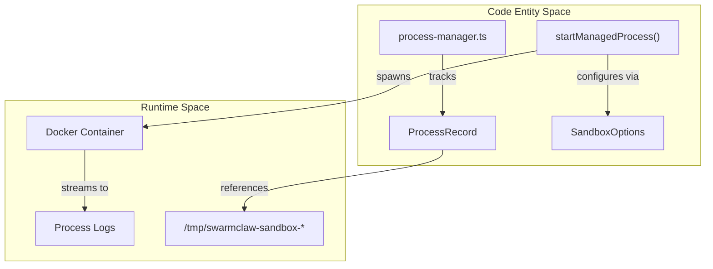
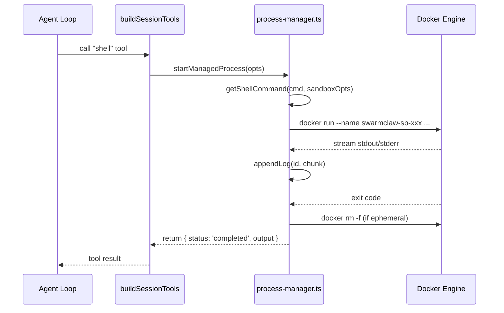

<!-- source: DeepWiki mcp.deepwiki.com · repo swarmclawai/swarmclaw · page 7.2 Sandbox Execution · fetched 2026-10-26 -->

# Sandbox Execution

Relevant source files

The following files were used as context for generating this wiki page:

- [scripts/postinstall.mjs](scripts/postinstall.mjs)
- [scripts/postinstall.test.mjs](scripts/postinstall.test.mjs)
- [src/app/api/mcp-servers/[id]/test/route.ts](src/app/api/mcp-servers/[id]/test/route.ts)
- [src/app/api/mcp-servers/route.test.ts](src/app/api/mcp-servers/route.test.ts)
- [src/components/mcp-servers/mcp-server-list.tsx](src/components/mcp-servers/mcp-server-list.tsx)
- [src/lib/providers/cli-utils.ts](src/lib/providers/cli-utils.ts)
- [src/lib/server/connectors/whatsapp.test.ts](src/lib/server/connectors/whatsapp.test.ts)
- [src/lib/server/mcp-connection-pool.test.ts](src/lib/server/mcp-connection-pool.test.ts)
- [src/lib/server/mcp-connection-pool.ts](src/lib/server/mcp-connection-pool.ts)
- [src/lib/server/provider-health.ts](src/lib/server/provider-health.ts)
- [src/lib/server/runtime/heartbeat-service.test.ts](src/lib/server/runtime/heartbeat-service.test.ts)
- [src/lib/server/runtime/heartbeat-service.ts](src/lib/server/runtime/heartbeat-service.ts)
- [src/lib/server/runtime/process-manager.ts](src/lib/server/runtime/process-manager.ts)
- [src/lib/server/sandbox/session-runtime.test.ts](src/lib/server/sandbox/session-runtime.test.ts)
- [src/lib/server/session-tools/context.ts](src/lib/server/session-tools/context.ts)
- [src/lib/server/session-tools/index.ts](src/lib/server/session-tools/index.ts)
- [src/proxy.ts](src/proxy.ts)

This page documents the Docker-based sandbox system: how code and browsers are isolated, the lifecycle of containers, the bridge between the host and sandbox filesystems, and the isolation model.

---

## Overview

SwarmClaw utilizes a Docker-based sandbox system to provide secure, isolated environments for executing arbitrary code and running web browsers. Unlike simple subprocess execution, the sandbox system provides resource limits (CPU/Memory), network isolation, and a clean filesystem state for every session.

The sandbox system is divided into two primary runtimes:
1.  **Session Runtime**: Manages persistent or ephemeral containers for shell and code execution via `process-manager.ts`.
2.  **Browser Runtime**: Manages isolated Playwright/Chromium instances with CDP (Chrome DevTools Protocol) and noVNC access.

---

## Sandbox Registry and Lifecycle

The `process-manager.ts` acts as the central registry for all managed processes and their associated sandbox containers.

### Container Lifecycle
When a tool requests a sandboxed execution, the `process-manager` handles the following flow:
1.  **Initialization**: Generates a unique `processId` and container name (e.g., `swarmclaw-sb-XXXXXX`) [src/lib/server/runtime/process-manager.ts:189-189]().
2.  **Execution**: Spawns a Docker container using `docker run` for ephemeral tasks or `docker exec` for persistent ones [src/lib/server/runtime/process-manager.ts:170-219]().
3.  **Monitoring**: Tracks the PID, exit code, and logs. It uses a `sigkillTimer` to escalate `SIGTERM` to `SIGKILL` if a process hangs [src/lib/server/runtime/process-manager.ts:13-13](), [src/lib/server/runtime/process-manager.ts:119-123]().
4.  **Cleanup**: For ephemeral sandboxes, the container is forcibly removed (`docker rm -f`) immediately after the process ends [src/lib/server/runtime/process-manager.ts:124-127](), [src/lib/server/runtime/process-manager.ts:129-136]().

### Prune Logic
The system includes a cleanup mechanism to prevent orphaned containers. The `postinstall.mjs` script ensures the required sandbox images are present [scripts/postinstall.mjs:78-82](), while runtime managers like `sweepOrphanedBrowsers` in the web tools module handle periodic cleanup of stale browser containers [src/lib/server/session-tools/index.ts:19-19]().

**Diagram: Process Manager Entity Map**

Sources: [src/lib/server/runtime/process-manager.ts:18-35](), [src/lib/server/runtime/process-manager.ts:56-68](), [src/lib/server/runtime/process-manager.ts:221-221]()

---

## Session Runtime (SandboxMode & Scope)

The session runtime supports two modes of operation defined in `SandboxOptions` [src/lib/server/runtime/process-manager.ts:56-56]():

| Mode | Type | Description |
| :--- | :--- | :--- |
| **Ephemeral** | `EphemeralSandboxOptions` | A fresh container is created for every command and destroyed immediately after. |
| **Persistent** | `PersistentSandboxOptions` | A named container that persists across multiple tool calls within a session. |

### Isolation Model
The isolation is enforced through Docker flags constructed in `getShellCommand` [src/lib/server/runtime/process-manager.ts:170-219]():
*   **CPU/Memory Limits**: Configurable via `memoryMb` and `cpus` [src/lib/server/runtime/process-manager.ts:41-42]().
*   **Network Isolation**: The `network` flag can be set to `none` to completely disable internet access [src/lib/server/runtime/process-manager.ts:40-40]().
*   **Security Options**: Uses `--security-opt=no-new-privileges` and `--pids-limit` to prevent fork bombs and privilege escalation [src/lib/server/runtime/process-manager.ts:196-197]().
*   **Read-Only Root**: Optionally mounts the root filesystem as read-only, using a `tmpfs` for `/tmp` [src/lib/server/runtime/process-manager.ts:200-202]().

### FS-Bridge (Workspace Mounts)
The sandbox bridges the host filesystem to the container using `workspaceMounts`. By default, the current project workspace is mounted to `/workspace` inside the container [src/lib/server/runtime/process-manager.ts:204-213]().
*   **Filesystem Scope**: Controlled via `filesystemScope` ('workspace' vs 'machine') [src/lib/server/session-tools/context.ts:97-98]().
*   **Path Validation**: `safePath` ensures that agents cannot use path traversal to escape the mounted directories [src/lib/server/session-tools/context.ts:116-141]().

---

## Browser Runtime

The browser runtime provides a sandboxed environment for web browsing, specifically designed for agents using Playwright.

### Implementation Details
*   **Browser Bridge**: Managed via `buildWebTools` [src/lib/server/session-tools/index.ts:19-19]().
*   **CDP Endpoint**: The sandbox exposes a Chrome DevTools Protocol port, allowing the host-side Playwright client to control the browser inside the container.
*   **noVNC**: For debugging and human-in-the-loop observation, the sandbox container typically runs a VNC server bridged to a web-based noVNC client.
*   **Lifecycle**: Browsers are cleaned up via `cleanupSessionBrowser` when a session ends or the tool is disposed [src/lib/server/session-tools/index.ts:74-74]().

**Diagram: Sandbox Execution Data Flow**

Sources: [src/lib/server/runtime/process-manager.ts:102-106](), [src/lib/server/runtime/process-manager.ts:170-170](), [src/lib/server/runtime/process-manager.ts:221-221](), [src/lib/server/session-tools/index.ts:128-128]()

---

## Resource Enforcement and Timeouts

The sandbox system enforces strict limits to ensure system stability.

*   **Command Timeouts**: Default timeouts are managed by `runtime-settings.ts` (e.g., `shellCommandTimeoutMs`) [src/lib/server/session-tools/index.ts:135-137]().
*   **Output Truncation**: Standard output and error are truncated to `MAX_OUTPUT` (50KB) to prevent context window overflow [src/lib/server/session-tools/context.ts:4-4](), [src/lib/server/chat-execution/tool-result-guard.ts:9-9]().
*   **Failure Tracking**: The `classifyWakeOutcome` function monitors heartbeat and wake results to detect if a session is stuck in a failing sandbox loop [src/lib/server/runtime/heartbeat-service.ts:65-72]().
*   **Provider Health**: If a sandbox-dependent tool (like a CLI-based provider) fails repeatedly, it is marked for cooldown in `provider-health.ts` [src/lib/server/provider-health.ts:64-84]().

Sources:
*   `src/lib/server/runtime/process-manager.ts`
*   `src/lib/server/session-tools/index.ts`
*   `src/lib/server/session-tools/context.ts`
*   `src/lib/server/runtime/heartbeat-service.ts`
*   `src/lib/server/provider-health.ts`
*   `scripts/postinstall.mjs`

---

