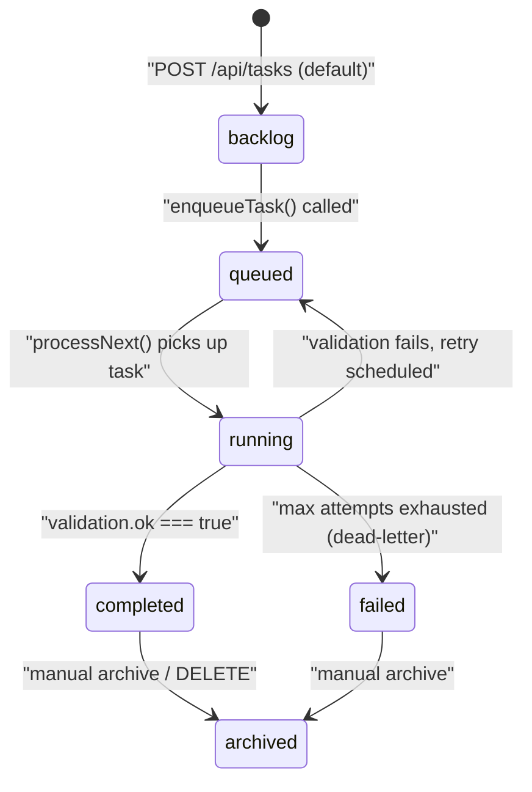
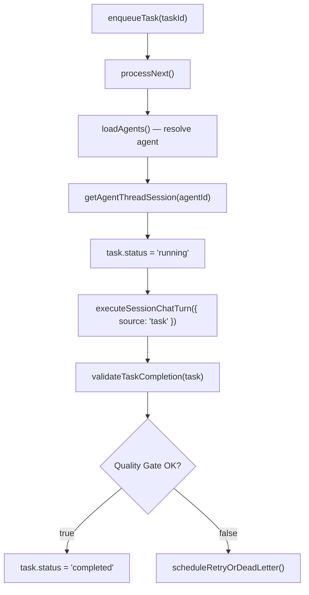

<!-- source: DeepWiki mcp.deepwiki.com · repo swarmclawai/swarmclaw · page 8 Task System · fetched 2026-10-26 -->

# Task System

Relevant source files

The following files were used as context for generating this wiki page:

- [src/app/api/agents/[id]/thread/route.ts](src/app/api/agents/[id]/thread/route.ts)
- [src/app/api/schedules/[id]/route.ts](src/app/api/schedules/[id]/route.ts)
- [src/app/api/schedules/[id]/run/route.ts](src/app/api/schedules/[id]/run/route.ts)
- [src/app/api/schedules/route.ts](src/app/api/schedules/route.ts)
- [src/app/api/tasks/[id]/route.ts](src/app/api/tasks/[id]/route.ts)
- [src/app/api/tasks/route.ts](src/app/api/tasks/route.ts)
- [src/app/api/webhooks/[id]/helpers.ts](src/app/api/webhooks/[id]/helpers.ts)
- [src/app/api/webhooks/route.test.ts](src/app/api/webhooks/route.test.ts)
- [src/components/schedules/schedule-sheet.tsx](src/components/schedules/schedule-sheet.tsx)
- [src/components/shared/settings-sheet.tsx](src/components/shared/settings-sheet.tsx)
- [src/components/tasks/task-card.tsx](src/components/tasks/task-card.tsx)
- [src/components/tasks/task-sheet.tsx](src/components/tasks/task-sheet.tsx)
- [src/lib/server/approvals.ts](src/lib/server/approvals.ts)
- [src/lib/server/runtime/scheduler.ts](src/lib/server/runtime/scheduler.ts)
- [src/lib/server/runtime/watch-jobs.ts](src/lib/server/runtime/watch-jobs.ts)
- [src/lib/server/schedules/schedule-normalization.ts](src/lib/server/schedules/schedule-normalization.ts)
- [src/lib/server/session-tools.ts](src/lib/server/session-tools.ts)
- [src/lib/server/session-tools/schedule.ts](src/lib/server/session-tools/schedule.ts)
- [src/stores/use-app-store.ts](src/stores/use-app-store.ts)
- [tests/memory.test.ts](tests/memory.test.ts)

This page provides an overview of how tasks are created, queued, executed by agents, retried on failure, validated, and archived. It covers the data model, status lifecycle, queue mechanics, and the REST API surface. For deeper detail on individual subsystems, see:

- [Task Queue](#8.1) — `enqueueTask`, `processNext`, retry/backoff, stall recovery, dead-lettering.
- [Scheduler](#8.2) — cron/interval/one-time schedules that generate tasks automatically.
- [Task Validation & Approvals](#8.3) — `validateTaskCompletion`, Quality Gates, and human-in-the-loop approvals.

---

## What is a Task?

A **task** (`BoardTask`) is a discrete unit of work assigned to a specific agent. Tasks are queued for execution, run inside a dedicated session, validated on completion, and archived when no longer needed. They serve as the primary mechanism for background agent work — including both user-created work items and jobs generated by the [Scheduler](#8.2).

Tasks differ from interactive chat sessions: they are fire-and-forget execution units driven by the background daemon, not live user interactions. The UI manages these via the `TaskSheet` [src/components/tasks/task-sheet.tsx:47-90]() and `TaskCard` [src/components/tasks/task-card.tsx:24-33]() components.

Sources: [src/app/api/tasks/route.ts:12-32](), [src/components/tasks/task-sheet.tsx:24-24]()

---

## Task Status Lifecycle

A `BoardTask` moves through the following statuses:

**Task Status State Machine**

| Status | Description |
|---|---|
| `backlog` | Created but not yet enqueued for execution. |
| `queued` | In the queue, waiting to be picked up; may have a future `retryScheduledAt`. |
| `running` | Actively being executed by an agent in a session. |
| `completed` | Execution finished and passed completion validation (Quality Gate). |
| `failed` | Exhausted retry attempts or failed a validation audit. |
| `archived` | Soft-deleted; hidden from the default task list. |

Sources: [src/app/api/tasks/route.ts:18-31](), [src/components/tasks/task-card.tsx:73-84]()

---

## Data Model

The `BoardTask` type carries all state needed to execute, track, and audit a task.

**Key `BoardTask` Fields**

| Field | Type | Purpose |
|---|---|---|
| `id` | `string` | Unique task identifier. |
| `title` | `string` | Short human-readable label. |
| `description` | `string` | Full task prompt sent to the agent. |
| `status` | `string` | Current lifecycle status (queued, running, etc). |
| `agentId` | `string` | ID of the agent assigned to the task. |
| `projectId` | `string` | Optional project grouping. |
| `qualityGate` | `TaskQualityGateConfig` | Configuration for automated completion checking. |
| `blockedBy` | `string[]` | List of task IDs that must complete before this one. |
| `attempts` | `number` | How many execution attempts have been made. |
| `customFields` | `Record<string, any>` | Metadata for external integrations or plugins. |

Sources: [src/components/tasks/task-sheet.tsx:24-24](), [src/components/tasks/task-sheet.tsx:120-142]()

---

## Task Execution Flow

When a task is processed, the queue runner creates a dedicated session and calls into the agent execution layer.

**Task Execution Pipeline**

The system uses `getAgentThreadSession` [src/app/api/agents/[id]/thread/route.ts:4-10]() to ensure a consistent execution context for the agent performing the task.

Sources: [src/lib/server/runtime/scheduler.ts:11-12](), [src/app/api/agents/[id]/thread/route.ts:7-7]()

---

## Queue Mechanics

The queue is managed by the background daemon. Tasks are picked up based on their `queued` status and lack of dependencies in `blockedBy` [src/components/tasks/task-card.tsx:73-73]().

- **Deduplication:** The scheduler prevents duplicate tasks for the same schedule using `inFlightScheduleKeys` [src/lib/server/runtime/scheduler.ts:96-101]().
- **Dependency Tracking:** Tasks can be "blocked" by other tasks. The UI reflects this with a lock icon and specific border colors [src/components/tasks/task-card.tsx:153-158]().

Sources: [src/lib/server/runtime/scheduler.ts:96-101](), [src/components/tasks/task-card.tsx:80-84]()

---

## Scheduler Integration

The `scheduler.ts` engine runs on a 60-second tick [src/lib/server/runtime/scheduler.ts:20-20](). It evaluates active schedules and fires them by:
1. Creating a new `BoardTask` if `taskMode === 'task'`.
2. Dispatching a session wake if `taskMode === 'wake_only'`.
3. Launching a protocol run if `taskMode === 'protocol'`.

Schedules support **Cron**, **Interval**, and **One-time** types [src/lib/server/runtime/scheduler.ts:108-125]().

Sources: [src/lib/server/runtime/scheduler.ts:108-125](), [src/lib/server/runtime/scheduler.ts:166-177]()

---

## Validation & Quality Gates

Tasks use a **Quality Gate** system to ensure work meets requirements before being marked complete. Configuration includes:
- `minResultChars`: Minimum length of the result text.
- `minEvidenceItems`: Number of supporting artifacts required.
- `requireVerification`: Whether a second agent/human must verify the output.

The `TaskSheet` UI allows users to configure these gates per task [src/components/tasks/task-sheet.tsx:82-87]().

Sources: [src/components/tasks/task-sheet.tsx:111-116](), [src/components/tasks/task-sheet.tsx:135-141]()

---

## External Integrations (Webhooks)

Tasks and sessions can be triggered by external events via the Webhooks API.
- **Handshake:** Uses `x-webhook-secret` for security [src/app/api/webhooks/route.test.ts:84-84]().
- **Lifecycle:** A POST to `/api/webhooks/[id]` creates a session, enqueues a run, and triggers a heartbeat for the assigned agent [src/app/api/webhooks/route.test.ts:79-107]().

Sources: [src/app/api/webhooks/route.test.ts:79-107](), [src/app/api/webhooks/route.test.ts:129-132]()

---

## REST API

The task system is exposed via `/api/tasks`.

| Method | Route | Description |
|---|---|---|
| `GET` | `/api/tasks` | List tasks. Excludes archived by default [src/app/api/tasks/route.ts:12-32](). |
| `POST` | `/api/tasks` | Create a new task [src/app/api/tasks/route.ts:40-51](). |
| `PUT` | `/api/tasks/[id]` | Update task properties (status, priority, etc) [src/app/api/tasks/[id]/route.ts:19-37](). |
| `DELETE` | `/api/tasks/[id]` | Archive a specific task [src/app/api/tasks/[id]/route.ts:39-45](). |

Sources: [src/app/api/tasks/route.ts:1-51](), [src/app/api/tasks/[id]/route.ts:1-46]()

---

