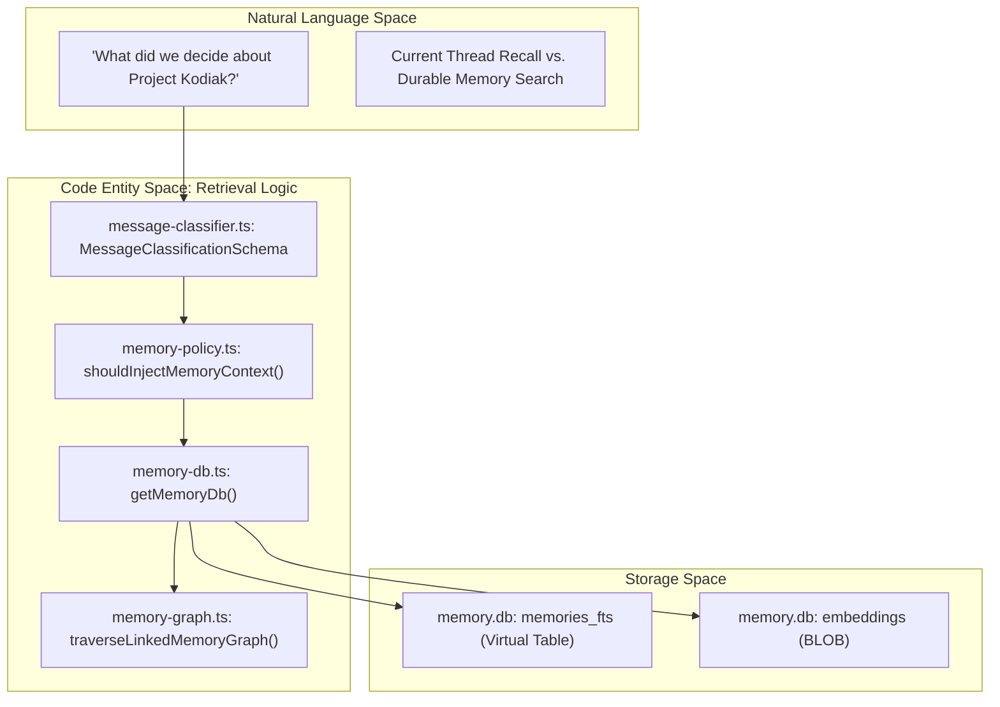
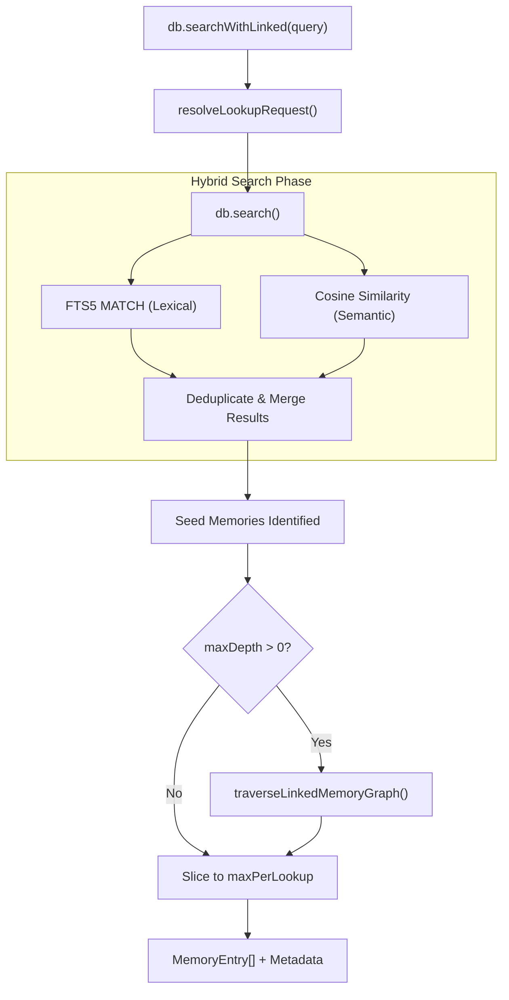

<!-- source: DeepWiki mcp.deepwiki.com · repo swarmclawai/swarmclaw · page 9.2 Memory Graph & Retrieval · fetched 2026-10-26 -->

# Memory Graph & Retrieval

<details>
<summary>Relevant source files</summary>

The following files were used as context for generating this wiki page:

- [src/lib/server/agents/guardian.ts](src/lib/server/agents/guardian.ts)
- [src/lib/server/autonomy/supervisor-reflection.test.ts](src/lib/server/autonomy/supervisor-reflection.test.ts)
- [src/lib/server/autonomy/supervisor-reflection.ts](src/lib/server/autonomy/supervisor-reflection.ts)
- [src/lib/server/chat-execution/continuation-evaluator.ts](src/lib/server/chat-execution/continuation-evaluator.ts)
- [src/lib/server/chat-execution/message-classifier.ts](src/lib/server/chat-execution/message-classifier.ts)
- [src/lib/server/chat-execution/prompt-builder.ts](src/lib/server/chat-execution/prompt-builder.ts)
- [src/lib/server/chat-execution/situational-awareness.ts](src/lib/server/chat-execution/situational-awareness.ts)
- [src/lib/server/memory/memory-consolidation.ts](src/lib/server/memory/memory-consolidation.ts)
- [src/lib/server/memory/memory-db.ts](src/lib/server/memory/memory-db.ts)
- [src/lib/server/memory/memory-integration.test.ts](src/lib/server/memory/memory-integration.test.ts)
- [src/lib/server/memory/memory-policy.ts](src/lib/server/memory/memory-policy.ts)
- [src/lib/server/memory/temporal-decay.ts](src/lib/server/memory/temporal-decay.ts)
- [src/lib/server/runtime/daemon-state.ts](src/lib/server/runtime/daemon-state.ts)
- [src/lib/server/runtime/heartbeat-service-timer.test.ts](src/lib/server/runtime/heartbeat-service-timer.test.ts)
- [src/lib/server/runtime/idle-window.ts](src/lib/server/runtime/idle-window.ts)
- [src/lib/server/runtime/queue.ts](src/lib/server/runtime/queue.ts)
- [src/lib/server/session-tools/memory.ts](src/lib/server/session-tools/memory.ts)
- [src/lib/server/skills/learned-skills.ts](src/lib/server/skills/learned-skills.ts)

</details>


The Memory Graph system handles linked memory traversal, hybrid search assembly, and the logic for injecting relevant context into agent prompts. It bridges raw database storage with the semantic needs of an autonomous agent by normalizing lookups, traversing relationship graphs, and applying temporal decay and relevance filtering.

---

## Overview

Retrieval in SwarmClaw is a multi-stage pipeline that combines lexical search (FTS5), semantic search (Vector), and graph traversal. When an agent queries its memory, the system resolves lookup limits, performs a hybrid search to find "seed" memories, and then traverses the graph of `linkedMemoryIds` to pull in related context.

Sources: [src/lib/server/memory/memory-db.ts:12-18](), [src/lib/server/session-tools/memory.ts:35-37]()

---

## Code Entity Space Mapping

The following diagram maps the high-level retrieval concepts to the specific TypeScript functions and classes that implement them.

**Diagram: Retrieval Pipeline Architecture**



Sources: [src/lib/server/chat-execution/message-classifier.ts:30-48](), [src/lib/server/memory/memory-policy.ts:33-51](), [src/lib/server/memory/memory-db.ts:7-18]()

---

## Memory Normalization & Limits

Before a retrieval operation begins, the system normalizes both the data and the request constraints.

### Normalization Functions

| Function | File | Purpose |
| :--- | :--- | :--- |
| `normalizeLinkedMemoryIds` | `memory-graph.ts` | Cleans ID arrays, removes self-references, and deduplicates. |
| `normalizeMemoryLookupLimits` | `memory-graph.ts` | Clamps `maxDepth`, `maxPerLookup`, and `maxLinkedExpansion` to safe bounds. |
| `resolveLookupRequest` | `memory-graph.ts` | Merges caller-specific overrides with system defaults. |
| `normalizeMemoryCategory` | `memory-policy.ts` | Maps fuzzy labels (e.g., "likes", "dislikes") to canonical paths like `identity/preferences`. |

Sources: [src/lib/server/memory/memory-graph.ts:13-16](), [src/lib/server/memory/memory-policy.ts:93-115]()

### Lookup Limits
The system enforces strict limits to prevent "context explosion" during graph traversal:
- **`maxDepth`**: Max BFS hops (default 3, max 12).
- **`maxPerLookup`**: Max total entries returned (default 20, max 200).
- **`maxLinkedExpansion`**: Max nodes added via links (default 60, max 1000).

Sources: [src/lib/server/memory/memory-db.ts:35-39]()

---

## Hybrid Retrieval & Result Assembly

Retrieval uses a hybrid FTS5 and Vector approach, followed by graph expansion.

**Diagram: Hybrid Search Flow (db.searchWithLinked)**



Sources: [src/lib/server/memory/memory-db.ts:812-836](), [src/lib/server/memory/memory-db.ts:755-780]()

### Scoring and Decay
Results are ranked using a combination of:
1.  **Semantic Score**: Vector similarity.
2.  **Temporal Decay**: Multiplier based on `createdAt` timestamp.
3.  **Salience Multipliers**: Specific categories like `reflection/open_loop` receive a boost (up to 1.6x) if they are past their `followUpAt` time.

Sources: [src/lib/server/memory/memory-db.ts:10-11](), [src/lib/server/memory/memory-db.ts:163-170]()

---

## Memory Consolidation & Injection

Once retrieved, memories are consolidated and injected into the agent's prompt.

### Consolidation Logic
The system uses `partitionMemoriesByTier` to group results into `working`, `durable`, and `archive` tiers. This allows the prompt builder to present a structured view of the agent's knowledge.

Sources: [src/lib/server/session-tools/memory.ts:20-21]()

### Prompt Injection
The function `shouldInjectMemoryContext` determines if the current turn warrants memory retrieval. It uses the `MessageClassification` from the LLM to skip lookups for simple greetings or acknowledgments.

Sources: [src/lib/server/memory/memory-policy.ts:33-51](), [src/lib/server/chat-execution/message-classifier.ts:105-115]()

### Thread Recall Optimization
If a query is identified as a "Thread Recall" (referring to the current conversation rather than long-term memory), the system bypasses the heavy `memory.db` search in favor of `compactThreadRecallText`.

Sources: [src/lib/server/session-tools/memory.ts:75-85](), [src/lib/server/chat-execution/prompt-builder.ts:29-30]()

---

## Implementation Details: `memory-graph.ts`

The traversal logic is a Breadth-First Search (BFS) that respects the `visited` set to prevent infinite loops in circular graphs (e.g., Memory A links to B, and B links to A).

```typescript
// Conceptual BFS logic in traverseLinkedMemoryGraph
while (queue.length > 0 && depth < limits.maxDepth) {
  const currentIds = queue.flatMap(node => node.linkedMemoryIds);
  const nextNodes = await fetchByIds(currentIds.filter(id => !visited.has(id)));
  // ... apply maxPerLookup and maxLinkedExpansion limits ...
  visited.add(...nextNodes.map(n => n.id));
  results.push(...nextNodes);
  queue = nextNodes;
  depth++;
}
```

Sources: [src/lib/server/memory/memory-db.ts:13-18](), [src/lib/server/memory/memory-integration.test.ts:149-161]()

---

