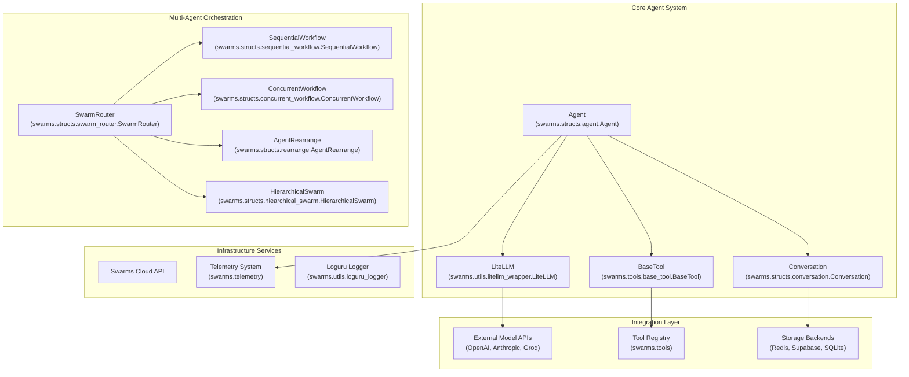
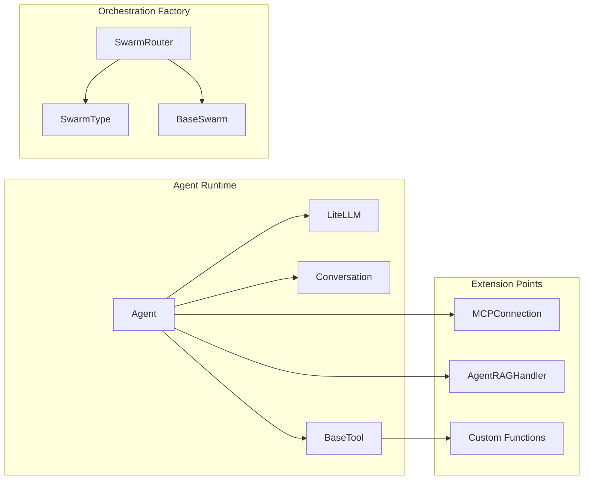
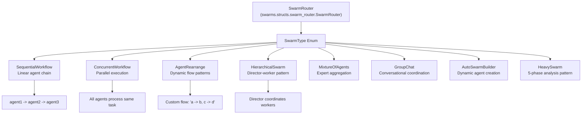
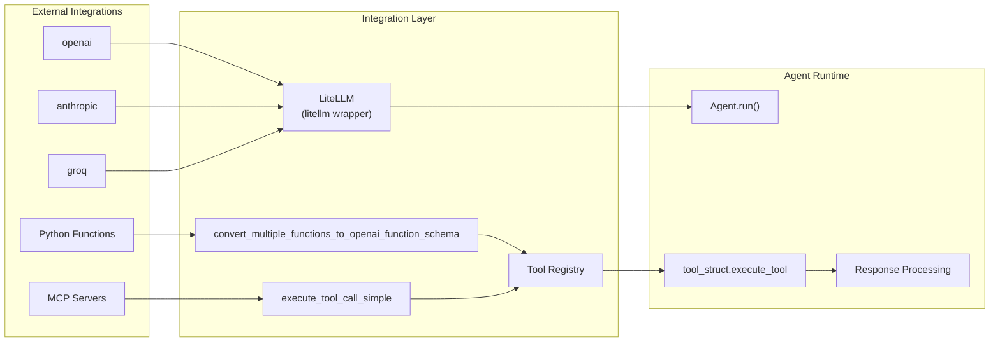

<!-- source: DeepWiki mcp.deepwiki.com · repo kyegomez/swarms · page 1 Overview · fetched 2026-10-26 -->

# Overview

<details>
<summary>Relevant source files</summary>

The following files were used as context for generating this wiki page:

- [.gitignore](.gitignore)
- [README.md](README.md)
- [docs/concepts/limitations.md](docs/concepts/limitations.md)
- [docs/index.md](docs/index.md)
- [docs/mkdocs.yml](docs/mkdocs.yml)
- [docs/swarms_cloud/best_practices.md](docs/swarms_cloud/best_practices.md)
- [example.py](example.py)
- [pyproject.toml](pyproject.toml)
- [requirements.txt](requirements.txt)
- [swarms/__init__.py](swarms/__init__.py)
- [swarms/agents/__init__.py](swarms/agents/__init__.py)
- [swarms/prompts/logistics.py](swarms/prompts/logistics.py)
- [swarms/prompts/sop_generator_agent_prompt.py](swarms/prompts/sop_generator_agent_prompt.py)
- [swarms/structs/__init__.py](swarms/structs/__init__.py)
- [swarms/structs/agent.py](swarms/structs/agent.py)
- [swarms/structs/concurrent_workflow.py](swarms/structs/concurrent_workflow.py)
- [swarms/structs/rearrange.py](swarms/structs/rearrange.py)
- [swarms/structs/sequential_workflow.py](swarms/structs/sequential_workflow.py)
- [swarms/structs/swarm_router.py](swarms/structs/swarm_router.py)
- [swarms/utils/__init__.py](swarms/utils/__init__.py)

</details>


## Purpose and Scope

Swarms is an enterprise-grade, production-ready multi-agent AI orchestration framework designed for building sophisticated autonomous agent systems at scale. This framework provides the infrastructure, tools, and patterns needed to create complex multi-agent applications that can handle real-world enterprise workloads through collaborative intelligence, parallel processing, and intelligent task distribution.

This document provides a comprehensive overview of the Swarms framework architecture, core components, and system design. For specific implementation details about individual agents, see [Agent Class](#2.1). For multi-agent coordination patterns, see [Multi-Agent Orchestration](#3). For tool integration capabilities, see [Tool System](#4).

## System Architecture Overview

The Swarms framework is built around a modular architecture with four primary layers: the Core Agent System, Multi-Agent Orchestration, Infrastructure Services, and Integration Layer.

### Primary System Architecture



Sources: [swarms/structs/agent.py:163-302](), [swarms/structs/swarm_router.py:106-173](), [swarms/structs/__init__.py:1-172](), [swarms/__init__.py:1-18]()

### Core Component Relationships



Sources: [swarms/structs/agent.py:303-438](), [swarms/structs/swarm_router.py:37-54](), [swarms/structs/base_swarm.py]()

## Core Agent System

The foundation of Swarms is the `Agent` class, which serves as the primary building block for all autonomous operations. Each agent is an independent entity that combines large language models with tools, memory, and conversation management.

### Agent Architecture Components

| Component | Class | Purpose | Configuration |
|-----------|-------|---------|---------------|
| **Language Model** | `LiteLLM` | Universal LLM interface supporting 100+ providers | `model_name`, `llm_base_url`, `llm_api_key` |
| **Conversation Memory** | `Conversation` | History management and context preservation | `conversation_schema`, `context_length` |
| **Tool Integration** | `BaseTool` | Function calling and external system integration | `tools`, `tool_choice`, `execute_tool` |
| **Agent Configuration** | `Agent.__init__()` | Agent behavior, prompts, and operational parameters | `system_prompt`, `max_loops`, `temperature` |

The `Agent` class supports extensive configuration through over 100 initialization parameters, enabling fine-tuned control over behavior, performance, and integration capabilities.

Sources: [swarms/structs/agent.py:163-302](), [swarms/utils/litellm_wrapper.py](), [swarms/structs/conversation.py](), [swarms/tools/base_tool.py]()

## Multi-Agent Orchestration System

Swarms provides multiple orchestration patterns for coordinating agents in complex workflows. The `SwarmRouter` serves as the central factory for dynamically selecting and instantiating different swarm architectures.

### Available Swarm Architectures



### Swarm Type Selection Matrix

| Swarm Type | Use Case | Pattern | Key Classes |
|------------|----------|---------|-------------|
| `SequentialWorkflow` | Linear processing pipelines | `A → B → C` | `SequentialWorkflow`, `AgentRearrange` |
| `ConcurrentWorkflow` | Parallel task execution | `A ∥ B ∥ C` | `ConcurrentWorkflow`, `ThreadPoolExecutor` |
| `AgentRearrange` | Dynamic workflow patterns | `A → B,C → D` | `AgentRearrange`, custom flow strings |
| `HierarchicalSwarm` | Director-worker coordination | Director → Workers | `HierarchicalSwarm`, feedback loops |
| `MixtureOfAgents` | Expert consensus building | Experts → Aggregator | `MixtureOfAgents`, expert specialization |
| `GroupChat` | Collaborative problem solving | Interactive conversation | `GroupChat`, speaker selection |

Sources: [swarms/structs/swarm_router.py:37-54](), [swarms/structs/sequential_workflow.py:12-28](), [swarms/structs/concurrent_workflow.py:17-135](), [swarms/structs/rearrange.py:27-63]()

## Key Framework Capabilities

### Production-Grade Infrastructure

Swarms is designed for enterprise deployment with comprehensive infrastructure support:

- **Error Handling**: Structured exception hierarchy with `AgentError`, `AgentInitializationError`, `AgentRunError` classes
- **Logging & Telemetry**: Integration with `loguru` for structured logging and built-in telemetry collection
- **State Management**: Automatic state persistence and recovery with `SafeStateManager` and `SafeLoaderUtils`
- **Performance Monitoring**: Built-in metrics collection and dashboard capabilities

### Extensibility and Integration

The framework provides multiple extension points for customization:

- **Model Provider Integration**: Universal LLM support through `LiteLLM` wrapper supporting OpenAI, Anthropic, Groq, and 100+ other providers
- **Tool System**: Flexible tool integration supporting Python functions, Pydantic models, and MCP (Model Context Protocol) servers
- **Memory Systems**: Pluggable storage backends including Redis, Supabase, SQLite, and DuckDB
- **Custom Agents**: Support for integrating external agents from LangChain, AutoGen, and other frameworks

### Deployment and Scaling

| Deployment Option | Implementation | Use Case |
|------------------|---------------|----------|
| **Local Development** | Direct Python imports | Development, testing, small-scale applications |
| **Container Deployment** | Docker with Poetry dependencies | Scalable local deployment |
| **Cloud Services** | Swarms Cloud API | Production scaling, managed infrastructure |
| **Enterprise Integration** | Custom API endpoints | Enterprise systems integration |

Sources: [pyproject.toml:58-82](), [README.md:112-148](), [swarms/structs/agent.py:115-161](), [docs/mkdocs.yml:431-456]()

## Integration Architecture

### Tool and Model Integration Flow



The integration architecture enables seamless connection between agents and external systems through standardized interfaces and conversion layers.

Sources: [swarms/structs/agent.py:633-651](), [swarms/tools/py_func_to_openai_func_str.py](), [swarms/tools/mcp_client_call.py:74-83](), [swarms/utils/litellm_wrapper.py]()

## Framework Entry Points

### Primary Import Structure

The framework provides a clean import hierarchy designed for ease of use:

```python
from swarms import Agent                    # Core agent class
from swarms import SequentialWorkflow       # Linear workflows  
from swarms import ConcurrentWorkflow       # Parallel workflows
from swarms import SwarmRouter             # Dynamic swarm selection
from swarms import BaseTool                # Tool integration
```

### Configuration and Initialization

Key configuration entry points include:

- **Environment Setup**: API keys, workspace directories, and provider configuration via `.env` files
- **Agent Configuration**: System prompts, model selection, tool integration, and behavior parameters  
- **Swarm Architecture**: Workflow patterns, agent coordination, and execution strategies
- **Production Settings**: Logging, telemetry, error handling, and performance monitoring

Sources: [swarms/__init__.py:1-18](), [swarms/structs/__init__.py:1-172](), [README.md:151-161](), [example.py:1-48]()

The Swarms framework provides a comprehensive foundation for building production-grade multi-agent AI systems, with robust infrastructure, flexible architecture patterns, and extensive integration capabilities. The modular design enables developers to start with simple agent configurations and scale to complex multi-agent orchestrations as requirements evolve.

---

