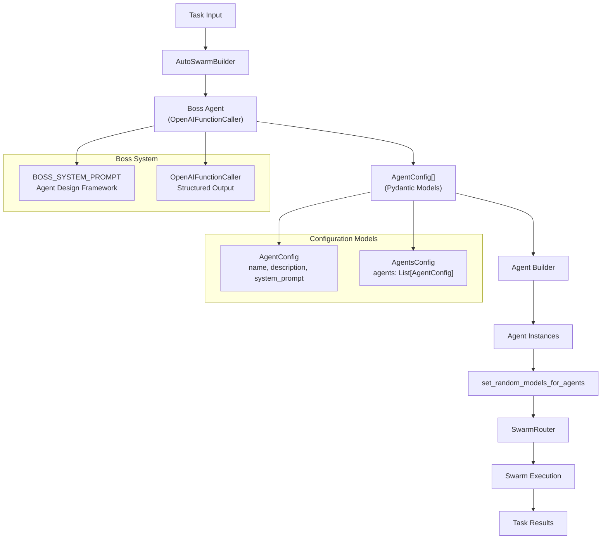
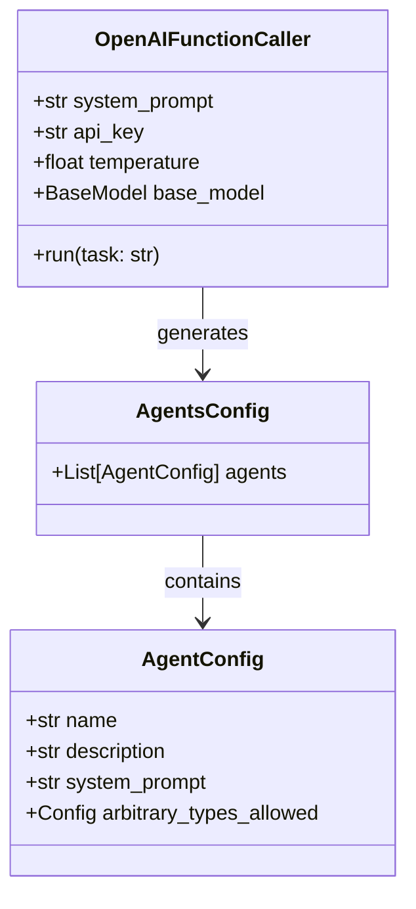
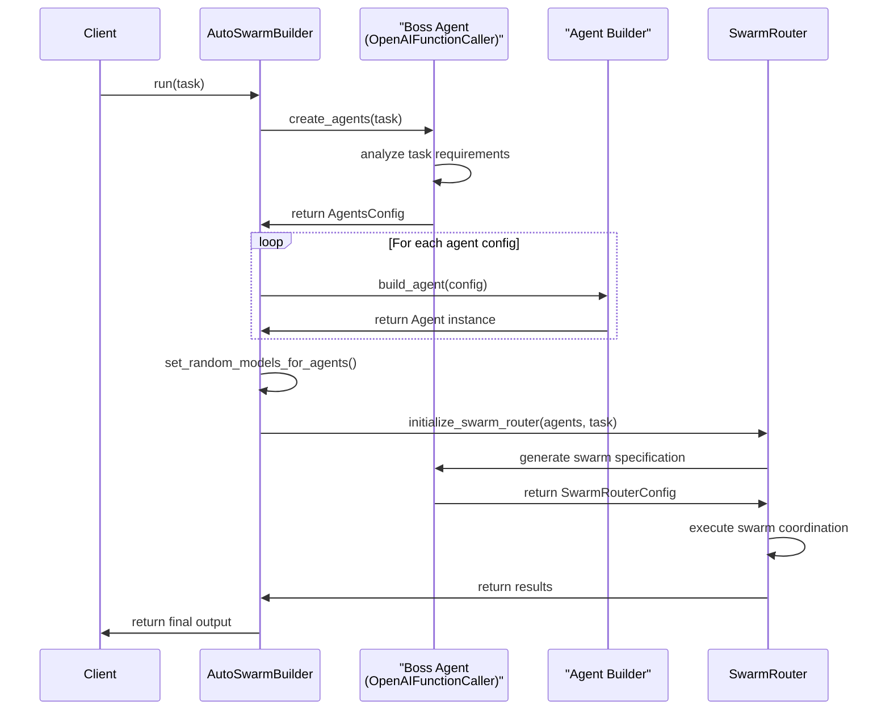
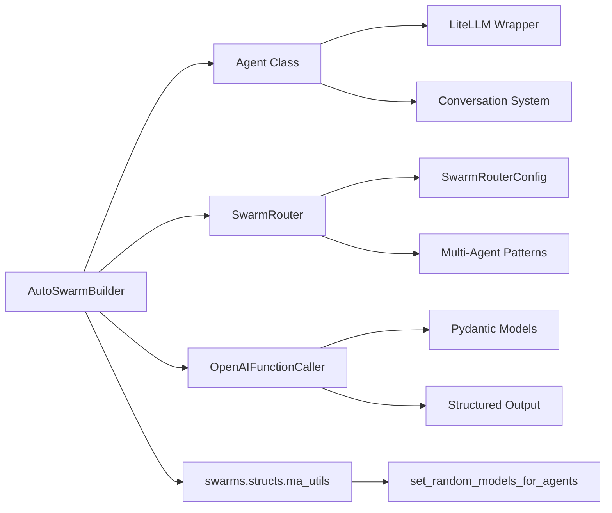

<!-- source: DeepWiki mcp.deepwiki.com · repo kyegomez/swarms · page 10.1 Auto Swarm Builder · fetched 2026-10-26 -->

# Auto Swarm Builder

<details>
<summary>Relevant source files</summary>

The following files were used as context for generating this wiki page:

- [docs/corporate/bounty_program.md](docs/corporate/bounty_program.md)
- [examples/multi_agent/enhanced_collaboration_example.py](examples/multi_agent/enhanced_collaboration_example.py)
- [swarms/structs/auto_swarm_builder.py](swarms/structs/auto_swarm_builder.py)
- [swarms/structs/multi_agent_exec.py](swarms/structs/multi_agent_exec.py)

</details>


This document covers the Auto Swarm Builder system, which provides automated swarm construction and dynamic agent generation capabilities. The Auto Swarm Builder analyzes tasks and automatically creates specialized AI agents with tailored system prompts, then coordinates them using appropriate orchestration patterns.

For information about manual swarm configuration and routing, see [SwarmRouter](#2.2). For details about multi-agent execution strategies, see [Multi-Agent Execution](#10.2).

## Purpose and Architecture

The `AutoSwarmBuilder` class serves as an intelligent swarm factory that eliminates the need for manual agent configuration. Given a task description, it leverages a boss agent to analyze requirements, design specialized agents, and coordinate their execution through the SwarmRouter system.

### Core Architecture Flow



Sources: [swarms/structs/auto_swarm_builder.py:129-366]()

## Boss Agent System

The boss agent operates as the core intelligence behind automatic swarm generation. It uses a comprehensive system prompt to analyze tasks and create specialized agent designs.

### Boss Agent Design Framework

The `BOSS_SYSTEM_PROMPT` [swarms/structs/auto_swarm_builder.py:15-97]() establishes six core principles:

| Principle | Description | Implementation |
|-----------|-------------|----------------|
| Deep Task Understanding | Analyzes task requirements and breaks them into components | Structured analysis framework |
| Agent Design Philosophy | Creates agents with specific purposes and personalities | Role-based specialization |
| Agent Creation Framework | Defines role, personality, expertise, and communication style | `AgentConfig` model generation |
| System Prompt Design | Creates detailed behavioral guidelines for each agent | Comprehensive prompt engineering |
| Swarm Coordination | Establishes communication channels and protocols | SwarmRouter integration |
| Quality Assurance | Implements verification and success criteria | Error handling and validation |

### Agent Configuration Models



Sources: [swarms/structs/auto_swarm_builder.py:100-127]()

## AutoSwarmBuilder Implementation

The `AutoSwarmBuilder` class coordinates the entire automatic swarm creation and execution process.

### Core Methods and Workflow



Sources: [swarms/structs/auto_swarm_builder.py:171-350]()

### Key Method Implementations

#### Agent Creation Process

The `create_agents()` method [swarms/structs/auto_swarm_builder.py:203-258]() implements the core agent generation logic:

1. **Boss Agent Initialization**: Creates `OpenAIFunctionCaller` with `BOSS_SYSTEM_PROMPT`
2. **Task Analysis**: Boss agent analyzes the input task and generates `AgentsConfig`
3. **Agent Building**: Iterates through configurations to build `Agent` instances
4. **Error Handling**: Comprehensive exception handling with logging

#### Swarm Router Integration

The `initialize_swarm_router()` method [swarms/structs/auto_swarm_builder.py:297-350]() handles coordination setup:

1. **Swarm Specification Generation**: Boss agent creates `SwarmRouterConfig`
2. **Router Initialization**: Configures `SwarmRouter` with generated specifications
3. **Execution**: Runs the coordinated swarm execution

### Configuration Options

| Parameter | Type | Default | Description |
|-----------|------|---------|-------------|
| `name` | str | None | Swarm identifier |
| `description` | str | None | Swarm purpose description |
| `verbose` | bool | True | Enable detailed logging |
| `max_loops` | int | 1 | Maximum execution loops |
| `random_models` | bool | True | Use random model assignment |

Sources: [swarms/structs/auto_swarm_builder.py:144-165]()

## Integration with Swarm Systems

The Auto Swarm Builder integrates with multiple components of the Swarms framework to provide comprehensive automation.

### Component Integration Map



Sources: [swarms/structs/auto_swarm_builder.py:6-11]()

### Random Model Assignment

When `random_models=True`, the system uses `set_random_models_for_agents()` [swarms/structs/auto_swarm_builder.py:190-192]() to diversify the model selection across created agents, improving swarm performance through model variety.

## Usage Patterns and Examples

### Basic Swarm Creation

```python
# Initialize Auto Swarm Builder
builder = AutoSwarmBuilder(
    name="Research Team",
    description="Automated research and analysis swarm",
    verbose=True,
    max_loops=1
)

# Execute task with automatic agent creation
result = builder.run("Analyze market trends in renewable energy")
```

### Batch Task Processing

The `batch_run()` method [swarms/structs/auto_swarm_builder.py:352-365]() enables processing multiple tasks with the same swarm configuration:

```python
tasks = [
    "Analyze quarterly financial reports",
    "Research competitor strategies", 
    "Evaluate market opportunities"
]

results = builder.batch_run(tasks)
```

### Error Handling and Logging

The system implements comprehensive error handling with `loguru` logging throughout the execution pipeline:

- Agent creation failures are logged and re-raised [swarms/structs/auto_swarm_builder.py:254-258]()
- Swarm router errors include detailed stack traces [swarms/structs/auto_swarm_builder.py:345-350]()
- Individual agent building errors are tracked [swarms/structs/auto_swarm_builder.py:290-295]()

Sources: [swarms/structs/auto_swarm_builder.py:1-366]()

## Advanced Configuration

### Boss Agent Customization

The boss agent behavior can be modified by adjusting the `BOSS_SYSTEM_PROMPT` to emphasize different aspects of agent design:

- **Task-Specific Expertise**: Focus on domain-specific knowledge requirements
- **Collaboration Patterns**: Emphasize inter-agent communication protocols  
- **Quality Standards**: Define specific success criteria and validation methods
- **Scalability Considerations**: Address resource management and performance optimization

### Integration with External Systems

The Auto Swarm Builder can be extended to integrate with external systems through:

- **Custom Agent Templates**: Pre-defined agent configurations for specific use cases
- **External Data Sources**: Integration with databases or APIs for context-aware agent creation
- **Monitoring Systems**: Real-time performance tracking and optimization
- **Deployment Pipelines**: Automated swarm deployment to production environments

Sources: [swarms/structs/auto_swarm_builder.py:15-97](), [swarms/structs/multi_agent_exec.py:1-479]()

---

