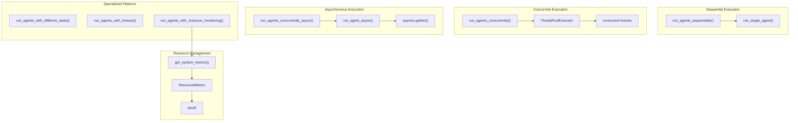
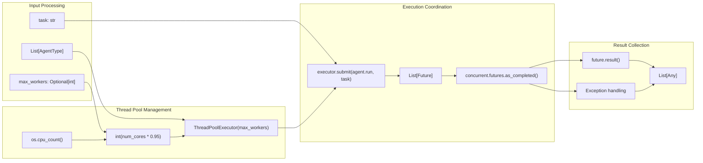
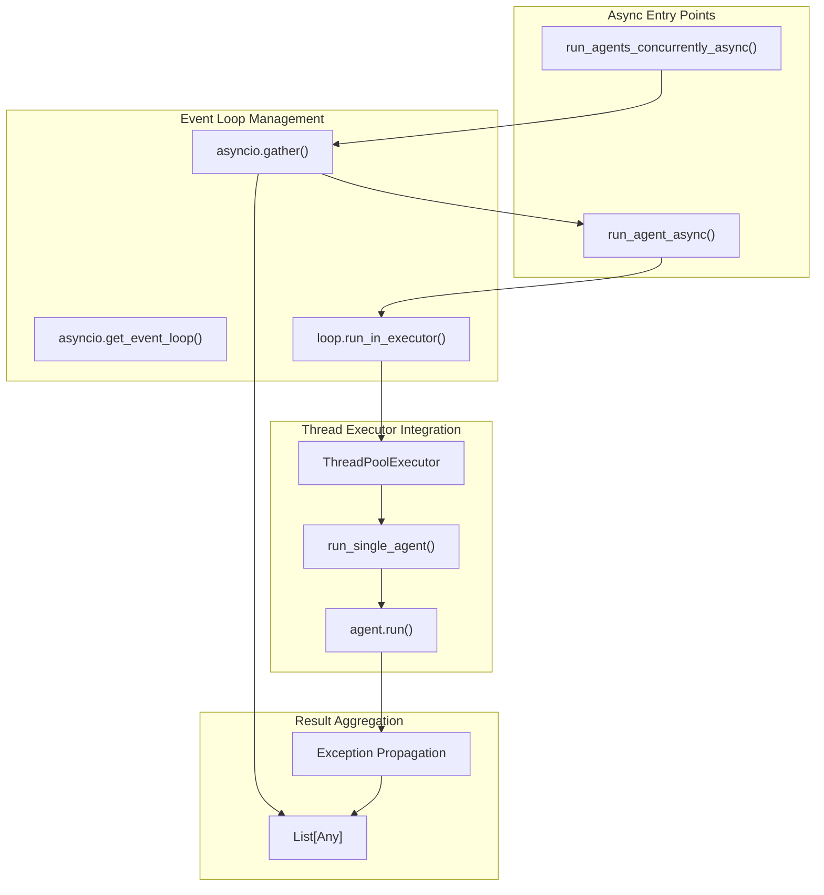
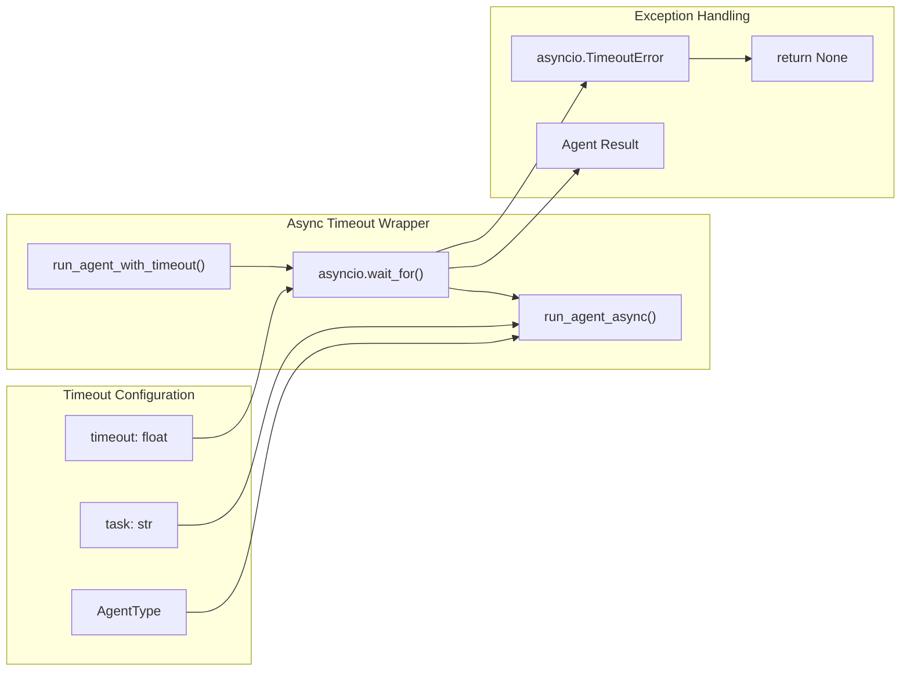

<!-- source: DeepWiki mcp.deepwiki.com · repo kyegomez/swarms · page 10.2 Multi-Agent Execution · fetched 2026-10-26 -->

# Multi-Agent Execution

<details>
<summary>Relevant source files</summary>

The following files were used as context for generating this wiki page:

- [docs/corporate/bounty_program.md](docs/corporate/bounty_program.md)
- [examples/multi_agent/enhanced_collaboration_example.py](examples/multi_agent/enhanced_collaboration_example.py)
- [swarms/structs/auto_swarm_builder.py](swarms/structs/auto_swarm_builder.py)
- [swarms/structs/multi_agent_exec.py](swarms/structs/multi_agent_exec.py)

</details>


## Purpose and Scope

This document covers concurrent and asynchronous execution strategies for coordinating multiple agents in the Swarms framework. It focuses on the technical implementation of parallel agent execution, resource management, performance optimization, and batch processing strategies.

For information about multi-agent orchestration patterns and workflow systems, see [Multi-Agent Orchestration](#3). For details about the core Agent class and its configuration, see [Agent Class](#2.1). For advanced orchestration patterns like AutoSwarmBuilder, see [Auto Swarm Builder](#10.1).

## Execution Strategies Overview

The Swarms framework provides multiple execution strategies for running agents, each optimized for different use cases and resource constraints. These strategies are implemented in the `multi_agent_exec` module and range from simple sequential execution to sophisticated concurrent and asynchronous patterns.

### Execution Strategy Comparison

| Strategy | Use Case | Resource Usage | Complexity | Performance |
|----------|----------|----------------|------------|-------------|
| Sequential | Simple tasks, debugging | Low | Low | Baseline |
| Concurrent | CPU-bound tasks | High CPU | Medium | High |
| Asynchronous | I/O-bound tasks | Low CPU, high I/O | High | Very High |
| Batch Processing | Large agent pools | Controlled | Medium | Scalable |

### Core Execution Functions Architecture



*Sources: [swarms/structs/multi_agent_exec.py:1-479]()*

## Concurrent Execution Patterns

### ThreadPoolExecutor-Based Execution

The primary concurrent execution strategy uses `ThreadPoolExecutor` to manage agent execution across multiple threads. The `run_agents_concurrently()` function provides optimized concurrent execution with automatic worker thread management.



*Sources: [swarms/structs/multi_agent_exec.py:69-109]()*

### Worker Thread Optimization

The framework automatically optimizes the number of worker threads based on system resources. By default, it uses 95% of available CPU cores to balance performance with system stability.

Key implementation details:
- **Dynamic Worker Sizing**: `max_workers = int(num_cores * 0.95)` [swarms/structs/multi_agent_exec.py:85-88]()
- **Exception Handling**: Failed agent executions are captured and included in results [swarms/structs/multi_agent_exec.py:105-107]()
- **Resource-Aware**: Prevents system overload while maximizing throughput

### Batch Processing for Large Agent Pools

For scenarios with large numbers of agents, the `run_agents_concurrently_multiprocess()` function implements batch processing to manage system resources effectively.

*Sources: [swarms/structs/multi_agent_exec.py:112-138]()*

## Asynchronous Execution Patterns

### AsyncIO-Based Coordination

The asynchronous execution pattern combines `asyncio` with `ThreadPoolExecutor` to handle I/O-bound operations efficiently while maintaining thread safety for CPU-bound agent processing.



*Sources: [swarms/structs/multi_agent_exec.py:29-66]()*

### Agent-Task Pairing Patterns

The framework supports multiple execution patterns for pairing agents with tasks:

1. **Same Task for All Agents**: `run_agents_concurrently()` executes the same task across all agents
2. **Different Tasks per Agent**: `run_agents_with_different_tasks()` pairs each agent with a specific task
3. **Agent-Task Correspondence**: `run_agents_with_tasks_concurrently()` matches agents to corresponding tasks by index

*Sources: [swarms/structs/multi_agent_exec.py:157-204](), [swarms/structs/multi_agent_exec.py:384-414]()*

## Resource Management and Monitoring

### System Resource Tracking

The `ResourceMetrics` dataclass and `get_system_metrics()` function provide real-time system resource monitoring during agent execution.

```python
@dataclass
class ResourceMetrics:
    cpu_percent: float
    memory_percent: float
    active_threads: int
```

*Sources: [swarms/structs/multi_agent_exec.py:17-22](), [swarms/structs/multi_agent_exec.py:282-288]()*

### Adaptive Resource Management

The `run_agents_with_resource_monitoring()` function implements adaptive execution that monitors system resources and adjusts execution patterns based on CPU and memory thresholds.

Key features:
- **CPU Threshold Monitoring**: Configurable CPU usage limits (default 90%)
- **Memory Threshold Monitoring**: Configurable memory usage limits (default 90%)
- **Adaptive Batch Sizing**: Dynamic adjustment of concurrent agents based on resource availability
- **Check Interval Configuration**: Customizable monitoring frequency

*Sources: [swarms/structs/multi_agent_exec.py:291-324]()*

## Timeout and Error Handling

### Timeout-Based Execution

The framework provides timeout mechanisms for agent execution to prevent hanging operations and ensure system responsiveness.

### Timeout Implementation Architecture



*Sources: [swarms/structs/multi_agent_exec.py:207-231](), [swarms/structs/multi_agent_exec.py:233-279]()*

### Error Handling Strategies

The execution functions implement comprehensive error handling:

1. **Individual Agent Failures**: Captured and included in results without stopping other agents
2. **Timeout Handling**: Graceful timeout management with `None` return values
3. **Resource Exhaustion**: Adaptive execution patterns based on system constraints
4. **Exception Propagation**: Controlled exception handling that maintains system stability

## Batch Processing Strategies

### Dynamic Batch Sizing

The framework implements intelligent batch processing to optimize performance while managing system resources. The default batch size is determined by system capabilities:

- **CPU-Based Batching**: `batch_size = os.cpu_count()` for optimal CPU utilization
- **Memory-Aware Batching**: Dynamic adjustment based on available memory
- **Custom Batch Sizes**: User-configurable batch sizes for specific use cases

### Batch Processing Workflow

1. **Agent Pool Segmentation**: Large agent lists are divided into manageable batches
2. **Sequential Batch Execution**: Each batch is processed concurrently, batches are processed sequentially
3. **Result Aggregation**: Results from all batches are combined into a single result list
4. **Resource Recovery**: System resources are released between batches

*Sources: [swarms/structs/multi_agent_exec.py:326-382]()*

## Performance Optimization

### Thread Pool Configuration

Optimal thread pool configuration is critical for performance:

- **Worker Thread Calculation**: `int(num_cores * 0.95)` balances performance and stability
- **Thread Reuse**: ThreadPoolExecutor reuses threads to minimize overhead
- **Context Manager Usage**: Proper resource cleanup with context managers

### Execution Strategy Selection

The framework provides guidelines for selecting appropriate execution strategies:

1. **Sequential**: Use for debugging, simple tasks, or when resource usage must be minimal
2. **Concurrent**: Optimal for CPU-bound tasks with multiple agents
3. **Asynchronous**: Best for I/O-bound operations or mixed workloads
4. **Batch Processing**: Required for large agent pools or resource-constrained environments

## Integration with Swarm Systems

### AutoSwarmBuilder Integration

The `AutoSwarmBuilder` class integrates with multi-agent execution patterns to provide automated swarm creation and execution. The builder creates agents dynamically and utilizes the execution strategies based on configuration.

Key integration points:
- **Agent Creation**: `create_agents()` method generates agents for execution [swarms/structs/auto_swarm_builder.py:203-258]()
- **Random Model Assignment**: `set_random_models_for_agents()` for load distribution [swarms/structs/auto_swarm_builder.py:190-192]()
- **SwarmRouter Integration**: Seamless integration with routing systems [swarms/structs/auto_swarm_builder.py:297-350]()

### Execution Context Management

The execution functions maintain proper context for agent coordination:

- **Agent State Management**: Each agent maintains independent state during concurrent execution
- **Resource Sharing**: Controlled access to shared resources through thread-safe patterns
- **Result Coordination**: Proper result collection and aggregation across execution patterns

*Sources: [swarms/structs/auto_swarm_builder.py:129-366](), [examples/multi_agent/enhanced_collaboration_example.py:1-257]()*

---

