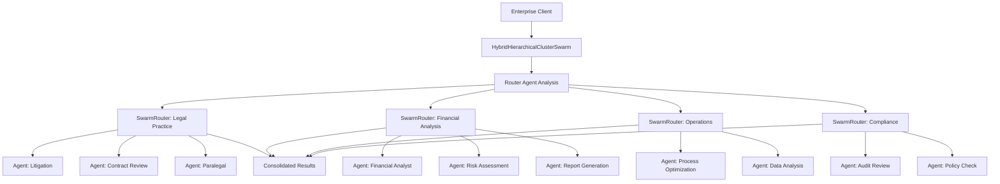
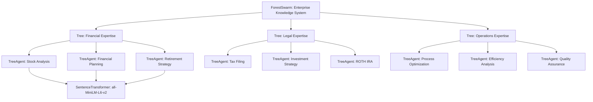
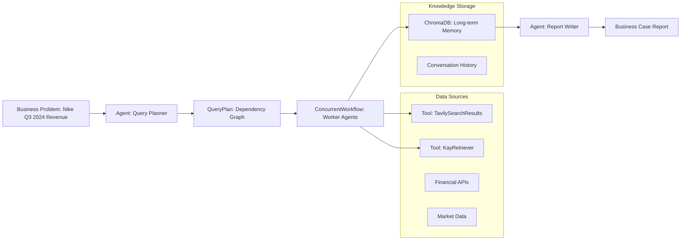
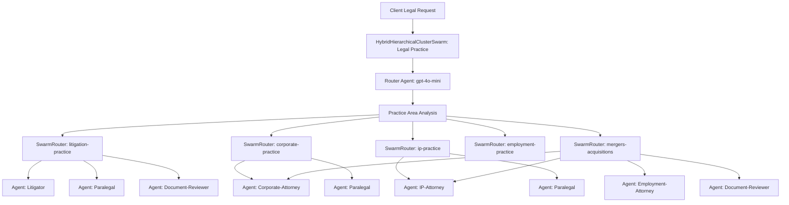
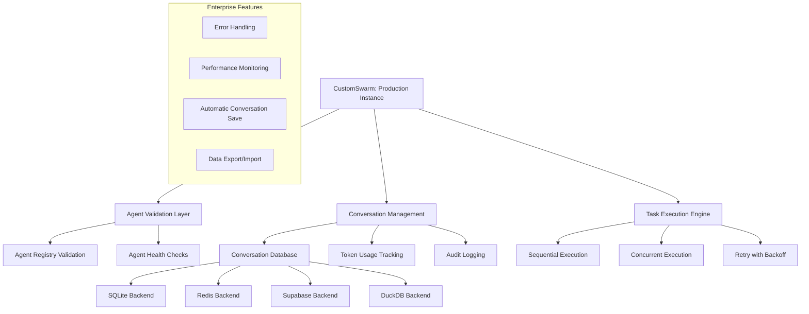
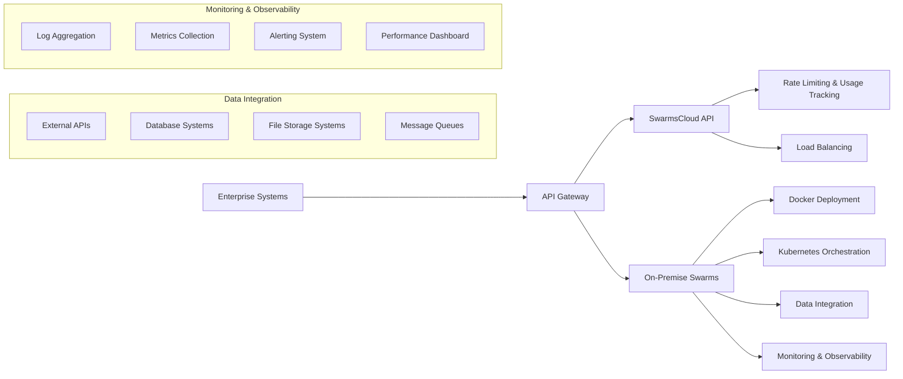
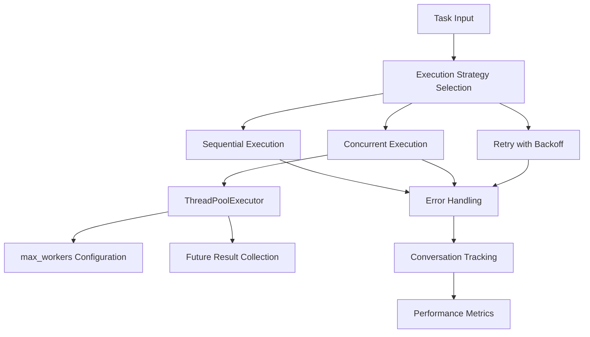

<!-- source: DeepWiki mcp.deepwiki.com · repo kyegomez/swarms · page 10.3 Enterprise Applications · fetched 2026-10-26 -->

# Enterprise Applications

Relevant source files

The following files were used as context for generating this wiki page:

- [docs/applications/business-analyst-agent.md](docs/applications/business-analyst-agent.md)
- [docs/assets/img/agent_def.png](docs/assets/img/agent_def.png)
- [docs/assets/img/docs/query-plan-mini.png](docs/assets/img/docs/query-plan-mini.png)
- [docs/assets/img/docs/query-plan.png](docs/assets/img/docs/query-plan.png)
- [docs/corporate/data_room.md](docs/corporate/data_room.md)
- [docs/requirements.txt](docs/requirements.txt)
- [docs/swarms/agents/tool_agent.md](docs/swarms/agents/tool_agent.md)
- [docs/swarms/framework/index.md](docs/swarms/framework/index.md)
- [docs/swarms/structs/custom_swarm.md](docs/swarms/structs/custom_swarm.md)
- [docs/swarms/structs/hhcs.md](docs/swarms/structs/hhcs.md)
- [docs/swarms/structs/multi_swarm_orchestration.md](docs/swarms/structs/multi_swarm_orchestration.md)
- [swarms/structs/tree_swarm.py](swarms/structs/tree_swarm.py)

This document covers real-world enterprise use cases and application patterns for the Swarms framework. It focuses on production-grade multi-agent architectures suitable for mission-critical business operations, including financial services, legal practice management, business analysis, and operations automation.

For information about basic swarm orchestration patterns, see [Multi-Agent Orchestration](#3). For cloud deployment and scaling, see [Cloud Services & APIs](#9).

## Enterprise Architecture Patterns

Enterprise applications require sophisticated orchestration patterns that can handle complex, multi-domain tasks with high reliability and scalability requirements. The Swarms framework provides several architectural patterns specifically designed for enterprise use.

### Hybrid Hierarchical-Cluster Swarm (HHCS)

The `HybridHierarchicalClusterSwarm` class provides the most robust architecture for enterprise applications requiring intelligent task routing and parallel processing across specialized domains.

**Enterprise HHCS Implementation Pattern**

Sources: [docs/swarms/structs/hhcs.md:1-223]()

### Tree-Based Decision Hierarchies

The `ForestSwarm` and `TreeAgent` classes enable hierarchical decision-making structures ideal for enterprise knowledge management and expert system applications.

**Tree-Based Enterprise Knowledge Architecture**

Sources: [swarms/structs/tree_swarm.py:190-344]()

## Business Use Cases

### Business Analysis and Reporting

Enterprise business analysis requires coordinated research, data gathering, and report generation across multiple domains. The framework supports comprehensive business analysis workflows through specialized agent coordination.

**Business Analysis Workflow Architecture**

The business analysis pattern uses a multi-stage approach:

1. **Planning Phase**: `QueryPlan` model breaks complex business problems into dependent sub-queries
2. **Research Phase**: `WorkerAgent` instances execute parallel research using `TavilySearchResults` and `KayRetriever` tools
3. **Knowledge Consolidation**: `ChromaDB` stores all research findings with embedding-based retrieval
4. **Report Generation**: Specialized writer agent synthesizes findings into executive reports

Sources: [docs/applications/business-analyst-agent.md:1-850]()

### Legal Practice Management

The legal domain demonstrates sophisticated multi-agent coordination for practice area specialization and case management.

**Legal Practice Multi-Agent Architecture**

Key enterprise features:
- **Specialized Practice Areas**: Each `SwarmRouter` represents a legal specialty with appropriate agent composition
- **Cross-Functional Teams**: Complex matters like M&A use `ConcurrentWorkflow` to coordinate multiple specialties
- **Document Processing**: Dedicated `Document-Reviewer` agents for legal document analysis
- **Scalable Architecture**: Router-based task distribution enables dynamic load balancing

Sources: [docs/swarms/structs/hhcs.md:99-223]()

## Production Deployment Patterns

### Custom Enterprise Swarms

Enterprise applications often require custom orchestration logic beyond standard workflow patterns. The `CustomSwarm` class provides a foundation for building production-grade swarm architectures.

**Custom Enterprise Swarm Architecture**

Enterprise-grade features include:
- **Comprehensive Validation**: `validate_agents()` method ensures all agents meet requirements
- **Conversation Persistence**: Multiple backend options for conversation storage and retrieval
- **Error Resilience**: `run_with_retries()` method with configurable retry logic
- **Performance Monitoring**: Built-in conversation summaries and token tracking
- **Data Portability**: Export capabilities for compliance and analysis

Sources: [docs/swarms/structs/custom_swarm.md:97-494]()

### Enterprise Integration Patterns

**Enterprise Integration Architecture**

Sources: [docs/corporate/data_room.md:52-70](), [docs/swarms/structs/multi_swarm_orchestration.md:169-203]()

## Scalability and Performance Considerations

### Architecture Selection Guidelines

| Use Case | Recommended Architecture | Scaling Pattern | Performance Characteristics |
|----------|-------------------------|-----------------|---------------------------|
| Multi-domain expertise | `HybridHierarchicalClusterSwarm` | Horizontal scaling of specialized swarms | High throughput, intelligent routing |
| Knowledge-based decisions | `ForestSwarm` with `TreeAgent` | Tree replication and load balancing | Low latency, semantic matching |
| Custom business logic | `CustomSwarm` | Configurable concurrency levels | Flexible, application-specific |
| General coordination | `SwarmRouter` | Simple agent pool scaling | Moderate complexity, good for 5-20 agents |

### Performance Optimization Patterns

**Concurrent Execution Strategy**

**Concurrent Execution Performance Architecture**

Key performance optimizations:
- **Configurable Concurrency**: `max_workers` parameter in `CustomSwarm` for optimal resource utilization
- **Future-based Coordination**: `concurrent.futures.ThreadPoolExecutor` for parallel agent execution
- **Error Isolation**: Individual agent failures don't cascade to other agents
- **Performance Monitoring**: Built-in metrics collection for optimization

Sources: [docs/swarms/structs/custom_swarm.md:280-366]()

## Enterprise Deployment Considerations

### Production Readiness Checklist

- **Agent Validation**: Implement comprehensive `validate_agents()` checks
- **Error Handling**: Deploy with retry logic and graceful degradation
- **Conversation Persistence**: Configure appropriate backend storage for audit requirements
- **Performance Monitoring**: Enable token tracking and conversation summaries
- **Security**: Implement proper API key management and access controls
- **Scalability**: Configure concurrency levels based on infrastructure capacity
- **Observability**: Set up logging and monitoring for production operations

### Cloud vs On-Premise Deployment

**Cloud Deployment** via Swarms Cloud API provides:
- Managed infrastructure and scaling
- Built-in rate limiting and usage tracking
- Cost optimization through usage-based pricing
- Simplified deployment and maintenance

**On-Premise Deployment** enables:
- Full control over data and infrastructure
- Custom security and compliance requirements
- Integration with existing enterprise systems
- Optimized performance for specific workloads

Sources: [docs/corporate/data_room.md:55-70](), [docs/swarms/structs/multi_swarm_orchestration.md:150-203]()

---

