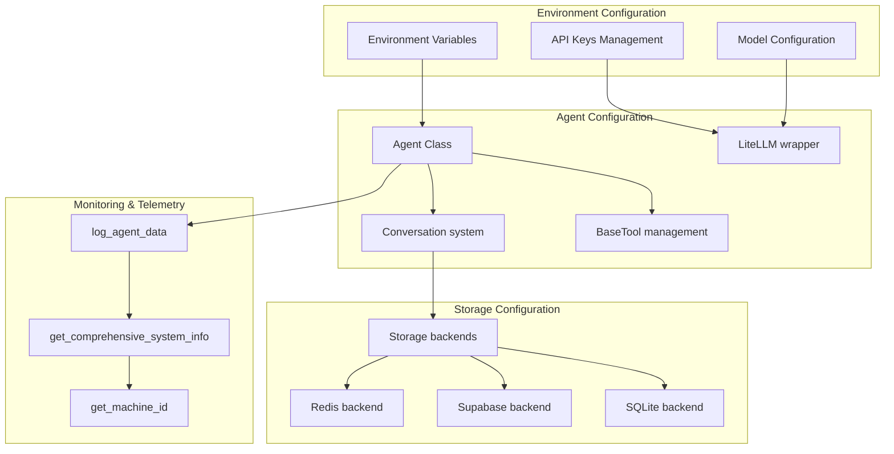
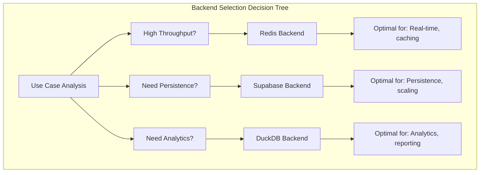
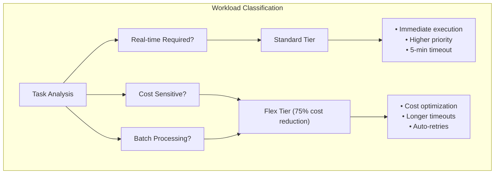
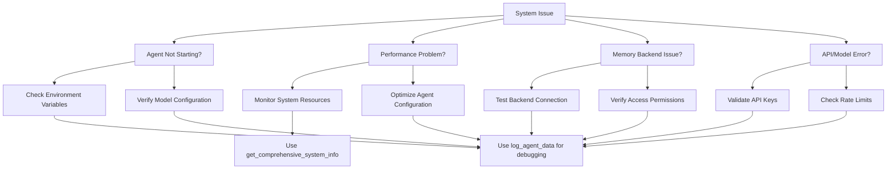

<!-- source: DeepWiki mcp.deepwiki.com · repo kyegomez/swarms · page 11 Best Practices & Troubleshooting · fetched 2026-10-26 -->

# Best Practices & Troubleshooting

<details>
<summary>Relevant source files</summary>

The following files were used as context for generating this wiki page:

- [SECURITY.md](SECURITY.md)
- [docs/concepts/limitations.md](docs/concepts/limitations.md)
- [docs/index.md](docs/index.md)
- [docs/swarms/models/gemini.md](docs/swarms/models/gemini.md)
- [docs/swarms_cloud/best_practices.md](docs/swarms_cloud/best_practices.md)
- [docs/swarms_platform/monetize.md](docs/swarms_platform/monetize.md)
- [swarms/telemetry/__init__.py](swarms/telemetry/__init__.py)
- [swarms/telemetry/main.py](swarms/telemetry/main.py)

</details>


## Purpose and Scope

This document provides production-grade best practices, performance optimization techniques, and troubleshooting guidance for deploying and maintaining Swarms framework applications. It covers configuration strategies, common issues, debugging approaches, and operational considerations for enterprise deployments.

For cloud-specific API best practices, see [Swarms Cloud API](#9.1). For security-focused guidance, see [Security Considerations](#11.3). For performance-specific optimizations, see [Performance Optimization](#11.2).

## Configuration Architecture Overview

### Core Configuration Components



Sources: [docs/index.md:1-92](), [swarms/telemetry/main.py:1-135]()

### Production Deployment Pipeline

```mermaid
graph LR
    subgraph "Development Environment"
        LocalDev["Local Development"]
        DockerLocal["Docker Container"]
        Testing["Pytest Test Suite"]
    end
    
    subgraph "CI/CD Pipeline"
        CodeQuality["Black + Ruff + Flake8"]
        SecurityScan["Codacy + CodeQL"]
        MultiPython["Python 3.10-3.12 Testing"]
    end
    
    subgraph "Production Environment"
        SwarmsCloud["Swarms Cloud API"]
        LoadBalancing["Load Balancing"]
        Monitoring["System Monitoring"]
    end
    
    LocalDev --> DockerLocal
    DockerLocal --> Testing
    Testing --> CodeQuality
    CodeQuality --> SecurityScan
    SecurityScan --> MultiPython
    MultiPython --> SwarmsCloud
    SwarmsCloud --> LoadBalancing
    LoadBalancing --> Monitoring
```



Sources: [docs/index.md:1-92](), [docs/swarms_cloud/best_practices.md:1-170]()

## Environment Configuration Best Practices

### Essential Environment Variables

| Variable | Purpose | Example | Required |
|----------|---------|---------|----------|
| `OPENAI_API_KEY` | OpenAI model access | `sk-...` | Yes |
| `ANTHROPIC_API_KEY` | Anthropic model access | `sk-ant-...` | Optional |
| `GEMINI_API_KEY` | Google Gemini access | `AIza...` | Optional |
| `GROQ_API_KEY` | Groq model access | `gsk_...` | Optional |
| `REDIS_URL` | Redis backend connection | `redis://localhost:6379` | Optional |
| `SUPABASE_URL` | Supabase backend connection | `https://...` | Optional |

### Secure API Key Management

```python
# Recommended pattern from codebase
def get_api_key_from_env(key_name: str) -> str:
    """Secure API key retrieval with validation"""
    api_key = os.getenv(key_name)
    if not api_key:
        raise ValueError(f"Missing required environment variable: {key_name}")
    return api_key
```

**Best Practices:**
- Store API keys in environment variables, never in code
- Use key rotation strategies for production systems
- Implement key validation at startup
- Use separate keys for development/staging/production environments

Sources: [SECURITY.md:1-40](), [docs/swarms/models/gemini.md:40-47]()

## Performance Optimization Strategies

### Agent Configuration Optimization

| Configuration | Recommended Value | Impact | Use Case |
|--------------|------------------|---------|----------|
| `max_tokens` | 1000-4000 | Response length control | Cost optimization |
| `temperature` | 0.1-0.3 | Consistency vs creativity | Production systems |
| `streaming` | `True` | Real-time response | Interactive applications |
| `retry_attempts` | 3-5 | Reliability | High-availability systems |

### Memory Backend Selection



Sources: [docs/swarms_cloud/best_practices.md:35-49]()

### Resource Utilization Monitoring

The framework includes comprehensive system monitoring capabilities:

```python
# System information collection from telemetry
system_info = get_comprehensive_system_info()
# Returns: CPU count, memory usage, platform details
```

**Key Metrics to Monitor:**
- CPU utilization (`cpu_count_logical`, `cpu_count_physical`)
- Memory usage (`memory_total_gb`, `memory_used_gb`, `memory_available_gb`)
- Response times and token consumption
- Error rates and retry patterns

Sources: [swarms/telemetry/main.py:34-93]()

## Common Troubleshooting Scenarios

### Error Handling Patterns

| Error Type | Typical Cause | Solution Pattern | Prevention |
|------------|---------------|------------------|------------|
| API Key Invalid | Missing/incorrect keys | Environment validation | Startup checks |
| Rate Limit Exceeded | Too many requests | Exponential backoff | Request throttling |
| Model Timeout | Long processing | Increase timeout limits | Async processing |
| Memory Errors | Large conversations | Conversation truncation | Context management |
| Connection Errors | Network issues | Retry with circuit breaking | Health checks |

### Agent Initialization Issues

```python
# Common initialization problems and solutions
try:
    agent = Agent(
        agent_name="production_agent",
        system_prompt="Your system prompt",
        llm=your_llm_instance,
        max_loops=5,
        autosave=True,
        verbose=True  # Enable for debugging
    )
except Exception as e:
    # Log comprehensive system info for debugging
    log_agent_data({"error": str(e), "context": "agent_init"})
```

### Memory Backend Troubleshooting

| Backend | Common Issue | Debug Approach | Solution |
|---------|--------------|----------------|----------|
| Redis | Connection refused | Check `REDIS_URL` | Verify Redis service status |
| Supabase | Authentication failed | Validate API keys | Check project settings |
| SQLite | Database locked | File permissions | Ensure write access |
| In-Memory | Data loss | Expected behavior | Use persistent backend |

Sources: [swarms/telemetry/main.py:130-135]()

## Production Deployment Guidelines

### Service Tier Selection



### Deployment Architecture Patterns

| Pattern | Components | Benefits | Use Cases |
|---------|------------|----------|-----------|
| **Single Agent** | `Agent` + `LiteLLM` | Simple, fast deployment | Prototyping, simple tasks |
| **Sequential Workflow** | `SequentialWorkflow` | Ordered processing | Document analysis, pipelines |
| **Concurrent Processing** | `ConcurrentWorkflow` | Parallel execution | Batch processing, scaling |
| **Hierarchical System** | `HierarchicalSwarm` | Complex coordination | Enterprise workflows |

Sources: [docs/swarms_cloud/best_practices.md:50-58]()

## Monitoring and Observability

### Telemetry Integration

The framework provides built-in telemetry through the `log_agent_data` function:

```python
# Automatic telemetry data collection
telemetry_data = {
    "agent_name": agent.agent_name,
    "model_name": agent.llm.model_name,
    "execution_time": execution_time,
    "token_usage": token_count,
    "success": success_status
}
log_agent_data(telemetry_data)
```

**Collected System Information:**
- Platform details (`platform.system()`, `platform.release()`)
- Hardware specs (`cpu_count`, memory usage)
- Network information (`hostname`, `mac_address`)
- Unique system identifier for tracking

Sources: [swarms/telemetry/main.py:95-135](), [swarms/telemetry/__init__.py:1-14]()

### Performance Benchmarks

| Metric | Target Range | Warning Threshold | Critical Threshold |
|--------|--------------|-------------------|-------------------|
| Response Time (Standard) | < 2s | > 5s | > 10s |
| Response Time (Flex) | < 15s | > 30s | > 60s |
| Success Rate | > 99% | < 95% | < 90% |
| Memory Usage | < 80% | > 90% | > 95% |
| CPU Utilization | < 70% | > 85% | > 95% |

### Error Tracking and Debugging

```python
# Enhanced error logging pattern
try:
    result = agent.run(task="Your task")
except Exception as error:
    error_data = {
        "error_type": type(error).__name__,
        "error_message": str(error),
        "agent_config": agent.to_dict(),
        "system_state": get_comprehensive_system_info()
    }
    log_agent_data(error_data)
    raise
```

Sources: [docs/swarms_cloud/best_practices.md:152-164]()

## Security and Compliance

### Security Configuration Checklist

- [ ] Environment variables for all API keys
- [ ] No hardcoded credentials in source code  
- [ ] Secure storage backend configuration
- [ ] Network encryption for data transmission
- [ ] Access control for agent management
- [ ] Regular dependency updates
- [ ] Vulnerability scanning in CI/CD

### Data Protection Measures

| Security Feature | Implementation | Benefit |
|------------------|----------------|---------|
| Environment Variables | Secure configuration | Prevents credential exposure |
| Data Encryption | Backend-level encryption | Protects sensitive data |
| Access Control | Authentication/authorization | Restricts system access |
| Dependency Security | Regular vulnerability scans | Reduces security risks |
| Audit Logging | Comprehensive activity logs | Enables security monitoring |

Sources: [SECURITY.md:1-40]()

## Troubleshooting Decision Tree



Sources: [swarms/telemetry/main.py:1-135](), [docs/swarms_cloud/best_practices.md:70-82]()

---

