<!-- source: DeepWiki mcp.deepwiki.com · repo kyegomez/swarms · page 11.1 Configuration Best Practices · fetched 2026-10-26 -->

# Configuration Best Practices

Relevant source files

The following files were used as context for generating this wiki page:

- [.env.example](.env.example)
- [docs/concepts/limitations.md](docs/concepts/limitations.md)
- [docs/index.md](docs/index.md)
- [docs/swarms_cloud/best_practices.md](docs/swarms_cloud/best_practices.md)
- [swarms/schemas/__init__.py](swarms/schemas/__init__.py)

This document provides comprehensive guidance for configuring the Swarms framework optimally across different deployment scenarios. It covers environment setup, agent configuration, model integration, storage backends, and production-ready settings that ensure reliable multi-agent system operation.

For information about performance optimization techniques, see [Performance Optimization](#11.2). For security-specific configuration considerations, see [Security Considerations](#11.3). For basic environment setup instructions, see [Environment Setup](#8.1).

## Configuration Architecture Overview

The Swarms framework employs a hierarchical configuration system that spans multiple layers, from environment variables to agent-specific settings.

**Configuration Flow Architecture**
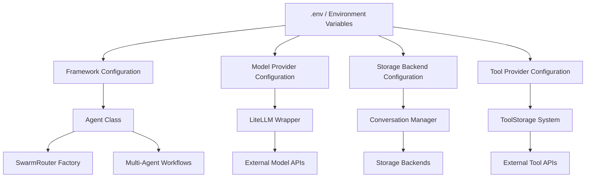

Sources: [.env.example:1-49](), [docs/swarms_cloud/best_practices.md:1-170]()

## Environment Configuration

### Core Framework Settings

The framework's primary configuration is managed through environment variables that control global behavior and workspace management.

| Variable | Purpose | Default | Best Practice |
|----------|---------|---------|---------------|
| `WORKSPACE_DIR` | Agent workspace directory | `"agent_workspace"` | Use absolute paths in production |
| `SWARMS_VERBOSE_GLOBAL` | Global logging verbosity | `"False"` | Set to `"True"` for development |
| `SWARMS_API_KEY` | Swarms Cloud API authentication | - | Rotate keys every 90 days |

**Environment Configuration Hierarchy**
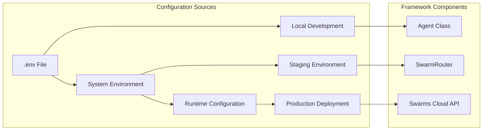

Sources: [.env.example:1-5]()

### Model Provider Configuration

Configure API keys for different LLM providers to enable model switching and fallback mechanisms.

**Primary Model Providers**
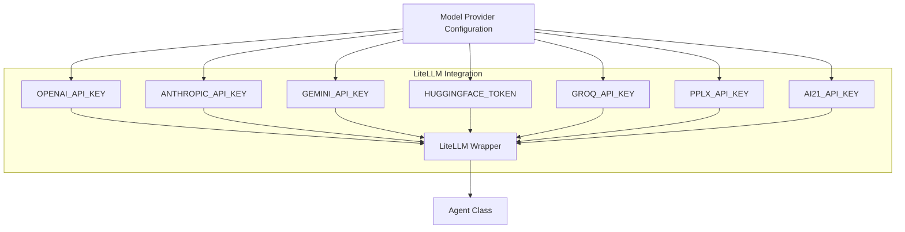

**Best Practices for Model Configuration:**

1. **Provider Redundancy**: Configure multiple providers for fallback scenarios
2. **Key Rotation**: Implement automated key rotation for production environments
3. **Usage Monitoring**: Track API usage across different providers
4. **Cost Optimization**: Route requests to cost-effective models based on task complexity

Sources: [.env.example:6-26]()

### Azure OpenAI Configuration

For enterprise deployments using Azure OpenAI services, additional configuration parameters are required.

| Variable | Purpose | Example |
|----------|---------|---------|
| `AZURE_OPENAI_ENDPOINT` | Azure OpenAI service endpoint | `https://your-resource.openai.azure.com/` |
| `AZURE_OPENAI_DEPLOYMENT` | Deployment name | `gpt-4-deployment` |
| `OPENAI_API_VERSION` | API version | `2024-02-15-preview` |
| `AZURE_OPENAI_API_KEY` | Azure API key | - |
| `AZURE_OPENAI_AD_TOKEN` | Azure AD token (alternative auth) | - |

Sources: [.env.example:42-49]()

## Agent Configuration Patterns

### Standard Agent Configuration

Configure agents with optimal settings for different deployment scenarios.

**Agent Configuration Components**
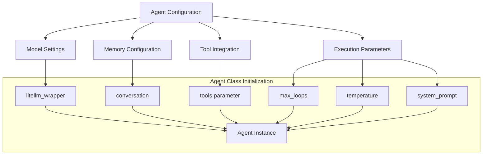

**Recommended Configuration Patterns:**

| Scenario | `max_loops` | `temperature` | Memory Backend | Tool Count |
|----------|-------------|---------------|----------------|------------|
| Development | 3 | 0.7 | In-memory | 5-10 |
| Production | 5 | 0.3 | Redis/Supabase | 10-20 |
| High-throughput | 2 | 0.1 | Redis | 5-15 |
| Research | 10 | 0.8 | DuckDB | 15-30 |

Sources: Based on configuration patterns from the Agent class architecture

### Multi-Agent Workflow Configuration

Different workflow patterns require specific configuration approaches for optimal performance.

**Workflow Configuration Matrix**
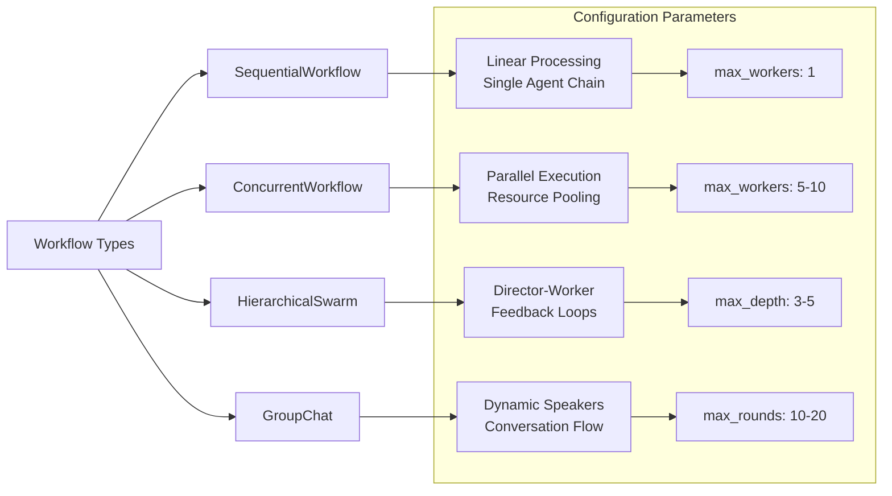

Sources: [docs/swarms_cloud/best_practices.md:7-23]()

## Storage Backend Configuration

### Backend Selection Matrix

Choose appropriate storage backends based on deployment requirements and performance needs.

| Backend | Use Case | Configuration | Performance |
|---------|----------|---------------|-------------|
| `InMemory` | Development, Testing | No external deps | High read/write |
| `Redis` | Production, Caching | Redis connection string | Very high |
| `Supabase` | Distributed, Persistent | PostgreSQL URL, API key | High |
| `SQLite` | Local, Single-instance | File path | Medium |
| `DuckDB` | Analytics, Reporting | File path | High analytical |

**Storage Backend Architecture**
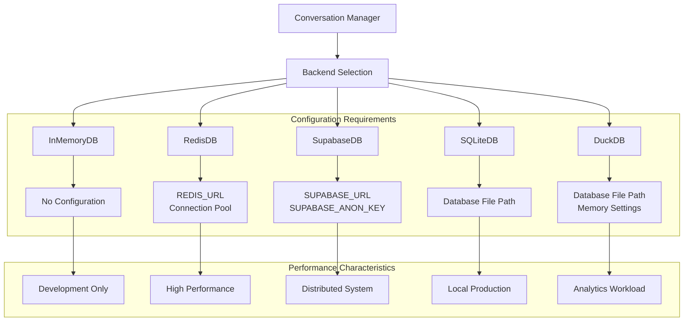

Sources: Based on conversation backend architecture from the framework

### Tool Provider Configuration

Configure external tool providers for enhanced agent capabilities.

**Tool Provider Integration**
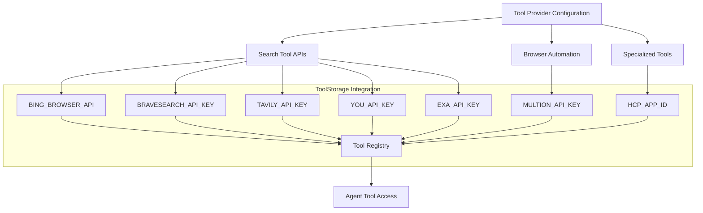

Sources: [.env.example:27-41]()

## Production Configuration Best Practices

### Security Configuration

Implement secure configuration management for production deployments.

**Security Configuration Layers**
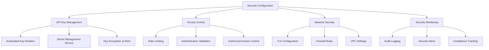

**Security Best Practices:**

1. **Never hardcode API keys** in source code
2. **Use environment-specific configurations** for different deployment stages
3. **Implement key rotation policies** (90-day maximum)
4. **Enable audit logging** for all configuration changes
5. **Use secure secret management services** (AWS Secrets Manager, Azure Key Vault)

Sources: [docs/swarms_cloud/best_practices.md:143-150]()

### Performance Configuration

Optimize configuration settings for high-performance production deployments.

| Component | Configuration | Impact | Recommended Value |
|-----------|---------------|--------|-------------------|
| **Agent Pool Size** | Concurrent agents | Memory usage | 5-10 agents |
| **Connection Pooling** | Database connections | I/O performance | 10-20 connections |
| **Cache TTL** | Response caching | Response time | 300-3600 seconds |
| **Timeout Settings** | Request timeouts | Reliability | 30-120 seconds |
| **Batch Size** | Bulk operations | Throughput | 10-50 items |

**Performance Configuration Architecture**
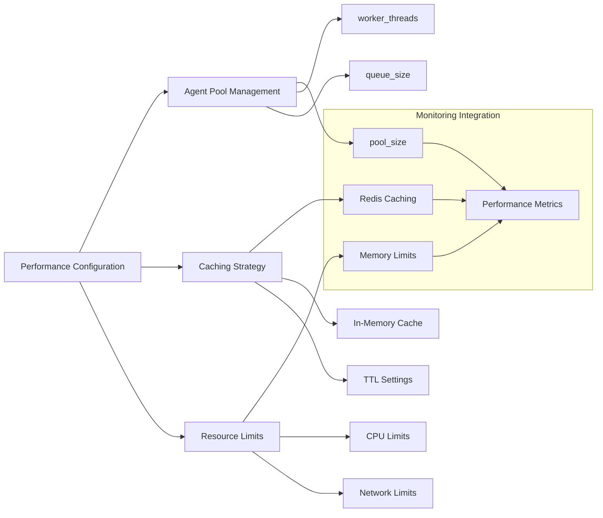

Sources: [docs/swarms_cloud/best_practices.md:152-164]()

### Environment-Specific Configuration

Implement configuration strategies that adapt to different deployment environments.

| Environment | Configuration Strategy | Key Considerations |
|-------------|----------------------|-------------------|
| **Development** | Local file-based config | Fast iteration, debugging enabled |
| **Staging** | Environment variables | Production-like, monitoring enabled |
| **Production** | Secret management service | High security, performance optimized |
| **Testing** | Isolated config | Reproducible, isolated from other envs |

**Configuration Management Workflow**
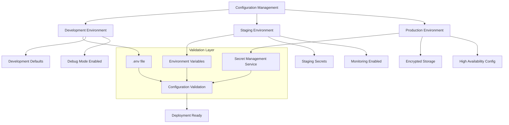

Sources: [docs/swarms_cloud/best_practices.md:130-151]()

## Configuration Validation and Testing

### Validation Patterns

Implement comprehensive configuration validation to prevent runtime errors.

**Configuration Validation Framework**
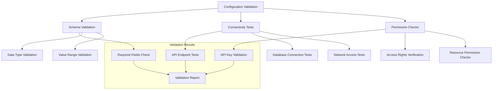

**Configuration Testing Checklist:**

1. **API Key Validation**: Test all configured API keys for validity
2. **Database Connectivity**: Verify all storage backend connections
3. **Tool Integration**: Validate external tool API access
4. **Resource Limits**: Confirm memory and CPU constraints
5. **Network Access**: Test external service connectivity
6. **Permission Verification**: Validate service account permissions

Sources: [swarms/schemas/__init__.py:1-12]()

## Troubleshooting Common Configuration Issues

### Common Configuration Problems

| Issue | Symptoms | Solution |
|-------|----------|----------|
| **Missing API Keys** | Authentication errors | Verify `.env` file and environment variables |
| **Invalid Endpoints** | Connection timeouts | Check endpoint URLs and network connectivity |
| **Permission Denied** | Authorization errors | Validate API key permissions and rate limits |
| **Resource Exhaustion** | Performance degradation | Adjust pool sizes and resource limits |
| **Configuration Conflicts** | Inconsistent behavior | Review configuration precedence and overrides |

### Diagnostic Configuration

Enable comprehensive logging and monitoring for configuration troubleshooting.

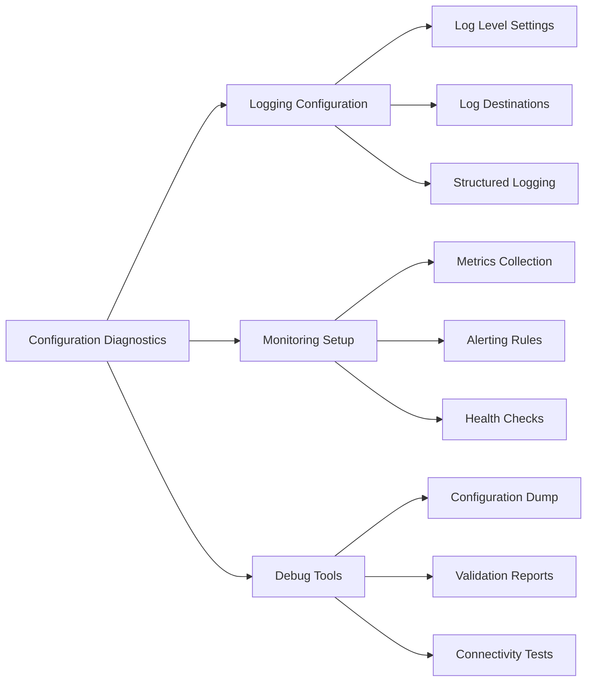

**Diagnostic Best Practices:**

1. **Enable verbose logging** during configuration setup
2. **Implement health checks** for all external dependencies
3. **Use configuration validation tools** before deployment
4. **Monitor configuration drift** in production environments
5. **Maintain configuration documentation** and change logs

Sources: [docs/concepts/limitations.md:132-159]()

---

