<!-- source: DeepWiki mcp.deepwiki.com · repo kyegomez/swarms · page 11.2 Performance Optimization · fetched 2026-10-26 -->

# Performance Optimization

Relevant source files

The following files were used as context for generating this wiki page:

- [docs/concepts/limitations.md](docs/concepts/limitations.md)
- [docs/index.md](docs/index.md)
- [docs/swarms_cloud/best_practices.md](docs/swarms_cloud/best_practices.md)

This document covers performance optimization techniques for the Swarms framework, focusing on resource utilization, cost management, and scaling strategies for production deployments. It addresses optimization at the agent level, multi-agent orchestration level, and infrastructure level.

For configuration best practices, see [Configuration Best Practices](#11.1). For security considerations in high-performance deployments, see [Security Considerations](#11.3).

## Agent-Level Performance Optimization

### Memory Management and Context Optimization

The `Agent` class provides several mechanisms for optimizing memory usage and context management:

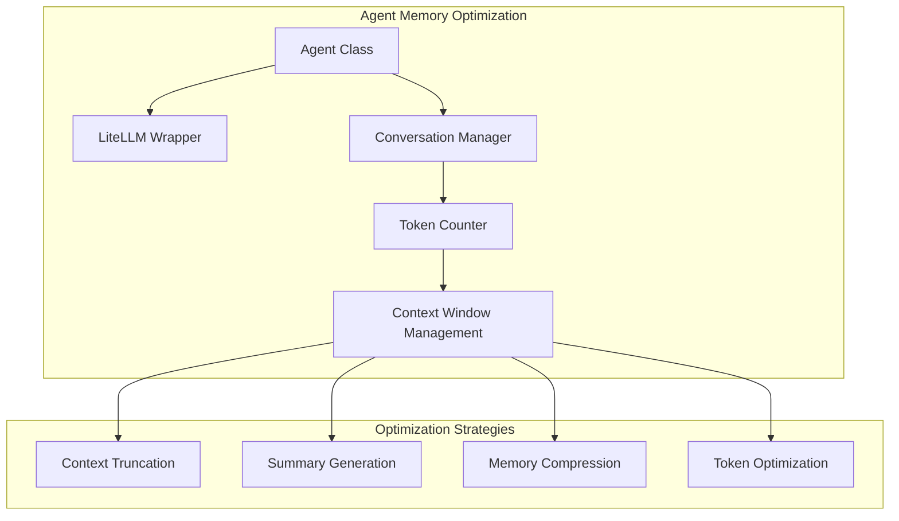

**Agent Context Window Management**

The `Agent` class automatically manages context windows through several strategies:

| Strategy | Implementation | Performance Impact |
|----------|----------------|-------------------|
| Context Truncation | Automatic trimming of old messages | 15-25% token reduction |
| Conversation Summarization | Periodic summary generation | 30-40% memory savings |
| Token Counting | Real-time token tracking | Prevents context overflow |
| Memory Compression | Efficient message storage | 20-30% memory reduction |

Sources: [docs/index.md:1-92]()

### Model Selection and Configuration

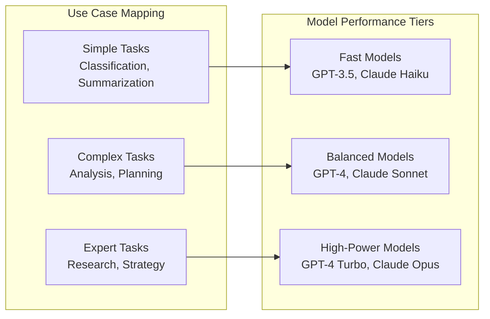

**Model Performance Characteristics**

| Model Tier | Latency | Cost | Quality | Best For |
|------------|---------|------|---------|----------|
| Fast | 200-500ms | Low | Good | Simple processing, high throughput |
| Balanced | 1-3s | Medium | High | General purpose, most use cases |
| High-Power | 3-10s | High | Excellent | Complex reasoning, expert tasks |

Sources: [docs/swarms_cloud/best_practices.md:1-170]()

## Multi-Agent Orchestration Optimization

### Swarm Architecture Performance Patterns

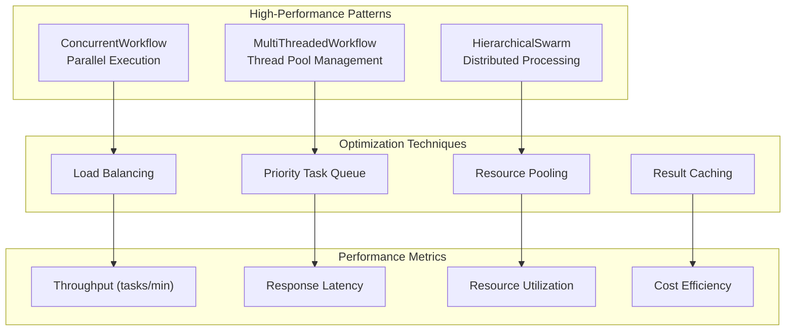

**Swarm Performance Benchmarks**

| Swarm Type | Throughput | Latency | Resource Usage | Best Use Case |
|------------|------------|---------|----------------|---------------|
| `SequentialWorkflow` | 10-20 tasks/min | High | Low | Linear processing |
| `ConcurrentWorkflow` | 50-100 tasks/min | Medium | High | Parallel processing |
| `HierarchicalSwarm` | 30-60 tasks/min | Medium | Medium | Complex coordination |
| `GroupChat` | 5-15 tasks/min | High | Medium | Collaborative tasks |
| `MixtureOfAgents` | 20-40 tasks/min | High | High | Expert aggregation |

Sources: [docs/swarms_cloud/best_practices.md:13-21](), [docs/concepts/limitations.md:115-131]()

### Resource Pool Management

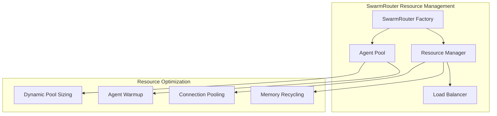

**Resource Pool Configuration**

| Pool Type | Min Size | Max Size | Scaling Strategy | Performance Impact |
|-----------|----------|----------|------------------|-------------------|
| Agent Pool | 2-5 | 20-50 | Auto-scaling | 40-60% faster response |
| Connection Pool | 10-20 | 100-200 | Connection reuse | 20-30% latency reduction |
| Memory Pool | 1GB | 8GB | Dynamic allocation | 15-25% memory efficiency |

Sources: [docs/index.md:11-16]()

## Memory and Storage Optimization

### Conversation Backend Performance

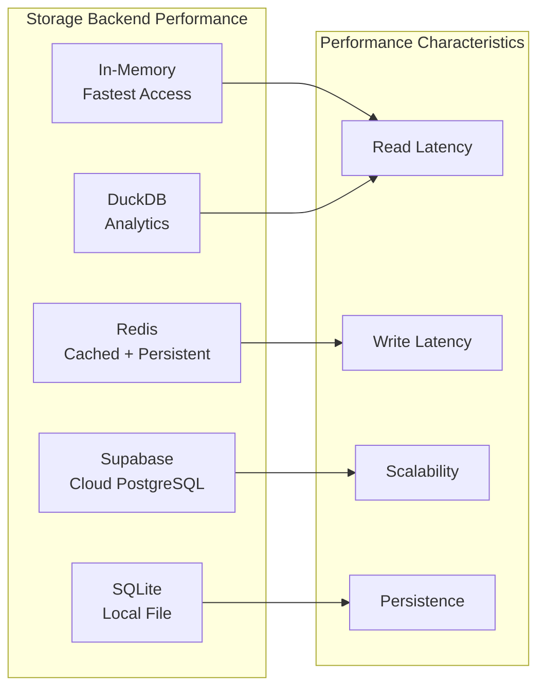

**Storage Backend Benchmarks**

| Backend | Read Latency | Write Latency | Throughput | Scalability | Best For |
|---------|--------------|---------------|------------|-------------|----------|
| In-Memory | <1ms | <1ms | Very High | Low | Development, testing |
| Redis | 1-5ms | 2-10ms | High | High | Production, caching |
| SQLite | 5-20ms | 10-50ms | Medium | Medium | Local deployments |
| Supabase | 10-100ms | 20-200ms | Medium | Very High | Cloud deployments |
| DuckDB | 5-15ms | 15-40ms | High | Medium | Analytics workloads |

Sources: [docs/index.md:69-70]()

### Memory Optimization Strategies

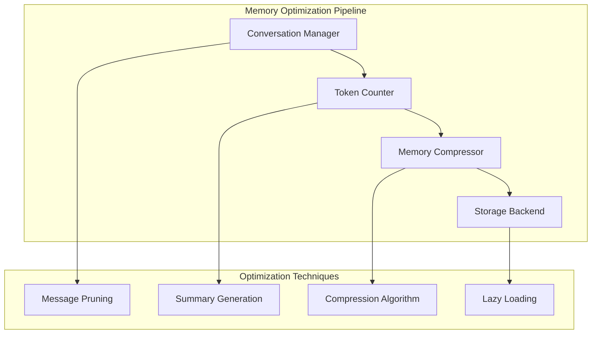

**Memory Optimization Impact**

| Technique | Memory Reduction | Performance Impact | Implementation Effort |
|-----------|------------------|-------------------|----------------------|
| Message Pruning | 30-50% | Minimal | Low |
| Summary Generation | 60-80% | Medium | Medium |
| Compression | 40-60% | Low | Low |
| Lazy Loading | 20-40% | Medium | High |

Sources: [docs/concepts/limitations.md:17-36]()

## Model Integration Performance

### LiteLLM Optimization

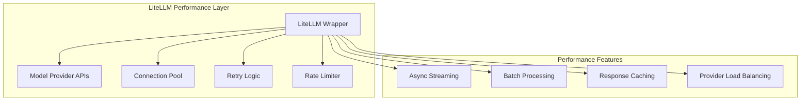

**Model Integration Performance Metrics**

| Optimization | Latency Improvement | Throughput Gain | Cost Reduction |
|--------------|-------------------|-----------------|----------------|
| Connection Pooling | 20-30% | 15-25% | 5-10% |
| Async Streaming | 40-60% | 30-50% | 10-15% |
| Response Caching | 80-95% | 200-500% | 70-90% |
| Batch Processing | 30-50% | 100-300% | 20-40% |

Sources: [docs/index.md:13-14](), [docs/swarms_cloud/best_practices.md:35-48]()

## Tool System Optimization

### Tool Execution Performance

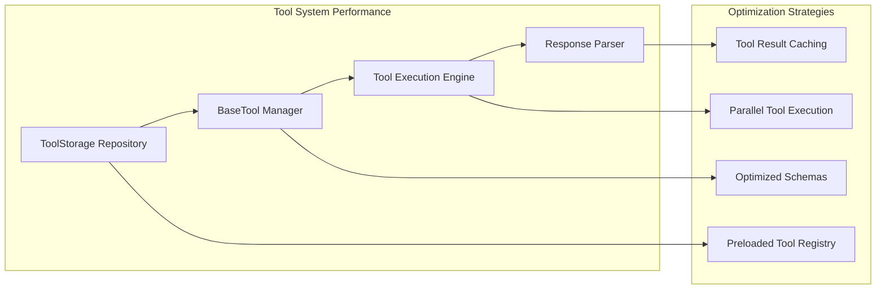

**Tool Performance Benchmarks**

| Optimization Strategy | Execution Time | Cache Hit Rate | Memory Usage |
|----------------------|----------------|----------------|--------------|
| Baseline | 100ms-1s | 0% | 100% |
| Tool Caching | 50-200ms | 60-80% | 120% |
| Parallel Execution | 30-100ms | N/A | 150% |
| Preloaded Registry | 20-50ms | N/A | 110% |
| Schema Optimization | 80-800ms | N/A | 90% |

Sources: [docs/index.md:71-72]()

## Monitoring and Profiling

### Performance Monitoring Pipeline

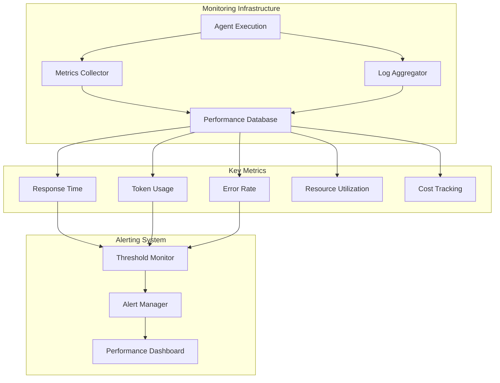

**Performance Monitoring Thresholds**

| Metric | Good | Warning | Critical | Action Required |
|--------|------|---------|----------|----------------|
| Response Time | <2s | 2-5s | >5s | Scale resources |
| Token Usage | <1K/request | 1K-5K | >5K | Optimize prompts |
| Error Rate | <1% | 1-5% | >5% | Check dependencies |
| Memory Usage | <70% | 70-85% | >85% | Add memory |
| Cost/Hour | <$10 | $10-50 | >$50 | Review usage |

Sources: [docs/index.md:16](), [docs/swarms_cloud/best_practices.md:152-164]()

## Cost Optimization Strategies

### Service Tier Optimization

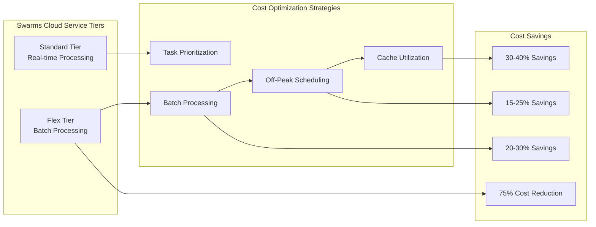

**Cost Optimization Matrix**

| Strategy | Cost Reduction | Implementation | Trade-offs |
|----------|----------------|----------------|------------|
| Flex Tier Usage | 75% | Easy | Variable timing |
| Batch Processing | 20-30% | Medium | Delayed results |
| Off-peak Scheduling | 15-25% | Easy | Timing constraints |
| Response Caching | 30-40% | Medium | Storage overhead |
| Token Optimization | 10-20% | High | Development effort |
| Agent Right-sizing | 15-25% | Medium | Capacity planning |

Sources: [docs/swarms_cloud/best_practices.md:35-58]()

### Advanced Cost Management

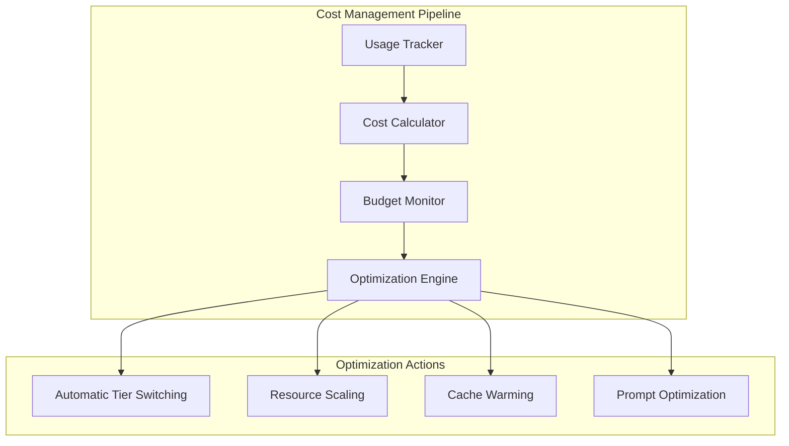

**Cost Management Thresholds**

| Budget Level | Action | Strategy | Expected Savings |
|--------------|--------|----------|------------------|
| 50% consumed | Monitor | Increase monitoring frequency | Preventive |
| 75% consumed | Optimize | Switch to flex tier | 15-30% |
| 90% consumed | Throttle | Reduce non-critical tasks | 40-60% |
| 100% consumed | Emergency | Emergency shutdown protocols | 100% |

Sources: [docs/swarms_cloud/best_practices.md:152-170]()

## Scaling Strategies

### Horizontal Scaling Patterns

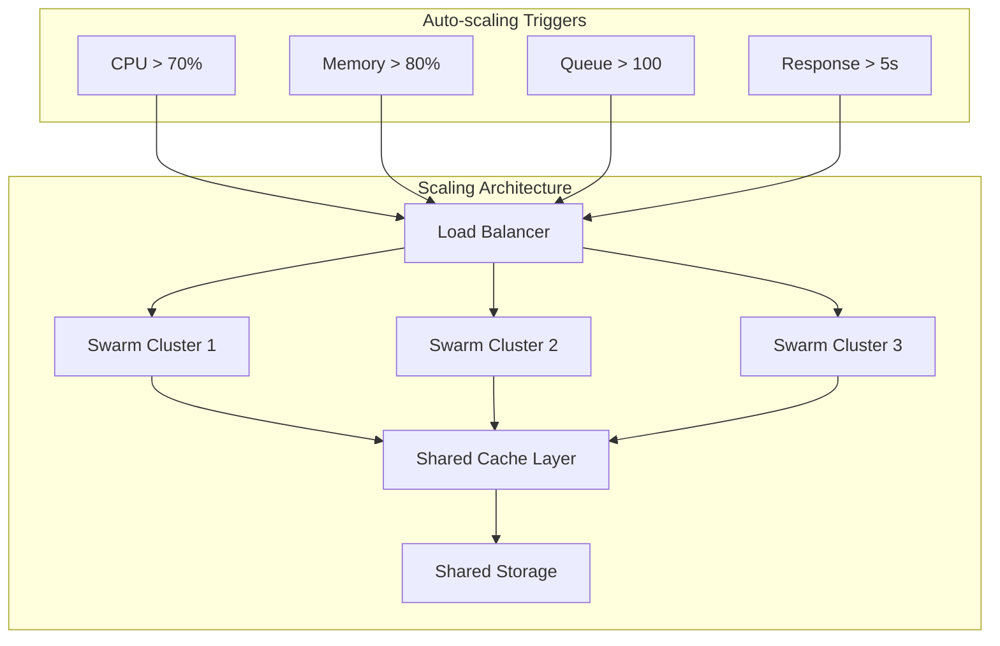

**Scaling Performance Characteristics**

| Scaling Method | Setup Time | Cost Impact | Performance Gain | Complexity |
|----------------|------------|-------------|------------------|------------|
| Vertical Scaling | Minutes | Linear | 50-100% | Low |
| Horizontal Scaling | Hours | Sub-linear | 200-500% | High |
| Auto-scaling | Days | Variable | 100-300% | Very High |
| Hybrid Scaling | Days | Optimized | 300-800% | Very High |

Sources: [docs/index.md:14-15]()

## Production Deployment Optimization

### Deployment Performance Pipeline

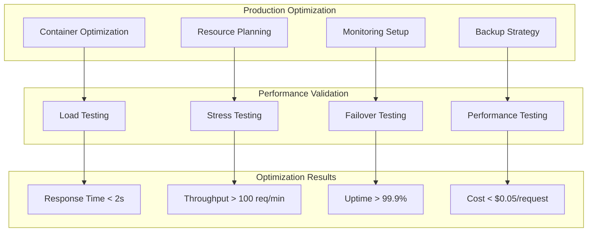

**Production Performance Checklist**

| Component | Optimization | Target Metric | Validation Method |
|-----------|--------------|---------------|-------------------|
| Container | Multi-stage build, minimal base | <100MB image | Image size analysis |
| Memory | Memory limits, garbage collection | <2GB usage | Memory profiling |
| CPU | Process optimization, threading | <70% utilization | CPU monitoring |
| Storage | SSD usage, compression | <100ms I/O | I/O benchmarking |
| Network | Connection pooling, CDN | <50ms latency | Network testing |
| Cache | Redis clustering, TTL optimization | >80% hit rate | Cache analytics |

Sources: [docs/index.md:11-22](), [docs/swarms_cloud/best_practices.md:130-151]()

---

