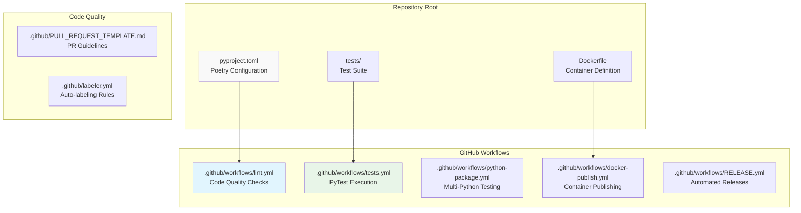
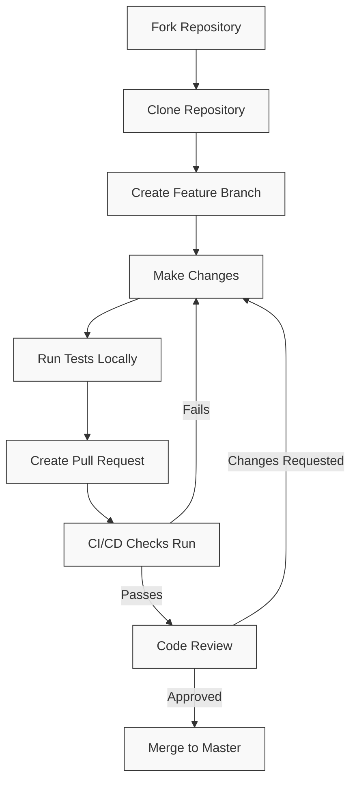
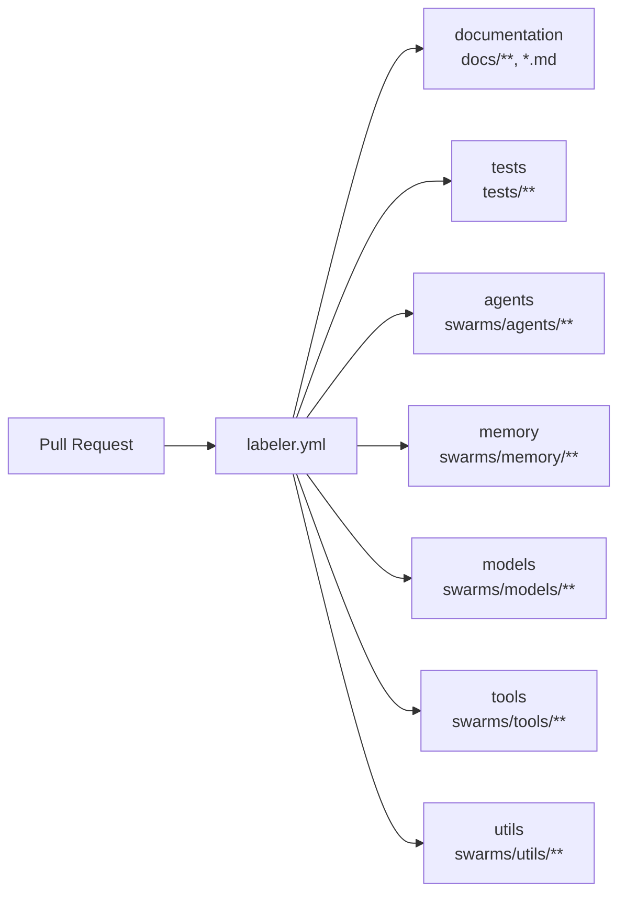
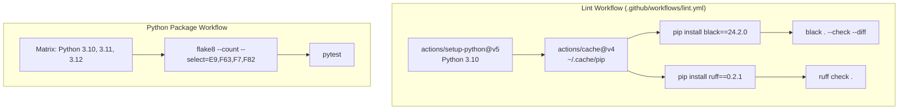
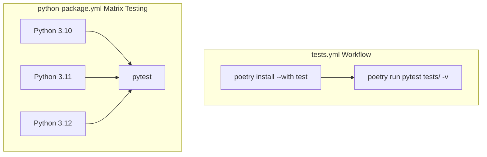
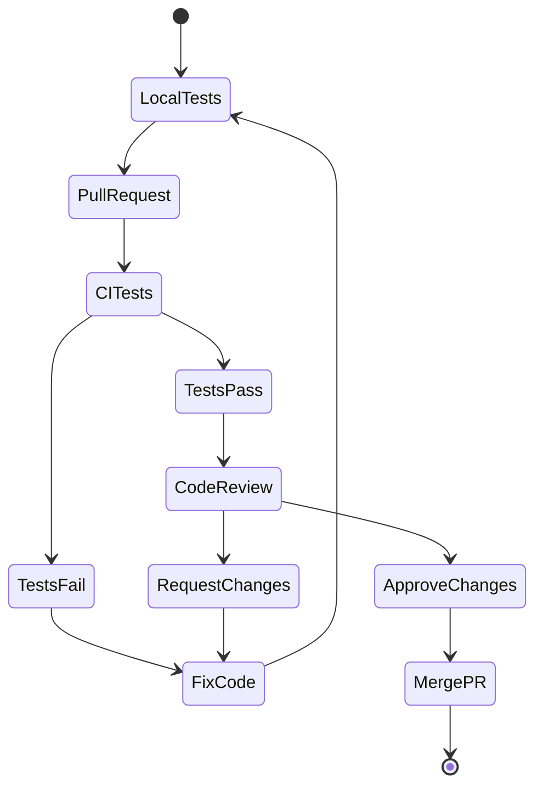
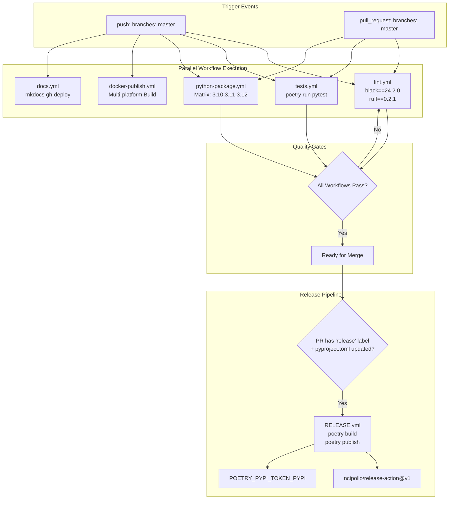
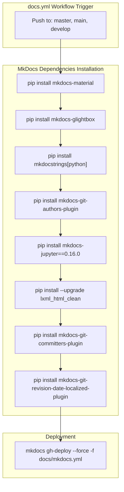
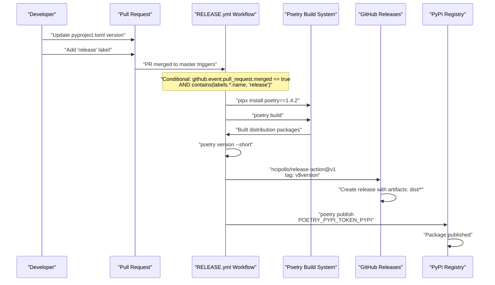
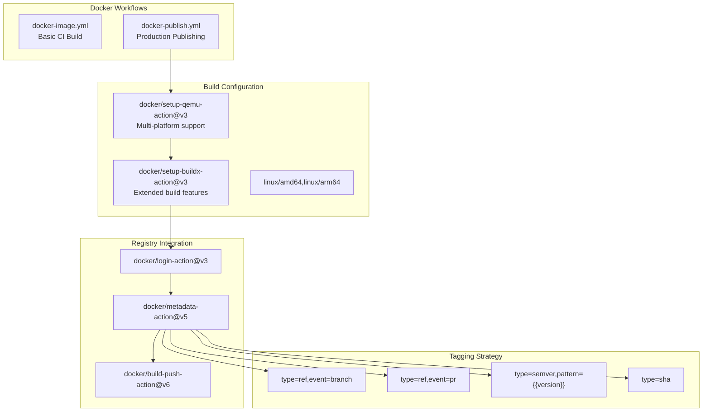

<!-- source: DeepWiki mcp.deepwiki.com · repo kyegomez/swarms · page 12 Contributing · fetched 2026-10-26 -->

# Contributing

<details>
<summary>Relevant source files</summary>

The following files were used as context for generating this wiki page:

- [.github/PULL_REQUEST_TEMPLATE.md](.github/PULL_REQUEST_TEMPLATE.md)
- [.github/workflows/RELEASE.yml](.github/workflows/RELEASE.yml)
- [.github/workflows/docker-image.yml](.github/workflows/docker-image.yml)
- [.github/workflows/docker-publish.yml](.github/workflows/docker-publish.yml)
- [.github/workflows/docs.yml](.github/workflows/docs.yml)
- [.github/workflows/lint.yml](.github/workflows/lint.yml)
- [.github/workflows/python-package.yml](.github/workflows/python-package.yml)
- [.github/workflows/tests.yml](.github/workflows/tests.yml)
- [docs/overrides/main.html](docs/overrides/main.html)

</details>


This page provides comprehensive guidelines for developers contributing to the Swarms framework. It covers the development workflow, code quality standards, automated testing, and the CI/CD pipeline infrastructure. The Swarms project maintains production-grade standards through automated tooling and comprehensive testing across multiple Python versions.

## Table of Contents

- [Getting Started](#getting-started)
- [Contribution Workflow](#contribution-workflow)
- [Development Standards](#development-standards)
- [Testing Requirements](#testing-requirements)
- [CI/CD Pipeline](#cicd-pipeline)
- [Documentation](#documentation)
- [Release Process](#release-process)

## Getting Started

The Swarms project follows a standard GitHub contribution workflow with comprehensive automated testing and quality assurance. Contributors must set up local development environments and ensure all automated checks pass before merge.

### Prerequisites

- Python 3.10, 3.11, or 3.12
- Poetry for dependency management
- Docker (optional for containerized development)
- Git for version control

### Repository Structure

**Core Development Components**


Sources: [.github/workflows/lint.yml:1-34](), [.github/workflows/tests.yml:1-32](), [.github/workflows/python-package.yml:1-43](), [.github/workflows/docker-publish.yml:1-74](), [.github/workflows/RELEASE.yml:1-48]()

## Contribution Workflow

The following diagram illustrates the standard contribution workflow for the Swarms project:

**Contribution Workflow Diagram**


Sources: [.github/workflows/test.yml:1-60](), [.github/workflows/python-package.yml:1-43]()

### Issue Tracking

Before starting work on a new feature or bug fix, check the existing issues or create a new one to discuss your proposed changes. This helps avoid duplicate efforts and ensures your contribution aligns with the project's roadmap.

When creating a new issue:
- Use a clear, descriptive title
- Provide detailed steps to reproduce bugs
- Include expected vs. actual behavior
- Attach screenshots or code snippets if applicable

### Pull Request Process

The project uses a structured pull request template to ensure consistent contribution quality:

**Pull Request Requirements**
- **Description**: Clear explanation of changes made
- **Issue**: Link to related issue number if applicable  
- **Dependencies**: Any new dependencies required
- **Tag maintainer**: Specific maintainer based on component modified
- **Tests**: Unit tests that don't rely on network access
- **Examples**: Notebook demonstrating new integrations

**Maintainer Assignment by Component**

| Component | Maintainer Contact | File Paths |
|-----------|-------------------|------------|
| General/Misc | kye@apac.ai | All unspecified areas |
| DataLoaders/VectorStores/Retrievers | kye@apac.ai | `swarms/memory/` |
| Models | kye@apac.ai | `swarms/models/` |
| Memory Systems | kye@apac.ai | `swarms/memory/` |
| Agent Structures | kye@apac.ai | `swarms/structures/` |

**Automated PR Labeling System**


Sources: [.github/PULL_REQUEST_TEMPLATE.md:1-30](), [.github/labeler.yml:1-35](), [.github/workflows/label.yml:1-21]()

## Development Standards

Swarms maintains high code quality standards through automated linting and formatting tools. All contributions must adhere to these standards.

**Code Quality Pipeline Architecture**


**Code Quality Tool Specifications**

| Tool | Version | Purpose | Workflow File |
|------|---------|---------|---------------|
| `black` | 24.2.0 | Code formatting | [.github/workflows/lint.yml:27]() |
| `ruff` | 0.2.1 | Fast Python linter | [.github/workflows/lint.yml:27]() |
| `flake8` | Latest | Syntax and undefined name checks | [.github/workflows/python-package.yml:34-39]() |
| `pytest` | Latest | Unit testing framework | [.github/workflows/python-package.yml:40]() |

**Quality Check Commands**
```bash
# Local development commands referenced in workflows
black . --check --diff                    # Format checking
ruff check .                              # Linting
flake8 . --count --select=E9,F63,F7,F82  # Critical error detection
pytest                                    # Test execution
```

Sources: [.github/workflows/lint.yml:24-33](), [.github/workflows/python-package.yml:29-42]()

## Testing Requirements

All contributions must include appropriate tests to verify functionality and prevent regressions. The project uses pytest for testing.

### Testing Infrastructure

The project implements multi-stage testing across Python versions with Poetry dependency management:

**Test Execution Workflows**


**Local Testing Commands**
```bash
# Primary test execution (matches tests.yml workflow)
poetry install --with test
poetry run pytest tests/ -v

# Multi-version testing (matches python-package.yml)
python -m pip install flake8 pytest
pytest

# Specific test targeting
poetry run pytest tests/path/to/test_file.py
```

**Test Workflow Specifications**

| Workflow | Python Versions | Command | Trigger |
|----------|----------------|---------|---------|
| `tests.yml` | 3.10 | `poetry run pytest tests/ -v` | Push/PR to master |
| `python-package.yml` | 3.10, 3.11, 3.12 | `pytest` | Push/PR to master |

Sources: [.github/workflows/tests.yml:25-31](), [.github/workflows/python-package.yml:21-42]()

### Test Coverage

The project aims to maintain high test coverage. New features should include tests that cover:
- Happy path functionality
- Edge cases
- Error handling

**Test Execution Workflow**


Sources: [.github/workflows/test.yml:1-60](), [.github/workflows/python-package.yml:1-43]()

## CI/CD Pipeline

The Swarms project implements a comprehensive CI/CD pipeline using GitHub Actions to automate testing, linting, and deployment processes.

**Comprehensive CI/CD Pipeline Implementation**


**Automated Workflow Matrix**

| Workflow File | Triggers | Python Versions | Key Actions |
|---------------|----------|----------------|-------------|
| `lint.yml` | Push/PR to master | 3.10 | `black --check`, `ruff check` |
| `tests.yml` | Push/PR to master | 3.10 | `poetry run pytest tests/ -v` |
| `python-package.yml` | Push/PR to master | 3.10, 3.11, 3.12 | `flake8`, `pytest` |
| `docker-publish.yml` | Push to master, tags | - | Multi-platform Docker build |
| `docs.yml` | Push to master/main/develop | 3.11 | `mkdocs gh-deploy` |
| `RELEASE.yml` | PR merged with release label | 3.9 | `poetry build`, `poetry publish` |

Sources: [.github/workflows/lint.yml:3](), [.github/workflows/tests.yml:4-7](), [.github/workflows/python-package.yml:8-12](), [.github/workflows/docker-publish.yml:3-9](), [.github/workflows/docs.yml:2-7](), [.github/workflows/RELEASE.yml:3-17]()

## Documentation System

The Swarms project uses an automated MkDocs-based documentation system with comprehensive plugin support and custom theming.

**Documentation Build Pipeline**


**Documentation Plugin Stack**

| Plugin | Purpose | Version Constraint |
|--------|---------|-------------------|
| `mkdocs-material` | Base theme | Latest |
| `mkdocs-glightbox` | Image lightbox functionality | Latest |
| `mkdocstrings[python]` | API documentation from docstrings | Latest |
| `mkdocs-git-authors-plugin` | Git author attribution | Latest |
| `mkdocs-jupyter` | Jupyter notebook integration | 0.16.0 |
| `mkdocs-git-committers-plugin` | Git committer information | Latest |
| `mkdocs-git-revision-date-localized-plugin` | Last modification dates | Latest |

**Custom Documentation Features**
- **Footer customization**: [docs/overrides/main.html:1-295]()
- **Company branding**: Swarms brand integration with custom CSS
- **Responsive design**: Mobile-optimized layouts
- **Dark/light mode support**: Theme switching capabilities

Sources: [.github/workflows/docs.yml:16-24](), [docs/overrides/main.html:1-295]()

## Release Process

Releases are automated through the GitHub Actions workflow. Here's how the release process works:

1. Update the version in `pyproject.toml`
2. Create a PR with the version change
3. Add the "release" label to the PR
4. After the PR is merged to master, a new release is automatically created:
   - A GitHub release is created with release notes
   - The package is built and published to PyPI

**Automated Release Pipeline Implementation**


**Release Workflow Configuration**

| Component | Specification | File Reference |
|-----------|---------------|----------------|
| Poetry Version | 1.4.2 | [.github/workflows/RELEASE.yml:12]() |
| Python Version | 3.9 | [.github/workflows/RELEASE.yml:26]() |
| Trigger Condition | `merged == true` AND `contains(labels.*.name, 'release')` | [.github/workflows/RELEASE.yml:15-17]() |
| Build Command | `poetry build` | [.github/workflows/RELEASE.yml:29]() |
| Version Check | `poetry version --short` | [.github/workflows/RELEASE.yml:33]() |
| Release Action | `ncipollo/release-action@v1` | [.github/workflows/RELEASE.yml:35]() |
| PyPI Token | `POETRY_PYPI_TOKEN_PYPI` | [.github/workflows/RELEASE.yml:45]() |

Sources: [.github/workflows/RELEASE.yml:12-47]()

## Docker Development and Deployment

The Swarms project provides comprehensive Docker support for both development and production deployment with multi-platform compatibility.

**Docker Build and Publish Pipeline**


**Docker Workflow Specifications**

| Workflow | Triggers | Platforms | Registry |
|----------|----------|-----------|----------|
| `docker-image.yml` | Push/PR to master | Default | None (CI only) |
| `docker-publish.yml` | Push to master, semver tags | linux/amd64, linux/arm64 | docker.io |

**Docker Environment Variables**
- `REGISTRY`: `docker.io` - [.github/workflows/docker-publish.yml:13]()
- `IMAGE_NAME`: `${{ github.repository }}` - [.github/workflows/docker-publish.yml:15]()
- `DOCKERHUB_USERNAME`: Required secret
- `DOCKERHUB_TOKEN`: Required secret

Sources: [.github/workflows/docker-image.yml:1-19](), [.github/workflows/docker-publish.yml:1-74]()

## Local Development Commands

For efficient local development, use these commands that mirror the CI/CD pipeline:

**Code Quality Commands**
```bash
# Formatting (matches lint.yml workflow)
black . --check --diff
black .  # Apply formatting

# Linting (matches lint.yml workflow)  
ruff check .
ruff check . --fix  # Apply fixes

# Testing (matches tests.yml workflow)
poetry install --with test
poetry run pytest tests/ -v

# Multi-version testing (matches python-package.yml)
python -m pip install flake8 pytest
flake8 . --count --select=E9,F63,F7,F82 --show-source --statistics
pytest
```

**Docker Development**
```bash
# Local container build (matches docker-image.yml)
docker build . --file Dockerfile --tag swarms-local:$(date +%s)

# Multi-platform build (matches docker-publish.yml)
docker buildx build --platform linux/amd64,linux/arm64 .
```

**Documentation Development**
```bash
# Local docs serving (matches docs.yml dependencies)
pip install mkdocs-material mkdocs-glightbox "mkdocstrings[python]"
pip install mkdocs-git-authors-plugin mkdocs-jupyter==0.16.0
pip install mkdocs-git-committers-plugin mkdocs-git-revision-date-localized-plugin
mkdocs serve -f docs/mkdocs.yml
```

Sources: [.github/workflows/lint.yml:27-33](), [.github/workflows/tests.yml:25-31](), [.github/workflows/docker-image.yml:18](), [.github/workflows/docs.yml:16-24]()

## Code of Conduct

The Swarms project is committed to providing a welcoming and inclusive environment for all contributors. Be respectful and professional in all interactions, and remember that open-source contributions come from volunteers with various backgrounds and experience levels.