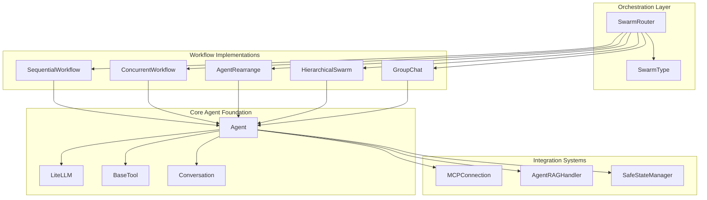
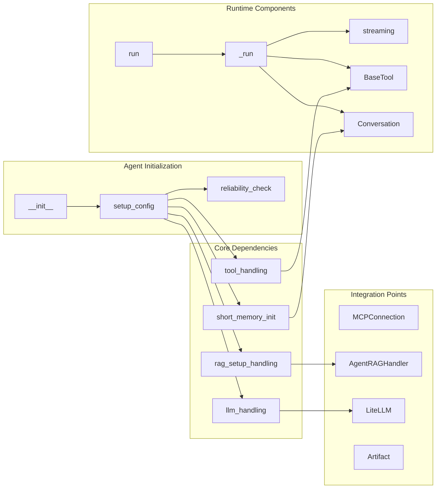
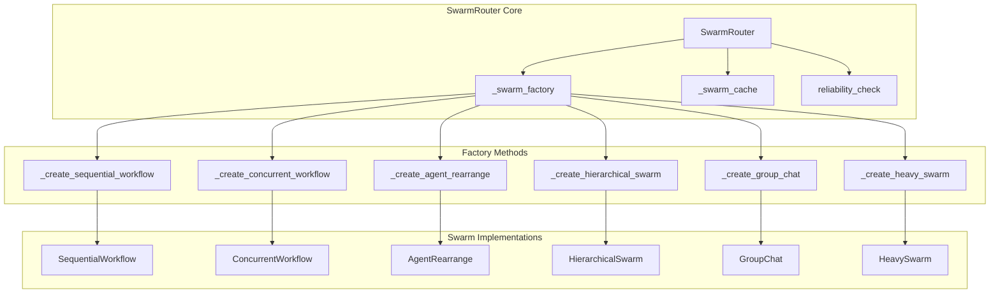
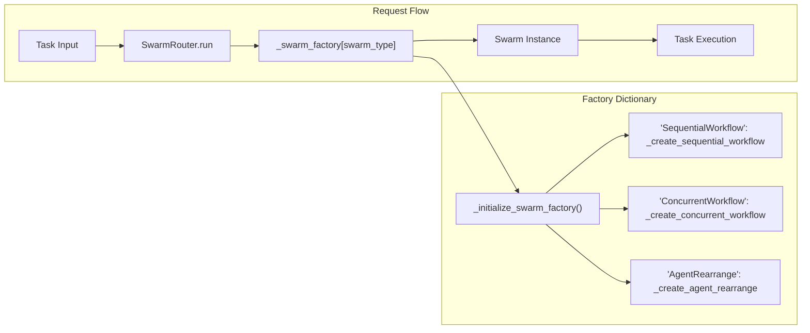

<!-- source: DeepWiki mcp.deepwiki.com · repo kyegomez/swarms · page 2 Core Agent System · fetched 2026-10-26 -->

# Core Agent System

Relevant source files

The following files were used as context for generating this wiki page:

- [.gitignore](.gitignore)
- [README.md](README.md)
- [docs/mkdocs.yml](docs/mkdocs.yml)
- [example.py](example.py)
- [pyproject.toml](pyproject.toml)
- [requirements.txt](requirements.txt)
- [swarms/__init__.py](swarms/__init__.py)
- [swarms/agents/__init__.py](swarms/agents/__init__.py)
- [swarms/prompts/logistics.py](swarms/prompts/logistics.py)
- [swarms/prompts/sop_generator_agent_prompt.py](swarms/prompts/sop_generator_agent_prompt.py)
- [swarms/structs/__init__.py](swarms/structs/__init__.py)
- [swarms/structs/agent.py](swarms/structs/agent.py)
- [swarms/structs/concurrent_workflow.py](swarms/structs/concurrent_workflow.py)
- [swarms/structs/rearrange.py](swarms/structs/rearrange.py)
- [swarms/structs/sequential_workflow.py](swarms/structs/sequential_workflow.py)
- [swarms/structs/swarm_router.py](swarms/structs/swarm_router.py)
- [swarms/utils/__init__.py](swarms/utils/__init__.py)

## Purpose and Scope

The Core Agent System provides the foundational infrastructure for creating, configuring, and orchestrating intelligent agents within the Swarms framework. This system encompasses the primary `Agent` class, the `SwarmRouter` factory pattern, and core orchestration mechanisms that enable both single-agent and multi-agent workflows.

This document covers the architectural overview and integration patterns of the core system. For detailed implementation specifics of individual agents, see [Agent Class](#2.1). For comprehensive SwarmRouter configuration and usage, see [SwarmRouter](#2.2). For multi-agent collaboration patterns, see [Multi-Agent Orchestration](#3).

## System Architecture Overview

The Core Agent System operates as a layered architecture where individual agents serve as the fundamental building blocks, orchestrated through various workflow patterns via the SwarmRouter factory system.

**Sources:** [swarms/structs/agent.py:163-301](), [swarms/structs/swarm_router.py:106-173](), [swarms/structs/__init__.py:1-172]()

## Agent Class Foundation

The `Agent` class serves as the core building block, integrating language models, tools, memory systems, and conversation management into a unified interface. The class provides extensive configuration options for production deployments.

**Sources:** [swarms/structs/agent.py:303-624](), [swarms/structs/agent.py:625-690](), [swarms/structs/conversation.py]()

## SwarmRouter Factory System

The `SwarmRouter` implements a factory pattern that provides dynamic selection and instantiation of different swarm types based on task requirements or explicit configuration. This system enables seamless switching between orchestration strategies.

**Sources:** [swarms/structs/swarm_router.py:175-249](), [swarms/structs/swarm_router.py:380-450](), [swarms/structs/swarm_router.py:37-54]()

## Core Integration Patterns

### Agent Configuration System

The Agent class utilizes several key integration patterns for production readiness:

| Integration Point | Implementation | Purpose |
|------------------|----------------|---------|
| `llm_handling()` | [swarms/structs/agent.py:2640-2672]() | LLM provider abstraction via LiteLLM |
| `tool_handling()` | [swarms/structs/agent.py:633-651]() | Function calling and tool integration |
| `short_memory_init()` | [swarms/structs/agent.py:652-693]() | Conversation history management |
| `rag_setup_handling()` | [swarms/structs/agent.py:625-631]() | Long-term memory and RAG integration |

### Orchestration Factory Pattern

The SwarmRouter employs a factory pattern with O(1) lookup performance for swarm type selection:

**Sources:** [swarms/structs/swarm_router.py:380-402](), [swarms/structs/swarm_router.py:658-715]()

### Memory and State Management

The core system provides multiple layers of memory and state persistence:

- **Short-term Memory**: `Conversation` class manages interaction history
- **Long-term Memory**: `AgentRAGHandler` integrates vector databases
- **State Persistence**: `SafeStateManager` handles agent state serialization
- **Distributed Memory**: Shared memory systems across agent swarms

**Sources:** [swarms/structs/conversation.py](), [swarms/structs/agent_rag_handler.py](), [swarms/structs/safe_loading.py]()

## Execution Models

The Core Agent System supports multiple execution paradigms:

### Single Agent Execution
Direct agent instantiation and task execution via `Agent.run()` method with support for:
- Synchronous and asynchronous execution
- Streaming output generation
- Tool integration and function calling
- Memory persistence and state management

### Multi-Agent Orchestration
Factory-based swarm creation through `SwarmRouter` supporting:
- Sequential task processing via `SequentialWorkflow`
- Parallel execution via `ConcurrentWorkflow`
- Dynamic agent arrangement via `AgentRearrange`
- Hierarchical coordination via `HierarchicalSwarm`
- Conversational coordination via `GroupChat`

**Sources:** [swarms/structs/agent.py:1549-1900](), [swarms/structs/swarm_router.py:658-800]()

## Configuration and Initialization

The system provides comprehensive configuration management through:

- **Environment Variables**: API keys and workspace configuration
- **YAML/JSON Configuration**: Agent and swarm parameter specification
- **Dynamic Configuration**: Runtime parameter adjustment
- **Validation Systems**: Configuration reliability checks and error handling

Key configuration classes include `SwarmRouterConfig`, `ConversationSchema`, and `RAGConfig` for structured parameter management.

**Sources:** [swarms/structs/swarm_router.py:62-92](), [swarms/schemas/conversation_schema.py](), [swarms/structs/agent_rag_handler.py]()

---

