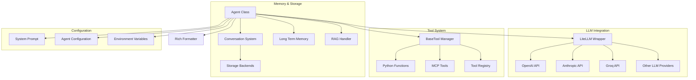
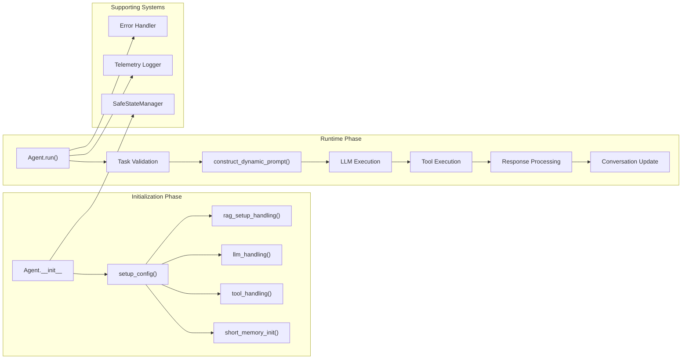
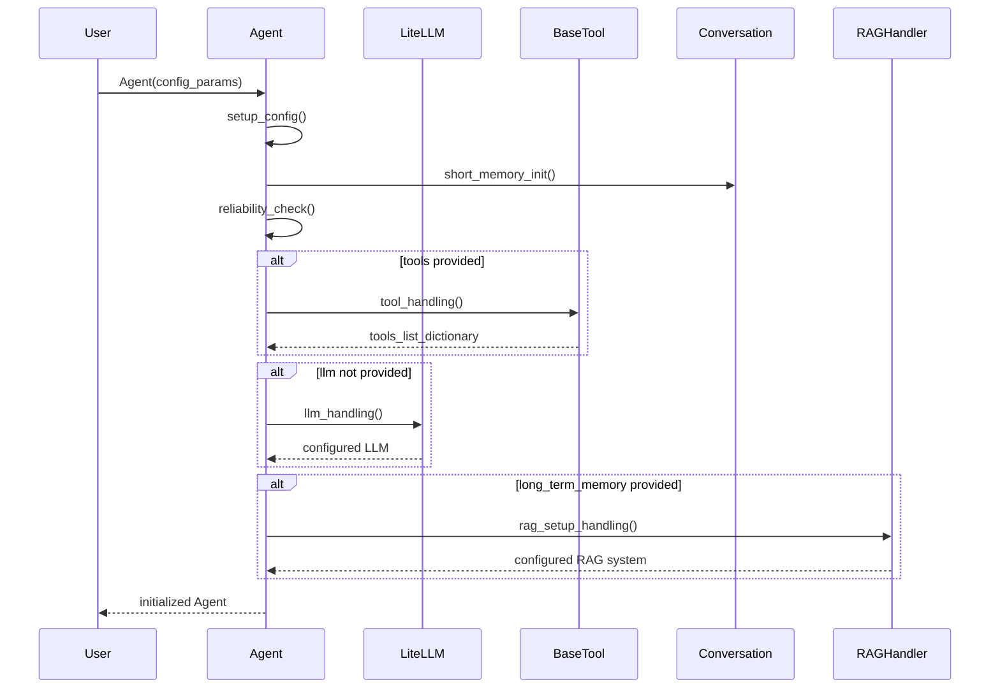
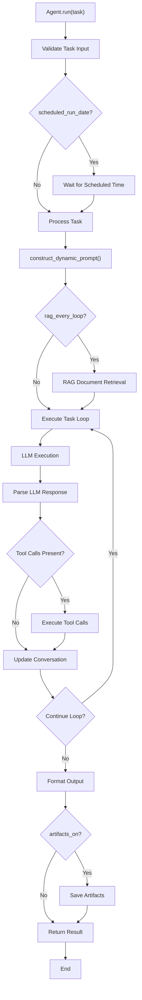
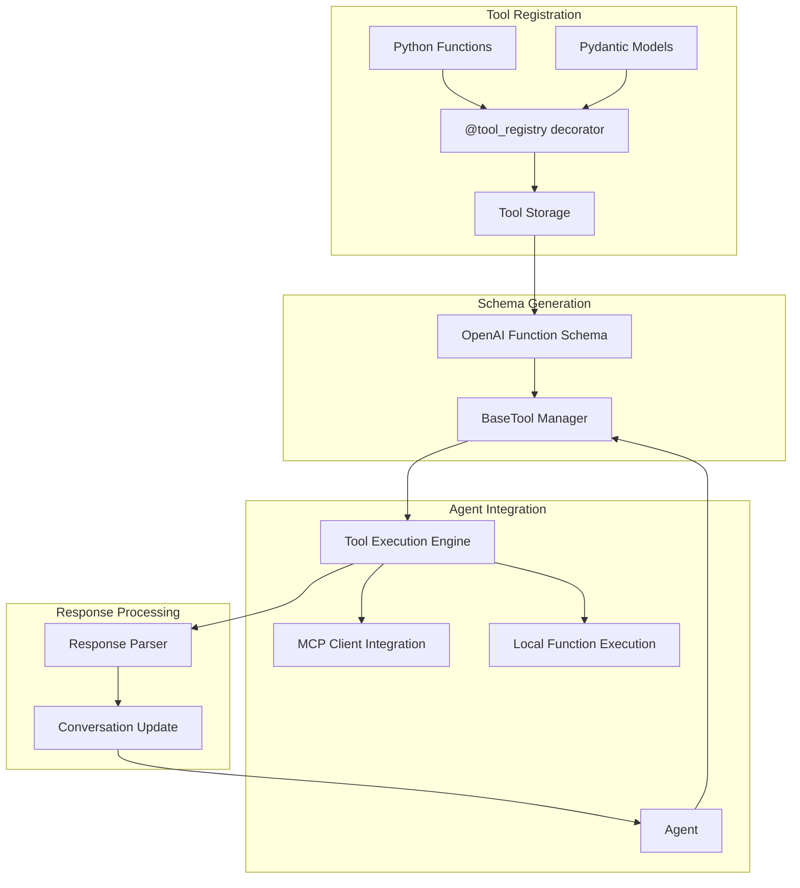
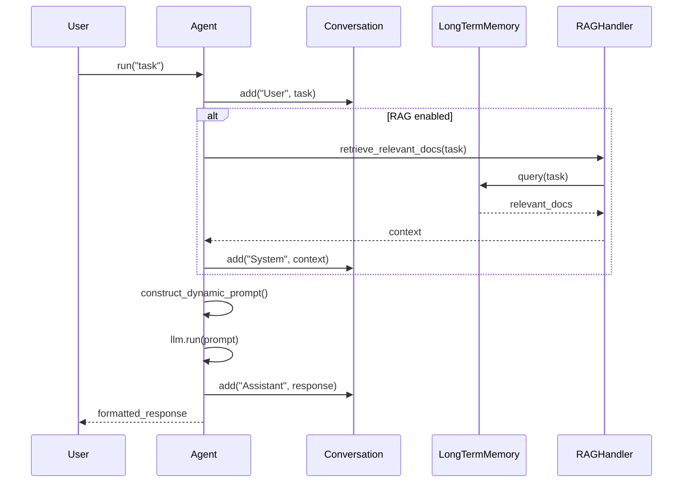

<!-- source: DeepWiki mcp.deepwiki.com · repo kyegomez/swarms · page 2.1 Agent Class · fetched 2026-10-26 -->

# Agent Class

<details>
<summary>Relevant source files</summary>

The following files were used as context for generating this wiki page:

- [.env.example](.env.example)
- [.gitignore](.gitignore)
- [README.md](README.md)
- [docs/mkdocs.yml](docs/mkdocs.yml)
- [example.py](example.py)
- [pyproject.toml](pyproject.toml)
- [requirements.txt](requirements.txt)
- [swarms/__init__.py](swarms/__init__.py)
- [swarms/agents/__init__.py](swarms/agents/__init__.py)
- [swarms/prompts/logistics.py](swarms/prompts/logistics.py)
- [swarms/prompts/sop_generator_agent_prompt.py](swarms/prompts/sop_generator_agent_prompt.py)
- [swarms/schemas/__init__.py](swarms/schemas/__init__.py)
- [swarms/structs/__init__.py](swarms/structs/__init__.py)
- [swarms/structs/agent.py](swarms/structs/agent.py)
- [swarms/structs/concurrent_workflow.py](swarms/structs/concurrent_workflow.py)
- [swarms/structs/rearrange.py](swarms/structs/rearrange.py)
- [swarms/structs/sequential_workflow.py](swarms/structs/sequential_workflow.py)
- [swarms/structs/swarm_router.py](swarms/structs/swarm_router.py)
- [swarms/utils/__init__.py](swarms/utils/__init__.py)

</details>


This document covers the `Agent` class, which serves as the foundational building block of the Swarms framework. The Agent class provides a comprehensive interface for creating autonomous AI agents with LLM integration, tool usage, memory systems, and conversation management capabilities.

For information about multi-agent orchestration patterns that use Agent instances, see [Multi-Agent Orchestration](#3). For details about tool integration, see [Tool System](#4).

## Overview

The `Agent` class is the core component that enables autonomous AI behavior within the Swarms ecosystem. It acts as a wrapper and orchestrator that combines language models, tools, memory systems, and conversation management into a unified interface for task execution.

**Key Capabilities:**
- Language model integration through `LiteLLM` wrapper
- Function calling and tool execution via `BaseTool`
- Conversation history management with `Conversation` class
- Long-term memory integration with various backend storage systems
- Streaming output and real-time interaction support
- State persistence and recovery mechanisms
- Multi-modal input processing (text, images)

Sources: [swarms/structs/agent.py:163-301](), [README.md:164-180]()

## Agent Architecture

The following diagram illustrates the core architecture of the Agent class and its primary dependencies:



The Agent class orchestrates these components to provide a unified interface for autonomous task execution. Each component handles a specific aspect of agent functionality while maintaining loose coupling for flexibility and extensibility.

Sources: [swarms/structs/agent.py:1-89](), [swarms/structs/agent.py:438-624]()

## Core Components Integration

The following diagram shows how the Agent class integrates its core components during initialization and runtime:



This architecture ensures that agents are properly initialized with all necessary components and can execute tasks through a well-defined pipeline that handles validation, execution, and state management.

Sources: [swarms/structs/agent.py:438-624](), [swarms/structs/agent.py:3278-3400]()

## Agent Configuration

The Agent class supports extensive configuration through its constructor parameters. The following table outlines the key configuration categories:

| Category | Key Parameters | Purpose |
|----------|----------------|---------|
| **Core Identity** | `agent_name`, `agent_description`, `system_prompt` | Define agent identity and behavior |
| **LLM Configuration** | `model_name`, `max_tokens`, `temperature`, `llm_args` | Control language model behavior |
| **Execution Control** | `max_loops`, `interactive`, `streaming_on` | Manage execution flow and output |
| **Tool Integration** | `tools`, `function_calling_type`, `tool_choice` | Configure function calling capabilities |
| **Memory Systems** | `long_term_memory`, `rag_config`, `conversation_schema` | Set up memory and retrieval systems |
| **Output Control** | `output_type`, `return_history`, `verbose` | Control response formatting and logging |

### Initialization Process

The Agent initialization follows a specific sequence to ensure all components are properly configured:



Sources: [swarms/structs/agent.py:303-624](), [swarms/structs/agent.py:625-651](), [swarms/structs/agent.py:652-686]()

## Task Execution Pipeline

The `run` method implements the core task execution pipeline. The following diagram illustrates the execution flow:



The execution pipeline handles various execution modes, tool integration, and output formatting while maintaining conversation state throughout the process.

Sources: [swarms/structs/agent.py:3278-3400](), [swarms/structs/agent.py:3401-3500]()

## Tool Integration Architecture

The Agent class integrates with the tool system through the `BaseTool` manager and supports multiple tool execution patterns:



The tool system supports both local Python function execution and MCP (Model Context Protocol) client integration for distributed tool services.

Sources: [swarms/structs/agent.py:633-651](), [swarms/tools/base_tool.py](), [swarms/tools/mcp_client_call.py:74-83]()

## Memory and Conversation Management

The Agent class manages conversation history and long-term memory through integrated systems:

| Component | Purpose | Implementation |
|-----------|---------|----------------|
| **Conversation** | Short-term conversation history | [swarms/structs/conversation.py]() |
| **Long Term Memory** | Persistent knowledge storage | Pluggable vector database backends |
| **RAG Handler** | Document retrieval and integration | [swarms/structs/agent_rag_handler.py]() |
| **State Persistence** | Agent state saving/loading | JSON-based state management |

### Conversation Flow



Sources: [swarms/structs/agent.py:669-705](), [swarms/structs/agent.py:625-632]()

## Common Usage Patterns

### Basic Agent Creation

The simplest agent setup requires minimal configuration:

```python
from swarms import Agent

agent = Agent(
    model_name="gpt-4o-mini",
    max_loops=1,
    interactive=True,
)

result = agent.run("What are the benefits of autonomous agents?")
```

### Advanced Configuration

Production agents typically require more comprehensive configuration:

```python
agent = Agent(
    agent_name="Financial-Analyst",
    agent_description="Expert financial analysis agent",
    system_prompt="You are a financial expert...",
    model_name="claude-3-sonnet-20240229",
    max_loops=3,
    tools=[calculate_ratios, fetch_market_data],
    streaming_on=True,
    verbose=True,
    artifacts_on=True,
    long_term_memory=vector_db_instance
)
```

### Multi-Modal Processing

Agents support image and document processing:

```python
agent = Agent(
    model_name="gpt-4-vision-preview",
    multi_modal=True
)

result = agent.run(
    task="Analyze this financial chart",
    img="path/to/chart.png"
)
```

Sources: [README.md:168-180](), [example.py:1-48](), [swarms/structs/agent.py:164-222]()

## State Management and Persistence

The Agent class provides comprehensive state management capabilities through the `SafeStateManager` and built-in serialization methods:

| Method | Purpose | Usage |
|--------|---------|-------|
| `save_state()` | Save current agent state | Automatic or manual state persistence |
| `load()` | Load saved agent state | Restore agent from previous session |
| `to_dict()` | Serialize agent configuration | Export for telemetry or debugging |
| `autosave` | Automatic state saving | Configurable background state persistence |

The state management system ensures agent continuity across sessions and provides recovery mechanisms for production deployments.

Sources: [swarms/structs/agent.py:4600-4700](), [swarms/structs/safe_loading.py]()

---

