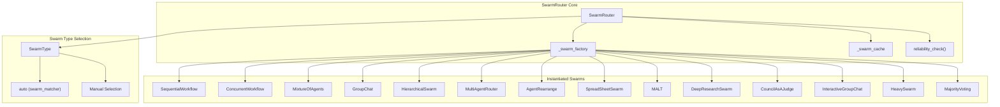
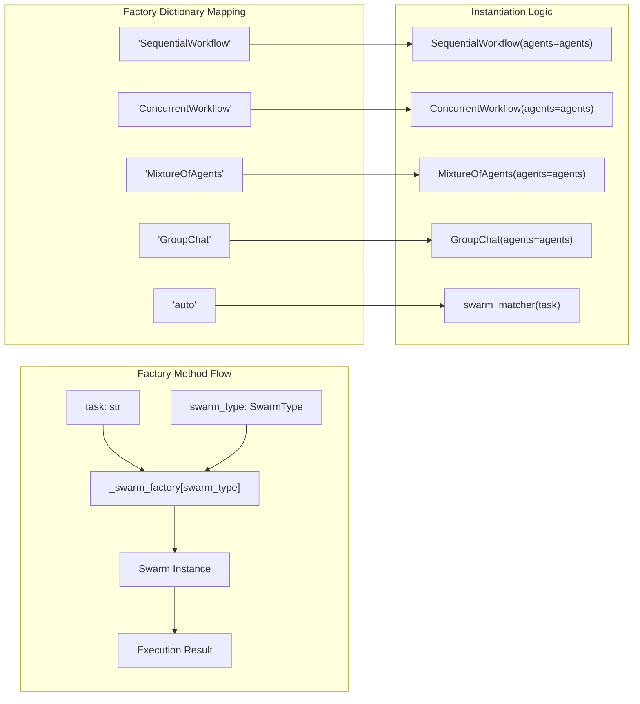
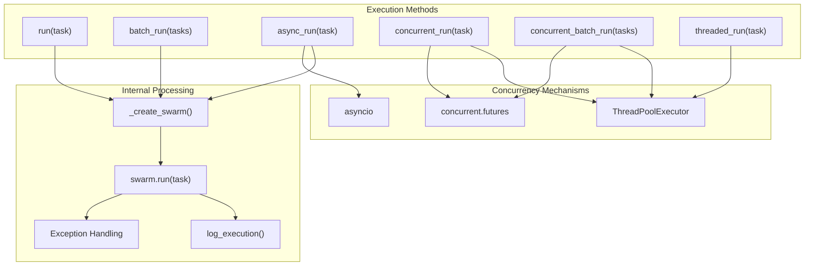
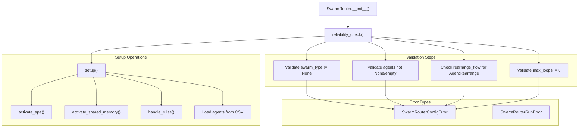
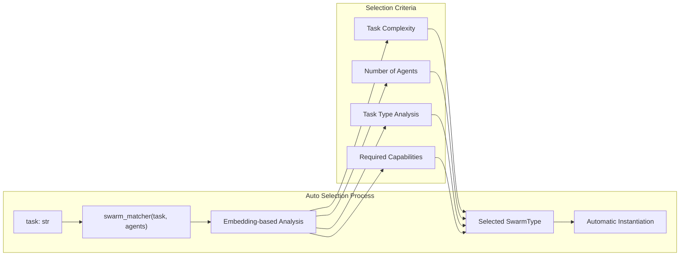
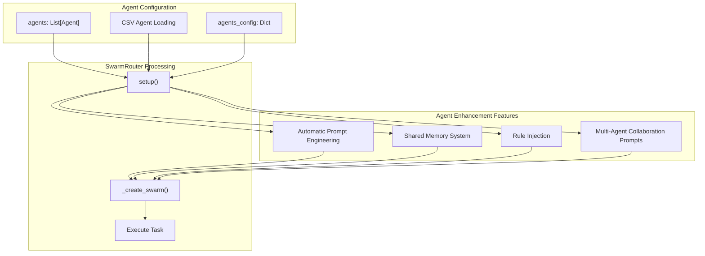

<!-- source: DeepWiki mcp.deepwiki.com · repo kyegomez/swarms · page 2.2 SwarmRouter · fetched 2026-10-26 -->

# SwarmRouter

<details>
<summary>Relevant source files</summary>

The following files were used as context for generating this wiki page:

- [.gitignore](.gitignore)
- [README.md](README.md)
- [docs/mkdocs.yml](docs/mkdocs.yml)
- [docs/swarms/concept/swarm_architectures.md](docs/swarms/concept/swarm_architectures.md)
- [docs/swarms/examples/multi_agent_router_minimal.md](docs/swarms/examples/multi_agent_router_minimal.md)
- [docs/swarms/prompts/main.md](docs/swarms/prompts/main.md)
- [docs/swarms/structs/swarm_router.md](docs/swarms/structs/swarm_router.md)
- [example.py](example.py)
- [examples/multi_agent/mar/multi_agent_router_minimal.py](examples/multi_agent/mar/multi_agent_router_minimal.py)
- [pyproject.toml](pyproject.toml)
- [requirements.txt](requirements.txt)
- [swarms/__init__.py](swarms/__init__.py)
- [swarms/agents/__init__.py](swarms/agents/__init__.py)
- [swarms/prompts/logistics.py](swarms/prompts/logistics.py)
- [swarms/prompts/sop_generator_agent_prompt.py](swarms/prompts/sop_generator_agent_prompt.py)
- [swarms/structs/__init__.py](swarms/structs/__init__.py)
- [swarms/structs/agent.py](swarms/structs/agent.py)
- [swarms/structs/concurrent_workflow.py](swarms/structs/concurrent_workflow.py)
- [swarms/structs/rearrange.py](swarms/structs/rearrange.py)
- [swarms/structs/sequential_workflow.py](swarms/structs/sequential_workflow.py)
- [swarms/structs/swarm_router.py](swarms/structs/swarm_router.py)
- [swarms/structs/swarming_architectures.py](swarms/structs/swarming_architectures.py)
- [swarms/utils/__init__.py](swarms/utils/__init__.py)
- [tests/prompts/test_prompt.py](tests/prompts/test_prompt.py)

</details>


SwarmRouter is a factory class that provides a unified interface for dynamically selecting and instantiating different multi-agent orchestration patterns within the Swarms framework. It serves as the central routing mechanism that allows users to execute tasks using various swarm architectures through a single, consistent API.

This document covers the SwarmRouter's architecture, supported swarm types, configuration options, and execution patterns. For information about individual swarm architectures, see [Multi-Agent Orchestration](#3). For basic agent configuration, see [Agent Class](#2.1).

## Architecture Overview

SwarmRouter implements a factory pattern that abstracts the complexity of different multi-agent architectures behind a unified interface. The router can either use a specified swarm type or automatically determine the most suitable architecture for a given task.



Sources: [swarms/structs/swarm_router.py:106-1173](), [swarms/structs/swarm_router.py:37-54](), [swarms/structs/swarm_router.py:449-527]()

## Swarm Factory Pattern

The SwarmRouter uses a factory pattern with O(1) lookup performance through the `_swarm_factory` dictionary. Each swarm type is mapped to its corresponding instantiation logic.



Sources: [swarms/structs/swarm_router.py:244-247](), [swarms/structs/swarm_router.py:449-527](), [swarms/structs/swarm_router.py:575-695]()

## Supported Swarm Types

SwarmRouter supports 14 different swarm architectures, each optimized for specific use cases:

| SwarmType | Class | Primary Use Case |
|-----------|-------|------------------|
| `SequentialWorkflow` | `SequentialWorkflow` | Linear task processing |
| `ConcurrentWorkflow` | `ConcurrentWorkflow` | Parallel task execution |
| `MixtureOfAgents` | `MixtureOfAgents` | Expert agent aggregation |
| `GroupChat` | `GroupChat` | Conversational collaboration |
| `HierarchicalSwarm` | `HierarchicalSwarm` | Director-worker patterns |
| `MultiAgentRouter` | `MultiAgentRouter` | Task-based agent selection |
| `AgentRearrange` | `AgentRearrange` | Custom flow orchestration |
| `SpreadSheetSwarm` | `SpreadSheetSwarm` | Structured data processing |
| `MajorityVoting` | `MajorityVoting` | Consensus-based decisions |
| `MALT` | `MALT` | Multi-agent language tasks |
| `DeepResearchSwarm` | `DeepResearchSwarm` | Research-oriented workflows |
| `CouncilAsAJudge` | `CouncilAsAJudge` | Evaluation and judgment |
| `InteractiveGroupChat` | `InteractiveGroupChat` | Dynamic speaker selection |
| `HeavySwarm` | `HeavySwarm` | Intensive computational tasks |
| `auto` | `swarm_matcher` | Automatic architecture selection |

Sources: [swarms/structs/swarm_router.py:37-54](), [swarms/structs/swarm_router.py:449-527]()

## Configuration and Initialization

SwarmRouter accepts extensive configuration options to customize behavior across different swarm types:

```mermaid
graph TD
    subgraph "Core Configuration"
        ID["id: str"]
        Name["name: str"]
        Desc["description: str"]
        Agents["agents: List[Agent]"]
        SwarmType["swarm_type: SwarmType"]
    end
    
    subgraph "Execution Options"
        MaxLoops["max_loops: int"]
        AutoSave["autosave: bool"]
        OutputType["output_type: OutputType"]
        ReturnJSON["return_json: bool"]
    end
    
    subgraph "Agent Enhancement"
        AutoPrompts["auto_generate_prompts: bool"]
        Rules["rules: str"]
        SharedMemory["shared_memory_system: Any"]
        MultiAgentCollab["multi_agent_collab_prompt: bool"]
    end
    
    subgraph "Specialized Options"
        RearrangeFlow["rearrange_flow: str"]
        SpeakerFn["speaker_fn: callable"]
        LoadCSV["load_agents_from_csv: bool"]
        CSVPath["csv_file_path: str"]
    end
    
    ID --> SwarmRouter
    Name --> SwarmRouter
    Desc --> SwarmRouter
    Agents --> SwarmRouter
    SwarmType --> SwarmRouter
    
    MaxLoops --> SwarmRouter
    AutoSave --> SwarmRouter
    OutputType --> SwarmRouter
    ReturnJSON --> SwarmRouter
    
    AutoPrompts --> SwarmRouter
    Rules --> SwarmRouter
    SharedMemory --> SwarmRouter
    MultiAgentCollab --> SwarmRouter
    
    RearrangeFlow --> SwarmRouter
    SpeakerFn --> SwarmRouter
    LoadCSV --> SwarmRouter
    CSVPath --> SwarmRouter
```



Sources: [swarms/structs/swarm_router.py:175-208](), [swarms/structs/swarm_router.py:309-393]()

## Execution Modes

SwarmRouter provides multiple execution patterns to handle different performance and concurrency requirements:



Sources: [swarms/structs/swarm_router.py:891-949](), [swarms/structs/swarm_router.py:951-977](), [swarms/structs/swarm_router.py:1008-1051](), [swarms/structs/swarm_router.py:1053-1094]()

## Reliability and Error Handling

The SwarmRouter implements comprehensive validation through the `reliability_check()` method, ensuring proper configuration before execution:



Sources: [swarms/structs/swarm_router.py:251-307](), [swarms/structs/swarm_router.py:309-393](), [swarms/structs/swarm_router.py:94-104]()

## Automatic Swarm Selection

When `swarm_type="auto"` is specified, SwarmRouter uses the `swarm_matcher` function to automatically select the most appropriate swarm architecture based on task characteristics:



Sources: [swarms/structs/swarm_router.py:23](), [swarms/structs/swarm_router.py:521-527]()

## Usage Patterns

SwarmRouter supports several common usage patterns for different scenarios:

### Basic Task Execution
```python
from swarms import Agent, SwarmRouter

router = SwarmRouter(
    agents=[agent1, agent2],
    swarm_type="SequentialWorkflow"
)
result = router.run("Analyze market trends")
```

### Automatic Architecture Selection
```python
router = SwarmRouter(
    agents=[agent1, agent2, agent3],
    swarm_type="auto"  # Automatically selects best architecture
)
result = router.run("Complex research task")
```

### Batch Processing
```python
tasks = ["Task 1", "Task 2", "Task 3"]
results = router.batch_run(tasks)
```

### Concurrent Execution
```python
result = router.concurrent_run("Parallel processing task")
```

Sources: [docs/swarms/structs/swarm_router.md:122-211](), [examples/multi_agent/mar/multi_agent_router_minimal.py:1-26]()

## Integration with Agent System

SwarmRouter seamlessly integrates with the core Agent system, providing enhanced capabilities through shared memory, rule injection, and collaborative prompting:



Sources: [swarms/structs/swarm_router.py:309-393](), [swarms/structs/swarm_router.py:395-447](), [swarms/structs/swarm_router.py:709-782]()

---

