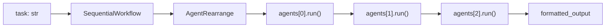
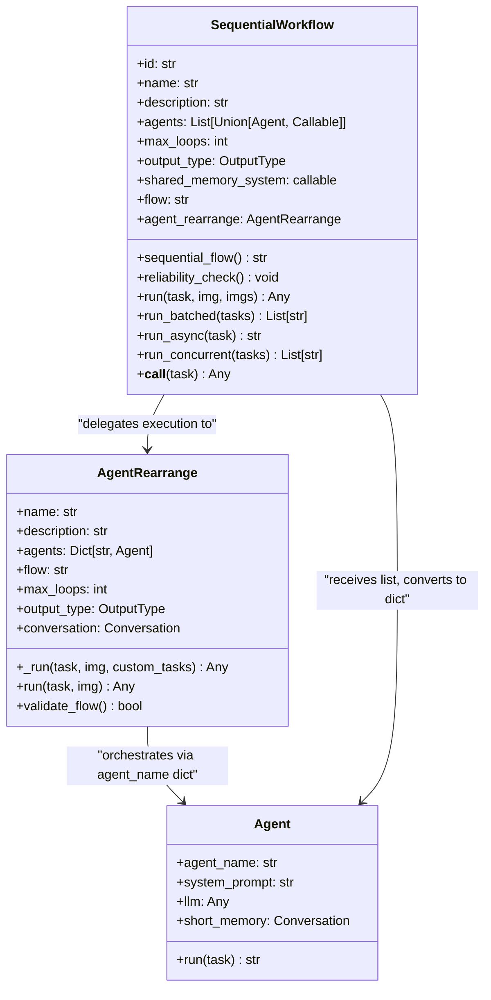
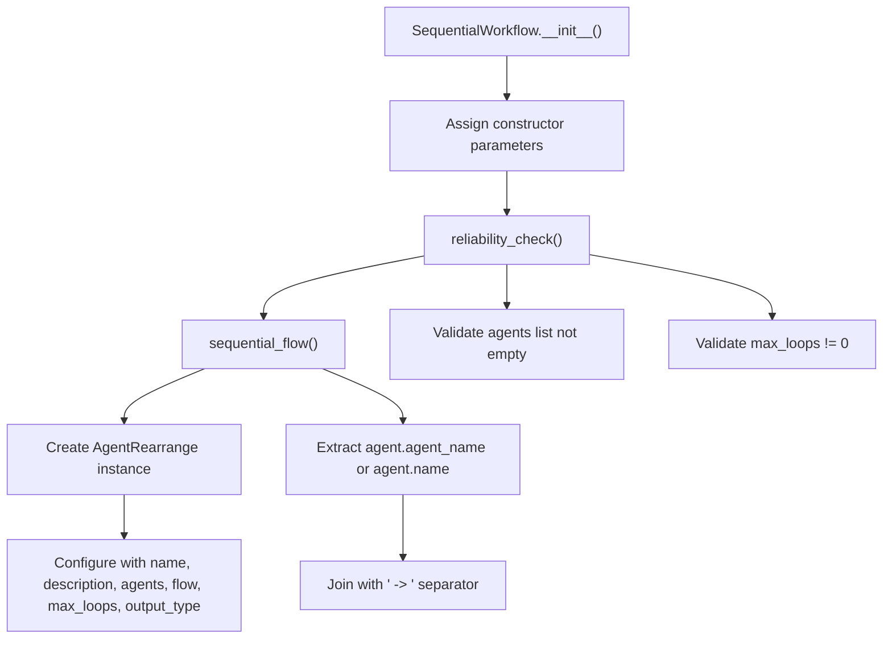
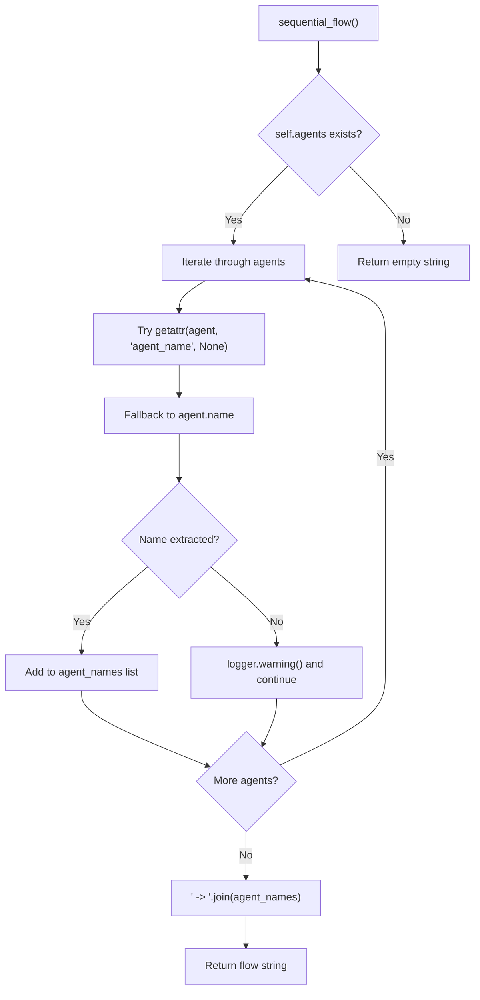
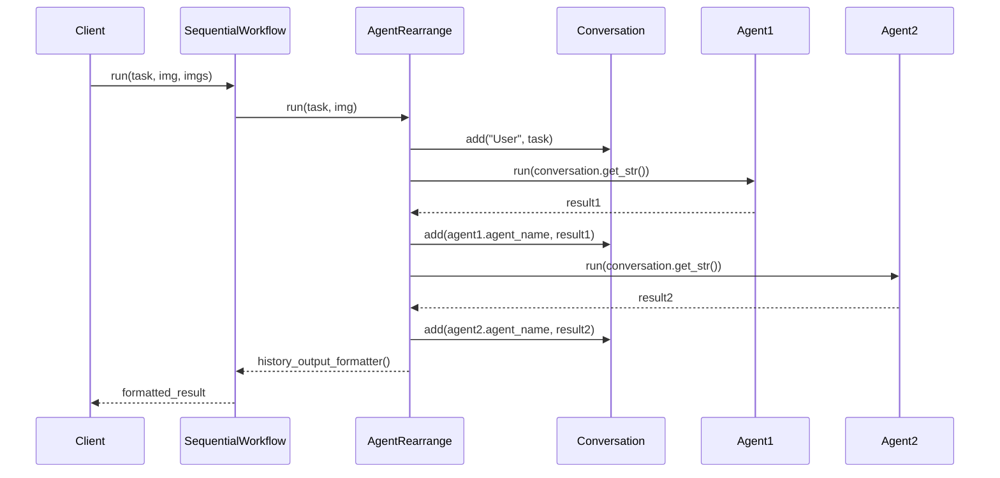
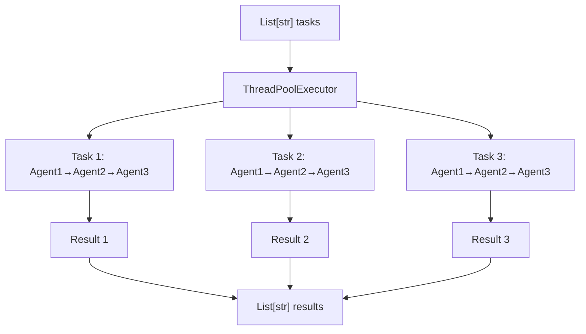
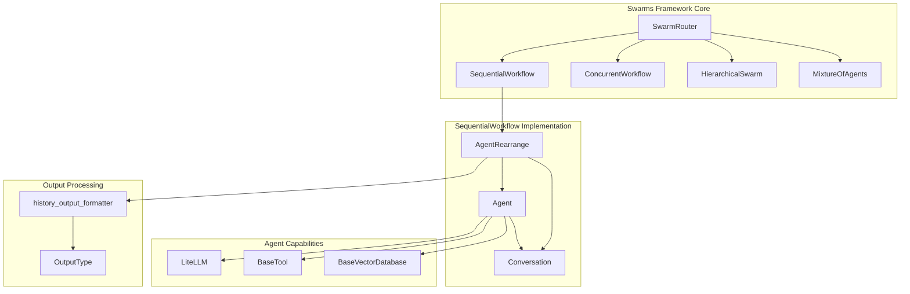

<!-- source: DeepWiki mcp.deepwiki.com · repo kyegomez/swarms · page 3.1 Sequential Workflow · fetched 2026-10-26 -->

# Sequential Workflow

<details>
<summary>Relevant source files</summary>

The following files were used as context for generating this wiki page:

- [.gitignore](.gitignore)
- [README.md](README.md)
- [docs/mkdocs.yml](docs/mkdocs.yml)
- [example.py](example.py)
- [pyproject.toml](pyproject.toml)
- [requirements.txt](requirements.txt)
- [swarms/__init__.py](swarms/__init__.py)
- [swarms/agents/__init__.py](swarms/agents/__init__.py)
- [swarms/prompts/logistics.py](swarms/prompts/logistics.py)
- [swarms/prompts/sop_generator_agent_prompt.py](swarms/prompts/sop_generator_agent_prompt.py)
- [swarms/structs/__init__.py](swarms/structs/__init__.py)
- [swarms/structs/agent.py](swarms/structs/agent.py)
- [swarms/structs/concurrent_workflow.py](swarms/structs/concurrent_workflow.py)
- [swarms/structs/rearrange.py](swarms/structs/rearrange.py)
- [swarms/structs/sequential_workflow.py](swarms/structs/sequential_workflow.py)
- [swarms/structs/swarm_router.py](swarms/structs/swarm_router.py)
- [swarms/utils/__init__.py](swarms/utils/__init__.py)

</details>


## Overview

`SequentialWorkflow` is a production-grade workflow orchestrator that executes agents in a linear chain where each agent processes the output from the previous agent. This workflow pattern is ideal for multi-step processes requiring ordered execution such as research → analysis → writing → editing pipelines.

The `SequentialWorkflow` class serves as a high-level wrapper around the `AgentRearrange` system, automatically generating arrow-based flow patterns and providing multiple execution modes including synchronous, asynchronous, batched, and concurrent processing.

**Sequential Workflow Data Flow**


Sources: [swarms/structs/sequential_workflow.py:12-29](), [swarms/structs/sequential_workflow.py:53-61]()

## Architecture and Class Structure

The `SequentialWorkflow` architecture follows a wrapper pattern around `AgentRearrange`, providing a simplified interface for linear agent execution while leveraging the full power of the underlying rearrangement system.

**SequentialWorkflow Class Architecture**


Sources: [swarms/structs/sequential_workflow.py:30-61](), [swarms/structs/rearrange.py:95-133]()

## Core Components

### SequentialWorkflow Class

The main orchestrator class that provides a simplified interface for sequential agent execution.

| Attribute | Type | Description |
|-----------|------|-------------|
| `id` | str | Unique identifier, defaults to "sequential_workflow" |
| `name` | str | Human-readable workflow name |
| `description` | str | Workflow purpose description |
| `agents` | List[Union[Agent, Callable]] | Ordered list of agents to execute |
| `max_loops` | int | Number of complete workflow iterations |
| `output_type` | OutputType | Result formatting: "dict", "str", "list" |
| `shared_memory_system` | callable | Optional shared memory between agents |
| `flow` | str | Generated arrow notation: "Agent1 -> Agent2 -> Agent3" |
| `agent_rearrange` | AgentRearrange | Internal execution engine |

Sources: [swarms/structs/sequential_workflow.py:30-50]()

### AgentRearrange Integration

`SequentialWorkflow` automatically configures an `AgentRearrange` instance with the generated flow pattern, converting the simple agent list into the dictionary format required by the rearrangement system.

Sources: [swarms/structs/sequential_workflow.py:53-61]()

## Initialization and Configuration

The `SequentialWorkflow` constructor performs initialization in a specific sequence to ensure proper workflow configuration.

**Initialization Flow**


Sources: [swarms/structs/sequential_workflow.py:30-61](), [swarms/structs/sequential_workflow.py:94-102]()

### Constructor Parameters

| Parameter | Type | Default | Description |
|-----------|------|---------|-------------|
| `id` | str | "sequential_workflow" | Unique workflow identifier |
| `name` | str | "SequentialWorkflow" | Workflow display name |
| `description` | str | "Sequential Workflow, where agents are executed in a sequence." | Workflow purpose description |
| `agents` | List[Union[Agent, Callable]] | [] | Ordered list of agents for execution |
| `max_loops` | int | 1 | Number of complete workflow iterations |
| `output_type` | OutputType | "dict" | Output format ("dict", "str", "list") |
| `shared_memory_system` | callable | None | Optional shared memory system |

Sources: [swarms/structs/sequential_workflow.py:30-41]()

### Validation Rules

The `reliability_check()` method enforces these constraints:

- **Non-empty agents**: `agents` list cannot be `None` or empty
- **Valid max_loops**: `max_loops` cannot be 0
- **Agent naming**: Each agent must have `agent_name` or `name` attribute

Sources: [swarms/structs/sequential_workflow.py:94-102]()

## Flow Generation and Agent Name Resolution

The `sequential_flow()` method generates the arrow-based flow notation that `AgentRearrange` uses for execution orchestration. This method handles the complexity of extracting agent names from different agent implementations.

**Flow Generation Process**


Sources: [swarms/structs/sequential_workflow.py:62-92]()

### Agent Name Resolution Logic

The flow generation handles different agent naming conventions:

1. **Primary**: `agent.agent_name` (standard Swarms Agent attribute)
2. **Fallback**: `agent.name` (alternative naming)
3. **Error handling**: Logs warning and skips agents without valid names

**Example Flow Outputs:**
- Input: `[researcher_agent, writer_agent, editor_agent]`
- Output: `"Researcher -> Writer -> Editor"`

Sources: [swarms/structs/sequential_workflow.py:68-78]()

## Execution Methods

`SequentialWorkflow` provides multiple execution patterns to handle different use cases, from single-task processing to high-throughput batch operations.

### Standard Execution: `run()`

The primary execution method that processes a single task through the agent sequence.

**Sequential Execution Flow**


**Method Signature:**
```python
def run(self, task: str, img: Optional[str] = None, imgs: Optional[List[str]] = None) -> Any
```

Sources: [swarms/structs/sequential_workflow.py:103-145](), [swarms/structs/rearrange.py:218-346]()

### Batch Processing: `run_batched()`

Executes multiple tasks sequentially through the same agent workflow. Each task goes through the complete agent sequence before the next task begins.

**Method Signature:**
```python
def run_batched(self, tasks: List[str]) -> List[str]
```

**Execution Pattern:**
- Task 1: Agent1 → Agent2 → Agent3 → Result1
- Task 2: Agent1 → Agent2 → Agent3 → Result2
- Task 3: Agent1 → Agent2 → Agent3 → Result3

Sources: [swarms/structs/sequential_workflow.py:149-177]()

### Asynchronous Execution: `run_async()`

Provides asynchronous task execution for integration with async/await workflows.

**Method Signature:**
```python
async def run_async(self, task: str) -> str
```

**Usage Pattern:**
```python
import asyncio

workflow = SequentialWorkflow(agents=[researcher, writer])
result = await workflow.run_async("Research quantum computing trends")
```

Sources: [swarms/structs/sequential_workflow.py:178-202]()

### Concurrent Task Processing: `run_concurrent()`

Executes multiple tasks concurrently using `ThreadPoolExecutor`. Each task runs through the complete agent sequence in parallel with other tasks.

**Concurrent Execution Architecture**


**Method Signature:**
```python
async def run_concurrent(self, tasks: List[str]) -> List[str]
```

Sources: [swarms/structs/sequential_workflow.py:203-239]()

### Callable Interface: `__call__()`

Enables direct invocation of the workflow instance as a callable function.

```python
workflow = SequentialWorkflow(agents=[agent1, agent2])
result = workflow("Process this data")  # Equivalent to workflow.run("Process this data")
```

Sources: [swarms/structs/sequential_workflow.py:146-148]()

## Error Handling and Validation

`SequentialWorkflow` implements comprehensive error handling at multiple levels to ensure robust operation in production environments.

### Initialization Validation

The `reliability_check()` method performs startup validation:

**Validation Rules:**
- **Agent List Validation**: `ValueError` if `agents` is `None` or empty
- **Loop Count Validation**: `ValueError` if `max_loops` is 0
- **Success Logging**: Confirms successful validation with logger.info()

```python
def reliability_check(self):
    if self.agents is None or len(self.agents) == 0:
        raise ValueError("Agents list cannot be None or empty")
    if self.max_loops == 0:
        raise ValueError("max_loops cannot be 0")
    logger.info("Checks completed; your swarm is ready.")
```

Sources: [swarms/structs/sequential_workflow.py:94-102]()

### Runtime Error Handling

Each execution method includes specific error handling:

**`run()` Method Error Handling:**
- Catches all exceptions during `agent_rearrange.run()`
- Logs detailed error information with `logger.error()`
- Re-raises exception for upstream handling

**`run_batched()` Method Validation:**
- Validates `tasks` is non-empty list
- Validates all tasks are strings
- Provides specific error messages for different failure modes

**`run_async()` Method Validation:**
- Validates task is non-empty string
- Handles async execution errors with detailed logging

**`run_concurrent()` Method Validation:**
- Validates tasks list format
- Handles `ThreadPoolExecutor` exceptions
- Manages concurrent execution failures

Sources: [swarms/structs/sequential_workflow.py:131-144](), [swarms/structs/sequential_workflow.py:163-168](), [swarms/structs/sequential_workflow.py:192-194](), [swarms/structs/sequential_workflow.py:217-220]()

### AgentRearrange Error Propagation

The underlying `AgentRearrange` system provides additional error handling through the `_catch_error()` method, which handles autosaving and detailed error logging.

Sources: [swarms/structs/rearrange.py:350-358]()

## Usage Examples

### Basic Sequential Processing

```python
from swarms import Agent, SequentialWorkflow

# Create specialized agents with specific roles
researcher = Agent(
    agent_name="Researcher",
    system_prompt="Research the given topic and provide detailed information.",
    model_name="gpt-4o-mini"
)

writer = Agent(
    agent_name="Writer", 
    system_prompt="Transform research into engaging content.",
    model_name="gpt-4o-mini"
)

editor = Agent(
    agent_name="Editor",
    system_prompt="Review and refine the content for clarity and accuracy.",
    model_name="gpt-4o-mini"
)

# Create workflow with automatic flow generation
workflow = SequentialWorkflow(
    name="Content-Creation-Pipeline",
    description="Research, write, and edit content in sequence",
    agents=[researcher, writer, editor],
    max_loops=1,
    output_type="dict"
)

# Execute single task
result = workflow.run("Analyze the impact of AI on healthcare")
print(f"Generated flow: {workflow.flow}")  # "Researcher -> Writer -> Editor"
```

### Batch Processing Example

```python
# Process multiple related tasks
tasks = [
    "Analyze AI trends in healthcare",
    "Analyze AI trends in finance", 
    "Analyze AI trends in education"
]

batch_results = workflow.run_batched(tasks)
for i, result in enumerate(batch_results):
    print(f"Task {i+1} result: {result}")
```

### Asynchronous Execution

```python
import asyncio

async def process_async_tasks():
    # Single async task
    result = await workflow.run_async("Research blockchain applications")
    
    # Concurrent processing of multiple tasks
    concurrent_tasks = [
        "Research quantum computing",
        "Research edge computing", 
        "Research neuromorphic computing"
    ]
    concurrent_results = await workflow.run_concurrent(concurrent_tasks)
    
    return result, concurrent_results

# Run async workflow
result, concurrent_results = asyncio.run(process_async_tasks())
```

### Integration with SwarmRouter

```python  
from swarms import SwarmRouter, SwarmType

# Use SequentialWorkflow through SwarmRouter
router = SwarmRouter(
    name="Research-Pipeline-Router",
    agents=[researcher, writer, editor],
    swarm_type=SwarmType.SequentialWorkflow,
    max_loops=1
)

result = router.run("Analyze renewable energy technologies")
```

Sources: [README.md:186-210](), [swarms/structs/sequential_workflow.py:103-148](), [swarms/structs/swarm_router.py:525-537]()

## Integration with Swarms Architecture

`SequentialWorkflow` integrates with the broader Swarms ecosystem through multiple touchpoints and standardized interfaces.

**Swarms Ecosystem Integration**


Sources: [swarms/structs/swarm_router.py:525-537](), [swarms/structs/sequential_workflow.py:4-7](), [swarms/structs/rearrange.py:1-19]()

### SwarmRouter Integration

`SequentialWorkflow` is available as `SwarmType.SequentialWorkflow` in the `SwarmRouter` factory system:

```python
# SwarmRouter factory method for SequentialWorkflow
def _create_sequential_workflow(self, *args, **kwargs):
    return SequentialWorkflow(
        name=self.name,
        description=self.description, 
        agents=self.agents,
        max_loops=self.max_loops,
        output_type=self.output_type,
        *args,
        **kwargs,
    )
```

Sources: [swarms/structs/swarm_router.py:525-537]()

### Multi-Agent Communication

Through the `AgentRearrange` system, `SequentialWorkflow` maintains conversation history using the `Conversation` class, enabling agents to access the full context of previous agent outputs.

**Conversation Flow Pattern:**
1. Initial task added as "User" role
2. Each agent output added with `agent.agent_name` as role
3. Subsequent agents receive full conversation context via `conversation.get_str()`

Sources: [swarms/structs/rearrange.py:122-133](), [swarms/structs/rearrange.py:250-255]()

### Output Type Compatibility

`SequentialWorkflow` supports all standard Swarms output types through the `history_output_formatter` system:

| Output Type | Description | Use Case |
|-------------|-------------|----------|
| `"dict"` | Agent name → output mapping | Structured access to individual results |
| `"str"` | Concatenated string output | Simple text processing |
| `"list"` | List of agent outputs | Ordered result processing |
| `"all"` | Complete conversation history | Full traceability |

Sources: [swarms/structs/sequential_workflow.py:37](), [swarms/utils/history_output_formatter.py:21-24]()

## Best Practices

1. **Order Matters**: Arrange agents in a logical processing sequence where each agent's capabilities build upon the previous agent's output.

2. **Specialized Agents**: Design each agent with a specific, focused role in the pipeline.

3. **Error Handling**: Implement error handling at both the workflow level and within individual agents.

4. **Monitoring**: Use the generated flow string to visualize and monitor the execution path.

5. **Memory Management**: Consider using a shared memory system when agents need to access information produced in earlier stages.

## When to Use Sequential Workflow

Sequential Workflow is ideal for:

- Tasks that naturally decompose into sequential steps
- Processes where the output of one step is the input to the next
- Cases where strict ordering of operations is required
- Scenarios where you need clear traceability of how information flows through the system

For tasks requiring parallel processing, consider the [Concurrent Workflow](#3.2) instead.

---

