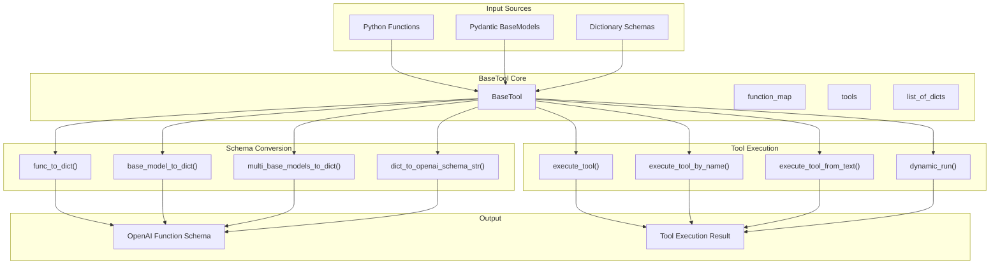
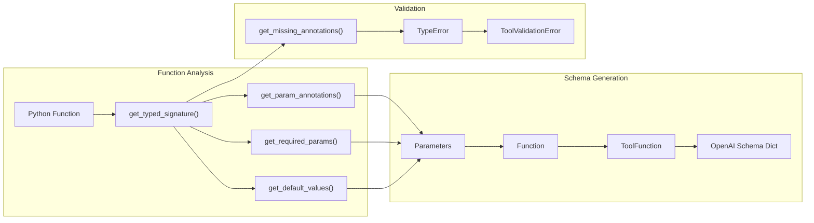
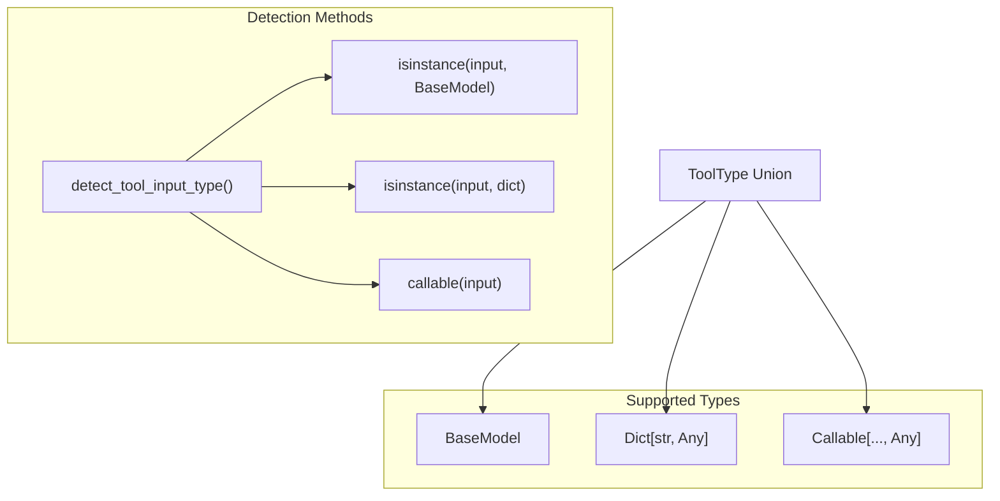
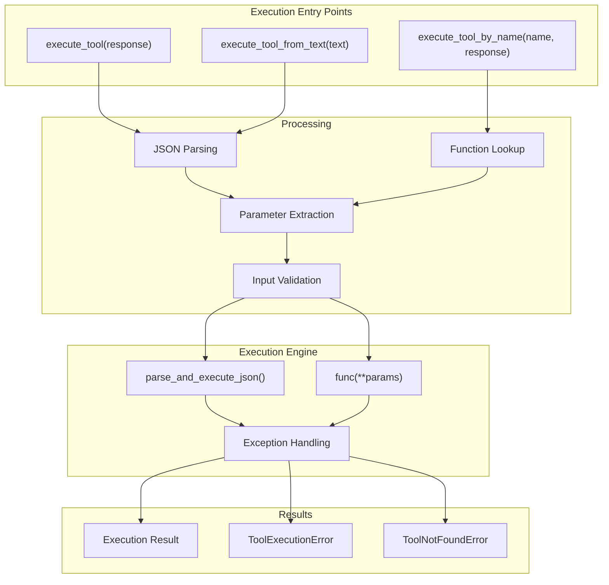

<!-- source: DeepWiki mcp.deepwiki.com · repo kyegomez/swarms · page 4.2 BaseTool Management · fetched 2026-10-26 -->

# BaseTool Management

<details>
<summary>Relevant source files</summary>

The following files were used as context for generating this wiki page:

- [docs/examples/agent_stream.md](docs/examples/agent_stream.md)
- [docs/swarms/examples/model_providers.md](docs/swarms/examples/model_providers.md)
- [docs/swarms/structs/agent_multi_agent_communication.md](docs/swarms/structs/agent_multi_agent_communication.md)
- [docs/swarms_cloud/rate_limits.md](docs/swarms_cloud/rate_limits.md)
- [examples/api/client_example.py](examples/api/client_example.py)
- [examples/api/rate_limits.py](examples/api/rate_limits.py)
- [examples/multi_agent/agent_communication_examples.py](examples/multi_agent/agent_communication_examples.py)
- [examples/multi_agent/concurrent_examples/concurrent_example_dashboard.py](examples/multi_agent/concurrent_examples/concurrent_example_dashboard.py)
- [examples/multi_agent/groupchat/quantum_physics_swarm.py](examples/multi_agent/groupchat/quantum_physics_swarm.py)
- [examples/multi_agent/heavy_swarm_examples/heavy_swarm_example.py](examples/multi_agent/heavy_swarm_examples/heavy_swarm_example.py)
- [examples/multi_agent/mixture_of_agents_example.py](examples/multi_agent/mixture_of_agents_example.py)
- [examples/single_agent/reasoning_agent_examples/agent_judge_evaluation_criteria_example.py](examples/single_agent/reasoning_agent_examples/agent_judge_evaluation_criteria_example.py)
- [examples/ui/chat.py](examples/ui/chat.py)
- [examples/utils/concurrent_wrapper_examples.py](examples/utils/concurrent_wrapper_examples.py)
- [simple_agent.py](simple_agent.py)
- [swarms/agents/agent_judge.py](swarms/agents/agent_judge.py)
- [swarms/prompts/prompt_generator_optimizer.py](swarms/prompts/prompt_generator_optimizer.py)
- [swarms/tools/__init__.py](swarms/tools/__init__.py)
- [swarms/tools/base_tool.py](swarms/tools/base_tool.py)
- [swarms/tools/py_func_to_openai_func_str.py](swarms/tools/py_func_to_openai_func_str.py)
- [swarms/utils/concurrent_wrapper.py](swarms/utils/concurrent_wrapper.py)
- [swarms/utils/formatter.py](swarms/utils/formatter.py)
- [swarms/utils/litellm_wrapper.py](swarms/utils/litellm_wrapper.py)

</details>


BaseTool Management is the core tool integration system within Swarms that handles function calling schema generation, tool execution, and management of Python functions and Pydantic models for AI agent interactions. This system bridges Python code with OpenAI's function calling API format, enabling agents to execute tools dynamically based on LLM responses.

For information about tool registration and storage, see [Tool Registry](#4.1). For guidance on creating custom tools, see [Creating Custom Tools](#4.3).

## Architecture Overview

The BaseTool management system operates as a comprehensive tool orchestration layer that converts Python functions and Pydantic models into OpenAI-compatible function calling schemas, manages tool execution, and provides error handling and validation.

### BaseTool System Architecture



Sources: [swarms/tools/base_tool.py:69-106](), [swarms/tools/base_tool.py:142-484]()

### Function to Schema Conversion Flow



Sources: [swarms/tools/py_func_to_openai_func_str.py:387-484](), [swarms/tools/base_tool.py:142-173]()

## Core Components

### BaseTool Class

The `BaseTool` class serves as the central management system for tool operations, providing a unified interface for schema conversion and tool execution.

| Attribute | Type | Description |
|-----------|------|-------------|
| `verbose` | `Optional[bool]` | Enable detailed logging output |
| `base_models` | `Optional[List[type[BaseModel]]]` | List of Pydantic models to manage |
| `tools` | `Optional[List[Callable]]` | List of callable functions to manage |
| `function_map` | `Optional[Dict[str, Callable]]` | Mapping of function names to callables |
| `auto_execute_tool` | `Optional[bool]` | Enable automatic tool execution |
| `tool_system_prompt` | `Optional[str]` | System prompt for tool operations |

Sources: [swarms/tools/base_tool.py:69-106]()

### Tool Type Support

BaseTool supports three primary input types for tool management:



Sources: [swarms/tools/base_tool.py:593-618](), [swarms/tools/base_tool.py:66]()

## Schema Generation and Conversion

### Function Schema Conversion

The `func_to_dict()` method converts Python functions to OpenAI function calling schema format through the underlying `get_openai_function_schema_from_func()` function.

**Key Requirements:**
- Function parameters must have type annotations
- Function must have a docstring or explicit description
- Required parameters cannot be missing annotations

```python
# Example function schema conversion process
def example_conversion():
    # Input: Python function with annotations
    # Output: OpenAI compatible schema dictionary
    pass
```

Sources: [swarms/tools/base_tool.py:142-173](), [swarms/tools/py_func_to_openai_func_str.py:387-484]()

### Pydantic Model Conversion

The `base_model_to_dict()` method handles Pydantic model conversion using the `base_model_to_openai_function()` utility:

**Conversion Process:**
1. Validate input is BaseModel subclass
2. Generate base function schema
3. Extract function definition from results
4. Format as OpenAI function calling schema

Sources: [swarms/tools/base_tool.py:231-315](), [swarms/tools/pydantic_to_json.py:33-49]()

### Multiple Model Support

The `multi_base_models_to_dict()` method processes multiple Pydantic models concurrently:

| Method | Input | Output | Use Case |
|--------|-------|---------|----------|
| `base_model_to_dict()` | Single BaseModel | Single schema dict | Individual model conversion |
| `multi_base_models_to_dict()` | List[BaseModel] | List[schema dict] | Batch model processing |
| `multi_dict_to_openai_schema_str()` | List[dict] | Combined schema string | Multiple dictionary schemas |

Sources: [swarms/tools/base_tool.py:316-358](), [swarms/tools/base_tool.py:416-478]()

## Tool Execution Management

### Tool Execution Flow



Sources: [swarms/tools/base_tool.py:527-592](), [swarms/tools/base_tool.py:716-796](), [swarms/tools/base_tool.py:798-881]()

### Dynamic Tool Processing

The `dynamic_run()` method provides automatic type detection and processing:

**Processing Logic:**
1. Detect input type (Pydantic, Dictionary, Function, Unknown)
2. Convert to appropriate schema format
3. Optionally execute tool if `auto_execute_tool` is enabled
4. Return schema string or execution result

Sources: [swarms/tools/base_tool.py:620-714]()

## Integration with Agent System

### LiteLLM Integration

BaseTool integrates with the `LiteLLM` wrapper through the `tools_list_dictionary` parameter:

| LiteLLM Parameter | Purpose | BaseTool Method |
|-------------------|---------|-----------------|
| `tools_list_dictionary` | List of tool schemas | `func_to_dict()`, `base_model_to_dict()` |
| `tool_choice` | Tool selection strategy | Used by agent execution logic |
| `parallel_tool_calls` | Enable parallel execution | Affects tool execution behavior |

Sources: [swarms/utils/litellm_wrapper.py:98-100](), [swarms/utils/litellm_wrapper.py:502-509]()

### Agent Tool Workflow

```mermaid
graph LR
    subgraph "Agent Setup"
        AgentInit["Agent Initialization"]
        ToolsParam["tools parameter"]
        BaseTool["BaseTool instance"]
    end
    
    subgraph "Schema Generation"
        ConvertTools["Convert tools to schemas"]
        ToolsListDict["tools_list_dictionary"]
        LiteLLMConfig["LiteLLM configuration"]
    end
    
    subgraph "Model Interaction"
        LLMCall["LLM API Call"]
        ToolCallResponse["Tool call response"]
        ToolExecution["Tool execution"]
    end
    
    subgraph "Response Processing"
        ParseResponse["Parse tool call JSON"]
        ExecuteFunction["Execute function"]
        ReturnResult["Return result to agent"]
    end
    
    AgentInit --> ToolsParam
    ToolsParam --> BaseTool
    BaseTool --> ConvertTools
    ConvertTools --> ToolsListDict
    ToolsListDict --> LiteLLMConfig
    
    LiteLLMConfig --> LLMCall
    LLMCall --> ToolCallResponse
    ToolCallResponse --> ToolExecution
    
    ToolExecution --> ParseResponse
    ParseResponse --> ExecuteFunction
    ExecuteFunction --> ReturnResult
```



Sources: [swarms/structs/agent.py:150-200](), [swarms/utils/litellm_wrapper.py:156-172]()

## Error Handling and Validation

### Exception Hierarchy

BaseTool implements a comprehensive exception system for robust error handling:

| Exception | Purpose | Raised By |
|-----------|---------|-----------|
| `BaseToolError` | Base exception for all BaseTool errors | All BaseTool operations |
| `ToolValidationError` | Input validation failures | Parameter validation methods |
| `ToolExecutionError` | Tool execution failures | Execution methods |
| `ToolNotFoundError` | Tool lookup failures | `execute_tool_by_name()` |
| `FunctionSchemaError` | Schema conversion failures | Schema generation methods |
| `ToolDocumentationError` | Missing/invalid documentation | Documentation extraction |
| `ToolTypeHintError` | Missing/invalid type hints | Type annotation validation |

Sources: [swarms/tools/base_tool.py:23-63]()

### Validation Methods

BaseTool provides comprehensive validation throughout the tool management lifecycle:

**Input Validation:**
- Function parameter type annotations
- Pydantic model inheritance validation
- JSON format validation
- Function map existence checks

**Execution Validation:**
- Tool existence verification
- Parameter completeness checks
- JSON schema validation
- Function signature matching

Sources: [swarms/tools/base_tool.py:204-230](), [swarms/tools/base_tool.py:883-944]()

---

