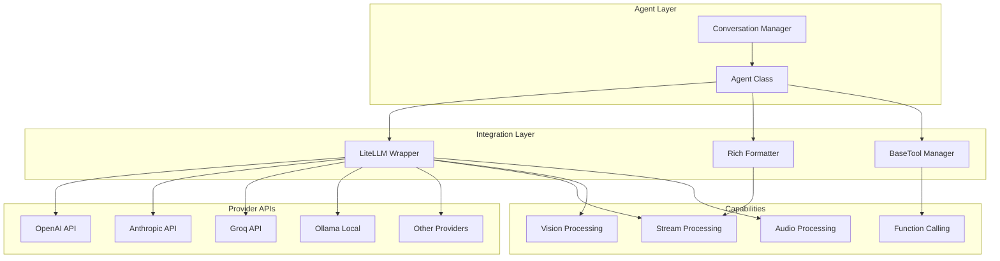
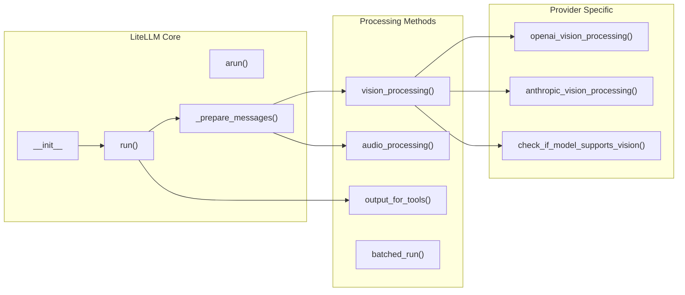
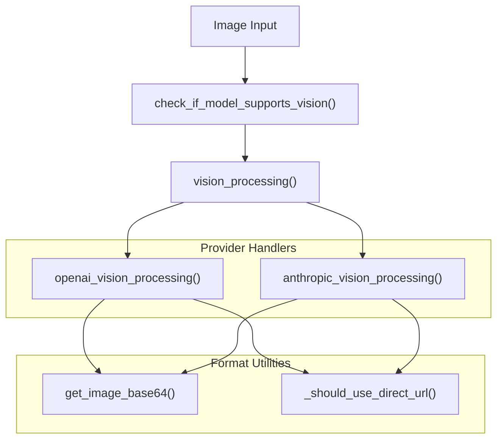
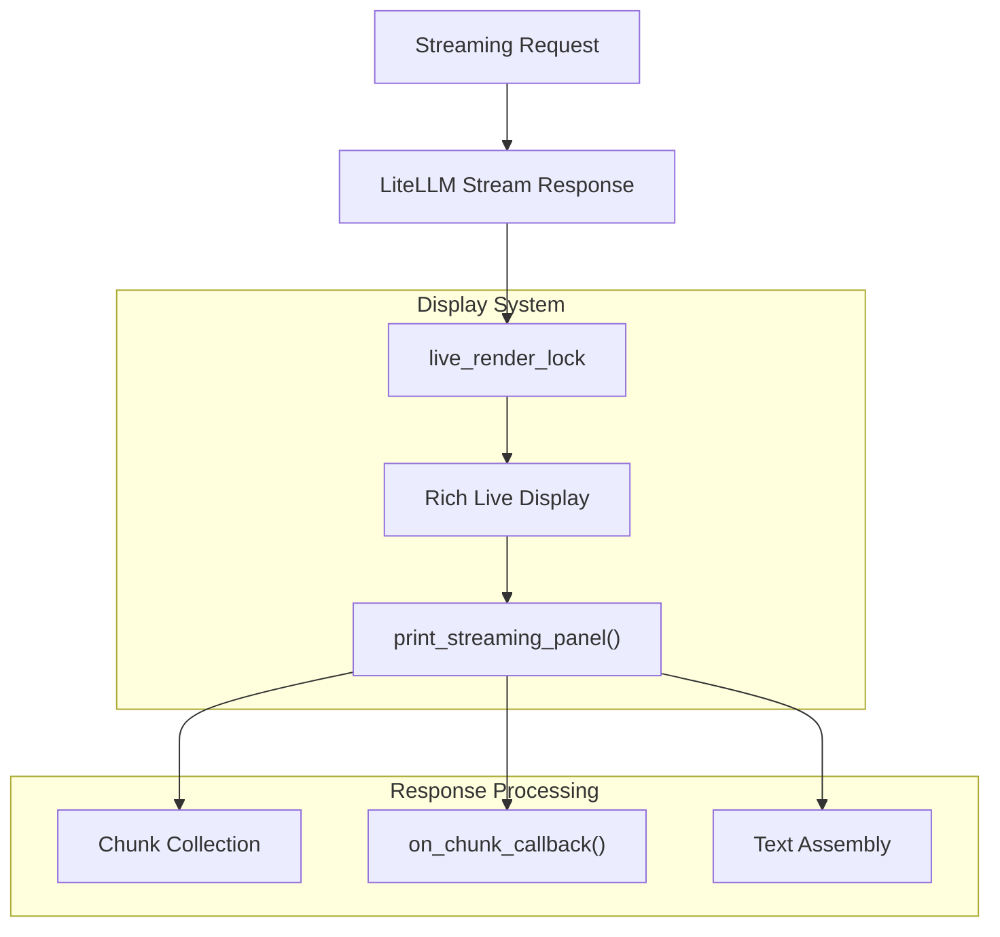
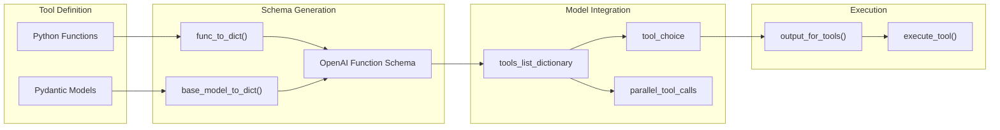

<!-- source: DeepWiki mcp.deepwiki.com · repo kyegomez/swarms · page 5 Model Integration · fetched 2026-10-26 -->

# Model Integration

<details>
<summary>Relevant source files</summary>

The following files were used as context for generating this wiki page:

- [SECURITY.md](SECURITY.md)
- [docs/examples/agent_stream.md](docs/examples/agent_stream.md)
- [docs/swarms/examples/model_providers.md](docs/swarms/examples/model_providers.md)
- [docs/swarms/models/gemini.md](docs/swarms/models/gemini.md)
- [docs/swarms_platform/monetize.md](docs/swarms_platform/monetize.md)
- [examples/multi_agent/groupchat/quantum_physics_swarm.py](examples/multi_agent/groupchat/quantum_physics_swarm.py)
- [examples/multi_agent/mixture_of_agents_example.py](examples/multi_agent/mixture_of_agents_example.py)
- [examples/ui/chat.py](examples/ui/chat.py)
- [swarms/telemetry/__init__.py](swarms/telemetry/__init__.py)
- [swarms/telemetry/main.py](swarms/telemetry/main.py)
- [swarms/tools/base_tool.py](swarms/tools/base_tool.py)
- [swarms/utils/formatter.py](swarms/utils/formatter.py)
- [swarms/utils/litellm_wrapper.py](swarms/utils/litellm_wrapper.py)

</details>


## Purpose and Scope

Model Integration in Swarms provides a unified interface for connecting with various AI model providers through standardized APIs. This system enables agents to seamlessly work with different language models, multimodal models, and specialized AI services while maintaining consistent behavior and configuration patterns. The integration layer abstracts provider-specific implementations and handles capabilities like streaming, tool calling, vision processing, and audio input across different model backends.

For information about tool system integration with models, see [Tool System](#4). For agent-level model configuration, see [Agent Class](#2.1).

## Architecture Overview

The model integration system in Swarms is built around a layered architecture that provides abstraction between agents and AI model providers:



**Sources:** [swarms/utils/litellm_wrapper.py:83-154](), [swarms/utils/formatter.py:48-72](), [swarms/tools/base_tool.py:69-106]()

## LiteLLM Wrapper

The `LiteLLM` class serves as the primary abstraction layer for model integration, providing a unified interface across different AI providers. It handles model initialization, request formatting, response processing, and capability detection.

### Core Components

The LiteLLM wrapper manages several key responsibilities:



**Sources:** [swarms/utils/litellm_wrapper.py:83-154](), [swarms/utils/litellm_wrapper.py:455-537]()

### Configuration Parameters

| Parameter | Type | Default | Description |
|-----------|------|---------|-------------|
| `model_name` | str | "gpt-4o" | Model identifier for the provider |
| `system_prompt` | str | None | System-level instructions |
| `stream` | bool | False | Enable streaming responses |
| `temperature` | float | 0.5 | Response randomness control |
| `max_tokens` | int | 4000 | Maximum response length |
| `tools_list_dictionary` | List[dict] | None | Function calling tools |
| `base_url` | str | None | Custom API endpoint |
| `api_key` | str | None | Provider authentication key |

**Sources:** [swarms/utils/litellm_wrapper.py:89-112]()

## Multimodal Integration

Swarms supports multimodal AI capabilities through specialized processing methods that handle vision and audio inputs alongside text. The system automatically detects model capabilities and formats inputs appropriately for different providers.

### Vision Processing

The vision processing system handles image inputs through provider-specific formatting:



The system supports multiple image formats and automatically converts between local files, URLs, and base64 encoding based on model requirements and performance optimization.

**Sources:** [swarms/utils/litellm_wrapper.py:364-405](), [swarms/utils/litellm_wrapper.py:274-318](), [swarms/utils/litellm_wrapper.py:208-272]()

### Audio Processing

Audio input processing converts audio files to base64 format for model consumption:

```python
# Audio processing implementation
def audio_processing(self, task: str, audio: str):
    encoded_string = get_audio_base64(audio)
    self.messages.append({
        "role": "user",
        "content": [
            {"type": "text", "text": task},
            {
                "type": "input_audio",
                "input_audio": {
                    "data": encoded_string,
                    "format": "wav",
                },
            },
        ],
    })
```

**Sources:** [swarms/utils/litellm_wrapper.py:407-432](), [swarms/utils/litellm_wrapper.py:23-51]()

## Streaming and Real-time Response

The streaming system provides real-time token-by-token response generation with rich formatting and display capabilities. The integration uses thread-safe rendering to prevent conflicts during concurrent operations.

### Stream Processing Architecture



The streaming system includes thread-safe rendering using a global lock to prevent Rich Live context conflicts when multiple agents stream simultaneously.

**Sources:** [swarms/utils/formatter.py:22-28](), [swarms/utils/formatter.py:235-349](), [swarms/utils/litellm_wrapper.py:526-528]()

## Tool Integration with Models

Model integration supports function calling through the BaseTool system, which converts Python functions and Pydantic models into OpenAI-compatible function schemas.

### Function Calling Flow



**Sources:** [swarms/tools/base_tool.py:142-173](), [swarms/tools/base_tool.py:231-314](), [swarms/utils/litellm_wrapper.py:156-171](), [swarms/utils/litellm_wrapper.py:502-509]()

## Supported Model Providers

Swarms integrates with numerous AI model providers through the LiteLLM abstraction layer:

| Provider | Models | Capabilities | Configuration |
|----------|---------|--------------|---------------|
| **OpenAI** | GPT-4o, GPT-4o-mini, GPT-4 | Text, Vision, Tools, Streaming | `OPENAI_API_KEY` |
| **Anthropic** | Claude-3.5-Sonnet, Claude-3-Haiku | Text, Vision, Tools, Streaming | `ANTHROPIC_API_KEY` |
| **Groq** | Llama, Mixtral, Gemma | Ultra-fast inference | `GROQ_API_KEY` |
| **DeepSeek** | DeepSeek-R1, DeepSeek-Chat | Advanced reasoning | `DEEPSEEK_API_KEY` |
| **Ollama** | Local models | Privacy, no API key | Local installation |
| **OpenRouter** | 100+ models | Unified access | `OPENROUTER_API_KEY` |
| **Cohere** | Command, Embed | Enterprise features | `COHERE_API_KEY` |
| **XAI** | Grok models | Research capabilities | `XAI_API_KEY` |

**Sources:** [docs/swarms/examples/model_providers.md:6-18](), [swarms/utils/litellm_wrapper.py:124]()

## Configuration and Environment Setup

Model integration requires proper environment configuration and API key management. The system supports multiple configuration methods:

### Environment Variables

```bash
# Core providers
OPENAI_API_KEY=your_openai_key
ANTHROPIC_API_KEY=your_anthropic_key
GROQ_API_KEY=your_groq_key

# Specialized providers  
DEEPSEEK_API_KEY=your_deepseek_key
OPENROUTER_API_KEY=your_openrouter_key
XAI_API_KEY=your_xai_key
```

### Model Selection Patterns

```python
# Direct model specification
agent = Agent(
    model_name="gpt-4o-mini",
    temperature=0.7,
    max_tokens=2000
)

# Custom endpoint configuration
agent = Agent(
    model_name="custom-model",
    base_url="https://custom-endpoint.com/v1",
    api_key="custom-key"
)
```

**Sources:** [docs/swarms/examples/model_providers.md:77-100](), [swarms/utils/litellm_wrapper.py:516-517]()

The integration system automatically handles provider-specific authentication, request formatting, and response parsing, allowing agents to work seamlessly across different model backends while maintaining consistent behavior and capabilities.

**Sources:** [swarms/utils/litellm_wrapper.py:83-154](), [docs/swarms/examples/model_providers.md:22-41]()

---

