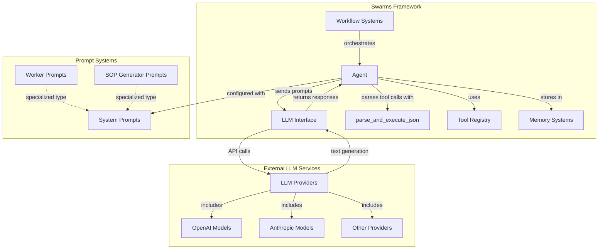
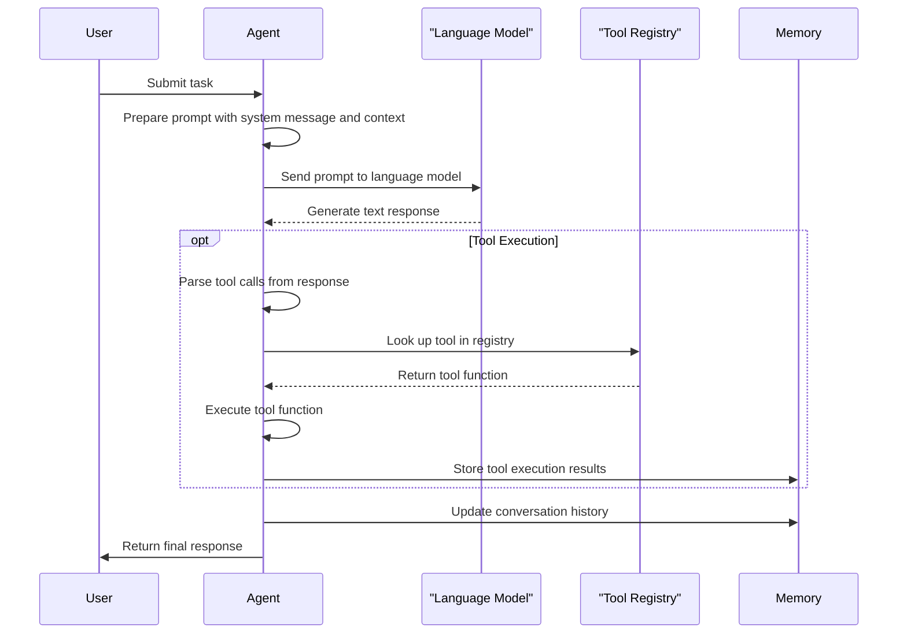
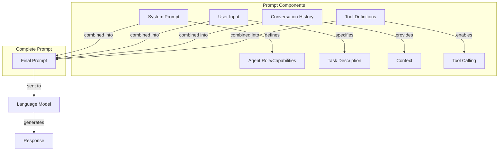
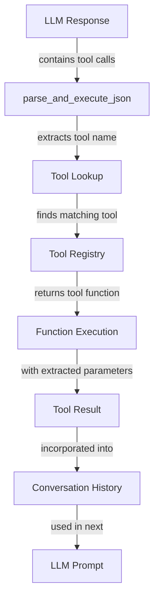

<!-- source: DeepWiki mcp.deepwiki.com · repo kyegomez/swarms · page 5.1 LiteLLM Wrapper · fetched 2026-10-26 -->

# Language Models

<details>
<summary>Relevant source files</summary>

The following files were used as context for generating this wiki page:

- [docs/examples/agent_stream.md](docs/examples/agent_stream.md)
- [docs/swarms/examples/model_providers.md](docs/swarms/examples/model_providers.md)
- [examples/multi_agent/groupchat/quantum_physics_swarm.py](examples/multi_agent/groupchat/quantum_physics_swarm.py)
- [examples/multi_agent/mixture_of_agents_example.py](examples/multi_agent/mixture_of_agents_example.py)
- [examples/ui/chat.py](examples/ui/chat.py)
- [swarms/tools/base_tool.py](swarms/tools/base_tool.py)
- [swarms/utils/formatter.py](swarms/utils/formatter.py)
- [swarms/utils/litellm_wrapper.py](swarms/utils/litellm_wrapper.py)

</details>


## Purpose and Scope

This document provides a technical overview of language model integrations in the Swarms framework. It covers how language models are integrated, configured, and utilized by agents within the system. For information about multimodal models that handle both text and images, see [Multimodal Models](#7.2).

## Overview of Language Models in Swarms

In the Swarms framework, language models (LLMs) serve as the cognitive engines that power autonomous agents. They enable agents to understand natural language instructions, generate responses, make decisions, and invoke tools based on context and goals. Language models operate as external services that agents communicate with through standardized interfaces.

### Language Model Integration Architecture



Sources: [swarms/prompts/worker_prompt.py:115-211]()

## Agent-LLM Interaction Flow

The diagram below illustrates how agents interact with language models in the Swarms framework:



Sources: [swarms/prompts/worker_prompt.py:31-114]()

## Supported Language Model Providers

The Swarms framework supports integration with various language model providers:

| Provider | Models | Key Features |
|----------|--------|--------------|
| OpenAI | GPT-3.5, GPT-4, etc. | Function calling, high reasoning capabilities |
| Anthropic | Claude models | Long context windows, detailed reasoning |
| Local Models | Various open-source models | Self-hosted deployment, privacy |
| Custom Providers | User-implemented | Extension through provider interfaces |

## Prompt Engineering in Swarms

Prompt engineering is crucial for effective agent-LLM interaction. The Swarms framework includes several prompt types and utilities:

### Prompt Structure



Sources: [swarms/prompts/worker_prompt.py:130-194](), [swarms/prompts/sop_generator_agent_prompt.py:1-88](), [swarms/prompts/logistics.py:1-52]()

### Worker Prompts

Worker prompts are specialized system prompts designed for task execution agents. They include:

1. **Task context and constraints**
2. **Tool usage instructions**
3. **Performance evaluation criteria**
4. **Response format specifications**

The Swarms framework provides a `tool_usage_worker_prompt` function that generates comprehensive worker prompts with tool documentation:

```python
def tool_usage_worker_prompt(current_time=time, tools: List[callable] = []):
    tool_docs = BaseTool(verbose=True, functions=tools)
    
    prompt = f"""
    **Date and Time**: {current_time}
    
    You have been assigned a task that requires the use of various tools to gather information and execute commands.
    Follow the instructions provided to complete the task effectively.
    ...
    """
    return prompt
```

Sources: [swarms/prompts/worker_prompt.py:124-211]()

### SOP Generator Prompts

Standard Operating Procedure (SOP) generator prompts help create structured documentation:

```python
def sop_generator_agent_prompt(task_name: str) -> str:
    SOP_GENERATOR_SOP = f"""
    Your are an autonomous agent that generates Standard Operating Procedures for autonomous
    worker agents, your goal is to generate a SOP for the following task: {task_name}
    ...
    """
    return SOP_GENERATOR_SOP
```

Sources: [swarms/prompts/sop_generator_agent_prompt.py:1-88]()

### Logistics Prompts

Specialized role-based prompts for different domains:

```python
Health_Security_Agent_Prompt = """Conduct a thorough analysis of the factory's working conditions focusing on health and safety standards...
"""

Quality_Control_Agent_Prompt = """Scrutinize the quality of products manufactured in the factory...
"""
```

Sources: [swarms/prompts/logistics.py:1-52]()

## Response Format and Tool Execution

Swarms uses structured response formats to enable agents to parse and execute tools from language model responses:

```python
class Thoughts(BaseModel):
    text: str = Field(..., title="Thoughts")
    reasoning: str = Field(..., title="Reasoning")
    plan: str = Field(..., title="Plan")

class Command(BaseModel):
    name: str = Field(..., title="Command Name")
    parameters: dict = Field({}, title="Command Arguments")

class ResponseFormat(BaseModel):
    thoughts: Thoughts = Field(..., title="Thoughts")
    command: Command = Field(..., title="Command")
```

Source: [swarms/prompts/worker_prompt.py:12-26]()

The response format encourages language models to structure their responses in a way that facilitates tool execution:

```json
{
  "thoughts": {
    "text": "I need to find the current weather in Miami",
    "reasoning": "Weather information is needed to answer the user's question",
    "plan": "I will use the browser tool to search for Miami weather"
  },
  "command": {
    "name": "browser",
    "parameters": {
      "query": "Miami weather"
    }
  }
}
```

## Tool Parsing and Execution

When language models generate responses with tool calls, the `parse_and_execute_json` function extracts and executes these tool invocations:



Sources: [swarms/prompts/worker_prompt.py:31-79]()

## Configuring Language Models in Agents

When creating an agent, you can configure various language model parameters:

```python
agent = Agent(
    system_prompt="You are a helpful assistant",
    model="gpt-4",
    temperature=0.7,
    max_tokens=1000,
    tools=[search_tool, calculator_tool],
    memory=memory_system
)
```

Key configuration parameters include:

| Parameter | Description | Typical Values |
|-----------|-------------|----------------|
| `model` | LLM to use | "gpt-4", "claude-2", etc. |
| `temperature` | Randomness (higher = more creative) | 0.0-1.0 (0.7 default) |
| `max_tokens` | Maximum response length | 256-4096 |
| `top_p` | Nucleus sampling parameter | 0.0-1.0 (1.0 default) |
| `frequency_penalty` | Repetition reduction | -2.0-2.0 (0.0 default) |
| `presence_penalty` | Topic repetition reduction | -2.0-2.0 (0.0 default) |

## Best Practices

When working with language models in the Swarms framework:

1. **Clear System Prompts**: Define agent roles and constraints clearly
2. **Tool Documentation**: Provide detailed descriptions of tool functionalities
3. **Chain of Thought**: Encourage structured reasoning with the Thoughts format
4. **Error Handling**: Implement retry mechanisms for API failures
5. **Context Management**: Be mindful of token limits in conversation history
6. **Cost Optimization**: Balance model capabilities with usage costs

## Conclusion

Language models are the core cognitive component in the Swarms framework, enabling agents to understand, reason, and act on complex tasks. Through structured prompts, response formats, and tool integration, Swarms leverages the capabilities of language models to create powerful autonomous agent systems.

---

