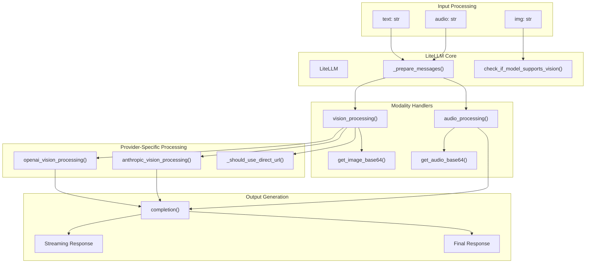
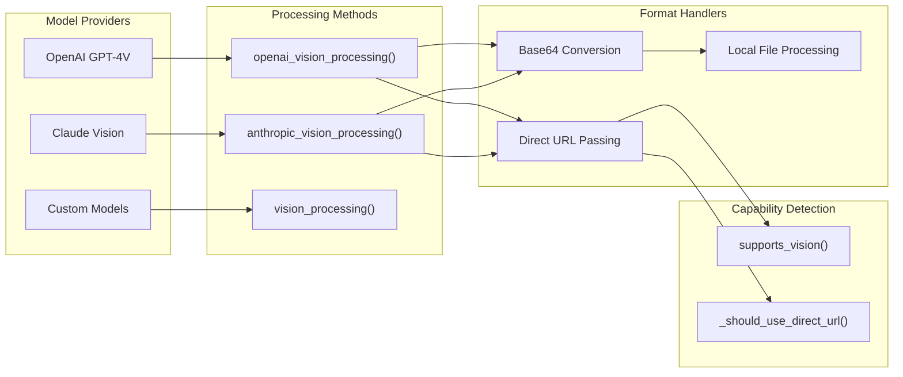
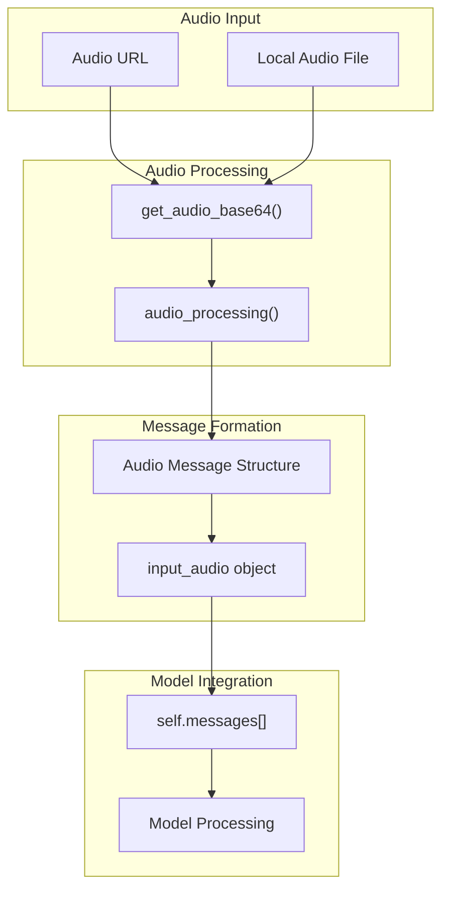

<!-- source: DeepWiki mcp.deepwiki.com · repo kyegomez/swarms · page 5.2 Multimodal Models · fetched 2026-10-26 -->

# Multimodal Models

<details>
<summary>Relevant source files</summary>

The following files were used as context for generating this wiki page:

- [docs/examples/agent_stream.md](docs/examples/agent_stream.md)
- [docs/swarms/examples/model_providers.md](docs/swarms/examples/model_providers.md)
- [examples/multi_agent/groupchat/quantum_physics_swarm.py](examples/multi_agent/groupchat/quantum_physics_swarm.py)
- [examples/multi_agent/mixture_of_agents_example.py](examples/multi_agent/mixture_of_agents_example.py)
- [examples/ui/chat.py](examples/ui/chat.py)
- [swarms/prompts/multi_modal_visual_prompts.py](swarms/prompts/multi_modal_visual_prompts.py)
- [swarms/tools/base_tool.py](swarms/tools/base_tool.py)
- [swarms/tools/tool_registry.py](swarms/tools/tool_registry.py)
- [swarms/utils/formatter.py](swarms/utils/formatter.py)
- [swarms/utils/litellm_wrapper.py](swarms/utils/litellm_wrapper.py)

</details>


This document covers the multimodal model integration capabilities within the Swarms framework, focusing on vision and audio processing through the LiteLLM wrapper system. For information about the core LiteLLM wrapper architecture and basic model integration, see [LiteLLM Wrapper](#5.1).

## Purpose and Scope

The multimodal models system enables Swarms agents to process and understand multiple types of input beyond text, including images and audio. This system provides unified interfaces for vision and audio processing across different model providers, automatic format conversion, and seamless integration with the core agent architecture.

## Architecture Overview

The multimodal system is built around the `LiteLLM` class which serves as the central orchestrator for multimodal processing, with specialized methods for different input types and model providers.

### Multimodal Processing Pipeline



Sources: [swarms/utils/litellm_wrapper.py:173-206](), [swarms/utils/litellm_wrapper.py:364-406](), [swarms/utils/litellm_wrapper.py:407-433]()

### Model Provider Integration



Sources: [swarms/utils/litellm_wrapper.py:274-318](), [swarms/utils/litellm_wrapper.py:208-272](), [swarms/utils/litellm_wrapper.py:320-363]()

## Vision Processing

The vision processing system handles image inputs through multiple pathways depending on the model provider and input format.

### Image Input Formats

| Format | Handler | Description |
|--------|---------|-------------|
| **HTTP/HTTPS URLs** | `DirectURLHandler` or `Base64Handler` | Remote images, processed based on model capabilities |
| **Local File Paths** | `Base64Handler` | Local images converted to base64 data URIs |
| **Data URIs** | `PassthroughHandler` | Pre-encoded images passed directly |

### Vision Processing Methods

The `vision_processing()` method in `LiteLLM` automatically routes to provider-specific implementations:

**OpenAI Vision Processing** (`openai_vision_processing()`):
- Supports direct URL passing for HTTP/HTTPS images when model supports it
- Falls back to base64 conversion for local files or unsupported models
- Formats images according to OpenAI's vision API specification
- Handles MIME type detection and format specification

**Anthropic Vision Processing** (`anthropic_vision_processing()`):
- Similar URL/base64 handling logic as OpenAI
- Uses Anthropic-specific message formatting
- Supports specific image formats: JPEG, PNG, GIF, WebP
- Includes format validation and fallback mechanisms

Sources: [swarms/utils/litellm_wrapper.py:274-318](), [swarms/utils/litellm_wrapper.py:208-272](), [swarms/utils/litellm_wrapper.py:364-406]()

### Image Encoding Utilities

The `get_image_base64()` function handles conversion of various image sources to base64 data URIs:

```python
# Function signature from litellm_wrapper.py
def get_image_base64(image_source: str) -> str
```

Key features:
- Handles URLs, local files, and existing data URIs
- Automatic MIME type detection from file extensions
- Returns properly formatted data URI with base64 encoding
- Error handling for network requests and file access

Sources: [swarms/utils/litellm_wrapper.py:54-81]()

## Audio Processing

Audio processing enables agents to work with audio inputs through the `audio_processing()` method and `get_audio_base64()` utility.

### Audio Processing Pipeline



Sources: [swarms/utils/litellm_wrapper.py:407-433](), [swarms/utils/litellm_wrapper.py:23-52]()

### Audio Message Format

The system creates structured audio messages for model consumption:

- `type`: "input_audio"
- `input_audio.data`: Base64-encoded audio data
- `input_audio.format`: Audio format specification (default: "wav")

Sources: [swarms/utils/litellm_wrapper.py:418-432]()

## Model Capability Detection

The system includes intelligent capability detection to optimize processing and prevent errors.

### Vision Support Detection

The `check_if_model_supports_vision()` method validates model capabilities before processing:

```python
# Validates vision support using LiteLLM's built-in function
def check_if_model_supports_vision(self, img: str = None):
    if img is not None:
        out = supports_vision(model=self.model_name)
        if out is False:
            raise ValueError(f"Model {self.model_name} does not support vision")
```

### Direct URL vs Base64 Decision Logic

The `_should_use_direct_url()` method determines the optimal processing approach:

**Direct URL Criteria**:
- Input must be HTTP/HTTPS URL
- Model must not be local/custom (excludes localhost, ollama, llama-cpp)
- Model must support vision capabilities via LiteLLM

**Base64 Conversion Used For**:
- Local file paths
- Local/custom model deployments
- Models without direct URL support

Sources: [swarms/utils/litellm_wrapper.py:434-454](), [swarms/utils/litellm_wrapper.py:320-363]()

## Agent Integration

Multimodal capabilities integrate seamlessly with the core `Agent` class through the LiteLLM wrapper system.

### Configuration Parameters

Key LiteLLM initialization parameters for multimodal support:

| Parameter | Type | Purpose |
|-----------|------|---------|
| `audio` | `str` | Audio input path/URL |
| `modalities` | `List[str]` | Supported modality types |
| `model_name` | `str` | Model identifier for capability detection |

### Usage Patterns

**Vision Processing in Agents**:
```python
# Called through Agent.run() with img parameter
response = agent.run(
    task="Describe this image",
    img="/path/to/image.jpg"  # or URL
)
```

**Audio Processing in Agents**:
```python  
# Audio processing through LiteLLM audio parameter
response = litellm_instance.run(
    task="Transcribe this audio",
    audio="/path/to/audio.wav"  # or URL
)
```

Sources: [swarms/utils/litellm_wrapper.py:455-552]()

## Visual Agent Prompting

The framework includes specialized prompts for multimodal visual agents through the `multi_modal_visual_prompts.py` module.

### Visual Agent Components

| Component | Purpose |
|-----------|---------|
| `VISUAL_AGENT_PREFIX` | System prompt defining visual agent capabilities |
| `VISUAL_AGENT_FORMAT_INSTRUCTIONS` | Tool usage format for visual tasks |
| `VISUAL_AGENT_SUFFIX` | Conversation context and guidelines |

### Key Visual Agent Behaviors

- **File Name Accuracy**: Strict adherence to actual image file names
- **Tool-Based Processing**: Uses tools rather than imagination for image analysis  
- **Sequential Tool Usage**: Can chain multiple visual tools together
- **Observation Loyalty**: Relies on tool outputs rather than assumptions

Sources: [swarms/prompts/multi_modal_visual_prompts.py:1-49]()

## Rich Formatting for Multimodal Content

The `Formatter` class provides enhanced display capabilities for multimodal interactions through Rich console formatting.

### Streaming Panel Display

The `print_streaming_panel()` method enables real-time display of multimodal responses with visual enhancements:

- Automatic text wrapping for multimodal content
- Blinking cursor during streaming
- Completion indicators
- Thread-safe rendering with `live_render_lock`

Sources: [swarms/utils/formatter.py:235-349]()

## Error Handling and Validation

The multimodal system includes comprehensive error handling:

### Vision Processing Errors
- Model capability validation before processing
- File access and network request error handling
- MIME type validation and fallback mechanisms
- Provider-specific error handling

### Audio Processing Errors  
- File format validation
- Network request error handling for URLs
- Base64 encoding error management

### General Multimodal Errors
- `LiteLLMException` for model-specific errors
- Rate limiting with automatic retry logic
- Graceful degradation for unsupported formats

Sources: [swarms/utils/litellm_wrapper.py:539-552](), [swarms/utils/litellm_wrapper.py:17-21]()

---

