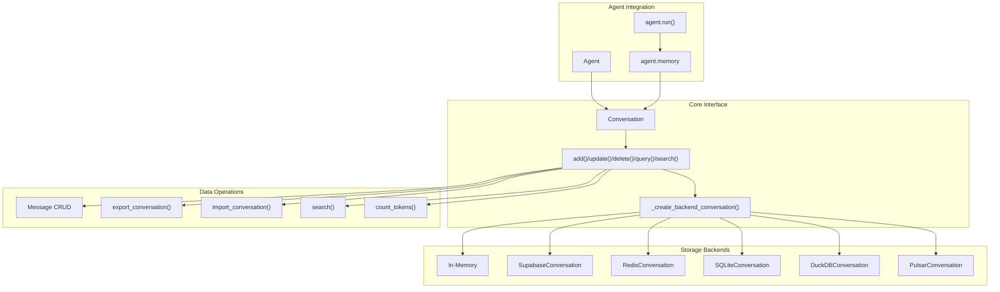
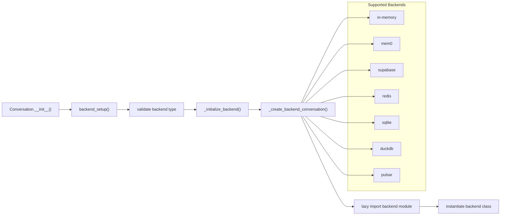
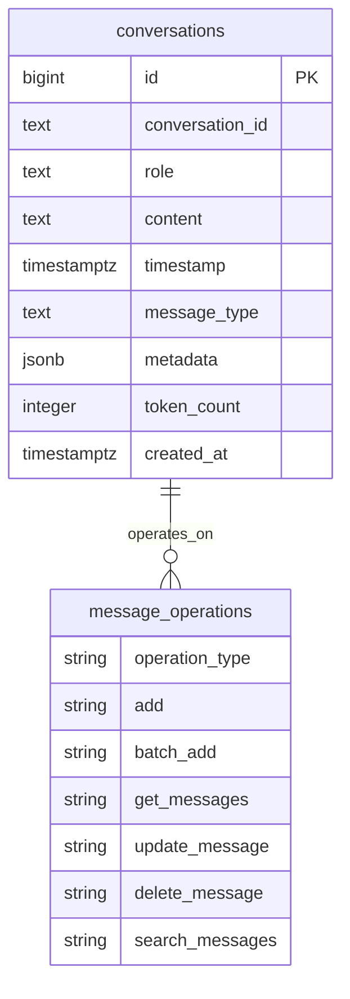
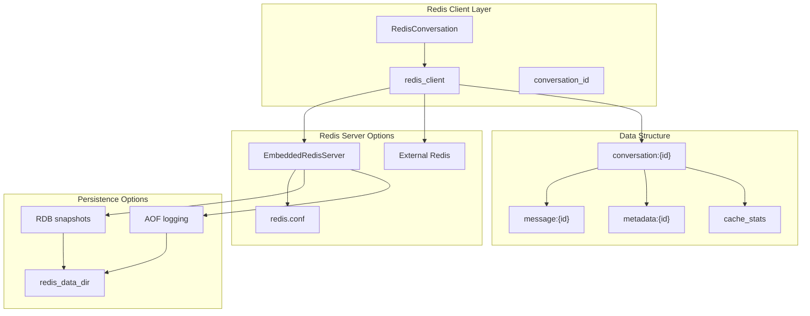
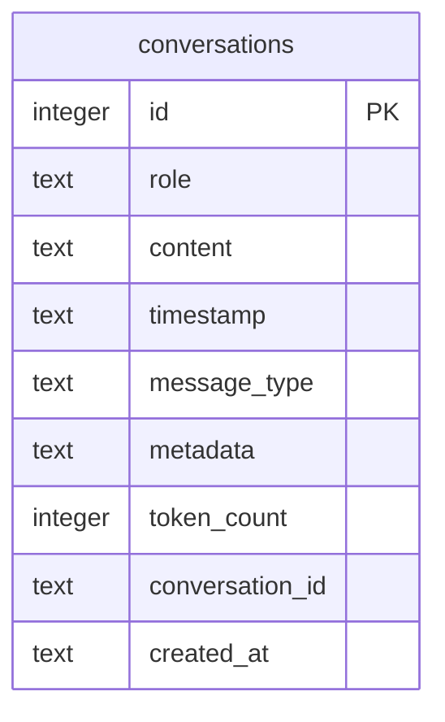
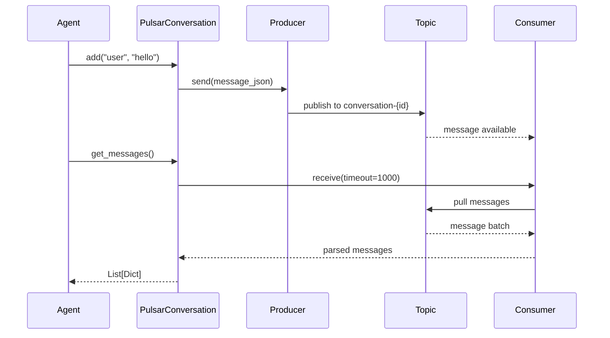
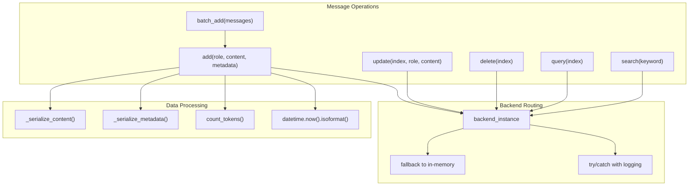
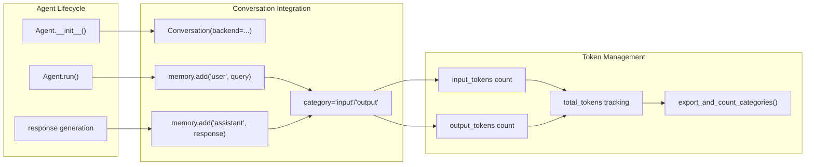

<!-- source: DeepWiki mcp.deepwiki.com · repo kyegomez/swarms · page 6 Conversation & Memory · fetched 2026-10-26 -->

# Conversation & Memory

<details>
<summary>Relevant source files</summary>

The following files were used as context for generating this wiki page:

- [swarms/communication/__init__.py](swarms/communication/__init__.py)
- [swarms/communication/duckdb_wrap.py](swarms/communication/duckdb_wrap.py)
- [swarms/communication/pulsar_struct.py](swarms/communication/pulsar_struct.py)
- [swarms/communication/redis_wrap.py](swarms/communication/redis_wrap.py)
- [swarms/communication/sqlite_wrap.py](swarms/communication/sqlite_wrap.py)
- [swarms/communication/supabase_wrap.py](swarms/communication/supabase_wrap.py)
- [swarms/structs/conversation.py](swarms/structs/conversation.py)
- [tests/communication/__init__.py](tests/communication/__init__.py)
- [tests/communication/test_duckdb_conversation.py](tests/communication/test_duckdb_conversation.py)
- [tests/communication/test_redis.py](tests/communication/test_redis.py)
- [tests/communication/test_sqlite_wrapper.py](tests/communication/test_sqlite_wrapper.py)
- [tests/communication/test_supabase_conversation.py](tests/communication/test_supabase_conversation.py)

</details>


This document covers the conversation history management and persistent memory systems within the Swarms framework. The conversation system provides a unified interface for storing, retrieving, and managing agent conversations across multiple storage backends, enabling both ephemeral and persistent memory capabilities for multi-agent systems.

For information about agent-to-agent communication patterns, see [GroupChat](#3.4). For tool integration and function calling, see [Tool System](#4).

## System Architecture

The conversation and memory system is built around a pluggable backend architecture that allows agents to persist conversation history across different storage systems while maintaining a consistent API.



Sources: [swarms/structs/conversation.py:146-326](), [swarms/communication/base_communication.py]()

## Core Conversation Class

The `Conversation` class serves as the primary interface for conversation management, implementing a factory pattern for backend selection and providing a unified API regardless of the underlying storage mechanism.

### Backend Selection and Initialization

The conversation system supports multiple providers through the `providers` literal type and dynamic backend instantiation:



The backend selection logic uses lazy loading to import dependencies only when needed:

| Backend | Module Import | Dependencies | Auto-Install |
|---------|---------------|--------------|--------------|
| `supabase` | `swarms.communication.supabase_wrap.SupabaseConversation` | `supabase` | Yes |
| `redis` | `swarms.communication.redis_wrap.RedisConversation` | `redis` | Yes |
| `sqlite` | `swarms.communication.sqlite_wrap.SQLiteConversation` | Built-in | N/A |
| `duckdb` | `swarms.communication.duckdb_wrap.DuckDBConversation` | `duckdb` | Yes |
| `pulsar` | `swarms.communication.pulsar_struct.PulsarConversation` | `pulsar-client` | Yes |

Sources: [swarms/structs/conversation.py:54-63](), [swarms/structs/conversation.py:66-144](), [swarms/structs/conversation.py:270-326]()

### Message Operations Interface

The `Conversation` class provides consistent message operations that delegate to the appropriate backend:

- `add(role, content, metadata, category)` - Add messages with automatic backend routing
- `delete(index)` - Remove messages by index
- `update(index, role, content)` - Modify existing messages  
- `query(index)` - Retrieve specific messages
- `search(keyword)` - Search message content
- `export_conversation(filename)` - Export to files
- `import_conversation(filename)` - Import from files

Sources: [swarms/structs/conversation.py:633-661](), [swarms/structs/conversation.py:714-786]()

## Storage Backend Implementations

### Supabase Backend (PostgreSQL)

The `SupabaseConversation` class provides PostgreSQL-based persistence through Supabase with comprehensive error handling and auto-installation capabilities.

#### Database Schema and Operations



Key methods and their SQL operations:

- `add()` - Inserts with JSON serialization and timestamp handling
- `batch_add()` - Bulk inserts with transaction management
- `get_messages()` - Paginated queries with conversation filtering
- `search()` - Content-based search with SQL LIKE operations

Sources: [swarms/communication/supabase_wrap.py:48-231](), [swarms/communication/supabase_wrap.py:510-589](), [swarms/communication/supabase_wrap.py:591-674]()

### Redis Backend with Embedded Server

The `RedisConversation` implementation includes an embedded Redis server capability for development and testing scenarios.

#### Redis Architecture and Key Structure



The Redis backend supports both embedded and external Redis instances with configurable persistence:

- Embedded server with automatic configuration
- RDB and AOF persistence options
- Connection retry logic with exponential backoff
- Cache statistics tracking

Sources: [swarms/communication/redis_wrap.py:81-234](), [swarms/communication/redis_wrap.py:236-453](), [swarms/communication/redis_wrap.py:454-600]()

### SQLite and DuckDB Backends

Both SQLite and DuckDB implementations provide local file-based persistence with similar schemas and APIs.

#### Local Database Schema



Key differences between SQLite and DuckDB implementations:

| Feature | SQLite | DuckDB |
|---------|--------|---------|
| File Extension | `.sqlite` | `.duckdb` |
| Connection Method | `sqlite3.connect()` | `duckdb.connect()` |
| Schema Type | `INTEGER PRIMARY KEY AUTOINCREMENT` | `BIGINT PRIMARY KEY` |
| Analytics Support | Basic | Advanced analytics functions |
| Thread Safety | Row-level locking | Better concurrent access |

Sources: [swarms/communication/sqlite_wrap.py:26-118](), [swarms/communication/duckdb_wrap.py:35-160]()

### Apache Pulsar Backend

The `PulsarConversation` implementation uses Apache Pulsar for message-based conversation storage, suitable for distributed and streaming scenarios.

#### Pulsar Message Flow



Pulsar-specific features:
- Topic-based message organization per conversation
- Subscription management for message consumption
- Message immutability (updates create new messages)
- Distributed message handling capabilities

Sources: [swarms/communication/pulsar_struct.py:27-187](), [swarms/communication/pulsar_struct.py:188-283]()

## Message Management Operations

### Core Message CRUD Operations

All backends implement a consistent set of message operations through the base interface:



### Content Serialization and Type Handling

The system handles various content types with automatic serialization:

- **String content**: Stored directly
- **Dict/List content**: JSON serialized with `DateTimeEncoder`
- **Complex objects**: Converted to string representation
- **Metadata**: Always JSON serialized with error handling

Sources: [swarms/structs/conversation.py:495-536](), [swarms/communication/supabase_wrap.py:438-490]()

### Token Counting and Context Management

Token counting is implemented with threading to avoid blocking message operations:

```python
def _count_tokens(self, content: str, message: dict):
    if self.token_count is True:
        def count_tokens_thread():
            tokens = count_tokens(any_to_str(content))
            message["token_count"] = int(tokens)
            if self.autosave:
                self.save_as_json(self.save_filepath)
        
        token_thread = threading.Thread(target=count_tokens_thread)
        token_thread.daemon = True
        token_thread.start()
```

Sources: [swarms/structs/conversation.py:668-690]()

## Data Export and Import

### File Format Support

The conversation system supports multiple export formats with consistent APIs across backends:

| Format | Export Method | Import Method | Use Case |
|--------|---------------|---------------|----------|
| JSON | `export_conversation(filename.json)` | `import_conversation(filename.json)` | Structured data exchange |
| YAML | `save_as_yaml()` | `load_from_yaml()` | Human-readable configuration |
| Text | `export_conversation(filename.txt)` | Not supported | Simple text export |

### Export Data Structure

JSON exports follow a standardized structure:

```json
{
  "metadata": {
    "id": "conversation_id",
    "name": "conversation_name", 
    "created_at": "2024-01-01T00:00:00",
    "system_prompt": "...",
    "rules": "..."
  },
  "history": [
    {
      "role": "user",
      "content": "message content",
      "timestamp": "2024-01-01T00:00:01",
      "message_type": "user",
      "metadata": {},
      "token_count": 10
    }
  ]
}
```

Sources: [swarms/structs/conversation.py:827-855](), [swarms/structs/conversation.py:949-1004]()

## Integration with Agent System

### Agent-Conversation Integration

Agents integrate with the conversation system through the `memory` attribute and automatic message logging:



### Category-Based Token Tracking

The system provides specialized token counting for input/output categorization:

```python
def export_and_count_categories(
    self, tokenizer_model_name: Optional[str] = "gpt-4.1-mini"
) -> Dict[str, int]:
    input_messages = []
    output_messages = []
    
    for message in self.conversation_history:
        category = message.get("category", "")
        if category == "input":
            input_messages.append(content)
        elif category == "output":
            output_messages.append(content)
    
    return {
        "input_tokens": count_tokens(all_input_text, tokenizer_model_name),
        "output_tokens": count_tokens(all_output_text, tokenizer_model_name), 
        "total_tokens": input_tokens + output_tokens,
    }
```

Sources: [swarms/structs/conversation.py:537-608]()

## Configuration and Setup

### Backend-Specific Configuration

Each backend requires specific configuration parameters:

#### Supabase Configuration
```python
conversation = Conversation(
    backend="supabase",
    supabase_url="https://project.supabase.co",
    supabase_key="anon_key", 
    table_name="conversations"
)
```

#### Redis Configuration  
```python
conversation = Conversation(
    backend="redis",
    redis_host="localhost",
    redis_port=6379,
    use_embedded_redis=True,
    persist_redis=True,
    redis_data_dir="~/.swarms/redis"
)
```

#### Local Database Configuration
```python
conversation = Conversation(
    backend="sqlite",  # or "duckdb"
    db_path="./conversations.db"
)
```

### Environment Variable Support

The system supports environment-based configuration for sensitive parameters:

- `SUPABASE_URL` and `SUPABASE_ANON_KEY` for Supabase backend
- Redis connection parameters via standard Redis environment variables
- Custom database paths via application-specific environment variables

Sources: [swarms/structs/conversation.py:182-268](), [swarms/communication/supabase_wrap.py:350-371](), [swarms/communication/redis_wrap.py:263-453]()

---

