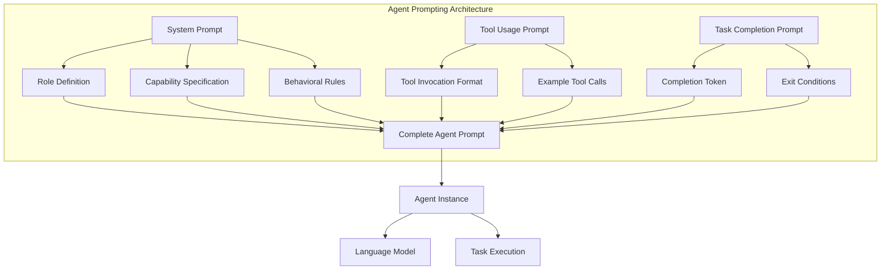
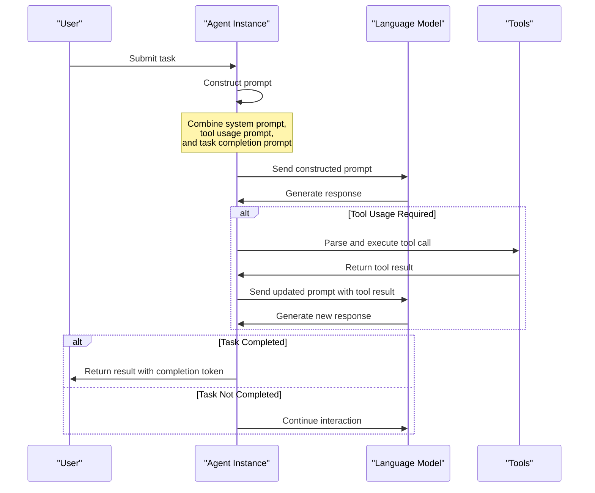
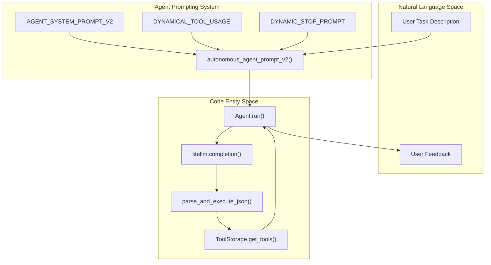
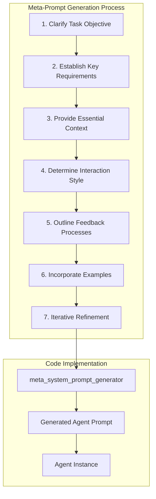

<!-- source: DeepWiki mcp.deepwiki.com · repo kyegomez/swarms · page 7 Agent Prompting · fetched 2026-10-26 -->

# Agent Prompting

<details>
<summary>Relevant source files</summary>

The following files were used as context for generating this wiki page:

- [docs/assets/img/agent_def.png](docs/assets/img/agent_def.png)
- [docs/requirements.txt](docs/requirements.txt)
- [docs/swarms/agents/tool_agent.md](docs/swarms/agents/tool_agent.md)
- [docs/swarms/framework/index.md](docs/swarms/framework/index.md)
- [swarms/prompts/meta_system_prompt.py](swarms/prompts/meta_system_prompt.py)

</details>


## Purpose and Scope

This document covers the agent prompting system within the Swarms framework. Agent prompting refers to the structured instructions provided to language models to guide their behavior when operating as autonomous agents. A well-crafted prompt is essential for defining agent behavior, capabilities, interaction protocols, and task execution patterns.

For information about specific system prompts used in different agent roles, see [System Prompts](#7.1).
For techniques to generate prompts with other prompts, see [Meta-Prompting](#7.2).

## Prompt Architecture

The Swarms framework implements a modular approach to agent prompting, where different components combine to create customized agent behaviors.



Sources: 
- [swarms/prompts/agent_system_prompts.py:7-43]()
- [swarms/prompts/tools.py:2-34]()

## Core Prompt Components

### System Prompts

System prompts define the agent's role, capabilities, and behavioral guidelines. The framework includes multiple versions with progressive improvements:

1. **AGENT_SYSTEM_PROMPT_V1** - Basic autonomous agent definition
2. **AGENT_SYSTEM_PROMPT_V2** - Enhanced prompt with explicit rules and quality standards

Example from AGENT_SYSTEM_PROMPT_V2:
```
You are an elite autonomous agent operating within an autonomous loop structure.
Your primary function is to reliably complete user's tasks.
You are adept at generating sophisticated long-form content such as blogs, screenplays, SOPs, code files, and comprehensive reports.
```

Sources:
- [swarms/prompts/agent_system_prompts.py:7-21]() - AGENT_SYSTEM_PROMPT_V2
- [swarms/prompts/agent_system_prompts.py:69-76]() - AGENT_SYSTEM_PROMPT_V1

### Tool Usage Prompts

Tool usage prompts instruct agents on how to invoke tools using specified JSON formats. The primary tool prompt is `DYNAMICAL_TOOL_USAGE`:

```
DYNAMICAL_TOOL_USAGE = """
You have access to the following tools:
Output a JSON object with the following structure to use the tools

commands: {
    "tools": {
        tool1: "search_api",
        "params": {
            "query": "What is the weather in New York?",
            "description": "Get the weather in New York"
        }
        ...
    }
}
"""
```

Sources:
- [swarms/prompts/tools.py:12-34]() - DYNAMICAL_TOOL_USAGE

### Task Completion Prompts

Task completion prompts define how agents signal task completion. The main completion prompt is `DYNAMIC_STOP_PROMPT`:

```
DYNAMIC_STOP_PROMPT = """
When you have finished the task from the Human, output a special token: <DONE>
This will enable you to leave the autonomous loop.
"""
```

Sources:
- [swarms/prompts/tools.py:2-8]() - DYNAMIC_STOP_PROMPT

## Dynamic Prompt Generation

The framework provides functions to generate dynamic agent prompts customized for specific tasks:

1. **autonomous_agent_prompt_v2** - Creates prompts for autonomous agents with customizable components
2. **agent_system_prompt_2_v2** - Generates prompts with specific agent names and task completion tokens

Example:

```python
def autonomous_agent_prompt_v2(
    tools_prompt: str = DYNAMICAL_TOOL_USAGE,
    dynamic_stop_prompt: str = DYNAMIC_STOP_PROMPT,
    agent_name: str = None,
):
    return f"""
    You are {agent_name}, an elite autonomous agent operating within a sophisticated autonomous loop structure.
    Your mission is to exceed user expectations in all tasks...
    """
```

Sources:
- [swarms/prompts/agent_system_prompts.py:24-43]() - autonomous_agent_prompt_v2
- [swarms/prompts/agent_system_prompts.py:46-65]() - agent_system_prompt_2_v2

## Prompt Flow in the Agent System

This diagram shows how prompts flow through the agent execution cycle:



Sources:
- [swarms/prompts/agent_system_prompts.py:7-43]()
- [swarms/prompts/tools.py:2-34]()
- [swarms/tools/tool_utils.py:9-90]()

## From Natural Language to Code Execution

This diagram illustrates how user inputs are transformed through the prompting system into agent actions:



## Meta-Prompting Template System

The Swarms framework includes a sophisticated meta-prompting system for generating agent prompts. The `meta_system_prompt_generator` provides a structured template for creating effective agent prompts:



### Meta-Prompt Template Structure

The `meta_system_prompt_generator` follows a systematic approach:

| Step | Component | Purpose |
|------|-----------|---------|
| 1 | Task Objective | Clearly articulate the primary goal or specific outcome expected |
| 2 | Key Requirements | Enumerate crucial requirements, limitations, response format |
| 3 | Essential Context | Provide relevant background and contextual information |
| 4 | Interaction Style | Define desired tone and style (professional, casual, instructional) |
| 5 | Feedback Processes | Describe evaluation methods and feedback mechanisms |
| 6 | Examples | Provide positive and negative response examples |
| 7 | Iterative Refinement | Review and test the prompt for improvements |

The template emphasizes: *"Only Return the prompt for the agent you're instructing. Nothing else"*

Sources:
- [swarms/prompts/agent_system_prompts.py:7-43]()
- [swarms/prompts/tools.py:2-34]()
- [swarms/prompts/meta_system_prompt.py:1-53]()
- [swarms/tools/tool_utils.py:50-90]()

## Best Practices for Agent Prompting

### Role Definition

Clearly define the agent's role, capabilities, and purpose in the prompt:

```
You are an elite autonomous agent operating within an autonomous loop structure.
Your primary function is to reliably complete user's tasks.
You are adept at generating sophisticated long-form content...
```

### Explicit Rules

Include specific rules that guide the agent's behavior:

```
You are programmed to follow these rules:
1. Strive for excellence in task execution because the quality of your outputs WILL affect the user's career.
2. Think step-by-step through every task before answering.
3. Always give full files when providing code so the user can copy paste easily to VScode...
```

### Tool Usage Instructions

Provide clear instructions for tool invocation with proper formatting requirements:

```
You have access to the following tools:
Output a JSON object with the following structure to use the tools

commands: {
    "tools": {
        tool1: "tool_name",
        "params": {
            "parameter1": "value1",
            "parameter2": "value2"
        }
    }
}
```

### Task Completion Signals

Include clear instructions for signaling task completion:

```
When you have finished the task from the Human, output a special token: <DONE>
This will enable you to leave the autonomous loop.
```

## Prompt Evolution in the Swarms Framework

The table below summarizes the evolution of prompting in the Swarms framework:

| Version | Key Features | Improvements |
|---------|-------------|--------------|
| v1 Basic | Simple role definition, basic capabilities | Established foundation for autonomous agents |
| v1 Autonomous | Added tool usage, completion signals | Enhanced agent capabilities with tools |
| v2 Basic | Explicit rules, quality standards | Improved output quality and task execution |
| v2 Autonomous | Sophisticated autonomy, dynamic customization | Enhanced adaptability to different tasks |

Sources:
- [swarms/prompts/agent_system_prompts.py:7-21]() - AGENT_SYSTEM_PROMPT_V2
- [swarms/prompts/agent_system_prompts.py:69-76]() - AGENT_SYSTEM_PROMPT_V1
- [swarms/prompts/agent_system_prompts.py:24-43]() - autonomous_agent_prompt_v2

## Domain-Specific Prompting

Swarms includes domain-specific prompts for specialized tasks. For example, urban planning agents use tailored prompts:

```
ARCHITECTURE_ANALYSIS_PROMPT = """
Analyze the architectural styles, building designs, and construction materials visible in the urban area image provided...
"""
```

Sources:
- [swarms/prompts/urban_planning.py:4-6]() - ARCHITECTURE_ANALYSIS_PROMPT

## Conclusion

Effective agent prompting is critical for creating agents that understand their roles, follow behavioral guidelines, use tools appropriately, and complete tasks successfully. The Swarms framework provides a flexible, modular approach to prompt construction that can be adapted to various agent types and tasks.

By following the best practices outlined in this document and leveraging the prompt components provided by the framework, developers can create powerful agents capable of accomplishing a wide range of tasks autonomously.

For more detailed information about specific prompt types and advanced prompting techniques, refer to [System Prompts](#6.1) and [Meta-Prompting](#6.2).

---

