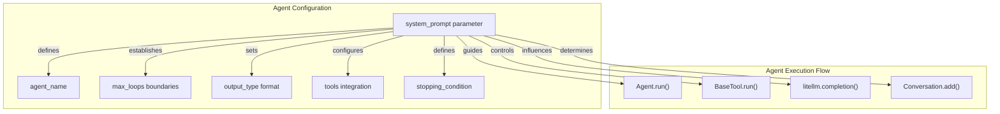
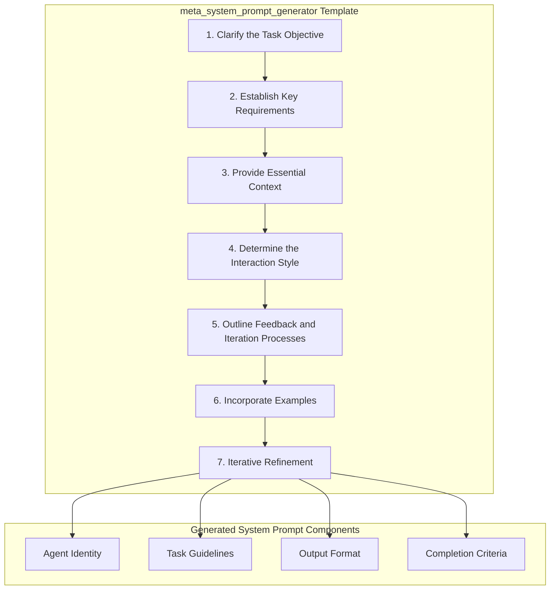
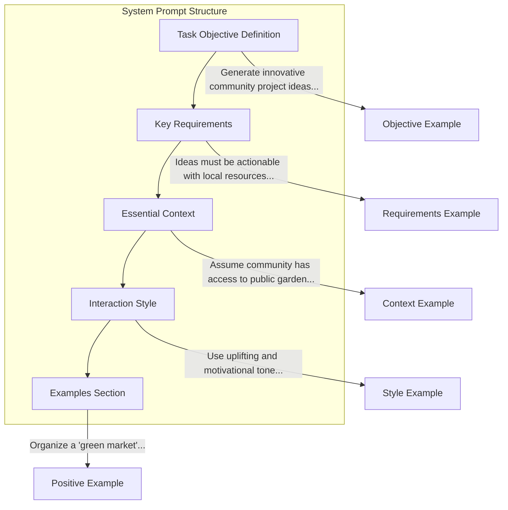
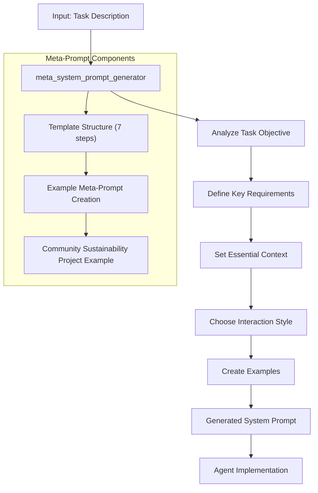
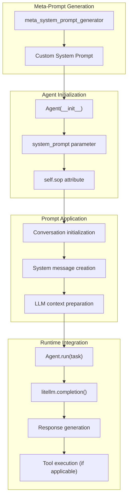
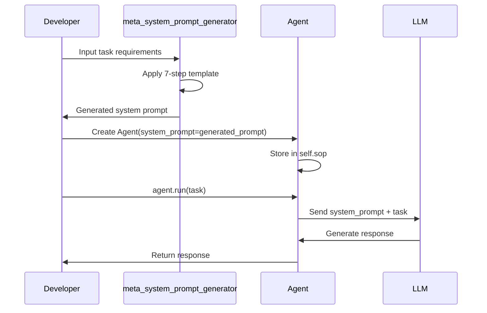
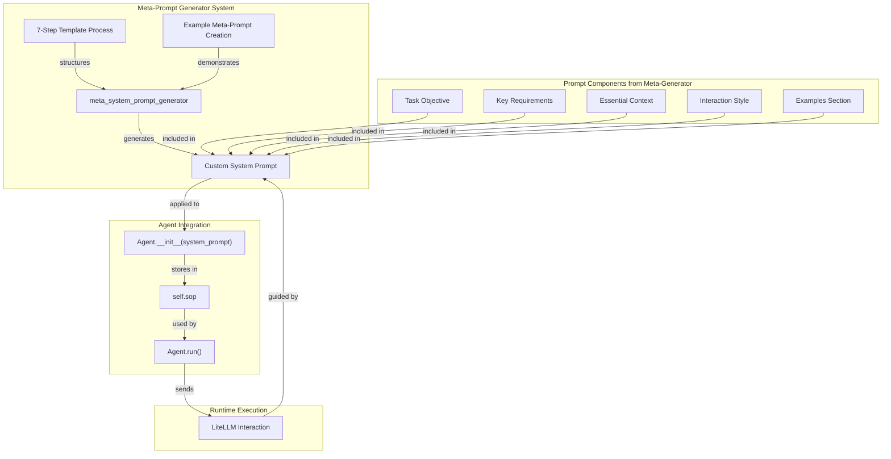
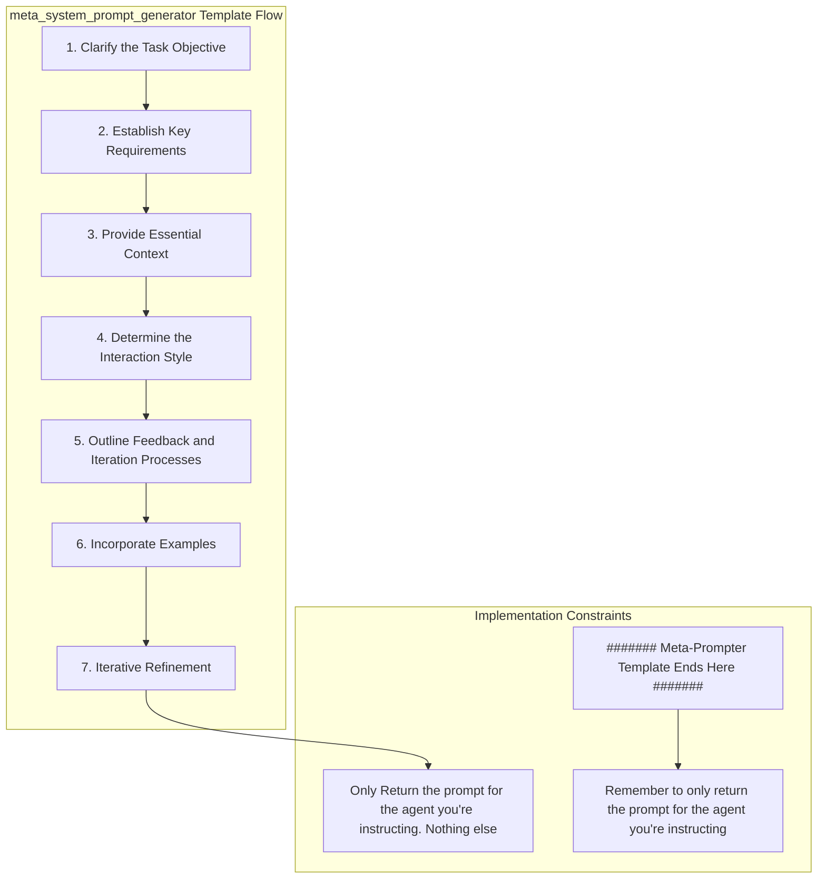

<!-- source: DeepWiki mcp.deepwiki.com · repo kyegomez/swarms · page 7.1 System Prompts · fetched 2026-10-26 -->

# System Prompts

<details>
<summary>Relevant source files</summary>

The following files were used as context for generating this wiki page:

- [swarms/prompts/meta_system_prompt.py](swarms/prompts/meta_system_prompt.py)

</details>


System prompts are specialized instructions that define the behavior, capabilities, and operational guidelines for AI agents within the Swarms framework. They serve as the foundation for agent personality, capabilities, and interaction patterns. This page details how system prompts are structured, created, and customized in Swarms.

For information about meta-prompting techniques used to generate prompts with other prompts, see [7.2](7.2).

## Purpose and Role of System Prompts

System prompts in Swarms act as the core instruction set that guides agent behavior. They:

- Define the agent's role and capabilities
- Establish operational boundaries and rules
- Set the tone and style of agent responses
- Integrate with tools and memory systems
- Configure task completion conditions

## System Prompt Architecture in Agent Class



Sources: [swarms/prompts/meta_system_prompt.py:1-52]()

## System Prompt Anatomy

System prompts in the Swarms framework follow a structured format with several key components:

### Core Components

## Meta-Prompt Generator for System Prompt Creation

The Swarms framework includes a meta-prompt generator that provides a structured template for creating effective system prompts. The `meta_system_prompt_generator` follows a systematic approach to prompt engineering.

### Meta-Prompt Generator Structure



Sources: [swarms/prompts/meta_system_prompt.py:1-52]()

### System Prompt Anatomy Using Meta-Prompt Framework



Sources: [swarms/prompts/meta_system_prompt.py:39-46]()

### Key Elements for Effective System Prompts

Based on the `meta_system_prompt_generator` template, effective system prompts should include:

1. **Task Objective Clarity**: Clearly articulate the primary goal or specific outcome expected
2. **Key Requirements**: Enumerate crucial requirements including response length, format, and information constraints
3. **Essential Context**: Provide relevant background information and necessary assumptions
4. **Interaction Style**: Define desired tone (professional, casual, instructional) and communication approach
5. **Feedback and Iteration**: Describe evaluation methods and refinement mechanisms  
6. **Examples**: Include both positive examples (what to aim for) and negative examples (what to avoid)
7. **Iterative Refinement**: Test and improve the prompt based on outcomes

Sources: [swarms/prompts/meta_system_prompt.py:9-35]()

## Creating System Prompts with Meta-Prompt Generator

The `meta_system_prompt_generator` provides a systematic approach to creating effective system prompts. This template guides prompt creators through essential considerations for agent behavior definition.

### Meta-Prompt Generator Workflow



Sources: [swarms/prompts/meta_system_prompt.py:1-52]()

### Example Meta-Prompt Application

The meta-prompt generator includes a practical example for creating community sustainability project prompts:

| Component | Example Content |
|-----------|----------------|
| **Objective** | Generate innovative community project ideas that promote sustainability |
| **Key Requirements** | Actionable with local resources, community participation, 6-month timeframe |
| **Context** | Community has public garden space and modest environmental project fund |
| **Interaction Style** | Uplifting and motivational tone to inspire community involvement |
| **Positive Example** | "Organize a 'green market' where local vendors sell sustainably produced goods" |
| **Negative Example** | "Launch a large-scale solar farm" (exceeds community scope and resources) |

Sources: [swarms/prompts/meta_system_prompt.py:39-46]()

## Evolution of System Prompts

The Swarms codebase shows an evolution of system prompting techniques:


Sources: [swarms/prompts/agent_system_prompts.py:7-21](), [swarms/prompts/agent_system_prompts.py:69-76](), [swarms/prompts/agent_system_prompts.py:79-110](), [swarms/prompts/agent_system_prompts.py:24-43](), [swarms/prompts/agent_system_prompts.py:46-65]()

## System Prompts and Tools Integration

System prompts include specific sections for tool integration, defining how agents should use available tools:

## System Prompt Integration with Agent Architecture



Sources: [swarms/prompts/meta_system_prompt.py:1-52]()

## Using System Prompts in Agents

System prompts are applied to agents during initialization:

## Using Meta-Prompt Generator for Agent Creation



Sources: [swarms/prompts/meta_system_prompt.py:1-52]()

## Customizing System Prompts

The framework provides several ways to customize system prompts:

### Creating Custom System Prompts with Meta-Prompt Generator

The `meta_system_prompt_generator` provides a structured template for creating effective system prompts. This approach ensures comprehensive prompt design following established best practices.

#### Using the Meta-Prompt Generator Template

```python
# Example using meta_system_prompt_generator approach
from swarms.prompts.meta_system_prompt import meta_system_prompt_generator

# The meta_system_prompt_generator provides the template structure
# Follow the 7-step process:
# 1. Clarify the Task Objective
# 2. Establish Key Requirements  
# 3. Provide Essential Context
# 4. Determine the Interaction Style
# 5. Outline Feedback and Iteration Processes
# 6. Incorporate Examples
# 7. Iterative Refinement
```

#### Meta-Prompt Generator Framework Components

| Component | Purpose | Implementation |
|-----------|---------|---------------|
| Task Objective Clarification | Define the primary goal and core problem | Lines 9-11 in template |
| Key Requirements Establishment | Enumerate response constraints and depth | Lines 13-15 in template |
| Essential Context Provision | Provide background and assumptions | Lines 17-19 in template |
| Interaction Style Determination | Define tone and communication approach | Lines 21-23 in template |
| Feedback Process Outline | Describe evaluation and refinement methods | Lines 25-27 in template |
| Example Incorporation | Include positive and negative examples | Lines 29-31 in template |
| Iterative Refinement | Test and improve prompt effectiveness | Lines 33-35 in template |

Sources: [swarms/prompts/meta_system_prompt.py:9-35]()

## Best Practices for Creating Effective System Prompts

Based on the `meta_system_prompt_generator` framework and established prompt engineering principles:

### Core Design Principles

1. **Task Objective Clarity**: Clearly articulate the primary goal or specific outcome expected from the agent
2. **Comprehensive Requirements**: Enumerate crucial requirements including response length, format, and information constraints
3. **Essential Context**: Provide relevant background information and necessary assumptions for accurate responses
4. **Interaction Style Definition**: Define desired tone (professional, casual, instructional) and communication approach
5. **Example-Driven Learning**: Include both positive examples (what to aim for) and negative examples (what to avoid)
6. **Iterative Testing**: Review and refine prompts based on actual agent performance and outcomes
7. **Feedback Integration**: Establish clear evaluation methods and refinement mechanisms

### Meta-Prompt Generator Implementation

The `meta_system_prompt_generator` enforces these principles through its structured 7-step template, ensuring comprehensive prompt design that addresses all critical aspects of agent behavior definition.

Sources: [swarms/prompts/meta_system_prompt.py:9-35]()

## System Prompt Integration with the Swarms Framework

This diagram shows how system prompts integrate with the broader Swarms framework:

## System Prompt Creation Ecosystem



Sources: [swarms/prompts/meta_system_prompt.py:1-52]()

## Meta-Prompt Generator Implementation Details

The `meta_system_prompt_generator` provides a comprehensive template for systematic prompt creation. Understanding its implementation helps create better system prompts.

### Template Structure Analysis



### Key Implementation Features

| Feature | Implementation | Line Reference |
|---------|---------------|----------------|
| Template Introduction | Meta-Prompter Template for Agent-Based Task Prompt Generation | [swarms/prompts/meta_system_prompt.py:4-6]() |
| Objective Definition | Clearly articulate the primary goal or specific outcome expected | [swarms/prompts/meta_system_prompt.py:9-11]() |
| Requirements Framework | Enumerate crucial requirements or limitations for agent response | [swarms/prompts/meta_system_prompt.py:13-15]() |
| Context Provision | Offer relevant background or contextual information | [swarms/prompts/meta_system_prompt.py:17-19]() |
| Style Specification | Define desired tone and style for agent responses | [swarms/prompts/meta_system_prompt.py:21-23]() |
| Feedback Integration | Describe evaluation methods and refinement mechanisms | [swarms/prompts/meta_system_prompt.py:25-27]() |
| Example Integration | Provide positive and negative examples | [swarms/prompts/meta_system_prompt.py:29-31]() |
| Output Constraints | Enforce prompt-only output with specific formatting | [swarms/prompts/meta_system_prompt.py:50-52]() |

Sources: [swarms/prompts/meta_system_prompt.py:1-52]()

## Conclusion

System prompts form the foundation of agent behavior in the Swarms framework, defining how agents interpret tasks, interact with tools, and generate outputs. By carefully crafting system prompts, developers can create specialized agents for various tasks while maintaining consistent behavior patterns.

---

