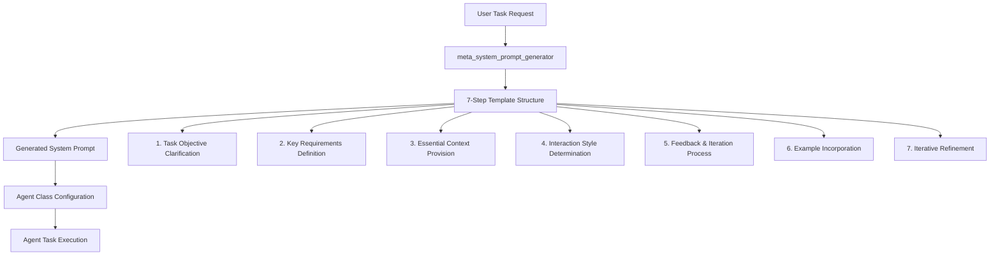
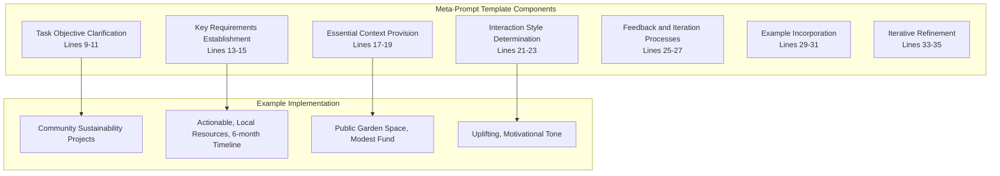

<!-- source: DeepWiki mcp.deepwiki.com · repo kyegomez/swarms · page 7.2 Meta-Prompting · fetched 2026-10-26 -->

# Meta-Prompting

Relevant source files

The following files were used as context for generating this wiki page:

- [swarms/prompts/meta_system_prompt.py](swarms/prompts/meta_system_prompt.py)

This document covers the meta-prompting system in Swarms, which provides structured templates and methodologies for generating effective system prompts for AI agents. Meta-prompting is the practice of using prompts to create other prompts, enabling systematic and optimized prompt engineering at scale.

For basic system prompt creation and agent behavior definition, see [System Prompts](#7.1). For broader agent configuration and setup, see [Agent Class](#2.1).

## Overview

Meta-prompting in Swarms enables developers to systematically generate high-quality system prompts for agents through structured templates and guided prompt engineering processes. The system provides a framework for creating prompts that are comprehensive, contextually appropriate, and aligned with specific task objectives.

The meta-prompting system addresses the challenge of creating effective agent instructions by providing a structured approach that ensures all critical elements are considered during prompt creation.

Sources: [swarms/prompts/meta_system_prompt.py:1-53]()

## Meta-Prompt Generator System

The core of Swarms' meta-prompting capability is implemented through the `meta_system_prompt_generator` template, which serves as a comprehensive guide for creating agent system prompts.

**Meta-Prompt Generation Flow**

Sources: [swarms/prompts/meta_system_prompt.py:1-53]()

## Template Structure Components

The meta-prompt generator follows a systematic 7-step approach for creating comprehensive agent system prompts:

| Component | Purpose | Implementation |
|-----------|---------|----------------|
| **Task Objective** | Define primary goal and expected outcome | Clear articulation of core problem or question |
| **Key Requirements** | Establish constraints and specifications | Response format, length, depth requirements |
| **Essential Context** | Provide background information | Relevant assumptions and preset conditions |
| **Interaction Style** | Define tone and communication approach | Professional, casual, instructional styles |
| **Feedback Process** | Establish evaluation mechanisms | Response assessment and iteration methods |
| **Example Integration** | Provide concrete illustrations | Positive and negative response examples |
| **Iterative Refinement** | Enable continuous improvement | Testing and optimization processes |

Sources: [swarms/prompts/meta_system_prompt.py:9-36]()

## Meta-Prompt Template Structure

The `meta_system_prompt_generator` provides a structured framework that guides users through systematic prompt creation:

**Meta-Prompt Template Architecture**

Sources: [swarms/prompts/meta_system_prompt.py:37-47]()

## Integration with Agent System

Meta-prompting integrates with the broader Swarms agent system to enable dynamic and optimized prompt generation for various agent configurations:

```mermaid
flowchart LR
    subgraph "Meta-Prompting System"
        MetaPromptGen[meta_system_prompt_generator]
        PromptTemplate["Structured Template"]
        GeneratedPrompt["Generated System Prompt"]
    end
    
    subgraph "Agent Configuration"
        AgentClass["Agent Class"]
        SystemPrompt["system_prompt Parameter"]
        AgentBehavior["Agent Behavior Definition"]
    end
    
    subgraph "Execution Context"
        TaskExecution["Task Execution"]
        ConversationManager["Conversation Management"]
        ResponseGeneration["Response Generation"]
    end
    
    MetaPromptGen --> PromptTemplate
    PromptTemplate --> GeneratedPrompt
    GeneratedPrompt --> SystemPrompt
    SystemPrompt --> AgentClass
    AgentClass --> AgentBehavior
    AgentBehavior --> TaskExecution
    TaskExecution --> ConversationManager
    ConversationManager --> ResponseGeneration
```

**Meta-Prompting Integration Architecture**

Sources: [swarms/prompts/meta_system_prompt.py:1-53]()

## Usage Patterns

### Basic Meta-Prompt Application

The meta-prompt generator is designed to be used as a template for creating specific agent system prompts. The template guides users through a systematic process:

1. **Objective Definition**: Clearly state the agent's primary task
2. **Requirement Specification**: Define constraints and expected outputs
3. **Context Establishment**: Provide necessary background information
4. **Style Configuration**: Set appropriate communication tone
5. **Feedback Integration**: Establish evaluation and improvement processes
6. **Example Provision**: Include illustrative cases
7. **Refinement Process**: Enable iterative optimization

Sources: [swarms/prompts/meta_system_prompt.py:9-36]()

### Example Meta-Prompt Implementation

The template includes a comprehensive example for creating sustainability-focused community project prompts:

| Element | Specification |
|---------|---------------|
| **Objective** | Generate innovative community sustainability project ideas |
| **Requirements** | Actionable with local resources, community participation, 6-month timeline |
| **Context** | Public garden space available, modest environmental project fund |
| **Style** | Uplifting and motivational tone to inspire community involvement |
| **Assessment** | Creativity, community impact, and sustainability metrics |

**Positive Example**: "Organize a 'green market' where local vendors and farmers can sell sustainably produced goods"

**Negative Example**: "Launch a large-scale solar farm initiative" (exceeds community scope and resources)

Sources: [swarms/prompts/meta_system_prompt.py:39-47]()

## Best Practices

### Template Application Guidelines

1. **Comprehensive Coverage**: Address all seven template components systematically
2. **Context Specificity**: Tailor context and requirements to specific use cases
3. **Example Quality**: Provide clear positive and negative examples
4. **Iterative Testing**: Test generated prompts in controlled environments
5. **Feedback Integration**: Establish clear evaluation and refinement processes

### Integration Considerations

- Use meta-generated prompts as `system_prompt` parameter in Agent class initialization
- Combine with conversation management for multi-turn interactions
- Integrate with tool systems for enhanced agent capabilities
- Consider prompt length and token limits for model compatibility

Sources: [swarms/prompts/meta_system_prompt.py:33-53]()

## Output Constraints

The meta-prompt generator includes specific output constraints to ensure focused and actionable prompt generation:

- **Single Output Focus**: "Only Return the prompt for the agent you're instructing. Nothing else"
- **Direct Implementation**: Generated prompts should be immediately usable with Agent class
- **Clear Boundaries**: Eliminate extraneous content that doesn't contribute to agent instruction

These constraints ensure that meta-generated prompts integrate seamlessly with the Swarms agent system while maintaining clarity and effectiveness.

Sources: [swarms/prompts/meta_system_prompt.py:6, 50]()

---

