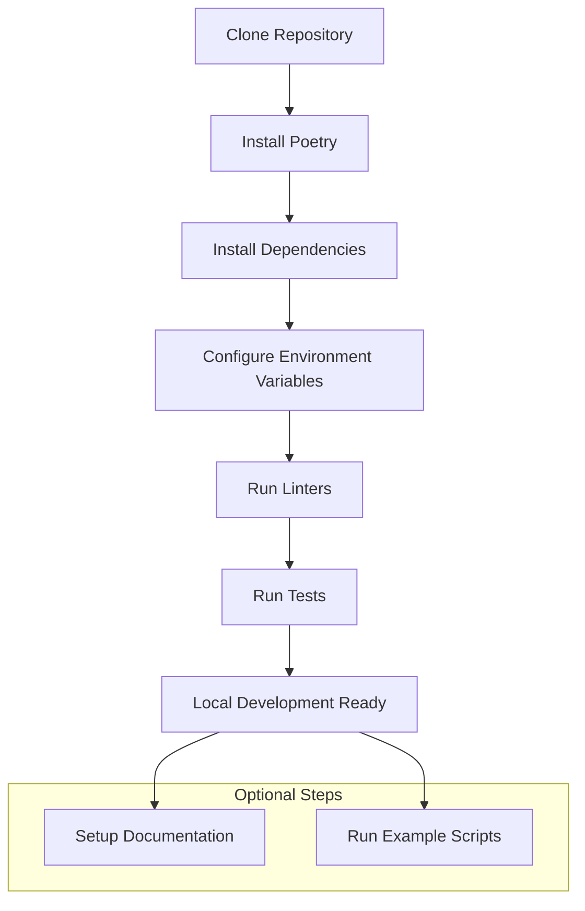
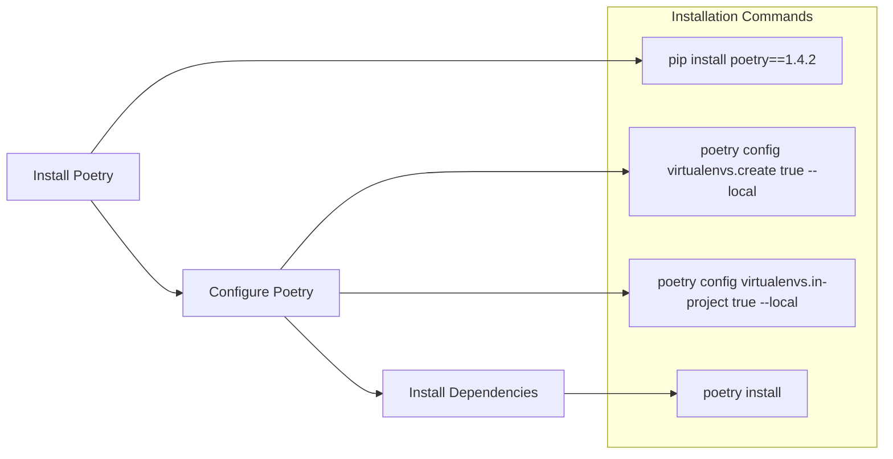
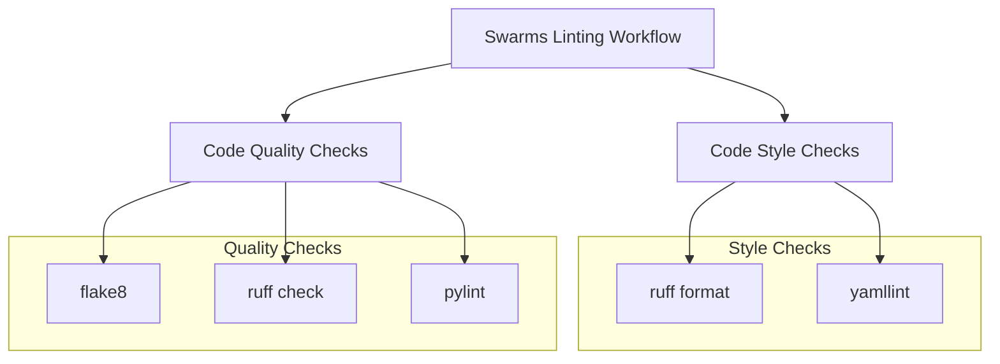
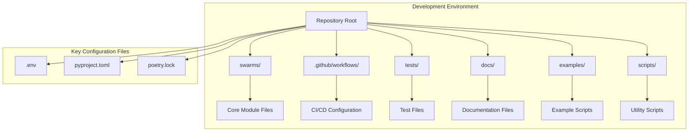
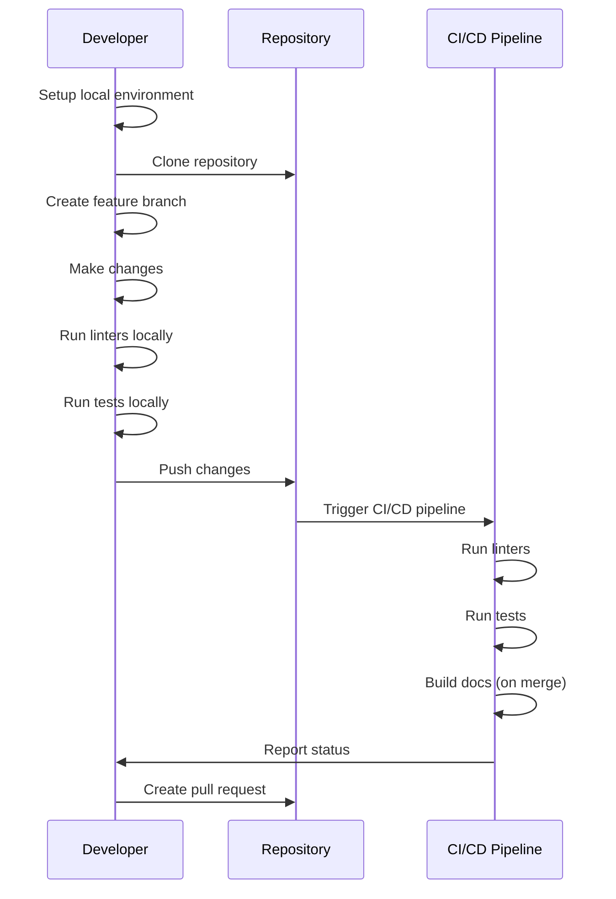

<!-- source: DeepWiki mcp.deepwiki.com · repo kyegomez/swarms · page 8.1 Environment Setup · fetched 2026-10-26 -->

# Setting Up Development Environment

<details>
<summary>Relevant source files</summary>

The following files were used as context for generating this wiki page:

- [.env.example](.env.example)
- [.github/action.yml](.github/action.yml)
- [.github/labeler.yml](.github/labeler.yml)
- [.github/workflows/codacy.yml](.github/workflows/codacy.yml)
- [.github/workflows/codeql.yml](.github/workflows/codeql.yml)
- [.github/workflows/label.yml](.github/workflows/label.yml)
- [.github/workflows/stale.yml](.github/workflows/stale.yml)
- [.github/workflows/welcome.yml](.github/workflows/welcome.yml)
- [swarms/schemas/__init__.py](swarms/schemas/__init__.py)

</details>


This document provides a comprehensive guide for setting up your local development environment to work with the Swarms framework. It covers all essential steps from initial system requirements through to running and testing your setup. For guidelines on contributing to the project, see [Contributing](#9.2).

## Prerequisites

Before setting up the Swarms development environment, ensure you have the following prerequisites installed:

| Requirement | Version | Notes |
|-------------|---------|-------|
| Python      | 3.10-3.12 | Swarms supports Python 3.10, 3.11, and 3.12 |
| Git         | Latest | For version control and cloning the repository |
| Poetry      | 1.4.2+ | Dependency management and packaging |
| OpenCV      | Latest | Required for certain visual tools |

Sources: [.github/workflows/python-package.yml:21-22](), [.github/workflows/RELEASE.yml:12](), [.github/workflows/test.yml:28]()

## Development Environment Setup Workflow



Sources: [.github/workflows/test.yml](), [.github/workflows/lint.yml]()

## Cloning the Repository

```bash
git clone https://github.com/kyegomez/swarms.git
cd swarms
```

## Setting Up Poetry Environment

Poetry is used for dependency management in the Swarms project. Follow these steps to set up your Poetry environment:



```bash
# Install Poetry (if not already installed)
pip install poetry

# Configure Poetry to create virtual environments in the project directory
poetry config virtualenvs.create true --local
poetry config virtualenvs.in-project true --local

# Install project dependencies
poetry install
```

For certain features, you may need to install additional system packages:

```bash
# For OpenCV dependencies (on Ubuntu/Debian)
sudo apt-get install python3-opencv
```

Sources: [.github/workflows/test.yml:14-27](), [.github/workflows/RELEASE.yml:12-27]()

## Environment Configuration

The Swarms framework relies on various environment variables for configuration, especially API keys for different models and tools. Copy the example environment file and update it with your own keys:

```bash
cp .env.example .env
# Edit the .env file with your API keys and configuration
```

### Framework Configuration Variables

| Category | Variable | Purpose |
|----------|----------|---------|
| **Framework Core** | `WORKSPACE_DIR` | Directory for agent workspace files |
| | `SWARMS_VERBOSE_GLOBAL` | Enable/disable verbose logging |
| | `SWARMS_API_KEY` | API key for Swarms Cloud services |

### Model Provider API Keys

| Provider | Variable | Usage |
|----------|----------|-------|
| **OpenAI** | `OPENAI_API_KEY` | GPT models access |
| **Anthropic** | `ANTHROPIC_API_KEY` | Claude models access |
| **Google** | `GEMINI_API_KEY` | Gemini models access |
| **Hugging Face** | `HUGGINGFACE_TOKEN` | HF model hub access |
| **Groq** | `GROQ_API_KEY` | Groq inference API |
| **Perplexity** | `PPLX_API_KEY` | Perplexity AI models |
| **AI21** | `AI21_API_KEY` | AI21 Labs models |

### Tool Provider API Keys

| Category | Variable | Purpose |
|----------|----------|---------|
| **Search Tools** | `BING_BROWSER_API` | Bing search integration |
| | `BRAVESEARCH_API_KEY` | Brave search API |
| | `TAVILY_API_KEY` | Tavily search service |
| | `YOU_API_KEY` | You.com search API |
| | `EXA_API_KEY` | Exa search platform |
| **Browser Tools** | `MULTION_API_KEY` | MultiOn browser automation |
| **Other Tools** | `HCP_APP_ID` | HashiCorp Cloud Platform |

### Azure OpenAI Configuration

| Variable | Purpose |
|----------|---------|
| `AZURE_OPENAI_ENDPOINT` | Azure OpenAI service endpoint |
| `AZURE_OPENAI_DEPLOYMENT` | Deployment name |
| `OPENAI_API_VERSION` | API version specification |
| `AZURE_OPENAI_API_KEY` | Authentication key |
| `AZURE_OPENAI_AD_TOKEN` | Azure AD token |

Sources: [.env.example]()

## Linting and Code Quality

The Swarms project uses several linting tools to maintain code quality. To run these tools:



```bash
# Install linting tools
pip install yamllint flake8 ruff pylint

# Run linters
yamllint .
flake8 .
ruff format .
ruff check --fix .
pylint swarms --recursive=y
```

Sources: [.github/workflows/lint.yml](), [.github/workflows/python-package.yml:34-39]()

## Testing

The Swarms framework uses pytest for testing. Run tests with the following command:

```bash
# Run all tests
poetry run pytest --verbose

# Run a specific test file
poetry run pytest tests/path/to/test_file.py
```

The project also includes a script to run example code:

```bash
chmod +x ./scripts/run_examples.sh
./scripts/run_examples.sh
```

Sources: [.github/workflows/test.yml:31-32](), [.github/workflows/test.yml:57-60]()

## Documentation

To build and preview the documentation locally:

```bash
# Install documentation dependencies
pip install mkdocs-material mkdocs-glightbox "mkdocstrings[python]" mkdocs-git-authors-plugin mkdocs-jupyter==0.16.0 lxml_html_clean mkdocs-git-committers-plugin mkdocs-git-revision-date-localized-plugin

# Build and serve documentation
mkdocs serve -f docs/mkdocs.yml
```

This will start a local server, typically at http://127.0.0.1:8000/, where you can preview the documentation as you make changes.

Sources: [.github/workflows/docs.yml:16-24]()

## Development Environment Structure



Sources: File structure derived from repo organization

## Python Version Compatibility

Swarms is tested against multiple Python versions to ensure compatibility. The CI/CD pipeline runs tests on:

| Python Version | Status |
|----------------|--------|
| 3.10           | Supported |
| 3.11           | Supported |
| 3.12           | Supported |

Sources: [.github/workflows/python-package.yml:21]()

## Development Workflow



This diagram outlines the typical development workflow for contributing to Swarms, from setting up your environment to submitting changes.

Sources: [.github/workflows/lint.yml](), [.github/workflows/test.yml](), [.github/workflows/docs.yml]()

## Troubleshooting Common Issues

Here are solutions to some common issues when setting up the development environment:

1. **Poetry installation issues**:
   - Ensure you're using a compatible Python version
   - Try installing Poetry through the official installer script instead of pip

2. **Dependency conflicts**:
   - Run `poetry update` to resolve conflicts
   - Check for compatibility with your Python version

3. **API key configuration**:
   - Double check your `.env` file configuration
   - Ensure API keys are correctly formatted without extra spaces

4. **Linting errors**:
   - Run `ruff check --fix .` to automatically fix many common issues
   - Review the pylint error messages for specific guidance

For more detailed troubleshooting guidance, see [Troubleshooting and Best Practices](#11).

Sources: Common development issues observed in similar projects

This setup guide should provide you with everything you need to start developing with the Swarms framework. Once your environment is configured, refer to [Contributing](#9.2) for guidelines on how to contribute to the project.

---

