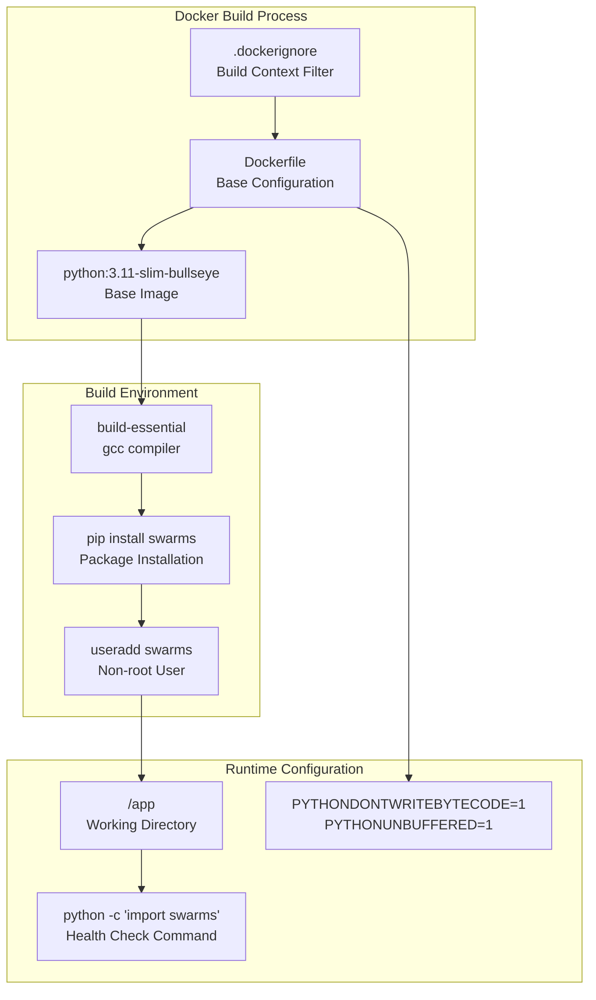
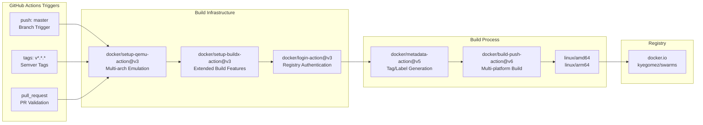

<!-- source: DeepWiki mcp.deepwiki.com · repo kyegomez/swarms · page 8.2 Docker Deployment · fetched 2026-10-26 -->

# Docker Deployment

<details>
<summary>Relevant source files</summary>

The following files were used as context for generating this wiki page:

- [.dockerignore](.dockerignore)
- [.github/PULL_REQUEST_TEMPLATE.md](.github/PULL_REQUEST_TEMPLATE.md)
- [.github/workflows/docker-image.yml](.github/workflows/docker-image.yml)
- [.github/workflows/docker-publish.yml](.github/workflows/docker-publish.yml)
- [.github/workflows/tests.yml](.github/workflows/tests.yml)
- [Dockerfile](Dockerfile)
- [docs/corporate/swarms_bounty_system.md](docs/corporate/swarms_bounty_system.md)
- [docs/overrides/main.html](docs/overrides/main.html)
- [docs/swarms/structs/multi_threaded_workflow.md](docs/swarms/structs/multi_threaded_workflow.md)

</details>


This document covers containerization and Docker deployment strategies for the Swarms framework. It details the Docker configuration, multi-platform build processes, CI/CD integration, and production deployment patterns used in the Swarms ecosystem.

For information about environment setup without Docker, see [Environment Setup](#8.1). For CI/CD pipeline details, see [CI/CD Pipeline](#8.3).

## Docker Configuration Overview

The Swarms framework uses a lightweight, security-focused Docker configuration built on Python 3.11. The containerization strategy emphasizes minimal image size, non-root execution, and comprehensive health monitoring.

## Docker Build Architecture



Sources: [Dockerfile:1-37](), [.dockerignore:1-298]()

## Base Image and Environment Configuration

The Docker configuration uses `python:3.11-slim-bullseye` as the base image with optimized Python environment variables for production deployment.

### Environment Variables

| Variable | Value | Purpose |
|----------|--------|---------|
| `PYTHONDONTWRITEBYTECODE` | `1` | Prevents Python from writing bytecode files |
| `PYTHONUNBUFFERED` | `1` | Forces stdout/stderr to be unbuffered |
| `PIP_NO_CACHE_DIR` | `1` | Disables pip cache to reduce image size |
| `PIP_DISABLE_PIP_VERSION_CHECK` | `1` | Disables pip version warnings |
| `PATH` | `/app:${PATH}` | Adds application directory to PATH |
| `PYTHONPATH` | `/app:${PYTHONPATH}` | Adds application directory to Python path |
| `USER` | `swarms` | Defines non-root username |

### System Dependencies

The container installs minimal system dependencies required for Python package compilation:
- `build-essential`: Essential compilation tools
- `gcc`: GNU Compiler Collection

Sources: [Dockerfile:5-11](), [Dockerfile:17-19]()

## Multi-Platform CI/CD Integration



Sources: [.github/workflows/docker-publish.yml:1-74](), [.github/workflows/docker-image.yml:1-19]()

## Docker Publishing Workflow

The automated Docker publishing pipeline supports multiple architectures and environments through GitHub Actions integration.

### Build Triggers

The Docker publishing workflow activates on:
- Pushes to `master` branch
- Semantic version tags (`v*.*.*` pattern)
- Pull requests for validation

### Multi-Architecture Support

The build process targets multiple CPU architectures:
- `linux/amd64`: Standard x86_64 architecture
- `linux/arm64`: ARM 64-bit architecture for Apple Silicon and ARM servers

### Registry Configuration

| Component | Value | Description |
|-----------|--------|-------------|
| Registry | `docker.io` | Docker Hub registry |
| Image Name | `${{ github.repository }}` | Dynamically set to repository name |
| Authentication | `DOCKERHUB_USERNAME`, `DOCKERHUB_TOKEN` | GitHub secrets for Docker Hub |

Sources: [.github/workflows/docker-publish.yml:11-16](), [.github/workflows/docker-publish.yml:40-46](), [.github/workflows/docker-publish.yml:71-71]()

## Security and User Management

The Docker configuration implements security best practices through non-root user execution and minimal privilege escalation.

### Non-Root User Setup

```bash
# User creation and permissions
useradd -m -s /bin/bash -U swarms
chown -R swarms:swarms /app
```

The container switches to the non-root `swarms` user before runtime, preventing privilege escalation attacks and following container security guidelines.

### Health Check Implementation

The container includes a comprehensive health check mechanism:

```bash
python -c "import swarms; print('Health check passed')"
```

Health check parameters:
- **Interval**: 30 seconds between checks
- **Timeout**: 30 seconds per check
- **Start Period**: 5 seconds initial delay
- **Retries**: 3 attempts before marking unhealthy

Sources: [Dockerfile:25-32](), [Dockerfile:35-36]()

## Build Context Optimization

The `.dockerignore` file excludes development artifacts and sensitive files from the Docker build context, reducing image size and preventing accidental inclusion of secrets.

### Excluded Categories

| Category | Examples | Purpose |
|----------|----------|---------|
| Version Control | `.git`, `.gitignore` | Excludes Git metadata |
| Python Artifacts | `__pycache__`, `*.pyc`, `.pytest_cache` | Removes compiled Python files |
| Virtual Environments | `venv/`, `.venv/`, `ENV/` | Excludes local development environments |
| Secrets | `.env` | Prevents environment variable leakage |
| Build Artifacts | `build/`, `dist/`, `*.egg-info/` | Excludes packaging outputs |
| Media Files | `image/`, `audio/`, `video/` | Removes large media assets |
| Development Files | `.vscode/`, `.DS_Store`, `Cargo.lock` | Excludes editor and system files |

Sources: [.dockerignore:1-25](), [.dockerignore:78-113](), [.dockerignore:209-217]()

## Local Development with Docker

For local development and testing, developers can build and run the Docker container using standard Docker commands:

```bash
# Build the Docker image
docker build -t swarms:local .

# Run the container
docker run -it swarms:local

# Run with environment variables
docker run -it -e OPENAI_API_KEY=your_key swarms:local
```

The container automatically installs the latest Swarms package from PyPI, ensuring consistency with the published version.

## Production Deployment Strategies

The Docker configuration supports various production deployment patterns:

### Container Orchestration

The lightweight image design makes it suitable for:
- **Kubernetes**: Pod deployment with health checks and resource limits
- **Docker Swarm**: Service deployment with replicas and load balancing
- **Docker Compose**: Multi-container application orchestration

### Cloud Platform Integration

The multi-architecture support enables deployment on:
- **AWS ECS/Fargate**: x86_64 and ARM-based compute
- **Google Cloud Run**: Serverless container deployment
- **Azure Container Instances**: Managed container hosting

Sources: [Dockerfile:2-2](), [.github/workflows/docker-publish.yml:71-71]()

---

