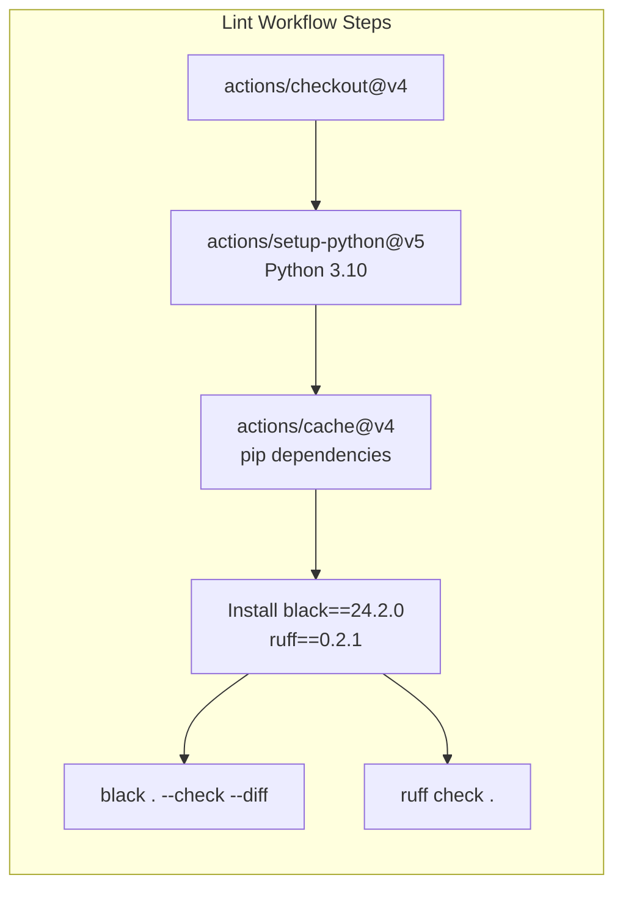
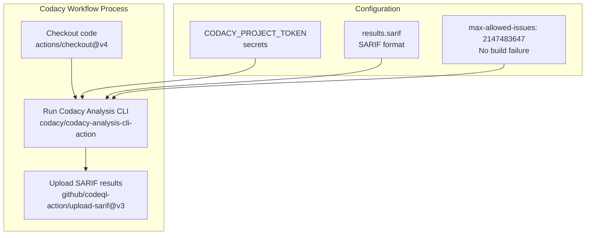
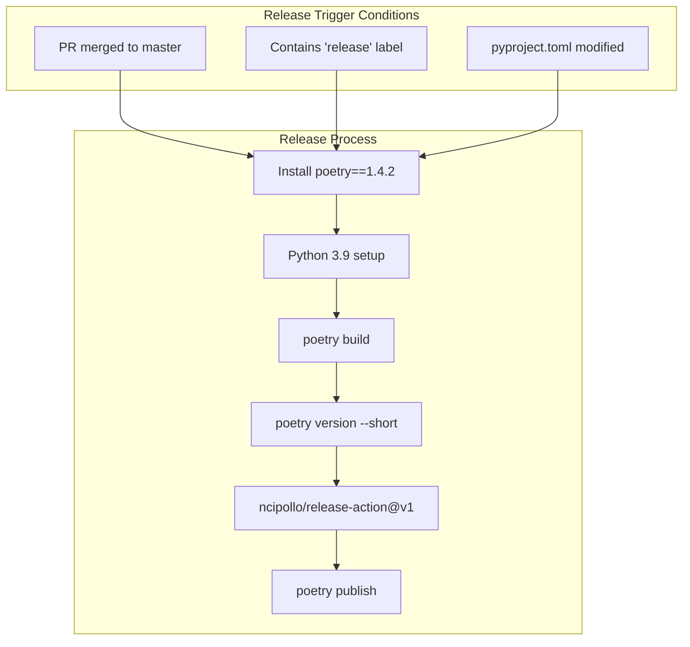
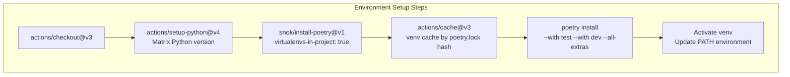

<!-- source: DeepWiki mcp.deepwiki.com · repo kyegomez/swarms · page 8.3 CI/CD Pipeline · fetched 2026-10-26 -->

# CI/CD Pipeline

Relevant source files

The following files were used as context for generating this wiki page:

- [.github/action.yml](.github/action.yml)
- [.github/labeler.yml](.github/labeler.yml)
- [.github/workflows/RELEASE.yml](.github/workflows/RELEASE.yml)
- [.github/workflows/codacy.yml](.github/workflows/codacy.yml)
- [.github/workflows/codeql.yml](.github/workflows/codeql.yml)
- [.github/workflows/docs.yml](.github/workflows/docs.yml)
- [.github/workflows/label.yml](.github/workflows/label.yml)
- [.github/workflows/lint.yml](.github/workflows/lint.yml)
- [.github/workflows/python-package.yml](.github/workflows/python-package.yml)
- [.github/workflows/stale.yml](.github/workflows/stale.yml)
- [.github/workflows/welcome.yml](.github/workflows/welcome.yml)

This document covers the automated Continuous Integration and Continuous Deployment (CI/CD) pipeline for the Swarms framework. The pipeline encompasses code quality checks, multi-version testing, security scanning, documentation deployment, and automated releases through GitHub Actions workflows.

For information about the Docker deployment strategies used within this pipeline, see [Docker Deployment](#8.2). For details about development environment setup that integrates with these workflows, see [Environment Setup](#8.1).

## Pipeline Architecture Overview

The Swarms CI/CD pipeline is built on GitHub Actions and consists of multiple specialized workflows that run in parallel and sequential stages based on different triggers.

```mermaid
graph TB
    subgraph "Trigger Events"
        Push["push"]
        PR["pull_request"]
        PRTarget["pull_request_target"]
        Schedule["schedule"]
        Merge["PR merge + release label"]
    end
    
    subgraph "Code Quality Workflows"
        LintWorkflow[".github/workflows/lint.yml"]
        PythonPackage[".github/workflows/python-package.yml"] 
        CodeQL[".github/workflows/codeql.yml"]
        Codacy[".github/workflows/codacy.yml"]
    end
    
    subgraph "Documentation & Release"
        DocsWorkflow[".github/workflows/docs.yml"]
        ReleaseWorkflow[".github/workflows/RELEASE.yml"]
    end
    
    subgraph "Repository Management"
        LabelWorkflow[".github/workflows/label.yml"]
        WelcomeWorkflow[".github/workflows/welcome.yml"]
        StaleWorkflow[".github/workflows/stale.yml"]
    end
    
    Push --> LintWorkflow
    Push --> PythonPackage
    Push --> CodeQL
    Push --> Codacy
    Push --> DocsWorkflow
    
    PR --> LintWorkflow
    PR --> PythonPackage
    PR --> CodeQL
    PR --> Codacy
    
    PRTarget --> LabelWorkflow
    PRTarget --> WelcomeWorkflow
    
    Schedule --> Codacy
    Schedule --> CodeQL
    Schedule --> StaleWorkflow
    
    Merge --> ReleaseWorkflow
```

**Workflow Execution Flow**
The pipeline executes workflows based on specific triggers, with code quality checks running on every push and pull request, while specialized workflows handle documentation, releases, and repository management.

Sources: [.github/workflows/lint.yml:1-34](), [.github/workflows/python-package.yml:1-43](), [.github/workflows/docs.yml:1-25](), [.github/workflows/RELEASE.yml:1-48]()

## Core Testing and Quality Workflows

### Python Package Testing

The `python-package.yml` workflow serves as the primary testing pipeline, executing comprehensive tests across multiple Python versions.

| Component | Configuration | Purpose |
|-----------|---------------|---------|
| **Python Versions** | `["3.10", "3.11", "3.12"]` | Multi-version compatibility testing |
| **OS** | `ubuntu-latest` | Standardized testing environment |
| **Linting** | `flake8` | Syntax and style validation |
| **Testing** | `pytest` | Unit and integration test execution |
| **Dependency Management** | `requirements.txt` | Package installation |

The workflow implements a matrix strategy for parallel execution across Python versions with `fail-fast: false` to ensure all versions are tested even if one fails.

Sources: [.github/workflows/python-package.yml:14-43]()

### Code Quality Enforcement

The `lint.yml` workflow enforces code formatting and style standards using modern Python tooling.

**Code Quality Tools Configuration**
- **Black**: Version `24.2.0` for consistent code formatting
- **Ruff**: Version `0.2.1` for fast Python linting
- **Caching**: Pip dependencies cached using `pyproject.toml` hash

Sources: [.github/workflows/lint.yml:8-34]()

## Security and Code Analysis

### CodeQL Security Analysis

The `codeql.yml` workflow implements GitHub's semantic code analysis for security vulnerability detection.

| Configuration | Value | Purpose |
|---------------|-------|---------|
| **Language Matrix** | `["python"]` | Python-specific analysis |
| **Schedule** | `"33 12 * * 5"` | Weekly Friday execution |
| **Timeout** | `360 minutes` | Extended analysis time |
| **Runner** | `ubuntu-latest` | Standardized environment |

The workflow uses `github/codeql-action` for initialization, autobuild, and analysis with results uploaded to GitHub Security tab.

Sources: [.github/workflows/codeql.yml:9-42]()

### Codacy Security Scanning

The `codacy.yml` workflow integrates third-party security analysis with SARIF result formatting.

**Codacy Integration Features**
- **SARIF Output**: Standardized security findings format
- **GitHub Integration**: Results appear in Security tab
- **Non-blocking**: `max-allowed-issues: 2147483647` prevents build failures
- **Schedule**: Daily execution at midnight UTC

Sources: [.github/workflows/codacy.yml:22-46]()

## Documentation and Release Automation

### Documentation Deployment

The `docs.yml` workflow automatically deploys documentation to GitHub Pages using MkDocs Material theme.

| Package | Version | Purpose |
|---------|---------|---------|
| `mkdocs-material` | Latest | Material Design theme |
| `mkdocs-glightbox` | Latest | Image lightbox functionality |
| `mkdocstrings[python]` | Latest | Python API documentation |
| `mkdocs-git-authors-plugin` | Latest | Author attribution |
| `mkdocs-jupyter` | `0.16.0` | Jupyter notebook integration |
| `mkdocs-git-committers-plugin` | Latest | Contributor tracking |

The deployment uses `mkdocs gh-deploy --force -f docs/mkdocs.yml` to publish to GitHub Pages on pushes to `master`, `main`, or `develop` branches.

Sources: [.github/workflows/docs.yml:8-25]()

### Release Automation

The `RELEASE.yml` workflow automates package building, GitHub release creation, and PyPI publishing.

**Release Workflow Features**
- **Conditional Execution**: Only runs when PR is merged with `release` label and `pyproject.toml` changes
- **Poetry Integration**: Uses Poetry `1.4.2` for dependency management and building
- **Artifact Generation**: Creates distribution packages in `dist/*`
- **Dual Publishing**: GitHub Releases and PyPI publication
- **Auto-tagging**: Creates tags with `v{version}` format

Sources: [.github/workflows/RELEASE.yml:13-48]()

## Repository Management Workflows

### Automatic Labeling System

The labeling system uses `labeler.yml` configuration to automatically categorize pull requests based on file changes.

| Label Category | File Patterns | Purpose |
|----------------|---------------|---------|
| `documentation` | `docs/**`, `*.md` | Documentation changes |
| `tests` | `tests/**` | Test suite modifications |
| `agents` | `swarms/agents/**` | Agent system changes |
| `memory` | `swarms/memory/**` | Memory system changes |
| `models` | `swarms/models/**` | Model integration changes |
| `tools` | `swarms/tools/**` | Tool system changes |

The `label.yml` workflow executes on `pull_request_target` events using `actions/labeler@v5` for automatic categorization.

Sources: [.github/labeler.yml:2-35](), [.github/workflows/label.yml:10-21]()

### Issue and PR Management

The `stale.yml` workflow implements automated lifecycle management for inactive issues and pull requests.

**Stale Management Configuration**
- **Issue Lifecycle**: 14 days to stale, 14 additional days to close
- **PR Lifecycle**: 14 days to stale, 14 additional days to close
- **Trigger Labels**: `status:awaiting user response`, `status:more data needed`
- **Exemption**: `override-stale` label prevents automatic closure
- **Schedule**: Daily execution at midnight UTC

Sources: [.github/workflows/stale.yml:19-50]()

## Environment Initialization Action

The repository includes a reusable composite action for environment setup used across workflows.

**Composite Action Features**
- **Poetry Configuration**: Virtual environments created in project directory
- **Caching Strategy**: Venv cached by OS, Python version, and `poetry.lock` hash
- **Dependency Groups**: Installs test, dev, and all optional extras
- **Environment Activation**: Updates `PATH` for subsequent workflow steps

Sources: [.github/action.yml:5-34]()

## Integration with Development Workflow

The CI/CD pipeline integrates with the development workflow through multiple touchpoints that ensure code quality and streamline collaboration.

**Development Integration Points**
- **Pre-merge Validation**: All quality checks must pass before merge
- **Automatic Documentation**: Changes automatically reflected in deployed docs
- **Security Monitoring**: Continuous security analysis with SARIF integration
- **Release Automation**: Version bumps trigger full release pipeline
- **Community Management**: Automated welcome messages and stale issue cleanup

The pipeline supports the Swarms framework's multi-agent architecture by ensuring code quality across the complex agent orchestration system while maintaining security standards for production deployments.

Sources: [.github/workflows/welcome.yml:14-23](), [.github/workflows/python-package.yml:8-12]()

---

