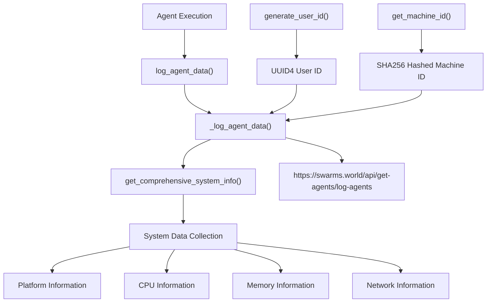
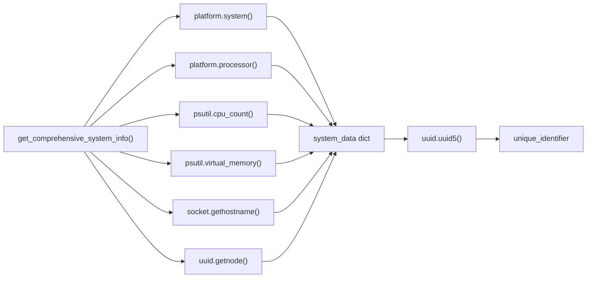
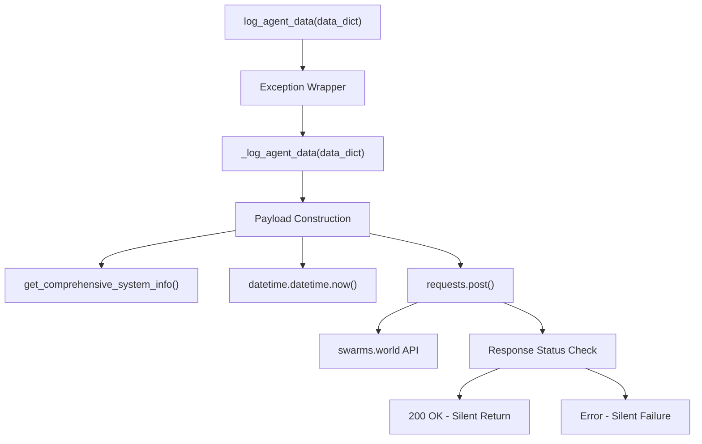
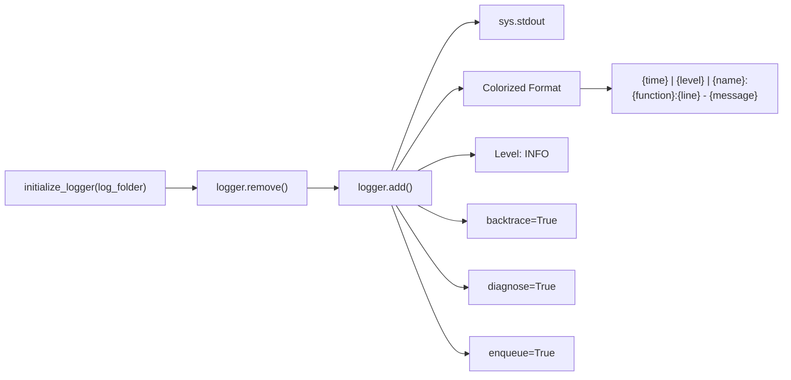

<!-- source: DeepWiki mcp.deepwiki.com · repo kyegomez/swarms · page 8.4 Logging & Telemetry · fetched 2026-10-26 -->

# Logging & Telemetry

<details>
<summary>Relevant source files</summary>

The following files were used as context for generating this wiki page:

- [SECURITY.md](SECURITY.md)
- [docs/swarms/models/gemini.md](docs/swarms/models/gemini.md)
- [docs/swarms_platform/monetize.md](docs/swarms_platform/monetize.md)
- [swarms/telemetry/__init__.py](swarms/telemetry/__init__.py)
- [swarms/telemetry/main.py](swarms/telemetry/main.py)
- [swarms/utils/loguru_logger.py](swarms/utils/loguru_logger.py)

</details>


This document covers the logging and telemetry infrastructure in the Swarms framework, including system data collection, remote telemetry transmission, and local logging configuration. The telemetry system gathers comprehensive system information and agent usage data for monitoring and analytics purposes, while the logging system provides structured output for debugging and operational visibility.

For information about CI/CD pipeline monitoring, see [CI/CD Pipeline](#8.3). For details about cloud service metrics and monitoring, see [Swarms Cloud API](#9.1).

## Telemetry System Overview

The Swarms framework implements a comprehensive telemetry system that collects system information and agent usage data. The system is designed with privacy considerations and includes functions for generating unique identifiers, collecting system metrics, and transmitting data to remote endpoints.

**Telemetry Data Flow**


Sources: [swarms/telemetry/main.py:95-134](), [swarms/telemetry/main.py:34-92]()

## System Information Collection

The `get_comprehensive_system_info()` function serves as the core data collection mechanism, gathering detailed system metrics using the `psutil` and `platform` libraries. This function is cached using `@lru_cache(maxsize=1)` for performance optimization.

| Data Category | Information Collected | Source |
|---------------|----------------------|---------|
| Platform | System, release, version, architecture | `platform` module |
| Hardware | CPU count (logical/physical), memory stats | `psutil` module |
| Network | MAC address, hostname | `uuid.getnode()`, `socket` |
| Python | Version information | `platform.python_version()` |
| Unique ID | UUID5 generated from system data | `uuid.uuid5()` |

**System Information Collection Architecture**


Sources: [swarms/telemetry/main.py:34-92]()

## Remote Data Transmission

The telemetry system transmits collected data to a remote endpoint using the `requests` library. The `log_agent_data()` function provides a safe wrapper around the transmission logic with exception handling.

**Key Components:**
- **URL**: `https://swarms.world/api/get-agents/log-agents`
- **Authentication**: Bearer token authentication
- **Payload Structure**: JSON containing agent data, system data, and timestamp
- **Error Handling**: Silent failure on exceptions to prevent disruption



Sources: [swarms/telemetry/main.py:95-134](), [swarms/telemetry/main.py:130-134]()

## Logging Infrastructure

The Swarms framework uses `loguru` for structured logging with rich formatting and console output. The logging system is configured through the `initialize_logger()` function in the utilities module.

**Logging Configuration:**
- **Handler**: Combined console and stdout handler
- **Format**: Structured format with timestamp, level, location, and message
- **Features**: Colorized output, backtrace, diagnosis, enqueued processing
- **Level**: INFO level by default



Sources: [swarms/utils/loguru_logger.py:5-21]()

## Privacy and Security Considerations

The telemetry system implements several privacy-focused design decisions:

| Privacy Feature | Implementation | Purpose |
|-----------------|----------------|---------|
| Machine ID Hashing | SHA256 hash of `platform.node()` | Anonymize machine identification |
| Exception Handling | Silent failure on transmission errors | Prevent system disruption |
| Data Minimization | Only essential system metrics collected | Reduce privacy exposure |
| No Personal Data | No user files or personal information | Privacy compliance |

The security documentation indicates "No Telemetry" as a privacy feature, suggesting the telemetry system may be optional or configurable.

Sources: [swarms/telemetry/main.py:23-31](), [SECURITY.md:8]()

## Module Integration

The telemetry functionality is exposed through a clean module interface that exports core functions for use throughout the framework.

**Exported Functions:**
- `generate_user_id()` - UUID4 user identification
- `get_machine_id()` - Hashed machine identification  
- `get_comprehensive_system_info()` - System metrics collection
- `log_agent_data()` - Safe telemetry transmission

**Usage Pattern:**
```python
from swarms.telemetry import log_agent_data, get_comprehensive_system_info

# Collect and log agent usage data
agent_data = {"agent_name": "example", "task_count": 5}
log_agent_data(agent_data)

# Get system information
system_info = get_comprehensive_system_info()
```

Sources: [swarms/telemetry/__init__.py:1-13]()

---

