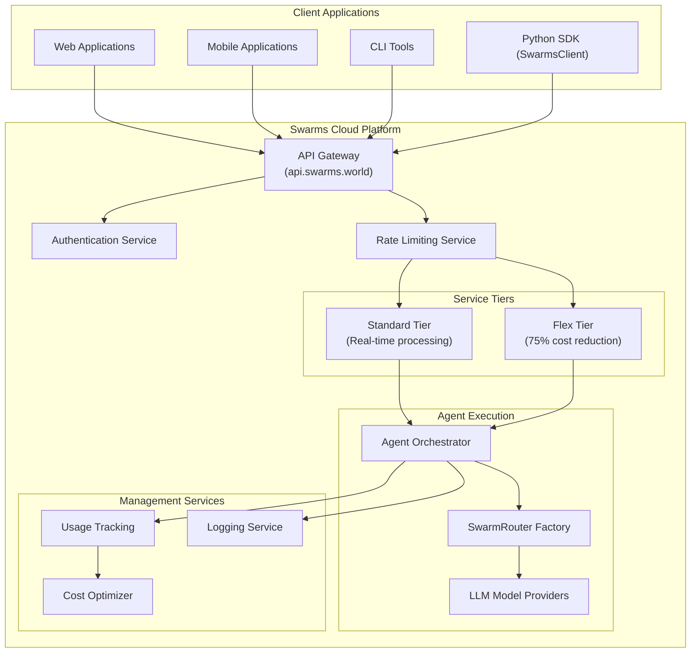
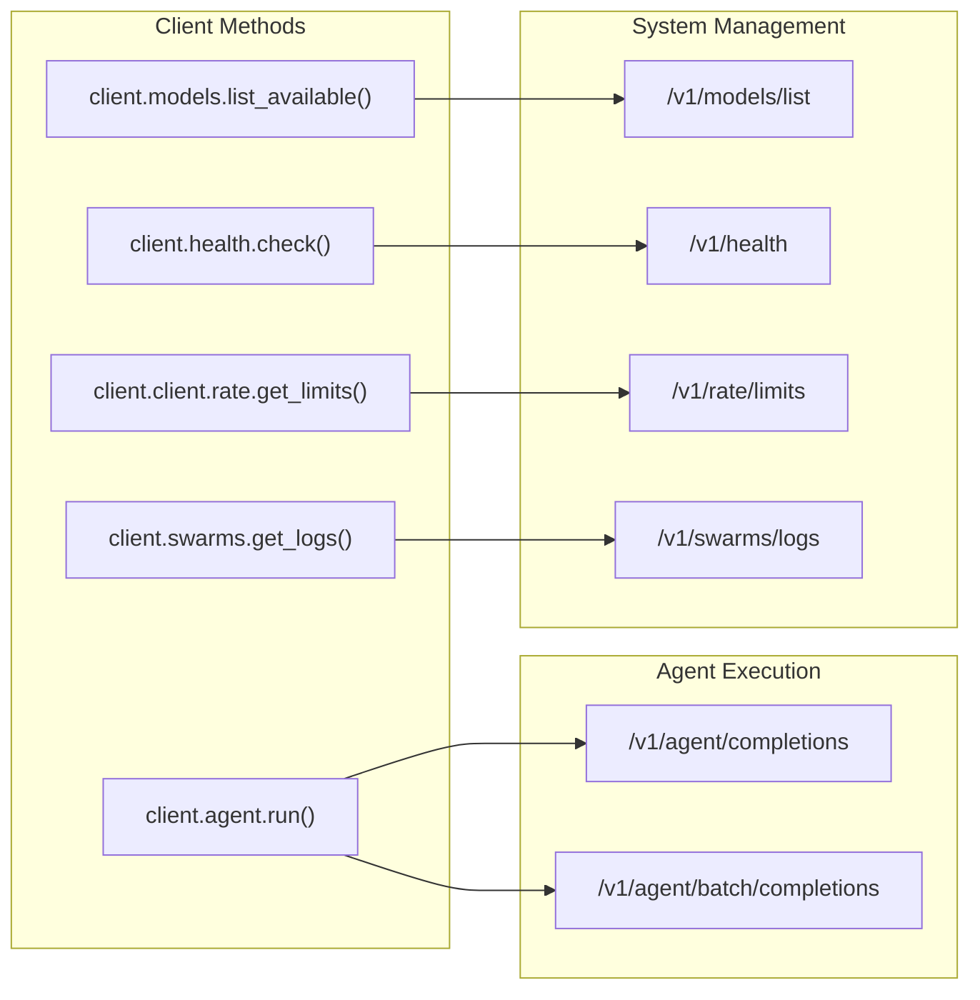
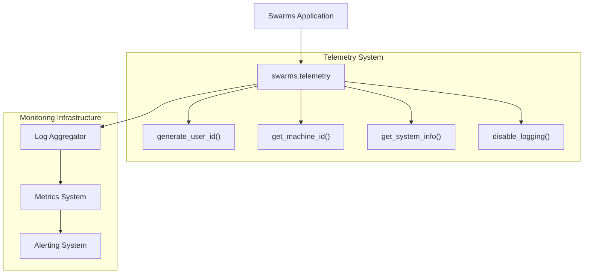

<!-- source: DeepWiki mcp.deepwiki.com · repo kyegomez/swarms · page 9 Cloud Services & APIs · fetched 2026-10-26 -->

# Cloud Services & APIs

<details>
<summary>Relevant source files</summary>

The following files were used as context for generating this wiki page:

- [docs/concepts/limitations.md](docs/concepts/limitations.md)
- [docs/index.md](docs/index.md)
- [docs/swarms/structs/agent_multi_agent_communication.md](docs/swarms/structs/agent_multi_agent_communication.md)
- [docs/swarms_cloud/best_practices.md](docs/swarms_cloud/best_practices.md)
- [docs/swarms_cloud/rate_limits.md](docs/swarms_cloud/rate_limits.md)
- [examples/api/client_example.py](examples/api/client_example.py)
- [examples/api/rate_limits.py](examples/api/rate_limits.py)
- [examples/multi_agent/agent_communication_examples.py](examples/multi_agent/agent_communication_examples.py)
- [examples/multi_agent/concurrent_examples/concurrent_example_dashboard.py](examples/multi_agent/concurrent_examples/concurrent_example_dashboard.py)
- [examples/multi_agent/heavy_swarm_examples/heavy_swarm_example.py](examples/multi_agent/heavy_swarm_examples/heavy_swarm_example.py)
- [examples/single_agent/reasoning_agent_examples/agent_judge_evaluation_criteria_example.py](examples/single_agent/reasoning_agent_examples/agent_judge_evaluation_criteria_example.py)
- [examples/utils/concurrent_wrapper_examples.py](examples/utils/concurrent_wrapper_examples.py)
- [simple_agent.py](simple_agent.py)
- [swarms/agents/agent_judge.py](swarms/agents/agent_judge.py)
- [swarms/prompts/prompt_generator_optimizer.py](swarms/prompts/prompt_generator_optimizer.py)
- [swarms/tools/__init__.py](swarms/tools/__init__.py)
- [swarms/tools/py_func_to_openai_func_str.py](swarms/tools/py_func_to_openai_func_str.py)
- [swarms/utils/concurrent_wrapper.py](swarms/utils/concurrent_wrapper.py)

</details>


This document provides comprehensive guidance for integrating with the Swarms Cloud platform and API services for scalable multi-agent deployment. The Swarms Cloud platform offers managed infrastructure for running multi-agent workflows without the complexity of managing your own servers.

## Swarms Cloud Platform Overview

The Swarms Cloud platform provides a managed service for deploying and scaling multi-agent systems with built-in cost optimization, rate limiting, and performance monitoring:



Sources: [docs/swarms_cloud/rate_limits.md](), [docs/swarms_cloud/best_practices.md](), [examples/api/client_example.py]()

## Swarms Cloud API Architecture

The Swarms Cloud API provides a comprehensive managed service for multi-agent orchestration with built-in scalability, cost optimization, and performance monitoring:

Swarms Cloud API System Architecture

```mermaid
flowchart TD
    subgraph "API Layer"
        APIEndpoint["api.swarms.world"]
        AuthMiddleware["x-api-key Authentication"]
        RateLimitMiddleware["Rate Limiting Middleware"]
    end
    
    subgraph "Core Services"
        AgentService["/v1/agent/completions"]
        BatchService["/v1/agent/batch/completions"]
        ModelsService["/v1/models/list"]
        HealthService["/v1/health"]
        RateLimitService["/v1/rate/limits"]
        LogsService["/v1/swarms/logs"]
    end
    
    subgraph "Execution Engine"
        SwarmRouterFactory["SwarmRouter Factory"]
        AgentOrchestrator["Agent Orchestrator"]
        ConcurrentWorkflow["ConcurrentWorkflow"]
        SequentialWorkflow["SequentialWorkflow"]
        HierarchicalSwarm["HierarchicalSwarm"]
    end
    
    subgraph "Model Integration"
        LiteLLMWrapper["LiteLLM Wrapper"]
        OpenAIModels["OpenAI Models"]
        AnthropicModels["Anthropic Models"]
        GroqModels["Groq Models"]
    end
    
    APIEndpoint --> AuthMiddleware
    AuthMiddleware --> RateLimitMiddleware
    RateLimitMiddleware --> AgentService
    RateLimitMiddleware --> BatchService
    RateLimitMiddleware --> ModelsService
    RateLimitMiddleware --> HealthService
    RateLimitMiddleware --> RateLimitService
    RateLimitMiddleware --> LogsService
    
    AgentService --> SwarmRouterFactory
    BatchService --> SwarmRouterFactory
    SwarmRouterFactory --> AgentOrchestrator
    AgentOrchestrator --> ConcurrentWorkflow
    AgentOrchestrator --> SequentialWorkflow
    AgentOrchestrator --> HierarchicalSwarm
    
    AgentOrchestrator --> LiteLLMWrapper
    LiteLLMWrapper --> OpenAIModels
    LiteLLMWrapper --> AnthropicModels
    LiteLLMWrapper --> GroqModels
```


Sources: [docs/swarms_cloud/rate_limits.md](), [examples/api/client_example.py](), [swarms/tools/__init__.py]()

### Service Tiers

The Swarms Cloud platform offers two service tiers optimized for different use cases:

| Tier | Best For | Cost | Processing Time | Timeout |
|------|----------|------|----------------|---------|
| **Standard** | Real-time processing, time-sensitive tasks | Higher cost | Immediate execution | 5 minutes |
| **Flex** | Batch processing, non-urgent tasks | 75% cost reduction | Variable timing | 15 minutes |

### API Authentication

All API requests require authentication using the `x-api-key` header:

```python
import os
from swarms_client import SwarmsClient

# Initialize client with API key
client = SwarmsClient(api_key=os.getenv("SWARMS_API_KEY"))

# Check API health
health_status = client.health.check()
print(health_status)
```

Sources: [examples/api/client_example.py:9](), [examples/api/rate_limits.py:7]()

### Core API Endpoints

API Endpoint Structure


Sources: [examples/api/client_example.py:36-40]()

## Security Considerations

### API Key Management

- Store API keys securely using environment variables or secret management systems
- Use different API keys for development and production
- Implement key rotation policies

### Container Security

- Run containers with non-root users (implemented in the official Dockerfile)
- Use read-only file systems where possible
- Scan images for vulnerabilities
- Keep base images updated

Sources: [Dockerfile:11-12](), [Dockerfile:24-27]()

## Telemetry and Monitoring

The Swarms framework includes telemetry utilities that can be useful for monitoring deployments:



Sources: [tests/telemetry/test_user_utils.py:1-101]()

## Production Best Practices

1. **Resource Allocation**: Ensure containers have appropriate CPU and memory limits based on expected workload
2. **Scaling Strategy**: Implement horizontal scaling for handling variable loads
3. **Persistent Storage**: Use volume mounts for data that needs to persist across container restarts
4. **Backup Strategy**: Implement regular backups of critical data
5. **Logging Configuration**: Configure appropriate logging levels and log aggregation
6. **Monitoring**: Set up monitoring for container health, resource usage, and API performance
7. **CI/CD Pipeline**: Automate deployment through CI/CD pipelines

Sources: [.github/workflows/codacy.yml](), [.github/workflows/codeql.yml](), [.github/workflows/stale.yml]()

## Troubleshooting Common Issues

| Issue | Possible Causes | Solutions |
|-------|----------------|-----------|
| Container fails to start | Missing API keys, insufficient resources | Check environment variables, increase resource limits |
| Health check failures | Network issues, package installation problems | Check network connectivity, verify Swarms installation |
| High memory usage | Large model inputs, memory leaks | Optimize input sizes, update to latest version |
| Slow response times | Insufficient resources, network latency | Scale up resources, optimize network configuration |

Sources: [Dockerfile:35-36]()

For more information on troubleshooting and logging, see [Debugging and Logging](#11.1).

---

