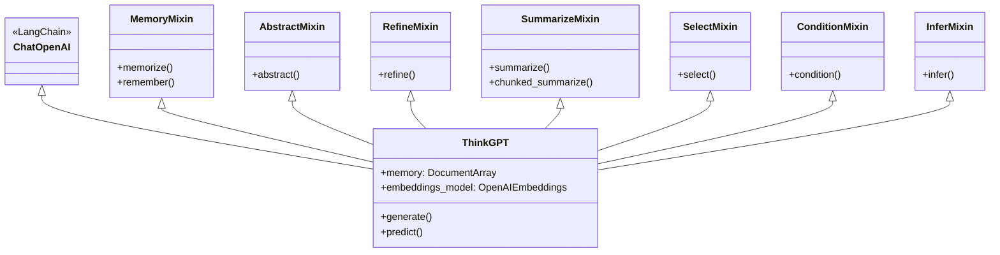
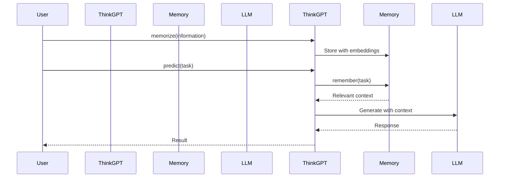
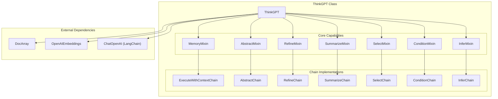

<!-- source: DeepWiki mcp.deepwiki.com · repo jina-ai/thinkgpt · page 1 Introduction to ThinkGPT · fetched 2026-10-26 -->

# Introduction to ThinkGPT

<details>
<summary>Relevant source files</summary>

The following files were used as context for generating this wiki page:

- [README.md](README.md)
- [thinkgpt/llm.py](thinkgpt/llm.py)

</details>


## Purpose and Scope

This document provides an overview of the ThinkGPT library, a Python framework designed to implement Chain of Thoughts for Large Language Models (LLMs). It covers the core concepts, architecture, and capabilities of ThinkGPT, explaining how it helps solve key limitations of LLMs while adding advanced reasoning capabilities. For detailed documentation on specific components, please refer to the respective sections in [Core Architecture](#2) and [API Reference](#5).

Sources: [README.md:1-9]()

## What is ThinkGPT?

ThinkGPT is a Python library that extends LLMs with cognitive abilities like memory, self-refinement, knowledge compression, and inference. It addresses three major limitations of standard LLMs:

1. **Limited Context Window**: ThinkGPT solves this with long-term memory and knowledge compression techniques
2. **Limited Reasoning Capabilities**: ThinkGPT enhances one-shot reasoning with higher-order reasoning primitives
3. **Lack of Persistence**: ThinkGPT adds the ability to maintain and recall information across multiple interactions

The library provides an intuitive API built on top of LangChain and DocArray, making it straightforward to integrate advanced cognitive capabilities into applications powered by models like GPT-3.5-Turbo and GPT-4.

Sources: [README.md:5-9](), [thinkgpt/llm.py:22-28]()

## Core Architecture

ThinkGPT's architecture is built around a central class that incorporates multiple specialized components through Python's mixin pattern. This design provides modularity while maintaining an easy-to-use interface.



The `ThinkGPT` class inherits from Langchain's `ChatOpenAI` while incorporating multiple mixins that provide specialized cognitive abilities. Each mixin corresponds to a specific functionality and is backed by a specialized chain implementation to handle its operations.

Sources: [thinkgpt/llm.py:22-59]()

## Workflow and Data Flow

The following diagram illustrates how data flows through ThinkGPT during typical operations:



The diagram shows how ThinkGPT serves as an intelligent layer between the user and the underlying LLM, adding memory management and context retrieval capabilities.

Sources: [thinkgpt/llm.py:62-82](), [README.md:39-50]()

## Key Features

ThinkGPT provides several core capabilities that extend traditional LLMs:

### Memory Management

ThinkGPT enables LLMs to store and retrieve information across multiple interactions using vector embeddings. This creates a form of long-term memory that can be queried semantically.

```python
# Store information in memory
llm.memorize(['DocArray is a library for representing, sending and storing multi-modal data.'])

# Retrieve relevant information
llm.remember('What is DocArray?')

# Predict with remembered context
llm.predict('What can I do with DocArray?', remember=llm.remember('DocArray capabilities'))
```

Sources: [README.md:39-67]()

### Knowledge Compression

ThinkGPT offers two approaches to compress knowledge to fit within an LLM's context window:

1. **Summarization**: Condenses large text into shorter summaries while preserving key information
   - One-shot summarization for content within context limits
   - Chunked summarization for very large content that exceeds context limits

2. **Abstraction**: Extracts higher-level rules or patterns from specific examples
   - Infers general rules from observations
   - Creates more compact representations of knowledge

Sources: [README.md:100-137]()

### Self-Refinement

ThinkGPT can improve its own outputs by incorporating feedback or criticism:

```python
refined_content = llm.refine(
    content="Original content with issues",
    critics=["Issue 1", "Issue 2"],
    instruction_hint="Fix the issues identified in the critics"
)
```

This enables iterative improvement of generated content, particularly useful for code generation and correction.

Sources: [README.md:76-98]()

### Natural Language Interface

ThinkGPT provides intuitive ways to express program logic in natural language:

1. **Conditions**: Evaluate natural language statements as boolean conditions
   ```python
   if llm.condition('Is this text expressing a positive sentiment?'):
       # Handle positive sentiment
   ```

2. **Selection**: Choose from multiple options based on natural language understanding
   ```python
   selected = llm.select(
       question="Which category does this product belong to?",
       options=["Electronics", "Clothing", "Food", "Books"]
   )
   ```

Sources: [README.md:142-160]()

### Inference

ThinkGPT can make educated guesses and derive new information based on existing knowledge, allowing for more sophisticated reasoning:

```python
new_observations = llm.infer(
    observations=["Existing fact 1", "Existing fact 2"],
    instruction_hint="Derive new insights from these observations"
)
```

Sources: [README.md:219-228]()

## System Component Diagram

The following diagram illustrates the main components of ThinkGPT and their relationships:



This diagram shows how the ThinkGPT class integrates various mixins and chains to provide its capabilities, while leveraging external dependencies like DocArray, OpenAI embeddings, and LangChain's ChatOpenAI.

Sources: [thinkgpt/llm.py:1-59]()

## Getting Started

To start using ThinkGPT, you need to install it and set up your OpenAI API key:

```shell
pip install git+https://github.com/alaeddine-13/thinkgpt.git
```

Then you can create a ThinkGPT instance and start using its features:

```python
from thinkgpt.llm import ThinkGPT

# Initialize ThinkGPT
llm = ThinkGPT(model_name="gpt-3.5-turbo")

# Store information in memory
llm.memorize(['DocArray is a library for representing, sending and storing multi-modal data.'])

# Query with memory retrieval
result = llm.predict('What is DocArray?', remember=llm.remember('DocArray definition'))
```

For more detailed usage instructions and examples, please refer to [Getting Started](#3).

Sources: [README.md:22-37]()

## Use Cases

ThinkGPT enables numerous advanced applications, including:

1. **Language Learning**: Teaching and learning new languages by abstracting rules from examples
2. **Library Documentation**: Learning about code libraries and generating examples
3. **Agent Memory Replay**: Creating agents that can replay memories to infer new observations
4. **Self-Criticism and Refinement**: Agents that can critique and refine their own knowledge
5. **Code Generation and Refinement**: Generating and automatically fixing code based on error messages

For detailed examples of these use cases, see [Advanced Usage](#4).

Sources: [README.md:163-239]()

## Next Steps

This introduction has provided an overview of ThinkGPT's features, architecture, and capabilities. For more detailed information, please explore the following sections:

- [Core Architecture](#2) - Detailed explanation of ThinkGPT's design
- [Getting Started](#3) - Installation and basic usage examples
- [Advanced Usage](#4) - More sophisticated use cases and techniques
- [API Reference](#5) - Comprehensive API documentation

Sources: [README.md:1-239]()

---

