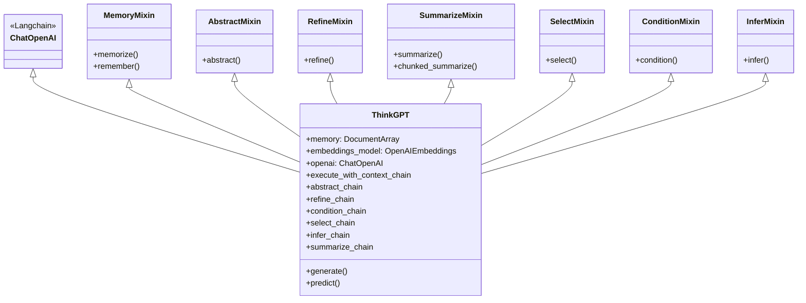
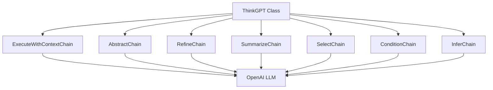
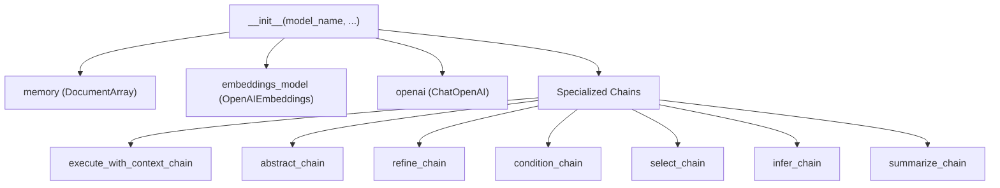
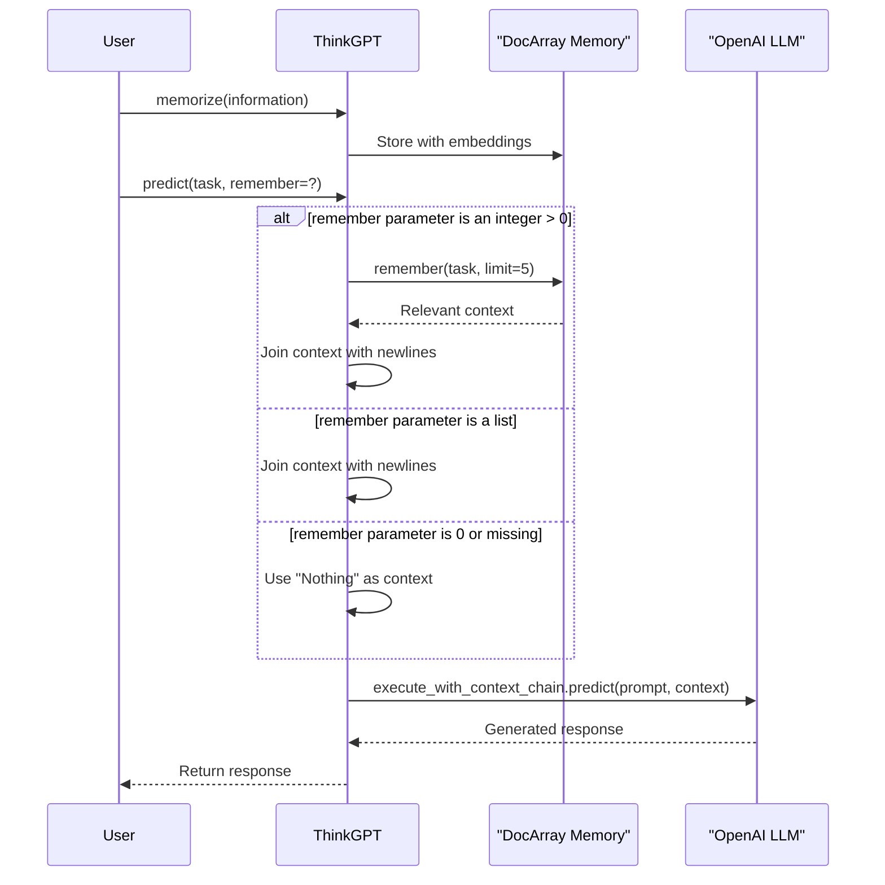
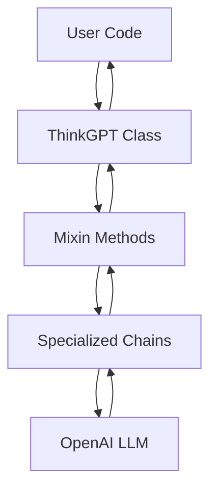
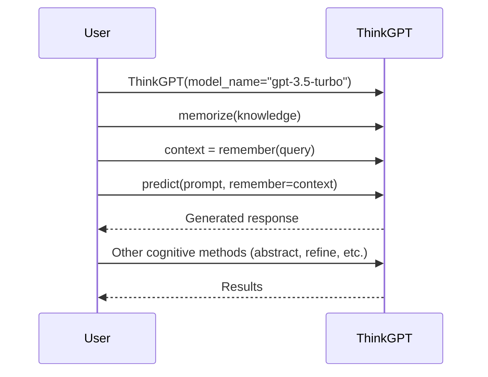

<!-- source: DeepWiki mcp.deepwiki.com · repo jina-ai/thinkgpt · page 2 Core Architecture · fetched 2026-10-26 -->

# Core Architecture

<details>
<summary>Relevant source files</summary>

The following files were used as context for generating this wiki page:

- [README.md](README.md)
- [pyproject.toml](pyproject.toml)
- [thinkgpt/llm.py](thinkgpt/llm.py)

</details>


## Purpose and Scope

This document describes the core architecture of ThinkGPT, a Python library that implements Chain of Thoughts for Large Language Models (LLMs). It focuses on the central design patterns, component relationships, and system organization. The core architecture serves as the foundation for enabling enhanced LLM capabilities including memory management, knowledge compression, self-refinement, natural language interfaces, and inference.

For detailed information about specific subsystems, see:
- [Memory Management System](#2.1) - Documentation of ThinkGPT's memory storage and retrieval system
- [Knowledge Compression](#2.2) - Details on summarization and abstraction capabilities
- [Self-Refinement System](#2.3) - Information on content improvement mechanisms
- [Natural Language Interfaces](#2.4) - Documentation on condition and selection capabilities
- [Inference Engine](#2.5) - Information on how ThinkGPT derives new knowledge

## Design Philosophy

ThinkGPT employs a modular, extensible architecture that enhances LLMs with cognitive capabilities. The system follows these key design principles:

1. **Compositional Architecture**: The main ThinkGPT class combines multiple specialized mixins, each adding a specific cognitive capability
2. **Chain-based Processing**: Leverages Langchain's chain concept for specialized operations
3. **Memory-centric Design**: Built around a persistent memory system using DocArray to overcome LLM context limitations
4. **Cognitive Augmentation**: Extends LLMs with higher-order reasoning capabilities

Sources: [README.md:5-9](), [thinkgpt/llm.py:23-82]()

## Core Components

### ThinkGPT Class

The central `ThinkGPT` class serves as the main entry point and orchestrates all functionality. It inherits from Langchain's `ChatOpenAI` and incorporates multiple mixins to provide enhanced capabilities.

#### ThinkGPT Inheritance Structure



Sources: [thinkgpt/llm.py:23-26]()

### Mixin Architecture

ThinkGPT uses a composition-based architecture where each mixin adds a specific cognitive capability:

| Mixin | Functionality | Key Methods |
|-------|--------------|-------------|
| MemoryMixin | Provides persistent memory capabilities | `memorize()`, `remember()` |
| AbstractMixin | Enables extraction of rules from examples | `abstract()` |
| RefineMixin | Implements self-refinement based on feedback | `refine()` |
| SummarizeMixin | Provides content summarization capabilities | `summarize()`, `chunked_summarize()` |
| SelectMixin | Enables option selection from alternatives | `select()` |
| ConditionMixin | Implements natural language condition evaluation | `condition()` |
| InferMixin | Provides inference capabilities | `infer()` |

Sources: [thinkgpt/llm.py:12-19]()

### Chain System

Each mixin is paired with a specialized chain implementation that handles the actual processing. These chains extend Langchain's `LLMChain` and implement the specialized logic for each cognitive capability.

#### Chain System Architecture



Sources: [thinkgpt/llm.py:47-59]()

## Initialization Process

The `ThinkGPT` class is initialized with various configuration options and component chains. The initialization process involves setting up the memory system, embedding model, and specialized chains.

#### Component Initialization Flow



Sources: [thinkgpt/llm.py:30-59]()

## Data Flow and Operation Model

The following sequence diagram illustrates the typical data flow when using ThinkGPT's memory and prediction capabilities.

#### Prediction Flow with Memory



Sources: [thinkgpt/llm.py:62-82]()

## Core Implementation Details

The `ThinkGPT` class implements two key methods that facilitate interaction with the LLM:

1. `generate()` - Processes prompts and returns generated content as an `LLMResult`
2. `predict()` - A convenience wrapper around `generate()` that returns just the text

The implementation shows how ThinkGPT integrates context from memory:

```python
def generate(
        self, prompts: List[List[str]], stop: Optional[List[str]] = None, remember: Union[int, List[str]] = 0
) -> LLMResult:
    # only works for single prompt
    if len(prompts) > 1:
        raise Exception('only works for a single prompt')
    prompt = prompts[0][0]
    if isinstance(remember, int) and remember > 0:
        remembered_elements = self.remember(prompt, limit=5)
        result = self.execute_with_context_chain.predict(prompt=prompt, context='\n'.join(remembered_elements) if remembered_elements else 'Nothing')
    elif isinstance(remember, list):
        result = self.execute_with_context_chain.predict(prompt=prompt, context='\n'.join(remember))
    else:
        result = self.execute_with_context_chain.predict(prompt=prompt, context='Nothing')

    return LLMResult(generations=[[Generation(text=result)]])
```

Sources: [thinkgpt/llm.py:62-77]()

## Key Dependencies

ThinkGPT relies on several external dependencies to provide its functionality:

| Dependency | Version | Purpose |
|------------|---------|---------|
| langchain | ^0.0.141 | Provides foundation for chain-based processing |
| docarray | <=0.21.0 | Used for document storage and retrieval |
| openai | ^0.27.4 | API client for OpenAI models |
| tiktoken | ^0.3.3 | Token counting for OpenAI models |

Sources: [pyproject.toml:9-14]()

## Component Interactions

The components in ThinkGPT interact through a well-defined pattern:

#### Component Interaction Flow



The primary workflow follows these steps:
1. User code calls a method on the ThinkGPT instance
2. The ThinkGPT class delegates to the appropriate mixin method
3. Mixin methods use specialized chains for processing
4. Chains interact with the OpenAI LLM and return results
5. Results flow back up the chain to the user

Sources: [thinkgpt/llm.py:23-82]()

## Usage Model

The primary usage pattern for ThinkGPT involves:

1. Creating a ThinkGPT instance
2. Storing information in memory using `memorize()`
3. Retrieving relevant information using `remember()`
4. Generating responses with `predict()`, optionally using remembered context
5. Using specialized cognitive capabilities (abstract, refine, summarize, etc.)

#### Typical Usage Flow



Basic usage example:

```python
from thinkgpt.llm import ThinkGPT

# Initialize ThinkGPT with OpenAI model
llm = ThinkGPT(model_name="gpt-3.5-turbo")

# Store information in memory
llm.memorize(['DocArray is a library for representing, sending and storing multi-modal data.'])

# Generate a response using relevant context from memory
response = llm.predict('what is DocArray?', remember=llm.remember('DocArray definition'))
```

Sources: [README.md:30-37](), [README.md:167-186]()

---

