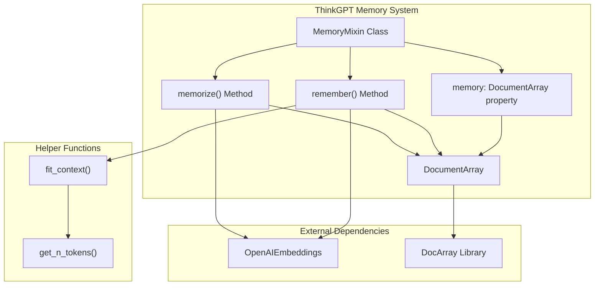
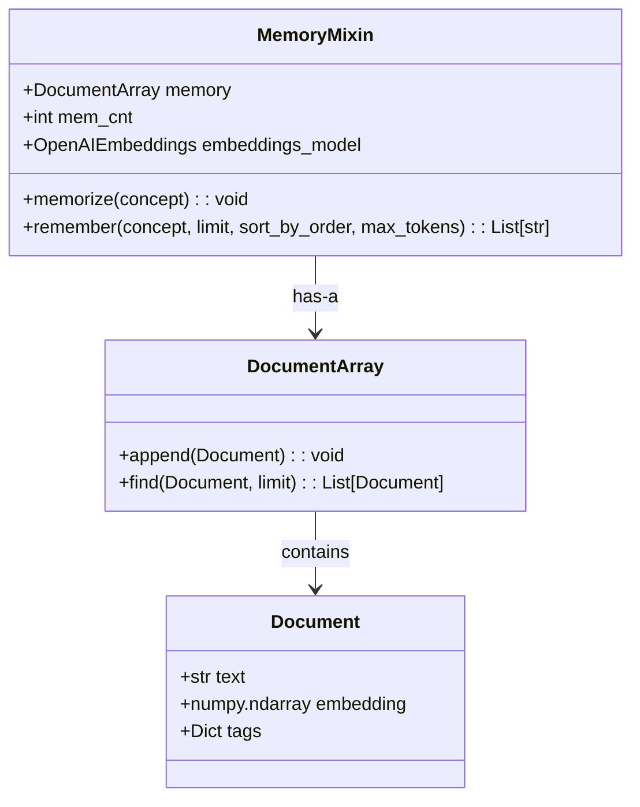
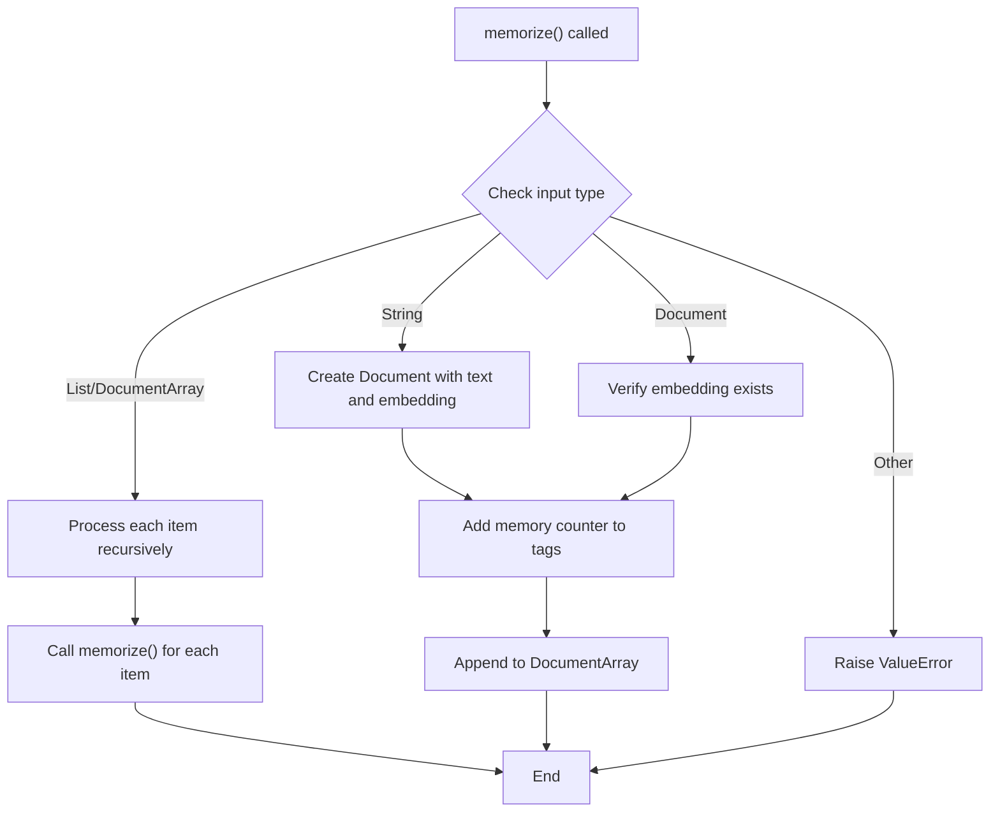
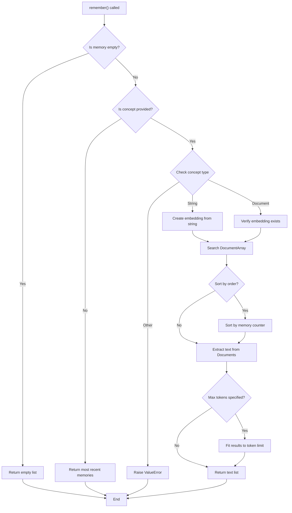
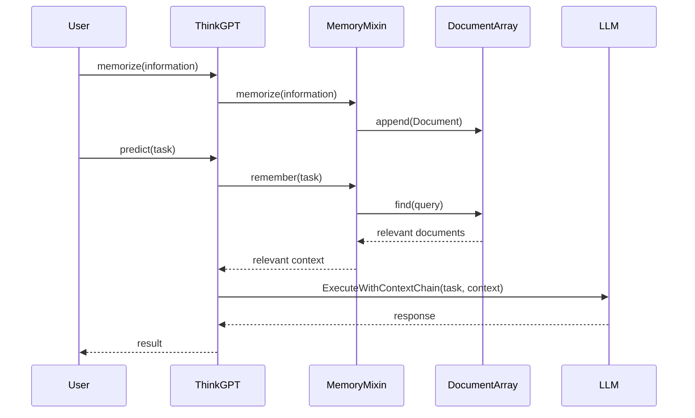

<!-- source: DeepWiki mcp.deepwiki.com · repo jina-ai/thinkgpt · page 2.1 Memory Management System · fetched 2026-10-26 -->

# Memory Management System

<details>
<summary>Relevant source files</summary>

The following files were used as context for generating this wiki page:

- [README.md](README.md)
- [thinkgpt/helper.py](thinkgpt/helper.py)
- [thinkgpt/memory.py](thinkgpt/memory.py)

</details>


## Purpose and Scope

The Memory Management System is a core component of ThinkGPT that enables Large Language Models (LLMs) to overcome their context window limitations by implementing long-term memory. This system allows ThinkGPT to store information, retrieve relevant context when needed, and manage memory within token constraints. This document covers the memory architecture, components, operations, and integration patterns within ThinkGPT.

For information about knowledge compression through summarization and abstraction, see [Knowledge Compression](#2.2).

Sources: [README.md:7-8](), [README.md:13-14]()

## Memory System Architecture

The ThinkGPT Memory Management System bridges the gap between the short-term context window of LLMs and long-term persistent memory through a semantic embedding-based approach.



Sources: [thinkgpt/memory.py:26-66](), [README.md:40-67]()

## Core Components

### MemoryMixin

The `MemoryMixin` class provides memory functionality to the ThinkGPT system. It's designed as a mixin that can be incorporated into the main ThinkGPT class. This class manages:

1. A `DocumentArray` instance to store memory documents
2. A counter `mem_cnt` to track the chronological order of memories
3. An `OpenAIEmbeddings` model to create vector embeddings



Sources: [thinkgpt/memory.py:26-30]()

### DocumentArray

DocumentArray is a data structure from the DocArray library that stores and manages a collection of Document objects. It provides vector search capabilities that enable semantic retrieval of memories based on embeddings. Each Document in the array contains:

- Text content (the actual memory)
- Vector embedding (for semantic search)
- Tags (metadata such as memory counter)

Sources: [thinkgpt/memory.py:8](), [README.md:20]()

### OpenAI Embeddings

The system uses OpenAI's embedding models to convert text into vector representations. These embeddings enable semantic search by finding conceptually similar content, not just keyword matches.

Sources: [thinkgpt/memory.py:6]()

## Memory Operations

### Memorizing Information

The `memorize()` method stores new information in the DocumentArray. It can accept:
- A string (converted to a Document with embedding)
- A Document object
- A list of strings or Documents
- A DocumentArray

For each item, the system:
1. Generates embeddings (if needed)
2. Assigns a memory counter for chronological tracking
3. Stores the item in the DocumentArray



Sources: [thinkgpt/memory.py:31-44](), [README.md:41-44]()

### Retrieving Information

The `remember()` method retrieves relevant information from memory based on:
- A query string or Document (converted to embedding for semantic search)
- Optional parameters for limiting results and sorting

The retrieval process:
1. Converts the query to an embedding (if needed)
2. Performs similarity search in the DocumentArray
3. Optionally sorts results chronologically
4. Optionally limits tokens to fit context windows
5. Returns a list of text strings



Sources: [thinkgpt/memory.py:46-66](), [README.md:46-67]()

### Token Management

The Memory Management System includes functions to manage token limitations within LLM context windows:

- `get_n_tokens()`: Counts the number of tokens in a string using tiktoken
- `fit_context()`: Trims a list of text elements to fit within a token limit

These functions help ensure that retrieved memories can fit within the LLM's context window.

Sources: [thinkgpt/helper.py:39-55](), [README.md:59-67]()

## Integration with ThinkGPT

The Memory Management System integrates with ThinkGPT through the `ExecuteWithContextChain` which enables the execution of tasks with relevant context retrieved from memory.



The typical workflow involves:
1. Storing information using `memorize()`
2. When executing a task with `predict()`, retrieving relevant context with `remember()`
3. Using the `ExecuteWithContextChain` to generate a response that incorporates the context

Sources: [thinkgpt/memory.py:12-23](), [README.md:36-37]()

## API Usage Examples

### Basic Memory Operations

```python
# Initialize ThinkGPT with memory capabilities
from thinkgpt.llm import ThinkGPT
llm = ThinkGPT(model_name="gpt-3.5-turbo")

# Store information in memory
llm.memorize(['DocArray is a library for representing, sending and storing multi-modal data.'])

# Retrieve and use relevant context for a task
llm.predict('what is DocArray?', remember=llm.remember('DocArray definition'))
```

### Managing Token Limits

```python
# Retrieve memories with token limit constraints
from thinkgpt.helper import get_n_tokens

results = llm.remember('query', max_tokens=1000, limit=1000)
print(get_n_tokens(''.join(results)))  # Will not exceed 1000 tokens
```

### Chronological Memory Retrieval

```python
# Retrieve memories sorted by their chronological order
chronological_memories = llm.remember('query', limit=5, sort_by_order=True)
```

Sources: [README.md:31-67]()

## Memory System Implementation Details

The memory system is implemented through a combination of:

| Component | Purpose | Key Functions |
|-----------|---------|---------------|
| MemoryMixin | Provides memory capabilities | memorize(), remember() |
| DocumentArray | Stores and retrieves documents | append(), find() |
| OpenAIEmbeddings | Creates vector representations | embed_query() |
| Helper Functions | Manages token limits | get_n_tokens(), fit_context() |
| ExecuteWithContextChain | Executes tasks with context | run() |

The system uses embedding-based similarity search rather than traditional keyword search, allowing it to find conceptually related information even when exact terms don't match.

Sources: [thinkgpt/memory.py:1-66](), [thinkgpt/helper.py:39-55]()

---

