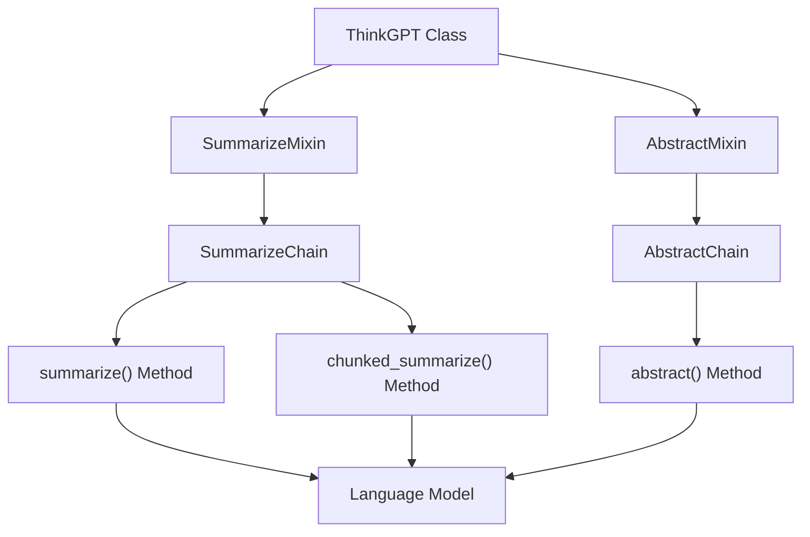
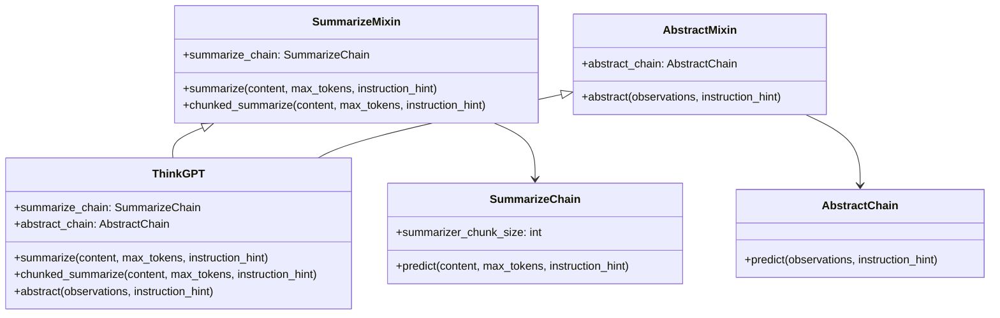
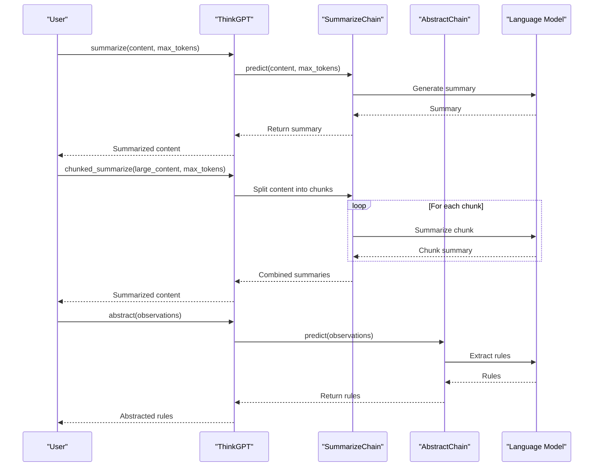

<!-- source: DeepWiki mcp.deepwiki.com · repo jina-ai/thinkgpt · page 2.2 Knowledge Compression · fetched 2026-10-26 -->

# Knowledge Compression

<details>
<summary>Relevant source files</summary>

The following files were used as context for generating this wiki page:

- [README.md](README.md)
- [thinkgpt/abstract.py](thinkgpt/abstract.py)
- [thinkgpt/summarize.py](thinkgpt/summarize.py)

</details>


Knowledge Compression in ThinkGPT provides mechanisms to condense, summarize, and abstract information so it can fit within the context limits of language models. This system helps overcome one of the main limitations of LLMs - their finite context window - by providing methods to compress knowledge while preserving essential information.

For information about Memory Management, which handles storing and retrieving information, see [Memory Management System](#2.1).

## Architecture Overview

The Knowledge Compression subsystem consists of two main components:

1. **Summarization** - Reduces content length while preserving key information
2. **Abstraction** - Extracts high-level rules or patterns from specific observations

These components are implemented through two key mixins that are incorporated into the main `ThinkGPT` class:



Sources: [thinkgpt/summarize.py](), [thinkgpt/abstract.py]()

## Class Architecture

The Knowledge Compression subsystem is organized into a set of specialized classes:



Sources: [thinkgpt/summarize.py:34-59](), [thinkgpt/abstract.py:93-100]()

## Summarization Component

The Summarization component provides methods to condense content while preserving essential information. It offers two main approaches:

### One-shot Summarization

The `summarize()` method processes content in a single LLM call. This method is suitable for content that doesn't exceed the LLM's context length limit.

```python
def summarize(self, content: str, max_tokens: int = 4096, instruction_hint: str = '') -> str:
    response = self.summarize_chain.predict(
        content=content, instruction_hint=instruction_hint, max_tokens=max_tokens
    )
    return response
```

Sources: [thinkgpt/summarize.py:37-42]()

### Chunked Summarization

The `chunked_summarize()` method handles large content by:
1. Breaking it into manageable chunks
2. Summarizing each chunk separately
3. Combining the summaries

This approach overcomes the context length limitation of language models by processing content in pieces.

```python
def chunked_summarize(self, content: str, max_tokens: int = 4096, instruction_hint: str = '') -> str:
    num_tokens = self.summarize_chain.llm.get_num_tokens(content)
    if num_tokens > max_tokens:
        avg_chars_per_token = len(content) / num_tokens
        chunk_size = int(avg_chars_per_token * self.summarize_chain.summarizer_chunk_size)
        chunks = textwrap.wrap(content, chunk_size)
        summary_size = int(max_tokens / len(chunks))
        result = ""
        for chunk in chunks:
            result += self.summarize(content=chunk, max_tokens=summary_size, instruction_hint=instruction_hint)
    else:
        return content
    return result
```

Sources: [thinkgpt/summarize.py:44-59]()

## Abstraction Component

The Abstraction component extracts high-level rules or patterns from specific observations. This allows for compressing knowledge by identifying general principles rather than storing numerous specific examples.

```python
def abstract(self, observations: List[str], instruction_hint: str = '') -> List[str]:
    result = self.abstract_chain.predict(
        observations="\n".join(observations), instruction_hint=instruction_hint
    )
    return LineSeparatorOutputParser().parse(result)
```

This method leverages few-shot learning by providing examples to the LLM to help it understand how to extract rules. The examples cover domains such as:
- Traffic rules
- Mathematical sequences
- Physics principles

Sources: [thinkgpt/abstract.py:93-100](), [thinkgpt/abstract.py:16-51]()

## Processing Workflow

The following sequence diagram illustrates how data flows through the Knowledge Compression system:



Sources: [thinkgpt/summarize.py:37-59](), [thinkgpt/abstract.py:93-100]()

## Prompt Templates

The system uses specialized prompt templates to guide the LLM in summarization and abstraction tasks:

### Summarization Prompt

```
Shorten the following memory chunk of an autonomous agent from a first person perspective, using at most {max_tokens} tokens. {instruction_hint}:
content:
{content}
---------
```

Source: [thinkgpt/summarize.py:11-16]()

### Abstraction Prompt

The abstraction prompt uses a few-shot approach with examples, followed by:

```
Extract rules from the following observations. Put each rule in a separate line. {instruction_hint}
Observations:
{observations}
Rules:
```

Source: [thinkgpt/abstract.py:54-71]()

## Usage Examples

### Basic Summarization

```python
from thinkgpt.llm import ThinkGPT

llm = ThinkGPT(model_name="gpt-3.5-turbo")

# Summarize content
summary = llm.summarize(
  large_content,
  max_tokens=1000,
  instruction_hint='Pay attention to code snippets, links and scientific terms.'
)
```

### Chunked Summarization for Very Large Content

```python
from thinkgpt.llm import ThinkGPT

llm = ThinkGPT(model_name="gpt-3.5-turbo")

# Summarize very large content by chunking
summary = llm.chunked_summarize(
  very_large_content,
  max_tokens=4096,
  instruction_hint='Pay attention to code snippets, links and scientific terms.'
)
```

### Abstracting Rules from Observations

```python
from thinkgpt.llm import ThinkGPT

llm = ThinkGPT(model_name="gpt-3.5-turbo")

# Extract rules from observations
rules = llm.abstract(observations=[
    "in tunisian, I did not eat is \"ma khditech\"",
    "I did not work is \"ma khdemtech\"",
    "I did not go is \"ma mchitech\"",
])
# Result: "Negation in Tunisian Arabic uses 'ma' + verb + 'tech' where 'ma' 
# means 'not' and 'tech' at the end indicates the negation in the past tense."
```

Sources: [README.md:100-137]()

## Integration with ThinkGPT

Knowledge Compression integrates with other ThinkGPT components to enable advanced capabilities:

| Component Integration | Description |
|----------------------|-------------|
| Memory Management    | Compressed knowledge can be stored in memory for later retrieval |
| Self-Refinement      | Compressed knowledge can be refined using feedback |
| Inference Engine     | Compressed rules can be used for making inferences |

This integration allows ThinkGPT to:
1. Store more information within context limits
2. Extract high-level principles from specific examples
3. Condense large amounts of information without losing critical details

## Key Implementation Insights

- The `SummarizeChain` has a configurable `summarizer_chunk_size` (default: 3000) that determines how large each chunk should be in tokens during chunked summarization.
- The `AbstractChain` uses a fixed set of examples that demonstrate rule extraction across different domains to guide the LLM through few-shot learning.
- Both components support custom `instruction_hint` parameters, allowing fine-tuned guidance for specific use cases.

Sources: [thinkgpt/summarize.py:19-31](), [thinkgpt/abstract.py:84-90]()

## Summary

The Knowledge Compression subsystem addresses one of the key limitations of LLMs - finite context windows - by providing mechanisms to:

1. Summarize content to reduce its size while preserving key information
2. Extract high-level rules and patterns from specific observations

Through these techniques, ThinkGPT can work with larger amounts of information than would otherwise fit in the LLM's context window, enabling more complex reasoning and knowledge management capabilities.

---

