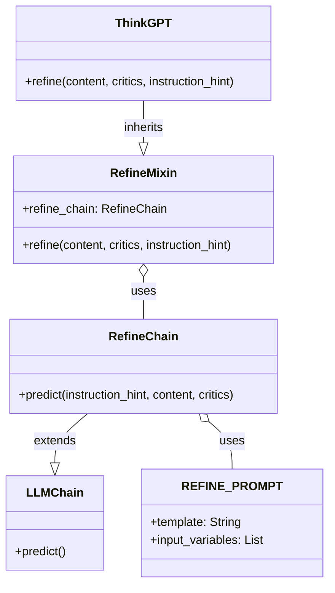
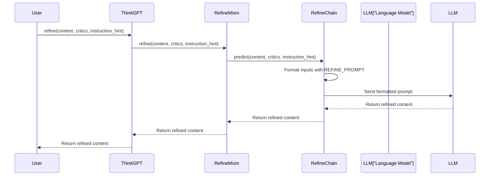
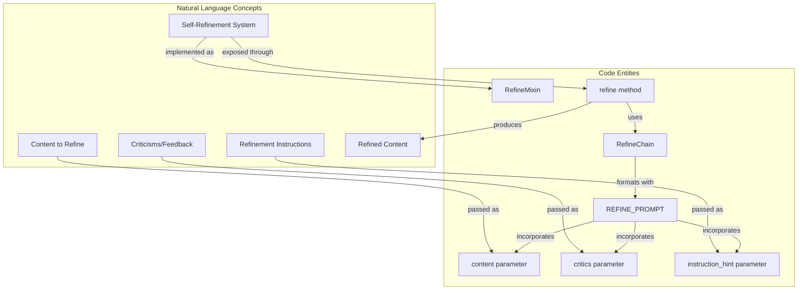
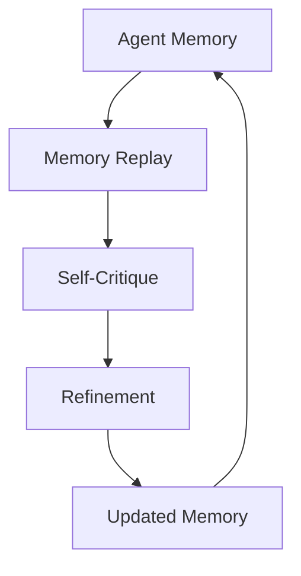

<!-- source: DeepWiki mcp.deepwiki.com · repo jina-ai/thinkgpt · page 2.3 Self-Refinement System · fetched 2026-10-26 -->

# Self-Refinement System

<details>
<summary>Relevant source files</summary>

The following files were used as context for generating this wiki page:

- [README.md](README.md)
- [examples/__init__.py](examples/__init__.py)
- [examples/code_self_refinement.py](examples/code_self_refinement.py)
- [thinkgpt/refine.py](thinkgpt/refine.py)

</details>


## Purpose and Scope

The Self-Refinement System in ThinkGPT provides a structured mechanism to improve content based on specific feedback or criticism. This component enables the refinement of model-generated outputs such as text or code by addressing critics and incorporating feedback. The system is particularly valuable for code correction, content improvement, and iterative refinement scenarios.

For information about related knowledge processing capabilities, see [Knowledge Compression](#2.2).

## Architecture Overview

The Self-Refinement System is implemented through two primary components: the `RefineMixin` class and the `RefineChain` class, which work together to enable content refinement functionality in ThinkGPT.

### Component Architecture Diagram



Sources: [thinkgpt/refine.py:20-36]()

### Core Components

1. **REFINE_PROMPT**: A PromptTemplate that formats content, critics, and instruction hints for the language model.
2. **RefineChain**: A specialized LLMChain that manages the refinement process using the prompt template.
3. **RefineMixin**: A mixin class that adds the `refine` method to the ThinkGPT class.

## Refinement Process Flow

The following diagram illustrates how data flows through the Self-Refinement System:



Sources: [thinkgpt/refine.py:30-36]()

## API Reference

The Self-Refinement System is accessed through the `refine` method provided by the `RefineMixin` class:

```python
def refine(self, content: str, critics: List[str], instruction_hint: str = '') -> str
```

### Parameters

| Parameter | Type | Description |
|-----------|------|-------------|
| `content` | str | The original content that needs refinement |
| `critics` | List[str] | A list of criticisms or feedback points |
| `instruction_hint` | str | Optional guidance for the refinement process (default: '') |

### Return Value

| Type | Description |
|------|-------------|
| str | The refined content |

Sources: [thinkgpt/refine.py:33-36]()

## Natural Language to Code Entity Mapping

The following diagram maps natural language concepts in the Self-Refinement System to specific code entities:



Sources: [thinkgpt/refine.py:1-36]()

## Implementation Details

### Prompt Template

The refinement prompt template is defined in `REFINE_PROMPT`:

```
Based on the critics, fix the content provided to you. {instruction_hint}:
content:
{content}
---------
critics:
{critics}
---------
```

This template structures how content and criticism are presented to the language model.

Sources: [thinkgpt/refine.py:9-17]()

### RefineChain Class

The `RefineChain` extends LangChain's `LLMChain` to handle refinement:

```python
class RefineChain(LLMChain):
    """Prompts the LLM to request to remember memory as needed"""
    def __init__(self, **kwargs):
        super().__init__(prompt=REFINE_PROMPT, **kwargs)

    def predict(self, instruction_hint: str = '', **kwargs: Any) -> str:
        return super().predict(instruction_hint=instruction_hint, **kwargs)
```

Sources: [thinkgpt/refine.py:20-27]()

### RefineMixin Class

The `RefineMixin` class adds refinement capabilities to ThinkGPT:

```python
class RefineMixin:
    refine_chain: RefineChain

    def refine(self, content: str, critics: List[str], instruction_hint: str = '') -> str:
        return self.refine_chain.predict(
            content=content, critics="\n".join(critics), instruction_hint=instruction_hint
        )
```

Sources: [thinkgpt/refine.py:30-36]()

## Common Applications

### Code Refinement

One of the most frequent applications is fixing code based on error messages:

```python
from thinkgpt.llm import ThinkGPT

llm = ThinkGPT(model_name="gpt-3.5-turbo")

fixed_code = llm.refine(
    content="""
    import re
        print('hello world')
    """,
    critics=[
        'IndentationError: unexpected indent'
    ],
    instruction_hint="Fix the code snippet based on the error provided."
)
```

Example output:
```
import re
print('hello world')
```

Sources: [examples/code_self_refinement.py:1-15](), [README.md:76-98]()

### Content Improvement

The system can refine written content based on specific feedback:

```python
refined_text = llm.refine(
    content="This text has spaeling and grammer errors.",
    critics=[
        "Contains spelling errors",
        "Contains grammar errors"
    ],
    instruction_hint="Correct the spelling and grammar errors."
)
```

### Self-Critique and Knowledge Refinement

The Self-Refinement System can be integrated with memory replay to enable agents to critique and refine their own knowledge, as demonstrated in the examples:



This approach is based on techniques described in the "Self-Refine: Iterative Refinement with Self-Feedback" paper.

Sources: [README.md:229-238]()

## Best Practices

For effective use of the Self-Refinement System:

1. **Specific critics**: Provide detailed, specific criticism for better targeted refinement
2. **Clear instruction hints**: Use instruction hints to guide the refinement process
3. **Iterative refinement**: For complex issues, use multiple refinement steps
4. **Appropriate scoping**: Ensure content fits within model context limits

Sources: [README.md:76-98](), [examples/code_self_refinement.py:1-15]()

## Limitations

- The quality of refinement depends on the specificity and clarity of criticisms
- Large content may exceed the language model's context window
- Highly technical refinements may require specialized instruction hints

---

