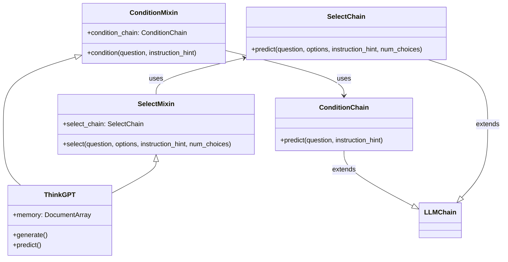
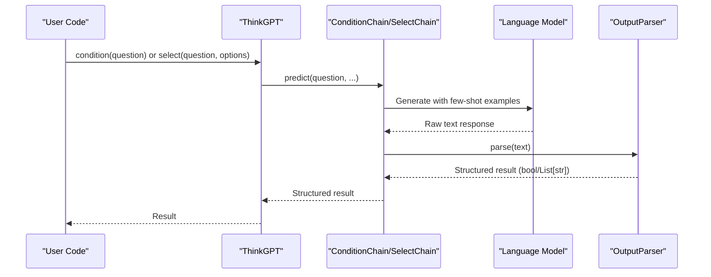
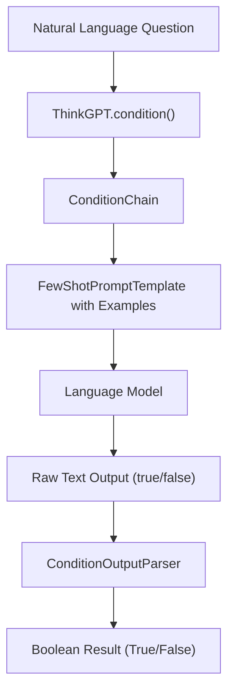
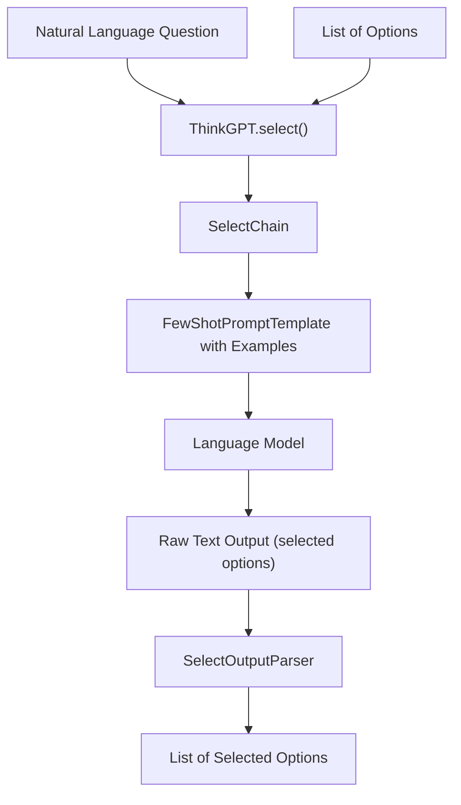

<!-- source: DeepWiki mcp.deepwiki.com · repo jina-ai/thinkgpt · page 2.4 Natural Language Interfaces · fetched 2026-10-26 -->

# Natural Language Interfaces

<details>
<summary>Relevant source files</summary>

The following files were used as context for generating this wiki page:

- [README.md](README.md)
- [thinkgpt/condition.py](thinkgpt/condition.py)
- [thinkgpt/gpt_select.py](thinkgpt/gpt_select.py)

</details>


This document covers ThinkGPT's natural language interfaces, which provide intuitive ways to integrate LLM-powered decision-making into code. The two primary interfaces are Natural Language Conditions and Natural Language Selection, which allow code to evaluate statements and choose options using natural language processing capabilities.

These interfaces bridge the gap between human language and programmatic decision-making, enabling more flexible and intuitive applications.

## Architecture Overview

The Natural Language Interfaces component consists of two primary mixins that are incorporated into the main ThinkGPT class, along with their corresponding chain implementations:



Sources: [thinkgpt/condition.py:63-67](), [thinkgpt/gpt_select.py:83-88]()

## Data Flow

The following diagram illustrates how data flows through the Natural Language Interfaces components:



Sources: [thinkgpt/condition.py:66-67](), [thinkgpt/gpt_select.py:87-88]()

## Natural Language Condition

The condition interface evaluates natural language statements and returns a boolean result. It allows code to make decisions based on complex linguistic criteria that would be difficult to express programmatically.



### Implementation Details

The condition functionality is implemented through the following components:

1. **ConditionMixin**: Adds the `condition` method to the `ThinkGPT` class, providing a simple interface for condition evaluation.

2. **ConditionChain**: A specialized `LLMChain` that:
   - Takes a natural language question
   - Uses a few-shot prompting approach with predefined examples
   - Returns a boolean result after parsing the LLM output

3. **ConditionOutputParser**: Converts the LLM's text output into a boolean value by matching against "true" or "false" (case-insensitive).

The system uses few-shot learning with examples like:
- "Is the sky blue?" → "True"
- "Do humans have three arms?" → "False"
- "Is water wet?" → "True"

Sources: [thinkgpt/condition.py:9-31](), [thinkgpt/condition.py:42-67]()

### Usage Example

```python
from thinkgpt.llm import ThinkGPT

llm = ThinkGPT(model_name="gpt-3.5-turbo")

# Evaluate a natural language condition
is_error = llm.condition('Does this represent an error message? "IndentationError: unexpected indent"')
print(is_error)  # True

# Use in conditional logic
if llm.condition("Is quantum computing faster than classical computing for all problems?"):
    print("Handling quantum computing case...")
else:
    print("Handling classical computing case...")
```

Sources: [README.md:142-148]()

## Natural Language Selection

The selection interface allows the LLM to choose one or more options from a list based on a natural language question. This provides a powerful way to delegate complex selection tasks to the language model.



### Implementation Details

The selection functionality is implemented through the following components:

1. **SelectMixin**: Adds the `select` method to the `ThinkGPT` class, providing a simple interface for option selection.

2. **SelectChain**: A specialized `LLMChain` that:
   - Takes a natural language question and a list of options
   - Formats the options as a newline-separated list
   - Uses a few-shot prompting approach with predefined examples
   - Can be configured to select a specific number of options
   - Returns a list of selected options after parsing the LLM output

3. **SelectOutputParser**: Converts the LLM's text output into a list of selected options by:
   - Splitting the response by newlines
   - Matching each line against the provided options (case-insensitive)
   - Returning a list of matched options

The system uses few-shot learning with examples like:
- "Which animal is known as the king of the jungle?" with options "Lion", "Elephant", "Tiger", "Giraffe" → "Lion"
- "Which of these are plants?" with options "Lily", "Giraffe", "Cactus", "Rose" → "Lily\nCactus\nRose"

Sources: [thinkgpt/gpt_select.py:9-42](), [thinkgpt/gpt_select.py:51-88]()

### Usage Example

```python
from thinkgpt.llm import ThinkGPT

llm = ThinkGPT(model_name="gpt-3.5-turbo")

# Single selection
king = llm.select(
    question="Which animal is the king of the jungle?",
    options=["Lion", "Elephant", "Tiger", "Giraffe"]
)
print(king)  # ['Lion']

# Multiple selection
mammals = llm.select(
    question="Which of these are mammals?",
    options=["Lion", "Shark", "Eagle", "Dolphin"]
)
print(mammals)  # ['Lion', 'Dolphin']

# Constrained selection (exact number of choices)
top_three = llm.select(
    question="Which are the three largest mammals?",
    options=["Elephant", "Blue Whale", "Giraffe", "Hippopotamus", "Lion"],
    num_choices=3
)
print(top_three)  # Example: ['Blue Whale', 'Elephant', 'Hippopotamus']
```

Sources: [README.md:149-160](), [thinkgpt/gpt_select.py:86-88]()

## Advanced Usage

### Custom Instruction Hints

Both interfaces accept an `instruction_hint` parameter that allows you to provide additional guidance to the LLM:

```python
# Providing instruction hints
result = llm.condition(
    "Is this code correct? print('Hello, world')",
    instruction_hint="Pay special attention to syntax errors."
)

result = llm.select(
    question="Which elements are transition metals?",
    options=["Sodium", "Iron", "Copper", "Calcium", "Zinc"],
    instruction_hint="Consider the position in the periodic table."
)
```

Sources: [thinkgpt/condition.py:66-67](), [thinkgpt/gpt_select.py:86-88]()

### System Integration

The Natural Language Interfaces are designed to integrate seamlessly with other ThinkGPT components and application code:

```mermaid
flowchart LR
    subgraph "Application Code"
        AppLogic["Application Logic"]
    end

    subgraph "ThinkGPT System"
        ThinkGPT["ThinkGPT"]
        
        subgraph "Natural Language Interfaces"
            direction TB
            ConditionMethod["condition()"]
            SelectMethod["select()"]
        end
        
        subgraph "Other ThinkGPT Components"
            Memory["Memory Management"]
            Abstract["Rule Extraction"]
            Refine["Self-Refinement"]
            Summarize["Summarization"]
        end
    end
    
    AppLogic --> ConditionMethod: "Uses for decisions"
    AppLogic --> SelectMethod: "Uses for options"
    
    ConditionMethod --> LLM["Language Model"]
    SelectMethod --> LLM
    
    LLM --> DecisionResult["Boolean/Selection Results"]
    DecisionResult --> AppLogic: "Informs application behavior"
```

Sources: [README.md:12-19]()

## Practical Applications

### Intelligent Decision Making

Natural Language Conditions enable more intuitive decision trees in code:

```python
# Error handling with natural language understanding
error_message = "IndentationError: unexpected indent"
if llm.condition(f'Does this represent an error message? "{error_message}"'):
    print("Detected an error, attempting to fix...")
    # Apply self-refinement to fix code
    
# Sentiment analysis
feedback = "I am very disappointed with the service I received."
if llm.condition(f'Does this text express negative sentiment? "{feedback}"'):
    print("Negative sentiment detected, escalating to customer support...")
    # Trigger support escalation workflow
```

### Smart Selection Systems

Natural Language Selection can be used for sophisticated option filtering:

```python
# Dynamic content categorization
content = "How to implement a neural network in PyTorch"
categories = ["Machine Learning", "Web Development", "DevOps", "Mobile Development", "Database"]
content_category = llm.select(
    question=f"Which category best fits this content: '{content}'?",
    options=categories
)

# Multiple relevant frameworks selection
task = "Build a real-time data dashboard with interactive visualizations"
frameworks = ["React", "Angular", "Vue", "D3.js", "Plotly", "Highcharts", "Flask", "Django"]
recommended_tools = llm.select(
    question=f"Which frameworks/libraries would be most suitable for this task: '{task}'?",
    options=frameworks,
    num_choices=3
)
```

## Limitations and Best Practices

When using the Natural Language Interfaces, keep in mind:

1. **Determinism**: LLM decisions aren't fully deterministic - the same input may produce different outputs across calls.

2. **Complexity Balance**: Too complex or ambiguous questions may lead to unpredictable results.

3. **Option Formatting**: The selection system works best with concise, distinct options.

4. **Performance**: Each call requires an LLM API call, which adds latency and potential costs.

Best practices:

1. Use specific, clear questions for more reliable results
2. Include instruction hints to guide the LLM's reasoning
3. Implement fallback logic for cases where the LLM might return unexpected results
4. Consider caching results for frequently used conditions or selections

## Summary

ThinkGPT's Natural Language Interfaces provide a bridge between human language and code logic through:

- **Natural Language Conditions**: Convert natural language statements into boolean decisions
- **Natural Language Selection**: Choose appropriate options from a list based on natural language criteria

These interfaces make it easier to incorporate LLM-powered decision-making into applications, enabling more flexible, intuitive, and powerful systems that can reason about complex criteria expressed in natural language.

Sources: [README.md:12-19](), [README.md:142-160](), [thinkgpt/condition.py](), [thinkgpt/gpt_select.py]()

---

